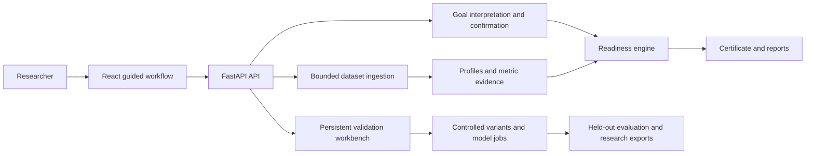

# FlightReady

FlightReady is a local research prototype for context-aware UAV dataset readiness assessment and controlled model validation. It helps a researcher describe an intended machine-learning task, ingest a dataset, measure applicable quality evidence, generate an auditable readiness certificate, and compare dataset conditions through downstream model experiments.

The project was developed over approximately one month as undergraduate research. Its completed experiments show that controlled data defects can reduce downstream performance, but also show that the current aggregate experimental score is not a calibrated predictor of model accuracy. FlightReady is therefore an assessment and research workbench, not an aviation-safety certificate or a guarantee of model performance.

## Implemented capabilities

- Local FastAPI backend and React/TypeScript interface.
- Guided goal interpretation with editable human confirmation and a deterministic offline fallback.
- Streaming ingestion for CSV/TSV, text, JSON/JSONL, XML, XLSX, Parquet, Feather/Arrow, standalone images, and supported ZIP/TAR layouts.
- Image datasets in ImageFolder, YOLO, native VisDrone DET, COCO detection, Pascal VOC, and unlabelled collection layouts.
- Task-dependent requirements for classification, regression, object detection, and related configured workflows.
- Evidence for integrity, validity, duplication, label quality, coverage, representativeness, leakage, provenance, and UAV-specific properties where the required inputs exist.
- Requirement-based `READY`, `NOT_READY`, and `INSUFFICIENT_EVIDENCE` decisions.
- A separate experimental weighted score with explicit evidence coverage; it does not replace the readiness decision.
- JSON and HTML certificates and analytical reports.
- Persistent workbench datasets, experiments, model registry, controlled variants, training/evaluation jobs, and research exports.
- Model-validation support for tabular baselines and YOLO object-detection workflows.

Unsupported or conditional evidence is reported as unknown rather than silently assigned a passing value. Semantic label correctness, missing objects inside otherwise valid annotation files, and corpus completeness require trusted references, audits, or acquisition manifests.

## Architecture



Important source areas:

- `main.py`: application entry point, legacy assessment API, and static UI hosting.
- `backend/`: ingestion, context, readiness decisions, reports, and workbench services.
- `metrics/`: metric registry, full-dataset checks, UAV properties, and scoring policies.
- `sql/`: SQLite metadata and bounded DuckDB dataset access.
- `frontend/`: guided workflow and research workbench UI.
- `experiments/`: completed validation evidence and reproducibility scripts.
- `reading/`: detailed engineering and scientific documentation.

## Installation

Python 3.12 and Node.js 22 are recommended. The commands below are written for Windows PowerShell; equivalent Python/npm commands work on other platforms.

```powershell
git clone <repository-url>
Set-Location DataReadiness
python -m venv .venv
.\.venv\Scripts\python.exe -m pip install -r requirements\requirements-training.txt
Copy-Item .env.example .env
Set-Location frontend
npm.cmd ci
npm.cmd run build
Set-Location ..
```

The default `.env.example` uses deterministic local interpretation and contains no secret. Optional remote interpretation requires a user-supplied backend key in the ignored `.env` file. Never place keys in frontend variables or commit `.env`.

## Start the application

Production-style local use (the backend serves the built frontend):

```powershell
.\.venv\Scripts\python.exe -m uvicorn main:app --host 127.0.0.1 --port 8000
```

Open `http://127.0.0.1:8000`. API documentation is at `http://127.0.0.1:8000/docs`.

For frontend development, keep the backend running and use a second terminal:

```powershell
Set-Location frontend
npm.cmd run dev
```

Then open `http://127.0.0.1:5173`.

## Researcher walkthrough

1. Describe the intended prediction or detection task and select the dataset modality.
2. Interpret the goal, review every inferred constraint, resolve questions, and confirm it.
3. Upload a supported dataset or archive. For ambiguous containers, select the relevant member/layout.
4. Review the generated profile, then run the assessment.
5. Inspect the categorical decision, evidence coverage, metric findings, and reasons for unavailable evidence.
6. Download the JSON or HTML certificate.
7. In the Model Validation Lab, select a persisted dataset, configure a controlled variation or model run, use a shared validation/test split, and export the comparison evidence.

No current-application screenshot is committed as a verified demonstration artifact. Detailed verified architecture diagrams are available under `reading/assets/architecture/`.

## Tests and verification

Install the pinned backend test environment before running the complete suite. It includes the PDF-export and connected-repository integrations exercised by CI.

```powershell
.\.venv\Scripts\python.exe -m pip install -r requirements\requirements-test.txt
.\.venv\Scripts\python.exe -m pytest -q --basetemp=.runtime\pytest-submission -o cache_dir=.runtime\pytest-cache
.\.venv\Scripts\python.exe scripts\verify_final_manuscript_results.py
Set-Location frontend
npm.cmd test
npm.cmd run build
```

A backend health check after startup:

```powershell
Invoke-RestMethod http://127.0.0.1:8000/api/health
```

## Completed experimental validation

### Tabular quality-impact matrix

The first experiment used 18 training-data conditions, two model architectures, and three seeds (108 fitted models) with a fixed clean test set. Combined degradation reduced mean R-squared from 0.1635 to 0.0573 for histogram gradient boosting and from 0.1567 to 0.0720 for random forest. Oracle restoration recovered the reference results. Missingness changed the categorical readiness decision, but valid-range feature noise and label corruption were largely invisible to readiness outputs. The experimental numeric score remained 100.0 at 50% evidence coverage for all variants.

See `experiments/data_quality_impact/data_quality_impact_report.md`.

### VisDrone/YOLO11n matrix

The second experiment used real VisDrone UAV imagery and seven matched YOLO11n training conditions. Clean test-dev mAP50-95 was 0.03328. Wrong-class corruption reduced it by 12.0%, removing 40% of training images reduced it by 15.6%, and combined defects reduced it by 15.2%. The repaired run reproduced clean aggregate metrics exactly. FlightReady marked every condition `NOT_READY`, but its numeric score was not directionally aligned with detector performance (Pearson r=-0.377, p=0.405; n=7).

See `experiments/visdrone_model_validation/research_report.md`.

These are resource-bounded, preliminary experiments. They do not establish universal validity or state-of-the-art model performance.

### Frozen v2 independent UAVVaste validation

FlightReady v2 was frozen before independent result inspection and evaluated on UAVVaste, an independently sourced single-class UAV litter-detection dataset. The resource-amended protocol contains **19 completed planned runs**. Two valid YOLO11n Gaussian-25 observations at seeds 42 and 93 are retained and labeled separately as supplemental; they are not counted as planned-run completion.

Reference-free primary scores were withheld for every condition at 55.6% evidence coverage. Under the prespecified controlled-defect rule, FlightReady detected 1/10 defects reference-free, 10/10 with a deterministic 10% trusted annotation audit, and 10/10 with a full oracle; conventional checks detected 5/10. Across eight related YOLO11n condition means, full-oracle score and test mAP50-95 had Pearson `r=0.7672` (`p=0.0263`) and Spearman `rho=0.8383` (`p=0.0093`). These correlations are descriptive condition-level associations, not independently validated accuracy prediction.

Primary review artifacts:

- [`experiments/independent_validation/REPRODUCIBILITY.md`](experiments/independent_validation/REPRODUCIBILITY.md): provenance, run ledger, commands, and exclusions.
- [`experiments/independent_validation/final_reports/FlightReady_Final_Independent_Validation_Report.pdf`](experiments/independent_validation/final_reports/FlightReady_Final_Independent_Validation_Report.pdf): complete validation report.
- [`submission/FlightReady_IEEE_IV_2027_FINAL.pdf`](submission/FlightReady_IEEE_IV_2027_FINAL.pdf): anonymous professor-review manuscript draft.
- [`submission/FlightReady_IEEE_IV_2027_FINAL.tex`](submission/FlightReady_IEEE_IV_2027_FINAL.tex): editable IEEEtran source.
- [`submission/Frozen_Methodology_Integrity_Audit.md`](submission/Frozen_Methodology_Integrity_Audit.md): resolution of the historical 63-character manifest hash entry without changing the manifest.
- [`submission/Final_Manuscript_Verification.md`](submission/Final_Manuscript_Verification.md): claim, equation, citation, and layout audit.

The manuscript has not been submitted. Its verification report records the remaining conference-policy, authorship, external-validity, and compilation checks.

## Reproducibility and storage

- Tabular experiment: `scripts/quality_impact_experiment.py`.
- VisDrone experiment: `scripts/visdrone_validation.py`.
- Exact condition manifests, hashes, result JSON/CSV files, certificates, and plots are retained under `experiments/`.
- Independent validation records distinguish the 19-run amended plan from two supplemental observations; pilot and feasibility records are explicitly excluded from the final ledger.
- Large public dataset archives, extracted VisDrone data, generated variants, local environments, model weights, and runtime state are ignored by Git.
- VisDrone download hashes and URLs are recorded in `experiments/visdrone_model_validation/provenance.json`.

Review `docs/Storage_Audit.md` before removing local artifacts. Large research artifacts are not deleted automatically merely to make the repository appear smaller.

## Research status and limitations

FlightReady successfully executes assessments and produces evidence-bearing reports. The experiments also demonstrate important blind spots: structurally valid wrong labels, missing in-image objects, and missing acquisition coverage cannot be established from internal consistency alone. The aggregate experimental score must not be interpreted as a validated probability of readiness or expected model accuracy.

Future work could include multiple independently sourced UAV datasets, flight/group-aware evaluation, repeated dataset resampling, blinded annotation audits, prospective score calibration, richer image-corruption measures, and external validation.

## Documentation

- `docs/FlightReady_Final_Research_Report.md`: academic research report.
- `docs/EXPERIMENTS.md`: completed studies, reproducibility entry points, and interpretation limits.
- `docs/FlightReady_Improved_Research_Report.md`: v2 evidence-aware reassessment and root-cause analysis.
- `docs/Professor_Project_Summary.md`: one-page faculty summary.
- `experiments/independent_validation/final_reports/FlightReady_Final_Independent_Validation_Report.md`: completed independent-validation report.
- `submission/FlightReady_IEEE_IV_2027_FINAL.pdf`: latest anonymous IEEE IV professor-review draft.
- `reading/README.md`: detailed technical documentation index.
- `reading/CODEBASE_VISUAL_GUIDE.pdf`: generated visual codebase guide.
