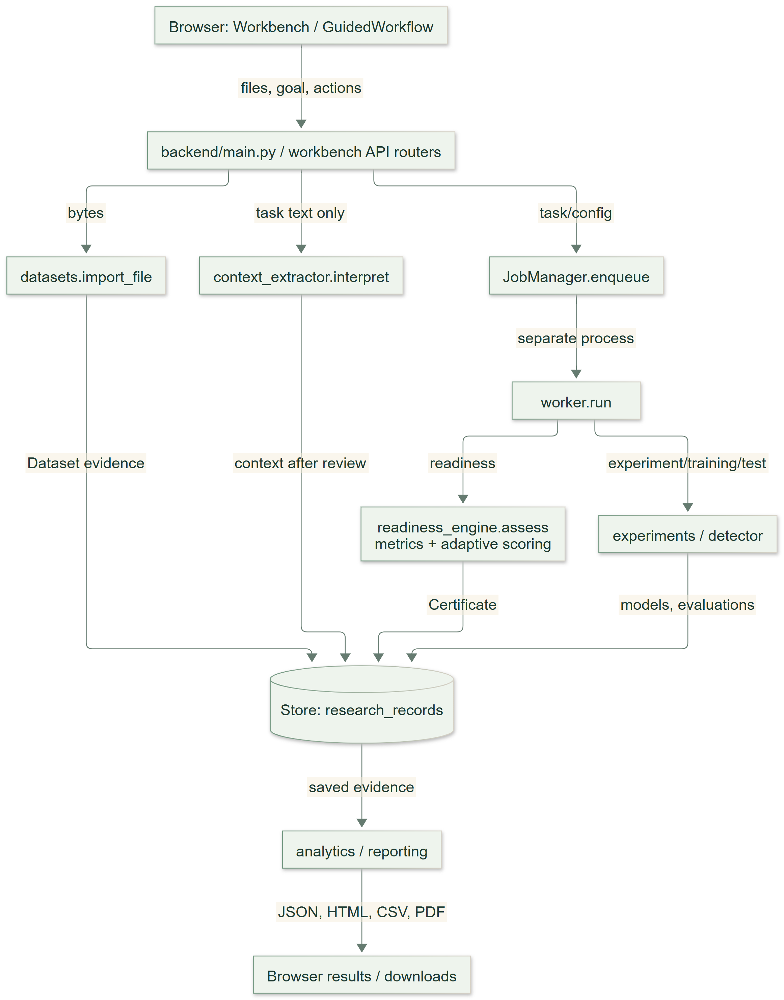
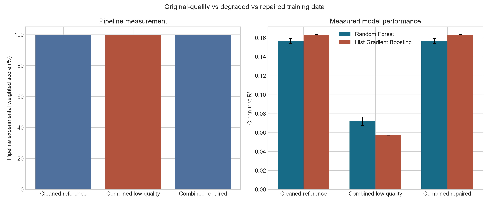
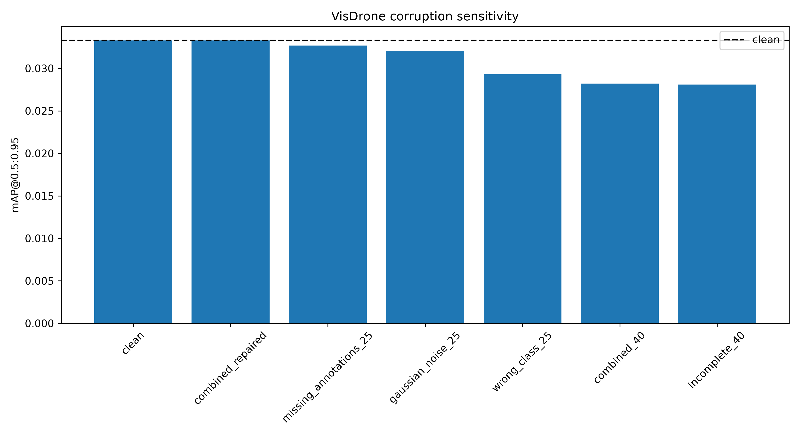
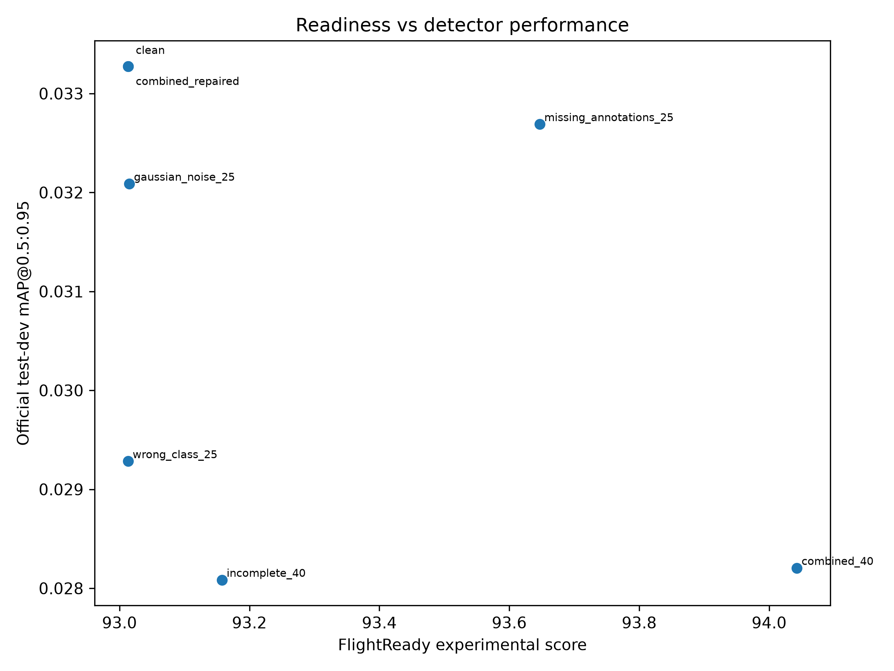

# FlightReady: A Context-Aware UAV Dataset Readiness and Model Validation Prototype

## Abstract

FlightReady is an implemented research prototype for UAV dataset readiness assessment, with preliminary experimental evaluation of the relationship between dataset quality and downstream machine-learning performance. The system combines human-confirmed task requirements, bounded local dataset ingestion, task-dependent metrics, categorical readiness decisions, evidence coverage, analytical certificates, controlled dataset variants, and model validation. Two experiments were completed. A tabular matrix trained 108 models across 18 conditions; a real VisDrone study trained seven YOLO11n conditions against one fixed official test-dev split. Controlled defects reduced downstream performance and oracle restoration recovered it. Some directly observable problems, especially missingness, affected the categorical decision. However, schema-valid feature/label corruption and missing acquisition coverage exposed important blind spots, and the aggregate experimental score was not a reliable predictor of model performance. FlightReady is therefore positioned as an auditable research workbench rather than a calibrated performance forecast or safety certificate.

## 1. Introduction

Machine-learning failures are often attributed to model selection even when the training data does not adequately represent the intended task. UAV datasets add difficulties such as small objects, class imbalance, occlusion, correlated frames, incomplete flight coverage, annotation errors, and metadata-dependent operating conditions. Generic data-quality scores can hide whether evidence is relevant to a particular prediction goal.

FlightReady was developed over approximately one month to explore a practical alternative: interpret and confirm the intended task, measure only applicable properties, preserve unknown evidence as unknown, produce an auditable decision, and then compare the assessment with downstream model behavior.

## 2. Problem statement and research motivation

The central research question was not whether a single score could be made to look successful. It was whether implemented readiness evidence would respond to controlled data defects and whether its outputs would correspond to held-out model performance.

The project addressed four operational needs:

1. Safely ingest realistic local datasets without executing repository content.
2. Connect quality evidence to a confirmed machine-learning goal.
3. Distinguish failure, pass, and insufficient evidence.
4. Preserve controlled experimental evidence linking data interventions to downstream results.

## 3. System design and architecture

The local application uses a React/TypeScript frontend and a FastAPI backend. General tables can be staged into bounded DuckDB-backed storage; image archives are streamed and decoded incrementally. Typed Pydantic contracts carry goals, requirements, evidence, findings, and certificates. SQLite supports persistent workbench metadata and artifact references.

**Figure 1.** Existing verified system overview generated from the codebase documentation.

The assessment flow is:

1. The researcher describes a task and selects a modality.
2. Local or optional remote interpretation produces an editable goal.
3. The researcher resolves questions and confirms requirements.
4. The dataset is uploaded, validated, profiled, and assigned a SHA-256 hash.
5. The readiness engine selects applicable metrics and records unavailable evidence explicitly.
6. A categorical decision, evidence, findings, and optional experimental score are reported.
7. The validation workbench can create controlled variants, train models, evaluate a shared held-out split, and export comparisons.

## 4. Dataset quality assessment methodology

FlightReady implements evidence across integrity, validity, duplication, label quality, coverage, representativeness, leakage, and reliability/provenance. UAV-specific properties extend this evidence where compatible annotations and metadata exist. Examples include required-field presence, missingness, invalid values, exact duplicates, annotation bounds, class counts, scenario intersections, cross-split duplicates, trusted-reference mismatches, and reference-distribution distances.

The categorical readiness decision is requirement based. Critical failed requirements produce `NOT_READY`; unavailable necessary evidence produces `INSUFFICIENT_EVIDENCE`; a dataset is `READY` only when selected requirements are satisfied. The optional weighted score is separate and reports evidence coverage. It is an engineering hypothesis, not a probability of success.

Metrics are conditional on available evidence. The system does not infer altitude, lighting, semantic label truth, acquisition completeness, or annotation independence from filenames or pixels. Missing objects inside an otherwise valid detection annotation file cannot be proved without a trusted reference.

## 5. Implemented pipeline

The implementation supports delimited tables, text/record formats, spreadsheets, Parquet and Arrow data, individual images, and bounded archive containers. Supported image layouts include ImageFolder, YOLO, native VisDrone DET, COCO detection, Pascal VOC, and unlabelled collections. Ambiguous containers require explicit layout selection.

The frontend provides a guided assessment flow and a persistent validation workbench. Outputs include structured certificates, escaped HTML reports, metric explanations, dataset profiles, experiment records, model comparisons, and research exports. The system uses local deterministic interpretation by default; optional remote interpretation sends only task text/tags and always requires user confirmation.

## 6. Experimental methodology

### 6.1 Tabular data-quality experiment

The experiment used a real local 2,580-row ramen-ratings dataset. Three rows without numeric regression targets were excluded before a frozen 20% clean test split was created. Training-only interventions produced 18 conditions covering missing inputs, valid-category feature noise, in-range label permutation, target-region under-representation, a combined 40% condition, and oracle repair.

Two fixed model pipelines were evaluated: random forest (240 trees) and histogram gradient boosting (180 iterations). Seeds 17, 42, and 93 produced 108 fitted models. MAE, RMSE, and R-squared were measured on the same untouched test set. Every training condition was independently assessed by FlightReady.

### 6.2 VisDrone object-detection experiment

Official VisDrone2019-DET train (6,471 images), validation (548), and labeled test-dev (1,610) archives were downloaded and hashed. Ignored regions were excluded during YOLO conversion. Seven completed conditions were trained from the same official YOLO11n initialization: clean, Gaussian noise on 25% of images, missing annotations on 25%, wrong classes on 25%, removal of 40% of images, combined defects on 40%, and oracle-repaired data.

All full runs used five epochs, 320-pixel inputs, batch size 16, seed 42, deterministic mode, the official validation split for checkpoint selection, and the untouched test-dev split for final evaluation. The short protocol measures relative sensitivity under a fixed adaptation budget; it is not a state-of-the-art VisDrone training claim.

## 7. Experimental results

### 7.1 Tabular results

| Condition | HistGB R-squared | Random forest R-squared | Readiness status | Experimental score |
|---|---:|---:|---|---:|
| Cleaned reference | 0.1635 | 0.1567 | READY | 100.0 |
| Combined 40% degradation | 0.0573 | 0.0720 | NOT_READY | 100.0 |
| Oracle repaired | 0.1635 | 0.1567 | READY | 100.0 |

Combined degradation reduced R-squared by 0.1062 for histogram boosting and 0.0847 for random forest. Restoration reproduced the reference results. Every missingness condition was categorically rejected, but valid-range feature noise, label corruption, and imbalance remained `READY`. At 40% label corruption, R-squared fell by 0.0743 and 0.0848 while the score and decision did not change. Because the numeric score was constant at 100.0 with 50% evidence coverage, correlation with performance was undefined.

**Figure 2.** Original, combined-degraded, and repaired tabular performance.

### 7.2 VisDrone results

| Training condition | FlightReady score | mAP50-95 | Relative change from clean |
|---|---:|---:|---:|
| Clean | 93.013 | 0.03328 | 0.0% |
| Repaired | 93.013 | 0.03328 | 0.0% |
| Missing annotations | 93.647 | 0.03269 | -1.8% |
| Gaussian noise | 93.015 | 0.03209 | -3.6% |
| Wrong classes | 93.013 | 0.02928 | -12.0% |
| Combined defects | 94.043 | 0.02820 | -15.2% |
| 40% images removed | 93.158 | 0.02808 | -15.6% |

Every completed defect reduced test mAP50-95. Wrong semantic labels were substantially more harmful than partial annotation omission. Combined defects caused the largest precision decline (45.8%), while the incomplete condition produced the lowest mAP50-95. The independent repaired run reproduced clean aggregate metrics exactly.

**Figure 3.** Test-dev mAP50-95 for the seven completed YOLO11n conditions.

All conditions were categorically `NOT_READY` with 80% evidence coverage, but the numeric score was not directionally aligned with performance. Across all seven rows, Pearson r was -0.377 (p=0.405) and Spearman rho was -0.561 (p=0.190). These small-sample descriptive statistics do not establish a general inverse relationship; they show that predictive alignment was unsupported in this matrix.

**Figure 4.** FlightReady experimental score versus official test-dev mAP50-95.

## 8. Discussion

Both experiments support the narrow conclusion that controlled reductions in training-data quality can reduce downstream performance under fixed protocols, and that restoring the imposed damage can recover it. Directly measurable missingness affected the categorical decision in the tabular study.

The negative findings define the current research boundary. A structurally valid but wrong class is not detectable from schema consistency. A lower annotation density may make internal statistics appear simpler while removing supervision. A collection cannot reveal flights or scenes that were never delivered unless an expected acquisition manifest exists. These are not implementation errors that can be repaired by adjusting a threshold; they require new evidence sources.

The aggregate score should therefore remain explicitly experimental. It may summarize available internal measurements, but the completed studies do not support using it as a calibrated proxy for model accuracy.

## 9. Limitations and threats to validity

- Only one tabular dataset and one UAV detection dataset were studied.
- The tabular dataset's local provenance did not include independently verified source/license metadata.
- The VisDrone experiment used one training seed and a short five-epoch, 320-pixel budget.
- Test-dev was held out from training and checkpoint selection, but repeated studies on the same benchmark can still encourage researcher adaptation.
- Oracle repair restored preserved clean data; it does not demonstrate automatic real-world repair.
- Controlled corruption mechanisms are not a complete model of real sensor, annotation, or acquisition failures.
- Model-seed variation does not quantify dataset-sampling or flight-level uncertainty.
- The experiments were exploratory and not preregistered.
- The current score weights and thresholds have not been calibrated prospectively or validated out of sample.
- No software license or explicit VisDrone dataset license was found in the consulted local/official materials; redistribution rights must be checked separately.

## 10. Future work

Future research should use independently sourced UAV datasets, flight/group-aware splits, multiple dataset resamples and model seeds, blinded annotation audits, and prospective hypotheses. Product improvements should add expected acquisition counts and route/scene coverage, annotation-density baselines, trusted gold-label samples, image-corruption measures, cross-model semantic disagreement, and transparent metric-level score contributions. Score calibration must be separated from confirmatory validation and evaluated out of sample.

## 11. Conclusion

Within approximately one month, FlightReady progressed to a functioning local research workbench with bounded ingestion, task-dependent evidence, auditable certificates, controlled variant generation, model evaluation, and two completed experimental studies. The experiments produced authentic positive and negative results: defects harmed models, missingness was partly detected, restoration recovered performance, and the aggregate score did not reliably predict downstream accuracy. This supports FlightReady's value as a platform for further research while ruling out stronger predictive or safety claims at this stage.

## 12. References

1. VisDrone Dataset Team. *VisDrone Dataset*. https://github.com/VisDrone/VisDrone-Dataset
2. Ultralytics. *VisDrone Dataset Documentation*. https://docs.ultralytics.com/datasets/detect/visdrone
3. Ultralytics. *YOLO11 Model Documentation*. https://docs.ultralytics.com/models/yolo11
4. FlightReady internal metric and architecture documentation, `reading/`.
5. FlightReady tabular experiment report, `experiments/data_quality_impact/data_quality_impact_report.md`.
6. FlightReady VisDrone experiment report, `experiments/visdrone_model_validation/research_report.md`.
