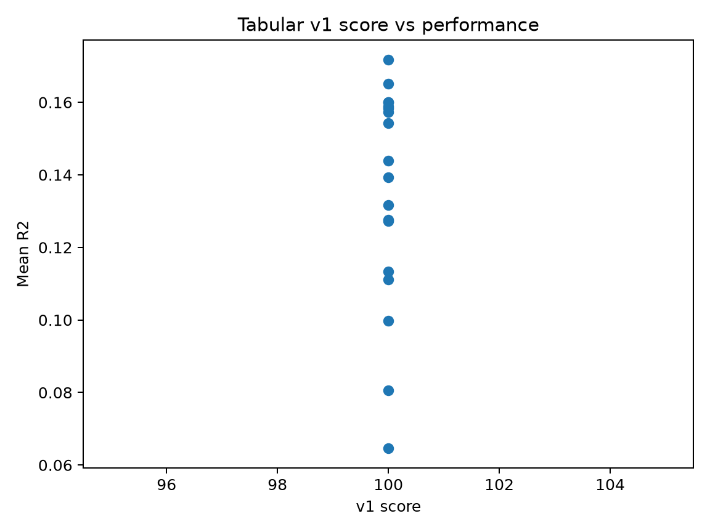
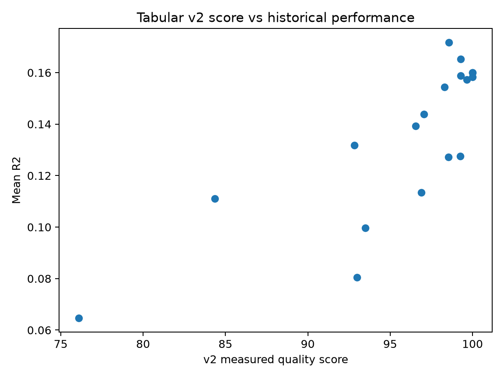
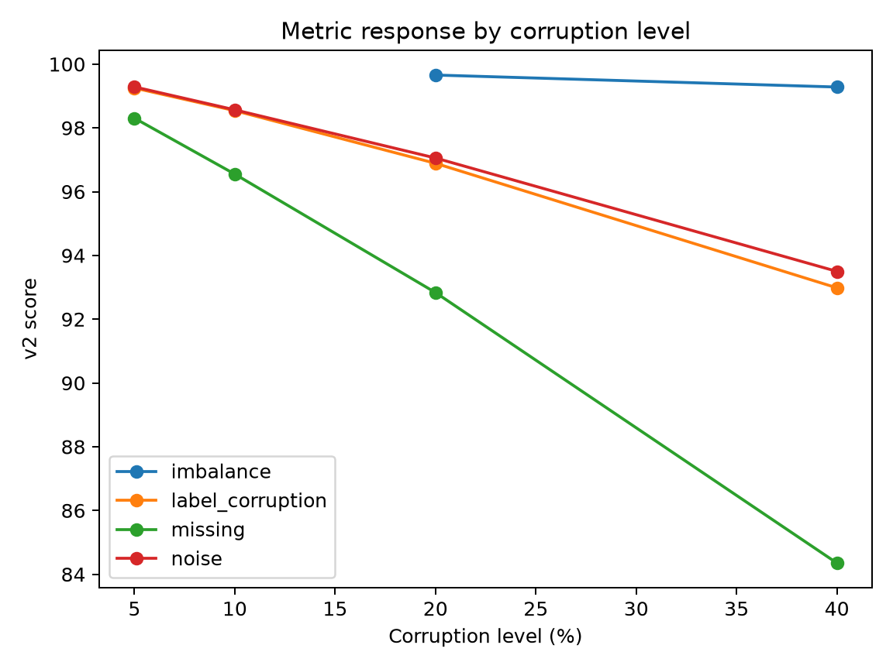
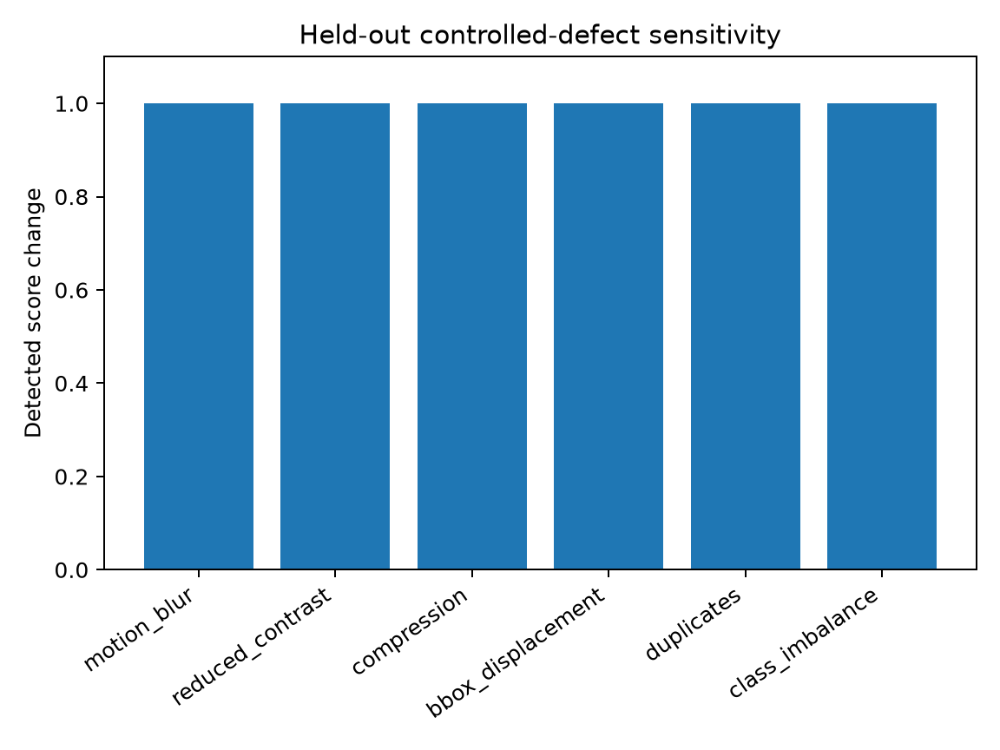
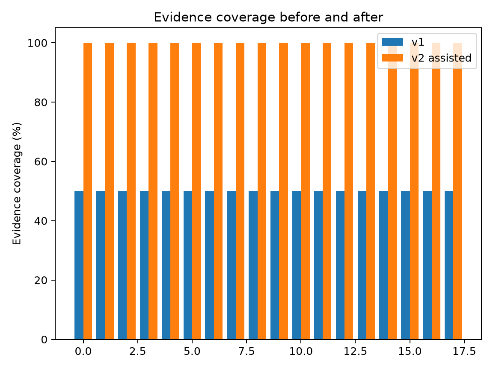
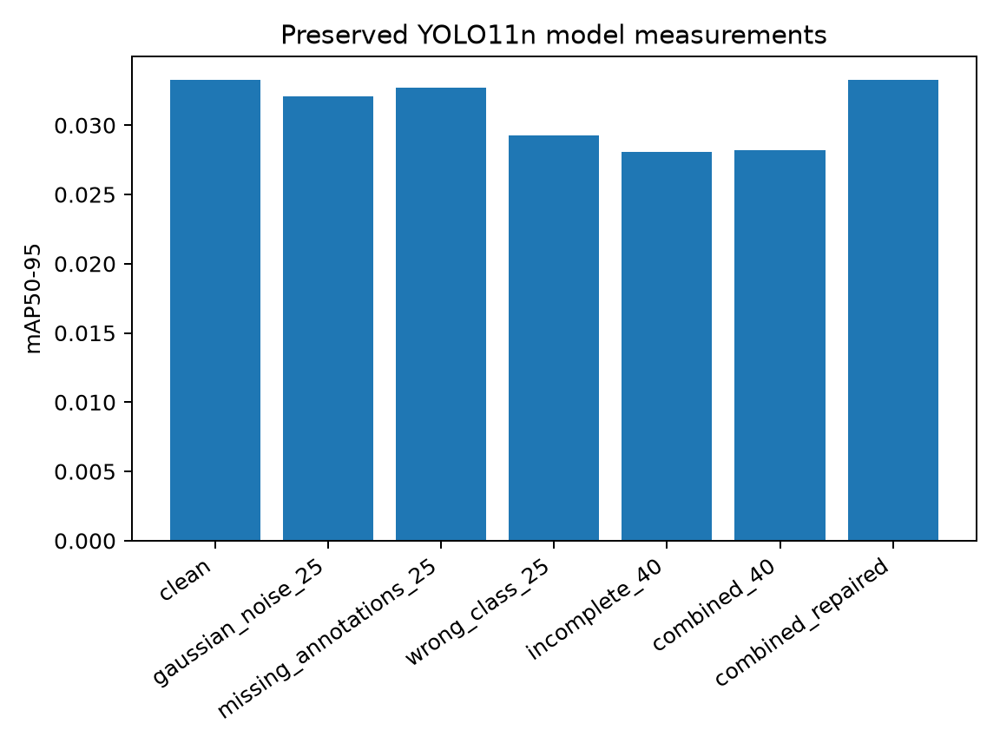

# FlightReady v2: Evidence-Aware UAV Dataset Readiness Assessment

## 1. Abstract

FlightReady is a research prototype for auditable UAV dataset-readiness assessment. Two earlier studies showed that controlled data degradation reduced downstream performance, but the v1 experimental score did not reliably respond: it remained 100.0 at 50% evidence coverage for all 18 tabular variants and correlated negatively with VisDrone detector performance across seven conditions. This work traced the failure to partial-evidence renormalization, compensatory proxy behavior, and absent semantic/coverage evidence rather than a single arithmetic error. FlightReady v2 retains missing evidence, exposes score bounds and contributions, separates gates from quality summaries, and adds trusted-reference checks for controlled validation. Reassessment covered all 18 tabular variants and 13 VisDrone conditions without retraining models. All saved manifests matched observed artifacts. Reference-assisted v2 scores responded in the intended direction to missingness, feature changes, label changes, annotation omission, class changes, box displacement, incompleteness, duplicates, and combined defects. Correlations with reused historical performance were positive (tabular Pearson r=0.790; VisDrone r=0.870), but these are descriptive, design-set results and are not evidence that the score predicts model accuracy. Reference-free coverage remained only 33.3% and 37.5%, demonstrating that semantic correctness and acquisition completeness remain unresolved without external evidence.

## 2. Introduction

Dataset readiness is not equivalent to model accuracy. A readiness system can measure syntax, completeness, provenance, coverage, signal properties, and agreement with trusted references; it cannot generally infer whether an in-range label is semantically correct or whether an observed collection is complete without knowing what was expected. FlightReady v2 is designed around that boundary.

## 3. Original research objectives

The original project sought to ingest tabular and UAV image datasets, translate a confirmed use case into measurable requirements, compute quality evidence, issue `READY`, `NOT_READY`, or `INSUFFICIENT_EVIDENCE`, and evaluate whether controlled degradation affected both readiness outputs and real model performance.

## 4. FlightReady v1 architecture

V1 contained two distinct paths. A requirement engine evaluated hard and preferred requirements to produce the category. A separate experimental weighted score averaged available components and reported coverage. An adaptive six-dimension profile already withheld its primary composite under incomplete evidence, but the historical experiments exported the optional experimental score. Certificates included raw metrics, findings, provenance, recommendations, and reproducibility hashes.

## 5. Initial experimental validation

The tabular study trained 108 real models: 18 dataset conditions, two architectures, and three seeds. Combined degradation reduced histogram-gradient-boosting R2 from 0.1635 to 0.0573 and random-forest R2 from 0.1567 to 0.0720. Missingness caused `NOT_READY`, but schema-valid feature and label corruption did not. Every numeric score was 100.0 with 50% coverage.

The VisDrone study trained seven YOLO11n conditions against a fixed evaluation set. Clean mAP50-95 was 0.03328; wrong classes reduced it to 0.02928, 40% image removal to 0.02808, and combined defects to 0.02820. V1 scores were 93.013, 93.013, 93.158, and 94.043 respectively. All categories were `NOT_READY` at 80% score coverage. Pearson correlation was -0.377 (p=0.405). These immutable historical results were reused, not overwritten.

## 6. Identified limitations

- Partial-evidence averaging made a perfect observed score compatible with large unmeasured weight.
- The score and decision used different evidence, allowing `NOT_READY` and 100.0 simultaneously.
- Laplacian variance confounds sharpness, texture, and noise.
- Annotation syntax and class histograms cannot establish semantic label correctness.
- Observed image count cannot establish acquisition completeness without a manifest.
- A weighted mean allowed easier remaining samples to compensate for omitted hard examples.
- The original experiments were too small and dependent for claims of score calibration.

## 7. Root-cause analysis

The detailed root-cause document distinguishes confirmed implementation/reporting faults from construct-validity gaps. The central finding is that counterintuitive behavior had multiple causes. The constant tabular score was a reporting/aggregation defect: measured components were renormalized to 100%. The VisDrone increases were primarily proxy and evidence-scope problems: omission changed the population being summarized, while no expected-count or trusted-label component was available. Wrong-class blindness was not fixable from the original statistics alone.

## 8. Implemented methodological improvements

FlightReady v2 (`flightready-v2.0`) adds a versioned scorecard to every new certificate. It validates metric direction and ranges, uses weighted geometric aggregation, preserves real zeroes, keeps unavailable evidence in the coverage denominator, publishes lower/upper score bounds, withholds the primary score unless coverage is complete, exposes normalized weights and contributions, and derives categories exclusively from explicit gates. A confirmed blocking failure takes precedence over unknown evidence. Reference-assisted metrics identify their evidence type and reference identifier.

The validation implementation adds observed missingness, duplicates, distribution divergence, expected-count checks, row-level feature/target disagreement, annotation omission, class disagreement, geometry disagreement, byte-verified duplicate images, deterministic paired-image fidelity, and image proxy ratios. Semantic checks are unavailable in the reference-free view rather than silently passed.

## 9. FlightReady v2 methodology

For measured metrics, lower-is-better fractions use `100 * (1 - fraction)`. Dimension and measured-quality summaries use a weighted geometric mean, so a true zero remains zero. Evidence coverage is measured applicable weight divided by all applicable weight. Missing evidence is not assigned zero quality, but it prevents a complete primary score and can force `INSUFFICIENT_EVIDENCE`. Blocking gates represent confirmed requirements such as maximum missingness or an authoritative expected acquisition count. Warning gates represent review-worthy disagreement. Scores describe measured criteria and are never presented as predicted accuracy.

## 10. Validation procedures

Assessment validation reran v2 over 18 preserved CSV variants and 13 real VisDrone collections. SHA-256 hashes verified every tabular variant against its saved manifest; observed VisDrone image counts matched all 13 manifest entries. Image comparison used a deterministic SHA-256-ranked sample of 48 paired training images per condition, while annotation comparisons used the complete label manifests. Six held-out VisDrone conditions - motion blur, reduced contrast, JPEG compression, box displacement, duplicates, and class imbalance - were not part of the original seven-model matrix and were not used to change formulas or weights.

Model validation was not rerun. The 108 saved tabular measurements and seven saved YOLO11n measurements were complete and reused. Thus all new results are reassessments, not claims of retraining. Fixed-epoch versus fixed-update confounding in the original incomplete-dataset detector comparison remains unresolved.

The final automated verification executed 356 backend tests and 37 frontend tests; all 393 passed with no failures or skips. The frontend production build completed, the backend health endpoint returned HTTP 200, the frontend development server returned HTTP 200, and end-to-end certificate tests confirmed the versioned v2 scorecard. Two backend deprecation/future warnings remain. An initial baseline run produced 83 setup errors solely because pytest's default user temp directory was inaccessible; the same suite passed when given a workspace-local temp directory.

## 11. Comparative experimental results

| Tabular condition | V1 score | V2 assisted score | V2 decision | Mean historical R2 |
|---|---:|---:|---|---:|
| Cleaned reference | 100.000 | 100.000 | READY | 0.16008 |
| Missing 40% | 100.000 | 84.352 | NOT_READY | 0.11114 |
| Feature noise 40% | 100.000 | 93.500 | CONDITIONALLY_READY | 0.09970 |
| Label corruption 40% | 100.000 | 92.983 | CONDITIONALLY_READY | 0.08054 |
| Combined defects | 100.000 | 76.103 | NOT_READY | 0.06464 |
| Oracle repaired | 100.000 | 100.000 | READY | 0.16008 |

| VisDrone condition | V1 score | V2 assisted score | V2 decision | Historical mAP50-95 |
|---|---:|---:|---|---:|
| Clean | 93.013 | 100.000 | READY | 0.03328 |
| Gaussian noise | 93.015 | 99.976 | CONDITIONALLY_READY | 0.03209 |
| Missing annotations | 93.647 | 95.587 | CONDITIONALLY_READY | 0.03269 |
| Wrong classes | 93.013 | 96.231 | CONDITIONALLY_READY | 0.02928 |
| Incomplete 40% | 93.158 | 88.010 | NOT_READY | 0.02808 |
| Combined defects | 94.043 | 90.459 | CONDITIONALLY_READY | 0.02820 |
| Oracle repaired | 93.013 | 100.000 | READY | 0.03328 |

The six held-out assessment conditions all produced a measurable response: motion blur 99.988, reduced contrast 99.784, JPEG compression 99.978, box displacement 96.465, byte-verified duplicates 97.249, and class-imbalance removal 94.661. The three pixel-only changes are small because only 25% of images were changed and paired pixel fidelity is intentionally conservative. This establishes sensitivity in these controlled collections, not universal defect detection.

## 12. Statistical analysis

The v1 tabular correlation was undefined because all scores were identical. V2 reference-assisted scores had Pearson r=0.790 (p=0.000096) and Spearman rho=0.810 (p=0.000046) across 18 variant means. VisDrone v1 retained Pearson r=-0.377 (p=0.405) and Spearman rho=-0.561 (p=0.190); v2 had Pearson r=0.870 (p=0.0108) and Spearman rho=0.891 (p=0.0071), n=7.

These p-values are descriptive only. Conditions share source data, repairs duplicate clean conditions, variants were used to motivate the methodology, and no multiple-comparison or independent calibration design was used. The results do not establish predictive validity. They demonstrate that the new metrics respond to the evidence they were designed to measure.

## 13. Remaining limitations

Reference-free evidence coverage was 33.3% for tabular and 37.5% for VisDrone. Consequently every reference-free reassessment remained `INSUFFICIENT_EVIDENCE` unless an observed hard failure independently established `NOT_READY`. Trusted-reference agreement is available only in controlled experiments or audited samples. Expected counts do not establish scenario representativeness. Pixel proxies remain content- and scale-dependent. The held-out conditions provide independent assessment sensitivity but have no held-out model-performance measurements. The v2 weights are engineering priorities, not learned effect sizes. The detector study has one training run per condition, low absolute mAP, and fixed-epoch dataset-size confounding.

## 14. Future work

Future studies should pre-register thresholds, acquire independent human-reviewed annotation samples, record flight/scene acquisition manifests, evaluate a new UAV dataset not used in development, run multiple detector seeds, compare fixed epochs with fixed optimizer updates, and estimate false-positive rates on naturally varying clean collections. Calibration should be separated from final validation.

## 15. Conclusion

The underlying problems were partly correctable. Missing-evidence renormalization and opaque contribution reporting were corrected. Controlled reference and manifest evidence now detect defects that v1 could not. The corrected system is more interpretable and behaves consistently on the studied conditions. However, the strongest gains depend on trusted references unavailable to an ordinary reference-free assessment. FlightReady v2 is therefore a more defensible evidence framework, not a validated predictor of downstream performance or an aviation safety certificate.

## 16. References

1. FlightReady original tabular experiment artifacts, `experiments/data_quality_impact`.
2. FlightReady original VisDrone/YOLO11n artifacts, `experiments/visdrone_model_validation`.
3. Wang et al., *Vision Meets Drones: A Challenge*, arXiv:1804.07437.
4. ISO/IEC 25012:2008, Data quality model.
5. Wang et al., *Image Quality Assessment: From Error Visibility to Structural Similarity*, IEEE TIP, 2004.
6. Lin et al., *Microsoft COCO: Common Objects in Context*, ECCV, 2014.
