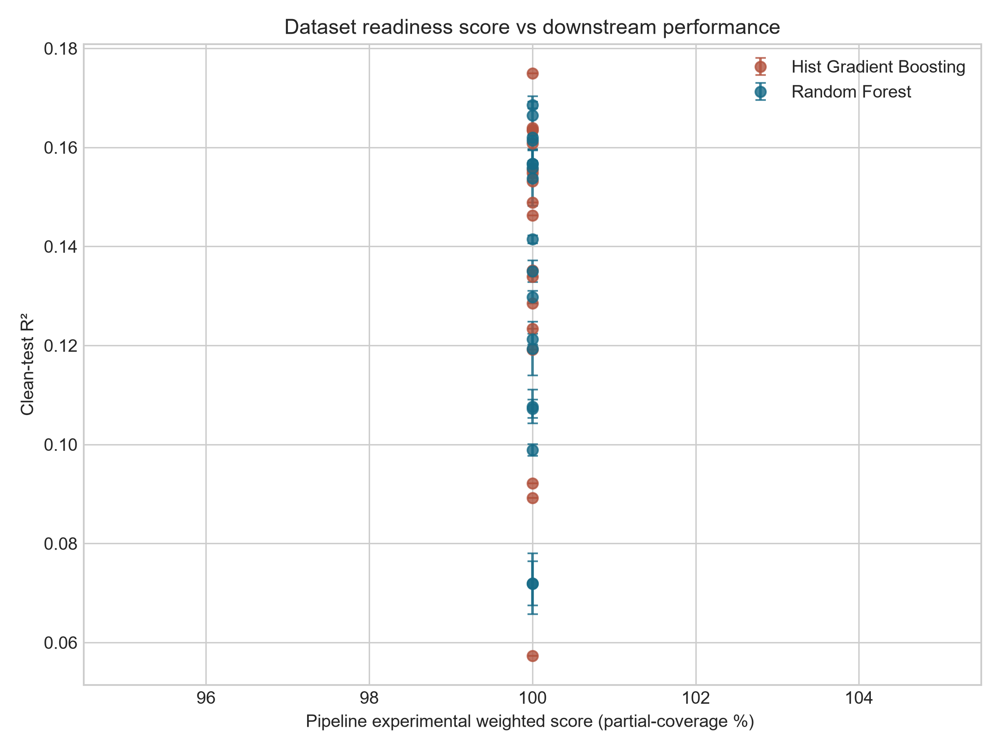
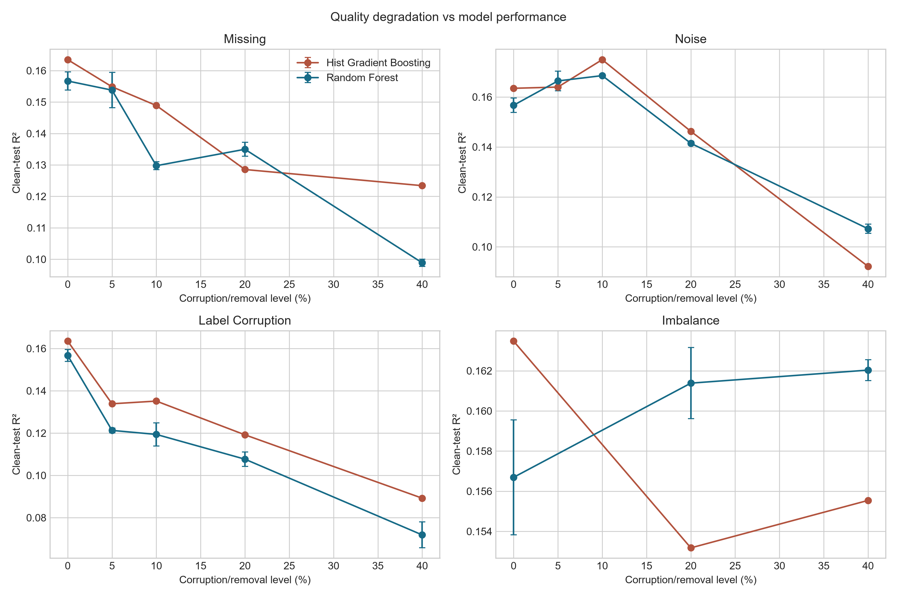
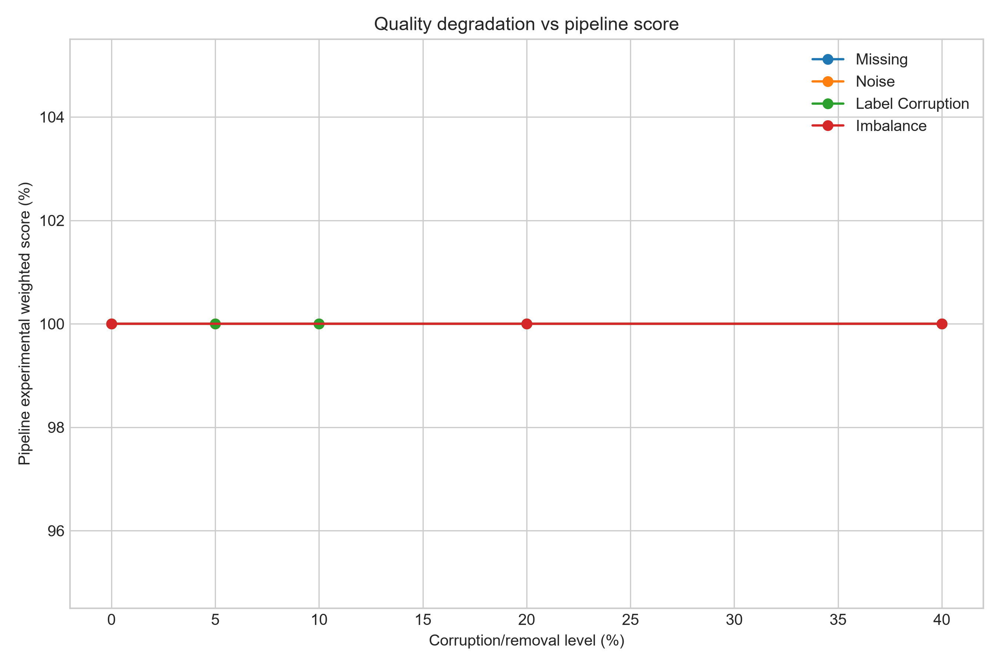
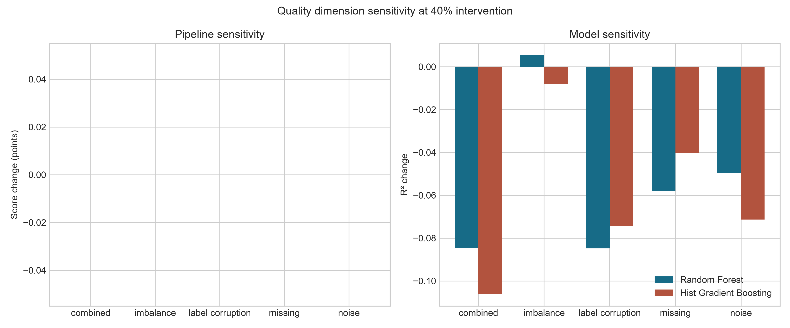
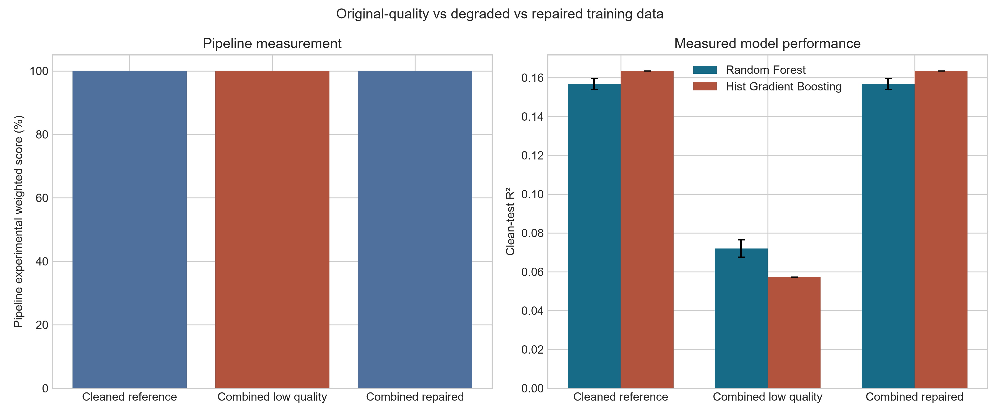

# Dataset quality impact experiment

## Research objective

Measure whether FlightReady's existing readiness evidence changes with controlled training-data defects, and whether those changes correspond to clean held-out model performance.

## Dataset and provenance

The experiment used the real local `ramen-ratings.csv` dataset (2580 rows, SHA-256 `24cae6482d3e3e8a144cb13e3f8fd16f7bc9281d367c4f3afce7bfc5fce38d9f`). The file is a local copy attributed by its schema/name to the Ramen Rater review collection; the local file contains no embedded download URL or license metadata, so origin authenticity was not independently established. A UAV VisDrone validation archive was also found locally, but a full 18-variant × 2-architecture × 3-seed detector training matrix was outside the fixed CPU-scale budget; the tabular dataset permits the requested controlled matrix without fabricated or incomplete runs.

The untouched source is preserved under `datasets/source_original/`. Three nonnumeric `Stars` rows were excluded before model splitting because they have no regression ground truth. A single 20% clean test partition was frozen before any corruption. All corruptions affect training only.

## Method

Models: Random Forest (240 trees) and histogram gradient boosting (180 iterations), using identical categorical imputation and ordinal encoding across variants. Seeds: 17, 42, and 93. Features: Brand, Style, Country. Metrics: MAE, RMSE, and R² on the same untouched test set. No test result selected a treatment or hyperparameter.

Controlled families were missing inputs, valid-category feature noise, in-range label permutation, low-rating under-representation, a combined 40% condition, and an oracle repair restoring the pre-corruption training snapshot. Exact modifications and hashes are in `variant_manifest.json`.

Every dataset was passed to `backend.readiness_engine.assess`; native certificates and HTML reports are in `pipeline_reports/`. FlightReady does not claim a validated composite readiness percentage. The numeric x-axis below is its existing **experimental weighted quality score**, and its evidence coverage/status are retained in the CSV. The categorical readiness decision and adaptive dimension scores are also retained.

## Results

| Variant | Model | Pipeline score | Status | R² mean ± SD | RMSE | MAE |
|---|---|---:|---|---:|---:|---:|
| cleaned_reference | hist_gradient_boosting | 100.00 | READY | 0.1635 ± 0.0000 | 0.9557 | 0.7042 |
| cleaned_reference | random_forest | 100.00 | READY | 0.1567 ± 0.0029 | 0.9595 | 0.7118 |
| combined_low_quality | hist_gradient_boosting | 100.00 | NOT_READY | 0.0573 ± 0.0000 | 1.0145 | 0.7289 |
| combined_low_quality | random_forest | 100.00 | NOT_READY | 0.0720 ± 0.0045 | 1.0066 | 0.7300 |
| combined_repaired | hist_gradient_boosting | 100.00 | READY | 0.1635 ± 0.0000 | 0.9557 | 0.7042 |
| combined_repaired | random_forest | 100.00 | READY | 0.1567 ± 0.0029 | 0.9595 | 0.7118 |
| imbalance_20 | hist_gradient_boosting | 100.00 | READY | 0.1532 ± 0.0000 | 0.9615 | 0.6983 |
| imbalance_20 | random_forest | 100.00 | READY | 0.1614 ± 0.0018 | 0.9569 | 0.6997 |
| imbalance_40 | hist_gradient_boosting | 100.00 | READY | 0.1555 ± 0.0000 | 0.9602 | 0.6873 |
| imbalance_40 | random_forest | 100.00 | READY | 0.1620 ± 0.0005 | 0.9565 | 0.6885 |
| label_corruption_10 | hist_gradient_boosting | 100.00 | READY | 0.1351 ± 0.0000 | 0.9717 | 0.7111 |
| label_corruption_10 | random_forest | 100.00 | READY | 0.1194 ± 0.0055 | 0.9806 | 0.7242 |
| label_corruption_20 | hist_gradient_boosting | 100.00 | READY | 0.1192 ± 0.0000 | 0.9807 | 0.7155 |
| label_corruption_20 | random_forest | 100.00 | READY | 0.1077 ± 0.0034 | 0.9870 | 0.7265 |
| label_corruption_40 | hist_gradient_boosting | 100.00 | READY | 0.0892 ± 0.0000 | 0.9972 | 0.7315 |
| label_corruption_40 | random_forest | 100.00 | READY | 0.0719 ± 0.0061 | 1.0067 | 0.7412 |
| label_corruption_5 | hist_gradient_boosting | 100.00 | READY | 0.1339 ± 0.0000 | 0.9725 | 0.7180 |
| label_corruption_5 | random_forest | 100.00 | READY | 0.1213 ± 0.0011 | 0.9795 | 0.7241 |
| missing_10 | hist_gradient_boosting | 100.00 | NOT_READY | 0.1489 ± 0.0000 | 0.9640 | 0.7058 |
| missing_10 | random_forest | 100.00 | NOT_READY | 0.1297 ± 0.0013 | 0.9748 | 0.7168 |
| missing_20 | hist_gradient_boosting | 100.00 | NOT_READY | 0.1285 ± 0.0000 | 0.9754 | 0.7249 |
| missing_20 | random_forest | 100.00 | NOT_READY | 0.1350 ± 0.0022 | 0.9718 | 0.7214 |
| missing_40 | hist_gradient_boosting | 100.00 | NOT_READY | 0.1234 ± 0.0000 | 0.9783 | 0.7206 |
| missing_40 | random_forest | 100.00 | NOT_READY | 0.0989 ± 0.0012 | 0.9919 | 0.7391 |
| missing_5 | hist_gradient_boosting | 100.00 | NOT_READY | 0.1549 ± 0.0000 | 0.9606 | 0.7097 |
| missing_5 | random_forest | 100.00 | NOT_READY | 0.1538 ± 0.0056 | 0.9612 | 0.7150 |
| noise_10 | hist_gradient_boosting | 100.00 | READY | 0.1749 ± 0.0000 | 0.9491 | 0.6961 |
| noise_10 | random_forest | 100.00 | READY | 0.1685 ± 0.0006 | 0.9528 | 0.7038 |
| noise_20 | hist_gradient_boosting | 100.00 | READY | 0.1462 ± 0.0000 | 0.9655 | 0.7161 |
| noise_20 | random_forest | 100.00 | READY | 0.1414 ± 0.0008 | 0.9682 | 0.7163 |
| noise_40 | hist_gradient_boosting | 100.00 | READY | 0.0922 ± 0.0000 | 0.9956 | 0.7257 |
| noise_40 | random_forest | 100.00 | READY | 0.1072 ± 0.0018 | 0.9873 | 0.7240 |
| noise_5 | hist_gradient_boosting | 100.00 | READY | 0.1640 ± 0.0000 | 0.9554 | 0.7062 |
| noise_5 | random_forest | 100.00 | READY | 0.1664 ± 0.0039 | 0.9540 | 0.7106 |
| original_training | hist_gradient_boosting | 100.00 | READY | 0.1608 ± 0.0000 | 0.9572 | 0.7063 |
| original_training | random_forest | 100.00 | READY | 0.1559 ± 0.0014 | 0.9600 | 0.7129 |

## Statistical association

Correlations use variant-level mean R². They are descriptive across dependent interventions, not independent-dataset validation.

| Model | n variants | Pearson r (p) | Spearman ρ (p) |
|---|---:|---:|---:|
| hist_gradient_boosting | 18 | undefined (undefined) | undefined (undefined) |
| random_forest | 18 | undefined (undefined) | undefined (undefined) |

## Controlled degradation and repair

- hist_gradient_boosting: combined degradation changed mean R² from 0.1635 to 0.0573 (-0.1062) while the pipeline score changed from 100.00 to 100.00 (+0.00 points). Repair returned R² to 0.1635 and the score to 100.00.
- random_forest: combined degradation changed mean R² from 0.1567 to 0.0720 (-0.0847) while the pipeline score changed from 100.00 to 100.00 (+0.00 points). Repair returned R² to 0.1567 and the score to 100.00.

## Interpretation

The intervention itself supports causal claims only about these controlled corruptions under this fixed modeling protocol. Correlation between a readiness score and performance does not show that the score causes performance.

In-range label permutation and replacement with other valid category values are deliberately difficult cases for schema/statistical checks: if performance declines while the score remains high, that is evidence of a pipeline blind spot, not an experimental failure. Missingness is directly observable and should affect confirmed requirements. Imbalance effects may be weak because this is regression and the intervention removes only part of one target region.

## Visualizations

## Limitations and threats to validity

- One real tabular dataset and one train/test split cannot establish universal predictive validity or UAV detector validity.
- The dataset's local provenance lacks an embedded source URL/license and is user-held, not independently authenticated.
- Category replacement is controlled measurement error; it does not represent every real sensor/noise process.
- Oracle repair uses the preserved clean snapshot and is evidence that reversing the imposed damage helps, not evidence of an automatic repair algorithm.
- Three model seeds quantify optimizer/ensemble randomness, not dataset-sampling uncertainty; confidence intervals across only three seeds would be unstable.
- The pipeline score is explicitly experimental and may have partial evidence coverage; its adaptive quality model intentionally withholds a primary composite when weighted coverage is incomplete.
- Hyperparameters were fixed in advance and not tuned on the test set, so absolute accuracy is not claimed to be optimal.

## Scientific assessment

- **Detects quality degradation — partially supported.** The categorical decision changed from READY to NOT_READY for every 5–40% missingness condition and for the combined condition. It remained READY for all feature-noise, label-corruption, and imbalance variants.
- **Numeric score tracks model performance — unsupported in this experiment.** The existing experimental score was 100.0 for every variant at only 50% evidence coverage. Because it had zero variance, Pearson and Spearman correlations were undefined even though clean-test R² varied substantially.
- **Quality improvement helps — supported for the controlled intervention.** Oracle restoration of the combined condition returned histogram boosting R² from 0.0573 to 0.1635 and random-forest R² from 0.0720 to 0.1567. The categorical status returned from NOT_READY to READY, while the numeric score stayed 100.0.
- **Missingness criteria are informative — partially supported.** At 40% missingness, R² fell by 0.0401 (histogram boosting) and 0.0578 (random forest), and the pipeline correctly rejected the data. However, its reported numeric score and measured dimension scores did not change.
- **Semantic label/feature correctness is a blind spot — supported.** At 40% in-range label corruption, R² fell by 0.0743 and 0.0848 while status stayed READY and score stayed 100.0. At 40% valid-category feature noise, R² fell by 0.0713 and 0.0495 with the same unchanged pipeline outputs.
- **Imbalance harm — unsupported here.** Removing 40% of low-rating rows changed R² by -0.0079 for histogram boosting and +0.0053 for random forest; this intervention did not measurably harm both models, so a pipeline penalty would not have been justified by these outcomes.
- **Individual adaptive dimensions — inconclusive.** Annotation-quality and signal-quality scores stayed 100.0; diversity, statistical adequacy, task suitability, and the integrity composite were withheld for insufficient coverage. None supplied a varying scalar suitable for correlation.
- **IEEE defensibility improvements:** preregister thresholds and hypotheses; add multiple independently sourced UAV datasets; use group/temporal splits; repeat dataset resampling as well as model seeds; obtain blinded label audits; report calibration and uncertainty; validate score weights out of sample; and separate exploratory score calibration from confirmatory evaluation.

Execution time: 54.65 seconds. Environment and dependency versions are in `environment.json`.
