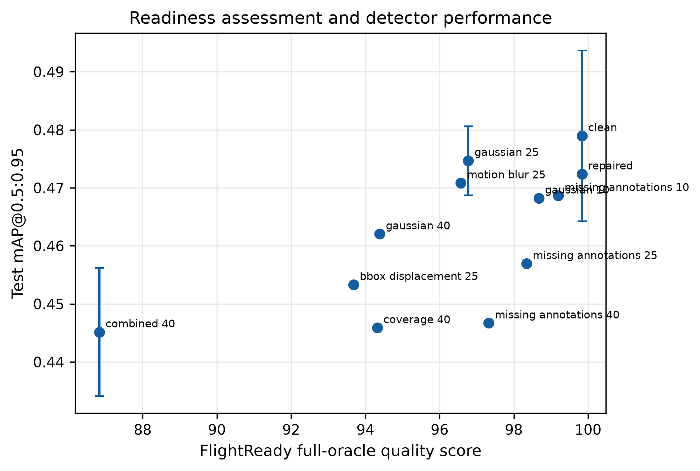
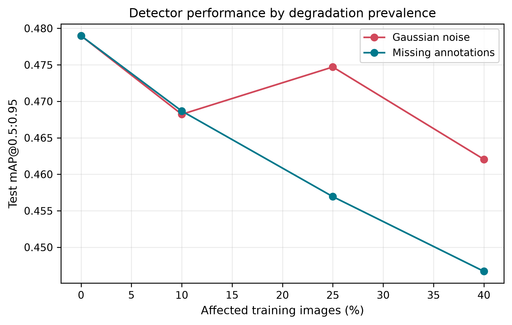
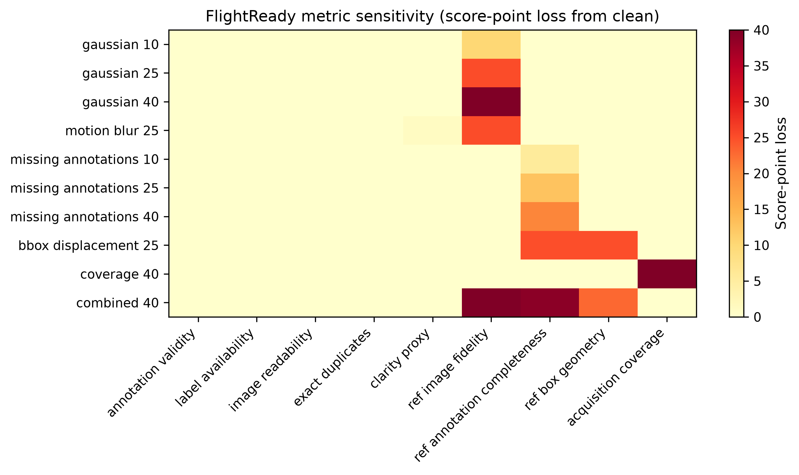
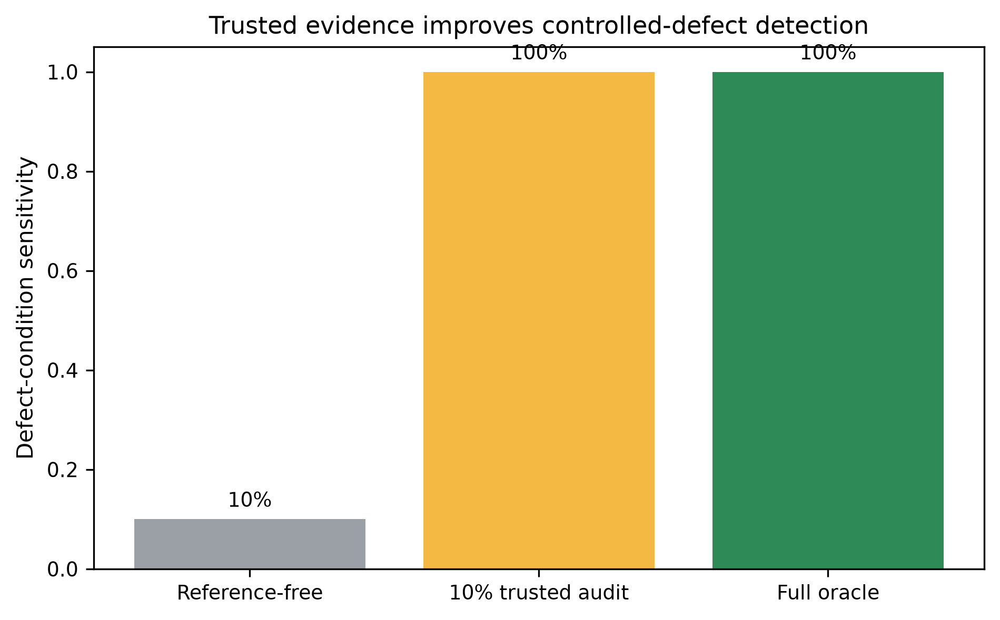
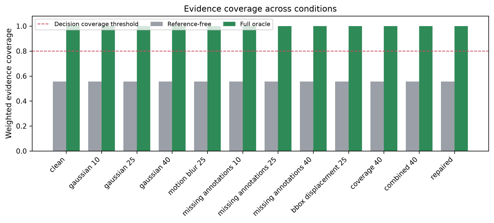
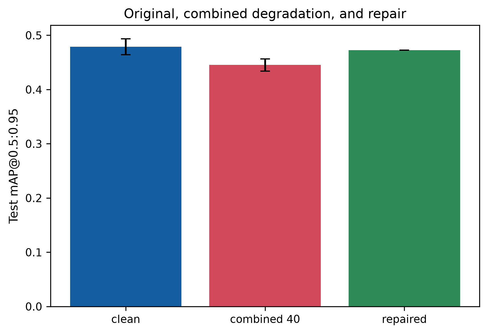
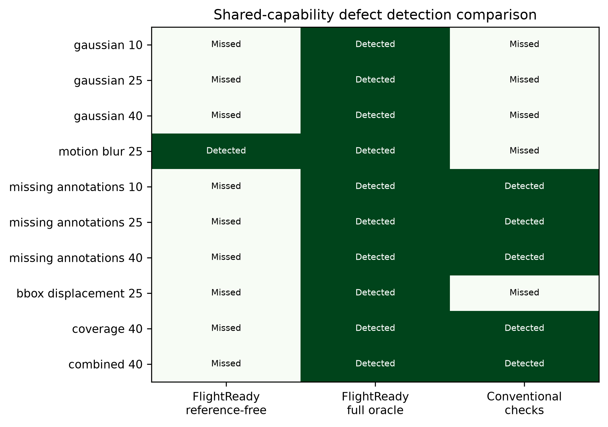
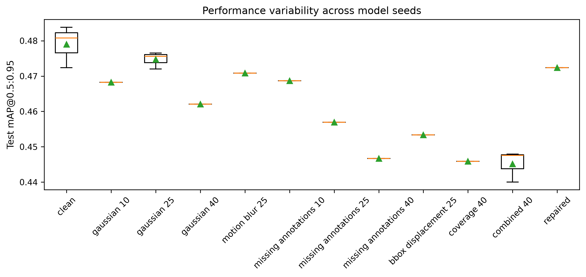

# FlightReady v2: Full Independent Validation Report

## Abstract

I independently evaluate the frozen FlightReady v2 evidence-aware UAV dataset-readiness method on UAVVaste, a public aerial litter-detection dataset not used in FlightReady development. I froze the method by source hashes before examining results. I generated reproducible training-only Gaussian noise, motion blur, missing annotations, bounding-box displacement, reduced coverage, combined degradation, and restored controls; the one-class dataset made wrong-class corruption inapplicable. The resource-amended protocol specifies repeated clean and combined comparisons, single-seed primary defect conditions, severity checks, a fixed-update control, and a YOLOv8n transfer check. The resource-amended protocol planned 19 final-protocol runs. The archived result ledger contains 19 completed planned runs plus 2 valid final-protocol observation(s) reported separately because they were not in that final plan. At report generation, the condition-level score/performance correlation is Pearson r=0.767 (p=0.0263, n=8) and Spearman rho=0.838 (p=0.0093); these are descriptive condition-level associations, not independent-dataset predictive validation. Reference-free primary scores were withheld for every condition at 55.6% evidence coverage. Across the prespecified controlled-defect variants, sensitivity was 10.0% reference-free, 100.0% with the deterministic 10% audit, and 100.0% with the full oracle under the prespecified >0.1-point-or-warning-change rule. The evidence supports interpretability and defect sensitivity when trusted references exist, while reference-free semantic coverage remains insufficient. This study does not establish a universal readiness-to-accuracy predictor.

## 1. Research questions

1. Does frozen FlightReady v2 detect controlled defects on an unfamiliar UAV dataset?
2. What is detected without a clean reference, and what remains unknowable?
3. Does a deterministic 10% trusted audit recover useful sensitivity?
4. How do score changes correspond to real detector performance under repeated seeds?
5. Is the resulting evidence strong enough for an IEEE submission?

## 2. Existing work summary

FlightReady v1 produced a constant 100 score at 50% coverage in the 18-condition tabular study, so correlation was undefined. In the seven-run VisDrone study, v1 correlated negatively with performance (Pearson r=-0.377, p=0.405). V2 added missing-evidence retention, bounds, auditable contributions, geometric aggregation, independent gates, references, and manifests. Reanalysis produced design-set reference-assisted Pearson correlations of +0.790 for tabular and +0.870 for VisDrone, but reference-free coverage was only 33.3% and 37.5%. Those results motivated this independent study.

## 3. Frozen v2 methodology

The method is `flightready-v2.0`, frozen at base commit `510d24eead326d1565dd29ddaf19ac059fcc6347` plus four SHA-256 implementation hashes in `frozen_methodology.json`. Measured applicable criteria use a weighted geometric mean. Unavailable applicable evidence stays in the denominator and defines score bounds; it is never treated as a pass. The primary score is withheld unless all applicable criteria are measured. Decisions follow the fixed order assessment error, measured blocking failure, unknown block or coverage below 0.8, measured warning, then ready. No v2 metric, threshold, weight, aggregation, coverage, or decision rule changed after results.

## 4. Dataset and provenance

UAVVaste (doi:10.5281/zenodo.8214061, CC BY 4.0) contains 772 images and 3718 COCO annotations for one `rubbish` category. The official split is 540/116/116. The 3.01 GB archive MD5 matched `1575c32c04bdf944047563e4a1786c2a`. All 12 variants retained byte-identical official test files; the audit found 0 test-byte issues.

UAVVaste differs materially from VisDrone: it is single-class, application-specific, much smaller, and dominated by tiny sparse litter rather than dense multi-class urban traffic. It is nevertheless only one independently sourced dataset.

## 5. Experimental design

Training-only variants used a fixed seed `20261112`. Gaussian noise used sigma 25 RGB at 10/25/40% prevalence; motion blur used a horizontal 9-pixel kernel at 25%; missing annotations removed 50% of boxes inside affected images at 10/25/40%; displacement shifted normalized centers by +0.08 at 25%; coverage removed 40% of training images; combined degradation applied noise, omission, and displacement to 40%; repaired was byte/label equivalent to clean. Wrong-class corruption was excluded because no second valid class exists.

The final common model protocol uses pretrained YOLO11n and YOLOv8n, 832-pixel input, batch 32, AdamW selected by Ultralytics `optimizer=auto`, deterministic execution, patience 10, and the planned seeds recorded per condition in `experiment_config.json`. Validation selects the best checkpoint; test data are used only for final evaluation. Coverage is evaluated at 40 epochs and 67 epochs to approximate matched optimizer updates. Resource-only amendments and excluded feasibility runs are disclosed in `protocol_amendment_*.json`.

## 6. FlightReady results

| Condition | Reference-free primary | RF measured | RF coverage | RF decision | Oracle score | Oracle decision | 10% audit score |
|---|---:|---:|---:|---|---:|---|---:|
| clean | withheld | 99.70 | 55.6% | INSUFFICIENT_EVIDENCE | 99.83 | READY | 99.83 |
| gaussian_10 | withheld | 99.70 | 55.6% | INSUFFICIENT_EVIDENCE | 98.67 | CONDITIONALLY_READY | 98.76 |
| gaussian_25 | withheld | 99.85 | 55.6% | INSUFFICIENT_EVIDENCE | 96.77 | CONDITIONALLY_READY | 95.81 |
| gaussian_40 | withheld | 99.81 | 55.6% | INSUFFICIENT_EVIDENCE | 94.38 | CONDITIONALLY_READY | 94.89 |
| motion_blur_25 | withheld | 99.48 | 55.6% | INSUFFICIENT_EVIDENCE | 96.57 | CONDITIONALLY_READY | 95.89 |
| missing_annotations_10 | withheld | 99.70 | 55.6% | INSUFFICIENT_EVIDENCE | 99.20 | CONDITIONALLY_READY | 99.60 |
| missing_annotations_25 | withheld | 99.70 | 55.6% | INSUFFICIENT_EVIDENCE | 98.34 | CONDITIONALLY_READY | 98.41 |
| missing_annotations_40 | withheld | 99.70 | 55.6% | INSUFFICIENT_EVIDENCE | 97.32 | CONDITIONALLY_READY | 97.29 |
| bbox_displacement_25 | withheld | 99.70 | 55.6% | INSUFFICIENT_EVIDENCE | 93.68 | CONDITIONALLY_READY | 97.85 |
| coverage_40 | withheld | 99.69 | 55.6% | INSUFFICIENT_EVIDENCE | 94.32 | CONDITIONALLY_READY | 93.52 |
| combined_40 | withheld | 99.85 | 55.6% | INSUFFICIENT_EVIDENCE | 86.83 | CONDITIONALLY_READY | 86.43 |
| repaired | withheld | 99.70 | 55.6% | INSUFFICIENT_EVIDENCE | 99.83 | READY | 99.83 |

Reference-free assessment correctly withheld all primary scores. Its measured summaries remained near 100 and often failed to distinguish label-only corruption, illustrating why the withheld status matters. The full oracle responded to all prespecified defect families; combined degradation had the largest score loss. The 10% audit improved access to semantic evidence but sampling caused attenuation, especially for localized box displacement. Natural exact duplicates/clarity proxies caused the clean score to remain below 100 and must not be interpreted as corruption injected by this study.

## 7. Model performance results

| Model | Condition | Schedule | n | P | R | mAP50 | mAP50-95 | SD | 95% CI |
|---|---|---:|---:|---:|---:|---:|---:|---:|---:|
| yolo11n | bbox_displacement_25 | fixed_epochs | 1 | 0.8606 | 0.6805 | 0.7540 | 0.4533 | NA | NA |
| yolo11n | clean | fixed_epochs | 3 | 0.8771 | 0.7231 | 0.7849 | 0.4790 | 0.0059 | [0.4643, 0.4937] |
| yolo11n | combined_40 | fixed_epochs | 3 | 0.8340 | 0.6931 | 0.7508 | 0.4452 | 0.0044 | [0.4341, 0.4562] |
| yolo11n | coverage_40 | fixed_epochs | 1 | 0.8517 | 0.6908 | 0.7526 | 0.4459 | NA | NA |
| yolo11n | coverage_40 | fixed_updates | 1 | 0.8549 | 0.7088 | 0.7579 | 0.4472 | NA | NA |
| yolo11n | gaussian_10 | fixed_epochs | 1 | 0.8859 | 0.7179 | 0.7795 | 0.4682 | NA | NA |
| yolo11n | gaussian_25 | fixed_epochs | 3 | 0.8512 | 0.7337 | 0.7755 | 0.4747 | 0.0024 | [0.4688, 0.4806] |
| yolo11n | gaussian_40 | fixed_epochs | 1 | 0.8495 | 0.7128 | 0.7731 | 0.4621 | NA | NA |
| yolo11n | missing_annotations_10 | fixed_epochs | 1 | 0.8769 | 0.7199 | 0.7773 | 0.4687 | NA | NA |
| yolo11n | missing_annotations_25 | fixed_epochs | 1 | 0.8724 | 0.6884 | 0.7571 | 0.4569 | NA | NA |
| yolo11n | missing_annotations_40 | fixed_epochs | 1 | 0.8721 | 0.6723 | 0.7614 | 0.4467 | NA | NA |
| yolo11n | motion_blur_25 | fixed_epochs | 1 | 0.8325 | 0.7550 | 0.7911 | 0.4708 | NA | NA |
| yolo11n | repaired | fixed_epochs | 1 | 0.8591 | 0.7215 | 0.7822 | 0.4724 | NA | NA |
| yolov8n | clean | fixed_epochs | 1 | 0.9054 | 0.6983 | 0.7968 | 0.4861 | NA | NA |
| yolov8n | combined_40 | fixed_epochs | 1 | 0.8509 | 0.6978 | 0.7610 | 0.4454 | NA | NA |

All numbers above come from final checkpoint evaluation on the same untouched official test set. Confidence intervals are t intervals only for rows with n=3; single-seed rows have no inferential interval. The protocol ledger distinguishes planned runs from supplemental valid observations.

## 8. Statistical analysis

The resource-amended protocol planned 19 final-protocol runs. The archived result ledger contains 19 completed planned runs plus 2 valid final-protocol observation(s) reported separately because they were not in that final plan. At report generation, the condition-level score/performance correlation is Pearson r=0.767 (p=0.0263, n=8) and Spearman rho=0.838 (p=0.0093); these are descriptive condition-level associations, not independent-dataset predictive validation. Reference-free primary scores were withheld for every condition at 55.6% evidence coverage. Across the prespecified controlled-defect variants, sensitivity was 10.0% reference-free, 100.0% with the deterministic 10% audit, and 100.0% with the full oracle under the prespecified >0.1-point-or-warning-change rule. The unit of correlation is a condition mean. Related variants, severity levels, and clean/repaired controls are not independent samples. Seed-level intervals describe training stochasticity, not population-level generalization. Fixed-epoch coverage effects are reported alongside fixed-update results so fewer images are not silently conflated with fewer optimizer updates.

## 9. Baseline comparisons

Conventional shared-capability checks included schema/label validity, file completeness, unreadable images, exact duplicates, an absolute clarity proxy, annotation counts, image counts, and center-distribution shifts. These are meaningful baselines but not equivalent aggregate readiness systems. They detected 5/10 defect conditions. FlightReady's advantage is evidence accounting and explicit withholding; its full-oracle semantic checks require more trusted evidence than conventional syntax checks.

## 10. Figures

## 11. Scientific interpretation

The strongest supported claim is not that one score predicts detector accuracy. It is that FlightReady v2 makes evidence boundaries visible, detects several important training-data defects when suitable references exist, and prevents high partial-evidence summaries from masquerading as complete assessments. A useful negative result is that ordinary reference-free evidence is still inadequate for semantic correctness and acquisition completeness. The correlation result is secondary and descriptive.

## 12. Limitations and threats to validity

- One new dataset and one primary architecture cannot establish broad generalization.
- UAVVaste is single-class; semantic wrong-class detection remains untested independently.
- The official image-level split shares 16 inferred filename source groups across each split pair, creating a possible adjacent-frame leakage threat. The official test was retained because stronger group metadata were unavailable.
- Full-oracle comparison is experimentally useful but unrealistic for many users.
- The deterministic 10% audit is one sample, not a replicated sampling study.
- Absolute Laplacian variance is content- and scale-sensitive; Gaussian noise can misleadingly increase apparent sharpness.
- Condition correlations use related interventions and cannot establish causal prediction or calibrated accuracy forecasts.
- Metric weights remain engineering judgments rather than empirically learned utilities.

## 13. Conclusions

FlightReady v2 is more scientifically defensible than v1 as an evidence-accounting and audit framework. Independent UAVVaste results support reference-assisted defect sensitivity and transparent uncertainty communication. They do not support describing FlightReady as an aviation safety certificate, universal quality score, or validated predictor of downstream mAP. A short conference or workshop paper centered on evidence-aware withholding and controlled validation is defensible; a broad full-paper claim requires additional datasets, valid multi-class corruption, replicated audit sampling, and stronger external baselines.

## References

[1] S. Afzal et al., “Data Readiness Report,” arXiv:2010.07213, 2020.

[2] A. Priestley et al., “A Survey of Data Quality Requirements That Matter in ML Development Pipelines,” ACM J. Data Inf. Quality, doi:10.1145/3592616, 2023.

[3] H. Chen et al., “A survey on dataset quality in machine learning,” Information and Software Technology, vol. 162, 107268, doi:10.1016/j.infsof.2023.107268, 2023.

[4] S. Sambasivan et al., “Everyone wants to do the model work, not the data work: Data Cascades in High-Stakes AI,” CHI, doi:10.1145/3411764.3445518, 2021.

[5] M. Kraft et al., “Autonomous, Onboard Vision-Based Trash and Litter Detection in Low Altitude Aerial Images Collected by an Unmanned Aerial Vehicle,” Remote Sensing, vol. 13, no. 5, 965, doi:10.3390/rs13050965, 2021.

[6] M. Schubert et al., “Identifying Label Errors in Object Detection Datasets by Loss Inspection,” WACV, 2024.

[7] S. Penquitt et al., “Object Detection Benchmarks are Incomplete: The Role of Label Errors and Annotation Uncertainty,” arXiv:2609.21822, 2026.

[8] C. Xie et al., “CPD-FCOS: A Scale-Isolated P2 Pathway for UAV Small-Object Detection,” Remote Sensing, vol. 18, no. 17, 3049, 2026.

[9] UAVVaste, Zenodo, doi:10.5281/zenodo.8214061, accessed 12 Nov. 2026.

[10] Ultralytics, “Ultralytics YOLO documentation and model assets,” software artifact, accessed 12 Nov. 2026.
