# FlightReady: a visual codebase textbook

**A beginner-friendly, source-derived guide to the UAV Dataset Readiness and Model Validation platform.**

Snapshot: 3 November 2026. This edition incorporates the research-evidence-2.0 pipeline and engine 1.5.0. Analysis covers 83 Python files and 23 TypeScript files, 851 Python symbols and 152 TypeScript declarations, including tests. Source inventory excludes dependencies, runtime uploads, databases and checkpoints.

<a id="contents"></a>

## Table of contents

- [1. Understanding the project in five minutes](#ch01)
- [2. Repository structure and responsibilities](#ch02)
- [3. How the application starts](#ch03)
- [4. Frontend architecture and user actions](#ch04)
- [5. Backend API and interface map](#ch05)
- [6. Dataset ingestion and storage](#ch06)
- [7. Natural language becomes a confirmed goal](#ch07)
- [8. Metrics: measurements before decisions](#ch08)
- [9. Adaptive normalization, weighting and gates](#ch09)
- [10. Model Validation Lab and real training](#ch10)
- [11. Research analytics and statistical limits](#ch11)
- [12. Database, filesystem and data lineage](#ch12)
- [13. Errors, cancellation and recovery](#ch13)
- [14. Three complete worked examples](#ch14)
- [15. Function, class and data-model reference](#ch15)
- [16. Debugging and safe extension map](#ch16)
- [17. Glossary, findings and verification](#ch17)

<a id="understand"></a>

## I Want to Understand...

- [How the website communicates with Python](#ch04)
- [How a dataset is uploaded and normalized](#ch06)
- [How natural-language requirements become a goal](#ch07)
- [How a metric is calculated](#ch08)
- [How weights are selected and why some matter more](#ch09)
- [How score masking and unknown evidence are handled](#ch09)
- [How real model training starts and uses the GPU](#ch10)
- [How model performance and fair comparisons work](#ch10)
- [How quality and downstream performance are connected](#ch11)
- [How results are stored](#ch12)
- [How a report is generated](#diagram-reporting-flow)
- [How errors and recovery work](#ch13)
- [Which function receives and returns each object](#ch15)
- [Where to debug or extend a component](#ch16)

---

<a id="ch01"></a>

# 1. Understanding the project in five minutes

## What the platform does

FlightReady is a local research application for asking whether a dataset contains the evidence needed for a particular task, and then testing how measured data differences relate to model performance. A dataset is not evaluated in isolation: the user supplies a goal, such as detecting drones in airport imagery, and confirms the interpretation before measurement starts.

The normal browser workflow has three stages. First, import data and confirm the goal. Second, run the readiness analysis and inspect a report. Third, for supported detection datasets, run a controlled training comparison and inspect independent-test results. The advanced workspace exposes the same underlying tools with more configuration. The original assessment interface remains reachable through `?legacy=1` or an `assessment` query parameter.

The inputs can be tables, documents represented as records, images and supported annotated image archives. Readiness supports more modalities and tasks than detector training: the current model adapter trains YOLO11n or YOLO11s object detectors on eligible YOLO/COCO sources. It does not train classification, regression, telemetry or tracking models merely because those task policies exist.

## Three outputs that must stay distinct

| Output | Actual meaning | Owning implementation |
|---|---|---|
| `Certificate.overall_status` | Whether the confirmed requirements pass, fail or lack evidence | `readiness_engine.decide` |
| `Certificate.quality_profile` | Six independent quality dimensions, coverage, gates, policy and adaptive status | `quality_aggregation.aggregate_quality` |
| `Certificate.experimental_score` | An older optional provisional arithmetic scalar over observed components | `experimental_scoring.calculate` / `aggregate` |

Passing a minimal requirement set can coexist with unknown quality dimensions. Unknown means that evidence or an explicit criterion is missing; it is not a zero measurement. None of these outputs is predicted model accuracy. Actual accuracy-related metrics come from held-out model evaluation.

<details>
<summary>Analogy: a research laboratory</summary>

The browser is reception. FastAPI is the coordinator. Ingestion registers and inspects the samples. The context interpreter writes a draft research brief that the user approves. Metrics are instruments; each measures one property. The decision engine compares instrument readings with the approved brief. Adaptive aggregation summarizes defined criteria while retaining gaps. The training worker runs the experiment. SQLite is the records archive, while large datasets and instruments' output files stay in managed cabinets on disk. Reporting prepares a readable account of the stored evidence.

This analogy does not imply a background scientist invents conclusions: context interpretation may use an external language model, but the measured report narrative and comparisons are generated from saved evidence by ordinary application code.

</details>

## How to read the diagrams

Rounded/action nodes describe verified functions or operations; boxes describe components or data; cylinders indicate persistent storage; diamonds are decisions. Solid arrows describe the labeled runtime control/data transfer. Dashed arrows in the dependency diagrams mean imports, not direct execution. Sequence diagrams show time from top to bottom. Class triangles mean inheritance, diamonds mean contained fields and labeled dependency arrows mean use/conversion. A subprocess boundary is always named. A polling request is a fresh HTTP read, not a server push.

The guide is a source snapshot. Line references refer to the inspected files and may move after edits. The generated inventory records source hashes. It does not inspect credentials, uploaded personal datasets or checkpoints. The documentation verification does not rerun expensive training or test live providers; earlier application test results are described separately from what was checked for this book.

## The current pipeline, in one continuous journey

This edition incorporates engine **1.5.0**, enhanced UAV property implementation **2.0**, evidence schema **research-evidence-2.0** and **interventions-2.0**. The public twenty UAV IDs and six independent quality dimensions remain stable. The following is the implemented path, including the newer research evidence.

1. Upload/import stages a managed source, validates its structure, parses canonical labels and inspects pixels. The image frame now caches the existing dHash signature and new global degradation indicators alongside historical measurements.
2. The goal assistant proposes a DatasetContext. A separate confirmation saves the finish line, including any explicit scale bins, detector preprocessing, joint scenarios or numerical minimums. Interpretation never independently validates collection metadata.
3. Training-scope analysis selects only training images. Image-level audits/candidates are scoped to those images without editing parent records. An old count-only audit cannot be assumed to describe the selected subset.
4. The existing registry executes requirements, diagnostics and stable UAV properties. New modules provide geometry, bounded local crops/rings, independent-reference audits, negative coverage, direct scenario conjunctions and collection/duplicate evidence. They do not create a parallel assessment engine.
5. Requirement findings determine Certificate.overall_status. Stored observations also feed the existing six-dimension policy with strict coverage and independent gates. New uncalibrated proxies add no automatic score weights or blockers.
6. A presentation adapter derives eight evidence views from actual MetricResult values. The certificate persists both raw evidence and its readable views. Guided and advanced interfaces use the same ResearchEvidence component; exports preserve missing values and recorded scope.
7. The Model Validation Lab can create reproducible training-only interventions, reassess changed data, freeze a matched protocol, run explicitly requested real training and evaluate on independent final data. Native-size recall is now recorded separately from standard AP. Research relationships remain unconfirmed until sufficient real outcomes exist.

Think of the new modules as additional instruments attached to the same laboratory bench. An instrument may return a useful observation while its policy score remains unavailable. More instruments do not themselves establish a better model or an empirically calibrated readiness score.


<a id="diagram-system-overview"></a>
### Figure: The complete system: a dataset research laboratory

<!-- diagram: system-overview -->

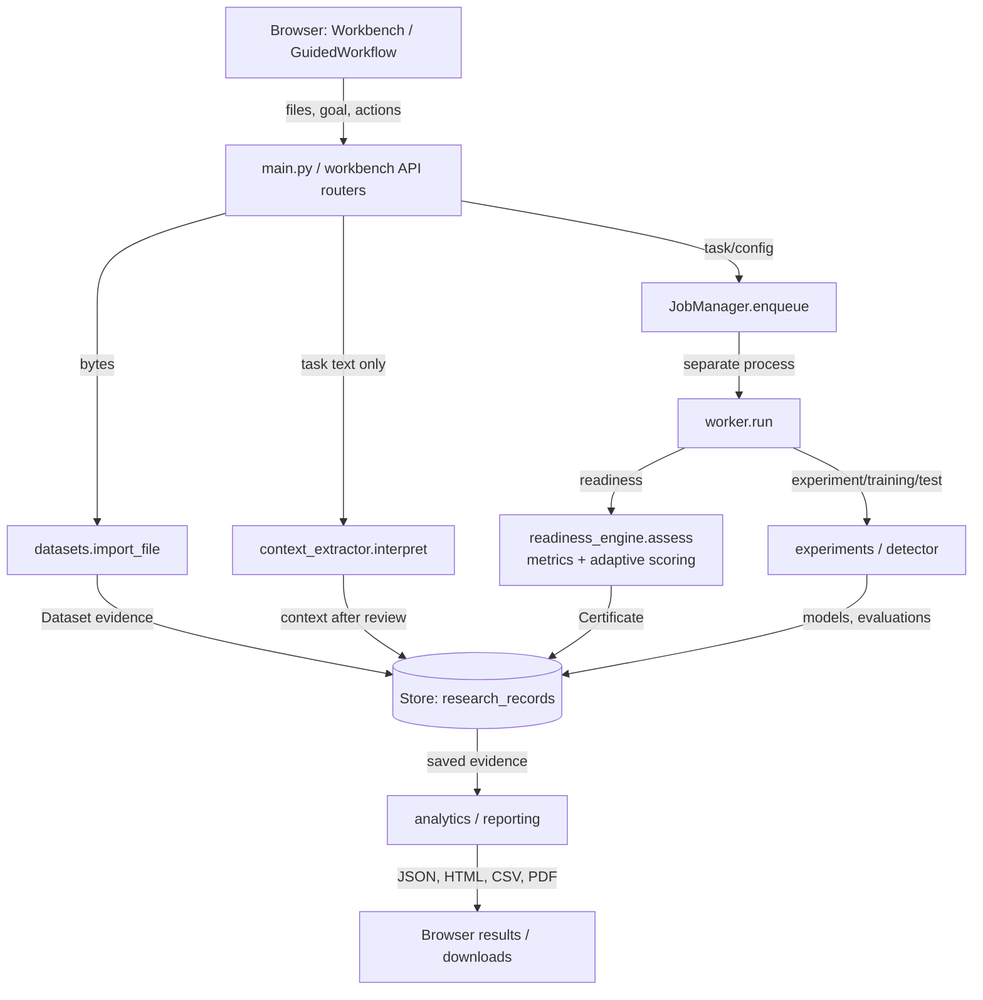

The trigger is a user submitting data or a confirmed goal. HTTP accepts work; JobManager crosses a process boundary for compute. SQLite holds JSON records; checkpoints and datasets remain on disk. The context provider is a separate optional network path, not the training engine.

Sources: [main.py](../main.py), [backend/workbench/api.py](../backend/workbench/api.py), [backend/workbench/worker.py](../backend/workbench/worker.py), [backend/workbench/reporting.py](../backend/workbench/reporting.py). [Open SVG](assets/architecture/system-overview.svg) | [High-resolution PNG](assets/architecture/system-overview.png)


**Chapter evidence:** [main.py](../main.py), [backend/readiness\_engine.py](../backend/readiness_engine.py), [metrics/quality\_aggregation.py](../metrics/quality_aggregation.py), [metrics/experimental\_scoring.py](../metrics/experimental_scoring.py), [frontend/src/GuidedWorkflow.tsx](../frontend/src/GuidedWorkflow.tsx).


[Back to contents](#contents) | [Question map](#understand)


---

<a id="ch02"></a>

# 2. Repository structure and responsibilities

## Why responsibilities are separated

The architecture separates evidence from policy and transport. Ingestion understands bytes and source formats. Metrics understand measurements. `Goal` and the requirement engine decide which checks are binding. Adaptive profiles define how supported measurements become criterion scores. API handlers accept validated requests and save work; they do not contain the PyTorch training loop. This lets the same assessment engine run from the web worker or standalone research tools.

The project has grown through several layers, so historical names and interfaces remain. `Dataprofiler` and `FeaturAnalyzer` are preserved public names with correctly spelled aliases. The original `ISOIECchecker` is a retained helper with partially implemented profile-only checks; no active web readiness path invokes it. The standalone `research` package is reachable from its CLI, not dead code just because it is outside the main API.

The inventory below describes repository-owned files. Virtual environments, node_modules, caches, uploads, runtime databases, pretrained checkpoints and generated frontend bundles are excluded from the architecture inventory. Test code is inventoried as evidence, not presented as application behavior. The documentation generation tools under `reading/tools` are separate from the analyzed application.

## Working directory map

The following tree is generated from actual source, configuration and test paths. It is intentionally a source tree, not a dump of downloaded dependencies or research artifacts.

## Current folder boundaries

The application now has three primary source folders: frontend/ for the React UI, backend/ for FastAPI, ingestion, context interpretation, orchestration and experiments, and metrics/ for profiling, metric execution, UAV-01 through UAV-20 and scoring policies. The sql/ package owns the actual SQLAlchemy table models, SQLite persistence and DuckDB connection configuration. Domain and request models remain with the backend. Reading material, documentation tools, examples and diagram assets live together under reading/.

The metric reading order is profiling, shared registry/dispatch, full-table or UAV evidence, quality policy and aggregation, then the optional experimental summary. The backend owns the confirmed-goal and readiness orchestration around those measurements. The UAV property identifiers retain their established numeric order; reorganizing source files does not change formulas, policy weights, gates or stored database records.

Start from the repository root using python -m uvicorn main:app, or backend/scripts/run_backend.ps1. Workers now use python -m backend.workbench.worker and standalone research uses python -m backend.research. The former demo_data directory was removed; optional sample generation targets .runtime/demo_data and automated browser fixtures use temporary directories.


```text
C:/DataReadiness/
|-- backend/
|   |-- __init__.py
|   |-- context.py
|   |-- context_extractor.py
|   |-- dataset_archives.py
|   |-- image_ingestion.py
|   |-- ingestion.py
|   |-- large_ingestion.py
|   |-- main.py
|   |-- readiness_engine.py
|   |-- record_formats.py
|   |-- reports.py
|   |-- research/
|   |   |-- __init__.py
|   |   |-- __main__.py
|   |   |-- experiments.py
|   |   `-- variants.py
|   |-- scripts/
|   |   |-- __init__.py
|   |   |-- generate_demos.py
|   |   |-- generate_uav_example.py
|   |   |-- preview_weighted_scores.py
|   |   |-- quality_performance_experiment.py
|   |   |-- quick_accuracy_experiment.py
|   |   |-- smoke_adaptive_lab.py
|   |   |-- smoke_resume.py
|   |   |-- smoke_workbench.py
|   |   |-- uav_api_example.py
|   |   |-- validate_image_archive.py
|   |   `-- validate_large_upload.py
|   |-- universal_images.py
|   `-- workbench/
|       |-- __init__.py
|       |-- analytics.py
|       |-- api.py
|       |-- combined.py
|       |-- contracts.py
|       |-- datasets.py
|       |-- detector.py
|       |-- experiments.py
|       |-- jobs.py
|       |-- lab_api.py
|       |-- quality_api.py
|       |-- reporting.py
|       |-- splits.py
|       |-- synthetic.py
|       |-- variations.py
|       |-- worker.py
|       `-- workflow_api.py
|-- frontend/
|   |-- e2e/
|   |   |-- adaptive-lab.spec.ts
|   |   |-- guided-workflow.spec.ts
|   |   |-- research-evidence.spec.ts
|   |   `-- workbench.spec.ts
|   |-- package.json
|   |-- playwright.config.ts
|   |-- src/
|   |   |-- BenchmarkCharts.tsx
|   |   |-- ExperimentBuilder.tsx
|   |   |-- ExperimentalScore.tsx
|   |   |-- GuidedValidation.tsx
|   |   |-- GuidedWorkflow.tsx
|   |   |-- QualityAnalytics.tsx
|   |   |-- ResearchEvidence.tsx
|   |   |-- Workbench.tsx
|   |   |-- adaptiveQuality.test.tsx
|   |   |-- api.ts
|   |   |-- assessmentReports.test.tsx
|   |   |-- datasetUploads.test.tsx
|   |   |-- experimentalScore.test.tsx
|   |   |-- guidedWorkflow.test.tsx
|   |   |-- main.tsx
|   |   |-- researchEvidence.test.tsx
|   |   |-- styles.css
|   |   |-- testSetup.ts
|   |   |-- useAssessment.ts
|   |   |-- workbench.css
|   |   |-- workbench.test.tsx
|   |   `-- workflow.css
|   |-- tsconfig.json
|   |-- vite.config.ts
|   `-- vitest.config.ts
|-- metrics/
|   |-- IsoIecChecker.py
|   |-- __init__.py
|   |-- config/
|   |   |-- adaptive_quality.json
|   |   `-- experimental_score.json
|   |-- core.py
|   |-- dataProfiler.py
|   |-- disk_metrics.py
|   |-- experimental_scoring.py
|   |-- featureAnalyzer.py
|   |-- labelAnalyzer.py
|   |-- quality_aggregation.py
|   |-- quality_profiles.py
|   `-- uav_metrics/
|       |-- __init__.py
|       |-- assessment.py
|       |-- audit.py
|       |-- independence.py
|       |-- learning.py
|       |-- pixels.py
|       |-- presentation.py
|       |-- registry.py
|       |-- research.py
|       `-- vision.py
|-- pyrightconfig.json
|-- pytest.ini
|-- requirements/
|   |-- requirements-dev.txt
|   |-- requirements-training.txt
|   `-- requirements.txt
|-- sql/
|   |-- __init__.py
|   |-- datasets.py
|   |-- models.py
|   `-- store.py
`-- tests/
    |-- test_adaptive_quality.py
    |-- test_csv_encodings.py
    |-- test_dataset_formats.py
    |-- test_experimental_scoring.py
    |-- test_gemini_provider.py
    |-- test_guided_workflow.py
    |-- test_large_datasets.py
    |-- test_readiness.py
    |-- test_research.py
    |-- test_research_metrics.py
    |-- test_uav_metrics.py
    |-- test_validation_lab.py
    |-- test_visdrone.py
    `-- test_workbench.py
```

## File responsibilities and actual source dependencies

### Backend entry, ingestion and orchestration

| File | Responsibility | Main symbols | Direct Python importers (subset) |
|---|---|---|---|
| [backend/\_\_init\_\_.py](../backend/__init__.py) | API, ingestion, orchestration and model experiments. | No declared top-level symbol | No direct Python import found; may be an entry, route, TS import or dynamic use |
| [backend/context.py](../backend/context.py) | Shared Pydantic contracts: goals, requirements, evidence, findings and certificates. The base Model forbids extra fields and disallows nonfinite values in validated numeric fields. | Model; Requirement; ScenarioRequirement; QualityPolicySettings; Goal; DatasetContext; MetricDefinition; AssessmentEvidence; MetricResult; AssessmentFinding; RemediationRecommendation; Certificate | backend/context_extractor.py; main.py; backend/readiness_engine.py; backend/research/__main__.py; backend/research/experiments.py |
| [backend/context\_extractor.py](../backend/context_extractor.py) | Deterministic text/tag extraction and optional Gemini or OpenAI-compatible REST extraction. Local validation and human confirmation remain final. | ContextProvider; extraction_instructions; GeminiProvider; OpenAICompatibleProvider; suspicious_instruction; interpret | main.py; backend/workbench/api.py; backend/workbench/workflow_api.py; tests/test_gemini_provider.py; tests/test_guided_workflow.py |
| [backend/dataset\_archives.py](../backend/dataset_archives.py) | Read ZIP/TAR/compressed containers, discover candidate datasets and require explicit choices for ambiguous contents. | TarAdapter; open_archive; is_auxiliary; discover; _expanded_compressed; load_container | backend/image_ingestion.py; backend/large_ingestion.py; backend/workbench/datasets.py; metrics/uav_metrics/pixels.py; metrics/uav_metrics/vision.py |
| [backend/image\_ingestion.py](../backend/image_ingestion.py) | Validate archive members, decode image evidence, parse YOLO/VisDrone annotations and merge declared image metadata. | validate_members; find_layouts; identify_layout; inspect_image; parse_yolo; merge_image_metadata; parse_visdrone; load_image_archive | backend/dataset_archives.py; backend/large_ingestion.py; backend/research/experiments.py; backend/research/variants.py; backend/universal_images.py |
| [backend/ingestion.py](../backend/ingestion.py) | Dataset dataclass, ingestion exceptions, strict CSV decoding and the smaller in-memory parsing path. | IngestionError; SelectionRequired; decode_csv; Dataset; load_dataset; load_images | backend/dataset_archives.py; backend/image_ingestion.py; backend/large_ingestion.py; main.py; backend/record_formats.py |
| [backend/large\_ingestion.py](../backend/large_ingestion.py) | Bounded upload staging, CSV/Parquet/record batching, whole-table DuckDB profiles and large-data dispatch. | ByteSource; detect_encoding; BoundedLines; csv_batches; forced_text_fields; load_record_table; full_profile; load_dataset_stream | backend/dataset_archives.py; backend/ingestion.py; main.py; backend/record_formats.py; backend/research/experiments.py |
| [main.py](../main.py) | FastAPI startup, body-limit middleware, original transient assessment API, router inclusion and production static hosting. | lifespan; BodyLimitMiddleware; InterpretRequest; InterpretationResponse; UploadResponse; AssessmentRequest; DatasetSelection; JobResponse; cleanup; get_dataset; get_job; context_interpret; upload; profile; select_dataset; delete_dataset; Cancelled; perform; start; job_response; progress; cancel; certificate; export; health; config; metric_registry | backend/scripts/quality_performance_experiment.py; backend/scripts/quick_accuracy_experiment.py; backend/scripts/smoke_workbench.py; tests/test_csv_encodings.py; tests/test_dataset_formats.py |
| [backend/readiness\_engine.py](../backend/readiness_engine.py) | Compiles Goal into requirements, executes checks, decides requirement readiness and assembles the Certificate. | build_requirements; evaluate; decide; assess; _assess | main.py; backend/research/experiments.py; backend/scripts/generate_uav_example.py; backend/workbench/combined.py; backend/workbench/worker.py |
| [backend/record\_formats.py](../backend/record_formats.py) | Stream-oriented adapters for delimited text, plain text, JSON/JSONL, XML, spreadsheets and Arrow records. | json_input; delimiter_for; _json_object; _invalid_constant; canonical_json; normalize_record; _preflight_json; json_keys; _json_records; local_tag; preflight_xml; xml_candidates; xml_value; _xml_records; prepare_records | backend/dataset_archives.py; backend/ingestion.py; backend/large_ingestion.py |
| [backend/reports.py](../backend/reports.py) | Escaped deterministic HTML for a saved Certificate, including adaptive profile charts. | html_report | main.py; backend/scripts/generate_uav_example.py; backend/workbench/api.py; tests/test_experimental_scoring.py; tests/test_readiness.py |
| [backend/universal\_images.py](../backend/universal_images.py) | COCO/VOC/ImageFolder/YAML-YOLO/unlabelled image adapters; maps source geometry into canonical normalized boxes. | GuardedJSONReader; coco_source; folder_labels; _small_read; coco_keys; image_choices; resolver; _coco; _voc; _yolo_classes; _normal_box; load_universal_images; load_single_image | backend/dataset_archives.py; backend/large_ingestion.py; backend/workbench/datasets.py |

### Metric calculations and scoring

| File | Responsibility | Main symbols | Direct Python importers (subset) |
|---|---|---|---|
| [metrics/\_\_init\_\_.py](../metrics/__init__.py) | Dataset measurements, scoring policies and stable UAV properties. | No declared top-level symbol | No direct Python import found; may be an entry, route, TS import or dynamic use |
| [metrics/core.py](../metrics/core.py) | One registry and run_metric dispatcher for requirement checks, diagnostics, disk checks and registered UAV properties. | metric; MissingEvidence; result; run_metric; need_column; references; row_count; field_presence; missingness; non_finite; unreadable; missing_label; usable_targets; type_validity; ranges; allowed; units; cross_field; bbox; duplicates; duplicate_ids; conflicting; near; class_counts; distribution; agreement; verified; required_class; manifest_errors; scenario; sufficiency; reference_comparison; split_overlap; group_leakage; near_split; target_leakage; preprocessing; provenance; timeliness; sensor_modality; excluded_usage; evidence_summary | main.py; backend/readiness_engine.py; backend/workbench/quality_api.py; metrics/disk_metrics.py; metrics/uav_metrics/assessment.py |
| [metrics/dataProfiler.py](../metrics/dataProfiler.py) | Dataprofiler/DataProfiler and DataProfile: basic observed statistics, missingness, duplication and descriptive ranges. | DataProfile; Dataprofiler | backend/image_ingestion.py; backend/ingestion.py; backend/universal_images.py; backend/workbench/combined.py; backend/workbench/datasets.py |
| [metrics/disk\_metrics.py](../metrics/disk_metrics.py) | Whole-data SQL implementations of supported tabular metrics. Does not compute statistics from the 100-row preview. | run_disk_metric | metrics/core.py |
| [metrics/experimental\_scoring.py](../metrics/experimental_scoring.py) | Older optional scalar summary. Computes an observed-component arithmetic mean, coverage and possible range; it does not decide readiness. | Component; Profile; enabled; load_profile; _finite; _metric_value; _normalize; _finding_fraction; _measure; _empty; aggregate; calculate | backend/readiness_engine.py; backend/scripts/preview_weighted_scores.py; backend/workbench/api.py; tests/test_experimental_scoring.py |
| [metrics/featureAnalyzer.py](../metrics/featureAnalyzer.py) | FeaturAnalyzer/FeatureAnalyzer and FeatureAnalysisResult: constant/dominant/redundant feature and target-copy heuristics. | FeatureAnalysisResult; FeaturAnalyzer | metrics/core.py; tests/test_readiness.py |
| [metrics/IsoIecChecker.py](../metrics/IsoIecChecker.py) | Retained profile-only checker. Several properties deliberately return None; it is not the active readiness dispatcher. | ISOIECresult; ISOIECchecker | tests/test_readiness.py |
| [metrics/labelAnalyzer.py](../metrics/labelAnalyzer.py) | LabelAnalyzer and LabelAnalysisResult: label counts, missing labels, imbalance and optional paired-label agreement. | LabelAnalysisResult; LabelAnalyzer | metrics/core.py; tests/test_readiness.py |
| [metrics/quality\_aggregation.py](../metrics/quality_aggregation.py) | Component normalization, applicability, evidence coverage, within-dimension geometry, independent gates and adaptive status. | finite; normalize; geometric; collect_measurements; _observed; _measure; _weights; aggregate_quality | backend/readiness_engine.py; backend/workbench/analytics.py; backend/workbench/combined.py; backend/workbench/quality_api.py; tests/test_adaptive_quality.py |
| [metrics/quality\_profiles.py](../metrics/quality_profiles.py) | Validated adaptive policy schema, file loading and deterministic configuration hashes. | StrictModel; QualityComponent; TaskPolicy; ScenarioPolicy; QualityProfile; load_profile; fingerprint | backend/workbench/combined.py; backend/workbench/detector.py; backend/workbench/experiments.py; backend/workbench/quality_api.py; metrics/quality_aggregation.py |

### Database schemas and persistence

| File | Responsibility | Main symbols | Direct Python importers (subset) |
|---|---|---|---|
| [sql/\_\_init\_\_.py](../sql/__init__.py) | Database models, persistence and connection helpers. | No declared top-level symbol | No direct Python import found; may be an entry, route, TS import or dynamic use |
| [sql/datasets.py](../sql/datasets.py) | Bounded DuckDB connection configuration for disk-backed datasets. | connect | backend/large_ingestion.py |
| [sql/models.py](../sql/models.py) | SQLAlchemy Base and Record table schema for persisted research records. | Base; Record | sql/store.py |
| [sql/store.py](../sql/store.py) | Generic SQLite JSON records through SQLAlchemy; managed artifact directories and serialized updates. | Store | backend/scripts/preview_weighted_scores.py; backend/scripts/quick_accuracy_experiment.py; backend/workbench/api.py; backend/workbench/worker.py; tests/test_experimental_scoring.py |

### Persistent workbench

| File | Responsibility | Main symbols | Direct Python importers (subset) |
|---|---|---|---|
| [backend/workbench/\_\_init\_\_.py](../backend/workbench/__init__.py) | Persistent local research application; existing metric code remains independent. | No declared top-level symbol | No direct Python import found; may be an entry, route, TS import or dynamic use |
| [backend/workbench/analytics.py](../backend/workbench/analytics.py) | Joins saved outcomes with readiness; comparability grouping, seed aggregation, correlation, held-out prediction and paired interventions. | numeric_metrics; comparison; research; ranking_stability; fingerprint_settings; predictive_comparison | backend/workbench/api.py; backend/workbench/reporting.py; tests/test_experimental_scoring.py; tests/test_research_metrics.py; tests/test_validation_lab.py |
| [backend/workbench/api.py](../backend/workbench/api.py) | Persistent dataset/job/model/report API; ErrorRoute, cached services, training/evaluation submission, research joins and exports. | ErrorRoute; services; cached_compute; compute_status; overview; upload; directory_upload; register; datasets; dataset; rename; delete; samples; image; split; splits; context; readiness; validate_context; training; model_evaluation; jobs; job; cancel; logs; curves; models; artifact; evaluations; predictions; compare; analytics; variations; csv_response; report; score_preview; research_export; settings | main.py; backend/scripts/quality_performance_experiment.py; backend/scripts/quick_accuracy_experiment.py; backend/scripts/smoke_workbench.py; backend/workbench/lab_api.py |
| [backend/workbench/combined.py](../backend/workbench/combined.py) | Reassesses the complete union of combined training subsets with cached source evidence and virtual source paths. | combined_readiness | backend/workbench/detector.py; tests/test_validation_lab.py |
| [backend/workbench/contracts.py](../backend/workbench/contracts.py) | Pydantic request/response models for import options, splits, readiness, training, testing and variations. | ContextRequest; RegisterRequest; RenameRequest; SplitRequest; ReadinessRequest; TrainRequest; TestRequest; VariantRequest; RecordResponse; ScorePreviewRequest | backend/scripts/smoke_adaptive_lab.py; backend/scripts/smoke_resume.py; backend/workbench/api.py; backend/workbench/experiments.py; backend/workbench/lab_api.py |
| [backend/workbench/datasets.py](../backend/workbench/datasets.py) | Persist/reload parsed datasets and source references, register directories, expose verified image bytes and derive training-only subsets. | file_sha; DirectoryArchive; image_source; training_eligibility; persist; load; import_file; register_directory; image_bytes; subset | backend/scripts/preview_weighted_scores.py; backend/scripts/quality_performance_experiment.py; backend/scripts/quick_accuracy_experiment.py; backend/workbench/api.py; backend/workbench/combined.py |
| [backend/workbench/detector.py](../backend/workbench/detector.py) | Real YOLO/PyTorch setup, source materialization, matched initialization, train/resume, independent evaluation and error matching. | compute; device; gpu_usage; resume_training; classes_for; class_mapping; materialize; write_yaml; setup_detector; validation_source; training_only_manifest; validate_training; train; finish_training; iou; detection_errors; native_size_outcomes; confusion_counts; test_manifest; evaluate_models | backend/workbench/api.py; backend/workbench/experiments.py; backend/workbench/lab_api.py; backend/workbench/worker.py; tests/test_research_metrics.py |
| [backend/workbench/experiments.py](../backend/workbench/experiments.py) | Validates frozen multi-mode/multi-seed protocols and serially executes child jobs in the parent worker. | ExperimentRequest; validate_experiment; _matched_split; execute_experiment | backend/workbench/lab_api.py; backend/workbench/worker.py; backend/workbench/workflow_api.py; tests/test_validation_lab.py |
| [backend/workbench/jobs.py](../backend/workbench/jobs.py) | Serialized persistent queue, subprocess launch, cancellation, hard-stop recovery and graceful close. | JobManager | backend/workbench/api.py; tests/test_validation_lab.py; tests/test_workbench.py |
| [backend/workbench/lab\_api.py](../backend/workbench/lab_api.py) | Named experiment registration/start, trusted checkpoint import/resume and separately labelled external published benchmarks. | experiments; create_experiment; experiment; start_experiment; ExternalBenchmarkRequest; external_benchmark; external_benchmarks; ImportModelRequest; import_model; resume | main.py; backend/workbench/workflow_api.py; tests/test_validation_lab.py |
| [backend/workbench/quality\_api.py](../backend/workbench/quality_api.py) | Frozen-profile reaggregation previews, saved aggregation history, task comparison and hypothetical sensitivity. | AggregationRequest; ComparisonRequest; store; certificate; registry; profiles; aggregate; history; dimensions; compare; sensitivity | main.py; tests/test_validation_lab.py |
| [backend/workbench/reporting.py](../backend/workbench/reporting.py) | Builds report documents from persisted evidence and renders application HTML/PDF with charts and wrapped tables. | text; quality_html; research_evidence_html; document; html_document; pdf_document | backend/reports.py; backend/workbench/api.py; tests/test_research_metrics.py |
| [backend/workbench/splits.py](../backend/workbench/splits.py) | Grouping, duplicate/perceptual signatures, reproducible train/validation/test partitions and independence assertions. | HashTree; perceptual; signatures; assert_development_disjoint; create_split; get_split; assert_independent | backend/scripts/preview_weighted_scores.py; backend/workbench/api.py; backend/workbench/combined.py; backend/workbench/detector.py; backend/workbench/experiments.py |
| [backend/workbench/synthetic.py](../backend/workbench/synthetic.py) | Explicit synthetic image/box fixture for software checks. It is not real UAV validation data. | detection_fixture | backend/scripts/smoke_workbench.py; tests/test_experimental_scoring.py; tests/test_guided_workflow.py; tests/test_validation_lab.py; tests/test_workbench.py |
| [backend/workbench/variations.py](../backend/workbench/variations.py) | Converts managed training subsets to the standalone variation format, records artificial provenance and preserves validation/test data. | variation | backend/workbench/api.py; backend/workbench/workflow_api.py; tests/test_workbench.py |
| [backend/workbench/worker.py](../backend/workbench/worker.py) | Subprocess dispatcher for readiness, training, evaluation and experiments; writes result/failure state. | run | backend/workbench/experiments.py; tests/test_experimental_scoring.py; tests/test_guided_workflow.py; tests/test_research_metrics.py; tests/test_validation_lab.py |
| [backend/workbench/workflow\_api.py](../backend/workbench/workflow_api.py) | Guided projects: saved goal conversations, confirmation pointers, assessment scope and controlled-comparison preparation/protocol. | ProjectRequest; MessageRequest; ConfirmRequest; AssessRequest; PrepareRequest; ProtocolRequest; project; require_idle; provider_status; create_project; projects; get_project; project_goal; confirm_project; assess_project; prepare_validation; get_validation; reset_validation; validation_protocol | main.py |

### UAV evidence

| File | Responsibility | Main symbols | Direct Python importers (subset) |
|---|---|---|---|
| [metrics/uav\_metrics/\_\_init\_\_.py](../metrics/uav_metrics/__init__.py) | Task-aware UAV evidence registered in the application's existing registry. | No declared top-level symbol | No direct Python import found; may be an entry, route, TS import or dynamic use |
| [metrics/uav\_metrics/assessment.py](../metrics/uav_metrics/assessment.py) | Observed/declared/estimated UAV measurements with explicit populations, denominators, provenance and unsupported states. | summary; numeric; categories; column; emit; unavailable; observed_category; valid_objects; bins; geometry; density; legacy; calculate; sensor; temporal | metrics/core.py; metrics/uav_metrics/learning.py; metrics/uav_metrics/registry.py; metrics/uav_metrics/vision.py; tests/test_uav_metrics.py |
| [metrics/uav\_metrics/audit.py](../metrics/uav_metrics/audit.py) | Independent-reference one-to-one annotation audit categories, image/object denominators and explicit negative/candidate evidence. | iou; match_pairs; annotation_audit; negative_coverage | metrics/uav_metrics/assessment.py; tests/test_research_metrics.py |
| [metrics/uav\_metrics/independence.py](../metrics/uav_metrics/independence.py) | Exact hashes, declared collection groups and resource-capped dHash/BK-tree near-duplicate candidate components. | collection_evidence | metrics/uav_metrics/assessment.py; tests/test_research_metrics.py |
| [metrics/uav\_metrics/learning.py](../metrics/uav_metrics/learning.py) | Six analytical views plus conditional class/nuisance associations and evidence-based recommendations. | associations; learning_views; recommendations | backend/readiness_engine.py; tests/test_uav_metrics.py |
| [metrics/uav\_metrics/pixels.py](../metrics/uav_metrics/pixels.py) | New cached global pixel features and one bounded, deterministic object/ring inspection shared within each assessment session. | pixel_features; settings; source_reader; crop_box; local_measurements | backend/image_ingestion.py; metrics/uav_metrics/assessment.py; tests/test_research_metrics.py |
| [metrics/uav\_metrics/presentation.py](../metrics/uav_metrics/presentation.py) | Eight chart/table evidence views derived from MetricResult values; it makes no separate readiness decision. | evidence_sections | backend/readiness_engine.py; tests/test_research_metrics.py |
| [metrics/uav\_metrics/registry.py](../metrics/uav_metrics/registry.py) | Stable UAV-01 through UAV-20 metadata and closure-based registration into the shared metric registry. | register | backend/readiness_engine.py; metrics/core.py; tests/test_uav_metrics.py |
| [metrics/uav\_metrics/research.py](../metrics/uav_metrics/research.py) | Versioned geometry, quantiles/bins, explicit preprocessing and shared three-valued image/object scenario intersections. | finite; bounded; distribution; size_bins; bin_name; object_records; scale_analysis; condition; conjunction; scenario_evidence; scenarios | backend/workbench/detector.py; metrics/core.py; metrics/uav_metrics/assessment.py; metrics/uav_metrics/audit.py; metrics/uav_metrics/independence.py |
| [metrics/uav\_metrics/vision.py](../metrics/uav_metrics/vision.py) | Optional trusted local ONNX adapters, bounded visual sampling, cached sessions, embeddings and classifier evidence. | vision_session; configuration; fingerprint; _source_images; infer; public; normalized; dispersion; nearest_within; visual_summary; object_analysis | backend/readiness_engine.py; metrics/uav_metrics/assessment.py; metrics/uav_metrics/pixels.py; tests/test_research_metrics.py; tests/test_uav_metrics.py |

### Standalone research

| File | Responsibility | Main symbols | Direct Python importers (subset) |
|---|---|---|---|
| [backend/research/\_\_init\_\_.py](../backend/research/__init__.py) | Optional controlled experiments. Assessment never imports or starts training. | No declared top-level symbol | No direct Python import found; may be an entry, route, TS import or dynamic use |
| [backend/research/\_\_main\_\_.py](../backend/research/__main__.py) | Optional command-line variant, assess, train and export workflow. Training requires the explicit --execute switch. | main | No direct Python import found; may be an entry, route, TS import or dynamic use |
| [backend/research/experiments.py](../backend/research/experiments.py) | Standalone training configuration, variant assessment, optional execution, library metric extraction and experiment exports. | TrainingConfig; assess_variant; _metrics; train_detector; export_experiments | backend/research/__main__.py; backend/workbench/detector.py; tests/test_research.py |
| [backend/research/variants.py](../backend/research/variants.py) | Standalone immutable controlled-data variants with checksums, partition preservation and intervention manifests. | VariantConfig; sha; label_path; assign_split; create_variant; _file_sha | backend/research/__main__.py; backend/research/experiments.py; backend/workbench/variations.py; tests/test_research.py |

### Browser implementation

| File | Responsibility | Main symbols | Direct Python importers (subset) |
|---|---|---|---|
| [frontend/src/BenchmarkCharts.tsx](../frontend/src/BenchmarkCharts.tsx) | Actual per-class outcomes, precision-recall curves and confusion matrix visualizations from Evaluation DTOs. | BenchmarkCharts | No direct Python import found; may be an entry, route, TS import or dynamic use |
| [frontend/src/ExperimentBuilder.tsx](../frontend/src/ExperimentBuilder.tsx) | Advanced experiment selection, frozen scoring versions, protocol review/start, import and published benchmarks. | Experiment; Props; Selection; ExperimentBuilder; DatasetSelection; SplitField; PublishedBenchmarks; AggregationField | No direct Python import found; may be an entry, route, TS import or dynamic use |
| [frontend/src/ExperimentalScore.tsx](../frontend/src/ExperimentalScore.tsx) | Older arithmetic scalar inspection and read-only weight previews with evidence-coverage warnings. | ScoreComponent; WeightedScore; number; ExperimentalScore | No direct Python import found; may be an entry, route, TS import or dynamic use |
| [frontend/src/GuidedValidation.tsx](../frontend/src/GuidedValidation.tsx) | Sequential intervention preparation, measured change, protocol review, actual training monitor and experiment-scoped outcomes. | Validation; Experiment; Props; GuidedValidation; QualityChange; ValidationResults | No direct Python import found; may be an entry, route, TS import or dynamic use |
| [frontend/src/GuidedWorkflow.tsx](../frontend/src/GuidedWorkflow.tsx) | Guided project restore, upload, goal chat/review, confirmation, analysis progress and readable readiness report. | Project; titleCase; GuidedWorkflow; Locked; DatasetUpload; DatasetStrip; GoalChat; conditions; ReadinessStep; ActivityIcon; ReportActions; ReadinessSummary | No direct Python import found; may be an entry, route, TS import or dynamic use |
| [frontend/src/QualityAnalytics.tsx](../frontend/src/QualityAnalytics.tsx) | Six-dimensional evidence cards/charts, frozen reweighting, gates, distributions, version history and sensitivity. | QualityMetric; QualityDimension; QualityProfile; Props; Evidence; Status; QualityAnalytics; WeightChart | No direct Python import found; may be an entry, route, TS import or dynamic use |
| [frontend/src/ResearchEvidence.tsx](../frontend/src/ResearchEvidence.tsx) | Shared guided/advanced evidence selector, actual count/distribution charts, unavailable states and provenance/denominator tables. | Plot; Row; EvidenceSection; ResearchEvidenceData; ResearchEvidence; EvidenceView | No direct Python import found; may be an entry, route, TS import or dynamic use |
| [frontend/src/Workbench.tsx](../frontend/src/Workbench.tsx) | React Query provider, Shell, primary/advanced navigation and reusable dataset, training, comparison, analytics and settings tools. | useData; Empty; ErrorMessage; Json; Badge; Chart; Export; Field; Boxes; Workbench; Shell; Common; Overview; DatasetManager; SplitSelector; EvaluationPage; TrainingPage; JobPanel; Experiments; ComparisonPage; Analytics; Reports; SettingsPage; ModelValidationLab | No direct Python import found; may be an entry, route, TS import or dynamic use |
| [frontend/src/api.ts](../frontend/src/api.ts) | Persistent API fetch helper, JSON request construction, response DTO aliases and display formatting. | RecordData; Box; Dataset; Split; Context; Metric; Certificate; Job; Compute; Model; Evaluation; Sample; Prediction; ResearchRow; Research; api; json; fmt; completed | No direct Python import found; may be an entry, route, TS import or dynamic use |
| [frontend/src/main.tsx](../frontend/src/main.tsx) | Browser entry: mounts Workbench normally or the original App for legacy=1 / assessment query parameters. | Goal; Context; Metric; Finding; Certificate; DatasetChoice; label; api; jsonPost; ListInput; App | No direct Python import found; may be an entry, route, TS import or dynamic use |
| [frontend/src/testSetup.ts](../frontend/src/testSetup.ts) | Package marker / shared namespace. | No declared top-level symbol | No direct Python import found; may be an entry, route, TS import or dynamic use |
| [frontend/src/useAssessment.ts](../frontend/src/useAssessment.ts) | Original UI hook: restore an assessment ID, poll progress and fetch completed certificates using separate abortable effects. | Job; ApiClient; hasReport; isPending; message; savedJob; useAssessment | No direct Python import found; may be an entry, route, TS import or dynamic use |

### Repository tools

| File | Responsibility | Main symbols | Direct Python importers (subset) |
|---|---|---|---|
| [backend/scripts/\_\_init\_\_.py](../backend/scripts/__init__.py) | Optional command-line utilities and examples. | No declared top-level symbol | No direct Python import found; may be an entry, route, TS import or dynamic use |
| [backend/scripts/generate\_demos.py](../backend/scripts/generate_demos.py) | Regenerate small SYNTHETIC datasets; these do not validate real UAV research. | generate | backend/scripts/generate_uav_example.py |
| [backend/scripts/generate\_uav\_example.py](../backend/scripts/generate_uav_example.py) | Export an actual synthetic assessment; never overwrite an existing directory. | main | No direct Python import found; may be an entry, route, TS import or dynamic use |
| [backend/scripts/preview\_weighted\_scores.py](../backend/scripts/preview_weighted_scores.py) | Preview temporary scores on stored assessments without rewriting research evidence. | main | No direct Python import found; may be an entry, route, TS import or dynamic use |
| [backend/scripts/quality\_performance\_experiment.py](../backend/scripts/quality_performance_experiment.py) | Fixed-budget mock test of measured training clarity versus detector performance. | mock_dataset; main | No direct Python import found; may be an entry, route, TS import or dynamic use |
| [backend/scripts/quick\_accuracy\_experiment.py](../backend/scripts/quick_accuracy_experiment.py) | Short, reproducible synthetic baseline/raw-label/corrected-label experiment. | fixture; main | No direct Python import found; may be an entry, route, TS import or dynamic use |
| [backend/scripts/smoke\_adaptive\_lab.py](../backend/scripts/smoke_adaptive_lab.py) | Actual named experiment/perturbation smoke against an isolated local fixture server. | main | No direct Python import found; may be an entry, route, TS import or dynamic use |
| [backend/scripts/smoke\_resume.py](../backend/scripts/smoke_resume.py) | Verify real epoch-checkpoint cancellation/resume on the isolated smoke backend. | main | No direct Python import found; may be an entry, route, TS import or dynamic use |
| [backend/scripts/smoke\_workbench.py](../backend/scripts/smoke_workbench.py) | Real API -> subprocess -> YOLO CPU/GPU smoke; explicitly synthetic data only. | main | No direct Python import found; may be an entry, route, TS import or dynamic use |
| [backend/scripts/uav\_api\_example.py](../backend/scripts/uav_api_example.py) | Two-stage localhost API example that preserves explicit human confirmation. | main | No direct Python import found; may be an entry, route, TS import or dynamic use |
| [backend/scripts/validate\_image\_archive.py](../backend/scripts/validate_image_archive.py) | Verify a real image ZIP through HTTP, assessment and exports without altering it. | validate | No direct Python import found; may be an entry, route, TS import or dynamic use |
| [backend/scripts/validate\_large\_upload.py](../backend/scripts/validate_large_upload.py) | Optional real 2 GiB HTTP upload test using an explicitly synthetic CSV. | validate | No direct Python import found; may be an entry, route, TS import or dynamic use |

### Python test suites

| File | Responsibility | Main symbols | Direct Python importers (subset) |
|---|---|---|---|
| [tests/test\_adaptive\_quality.py](../tests/test_adaptive_quality.py) | Scientific invariants for adaptive profiles, coverage and non-compensatory gates. | 11 top-level tests/fixtures/helpers; all signatures are in chapter 15. | No direct Python import found; may be an entry, route, TS import or dynamic use |
| [tests/test\_csv\_encodings.py](../tests/test_csv_encodings.py) | Small synthetic regressions for legacy spreadsheet CSV encodings. | 8 top-level tests/fixtures/helpers; all signatures are in chapter 15. | No direct Python import found; may be an entry, route, TS import or dynamic use |
| [tests/test\_dataset\_formats.py](../tests/test_dataset_formats.py) | End-to-end format tests use generated fixtures, never downloaded code. | 39 top-level tests/fixtures/helpers; all signatures are in chapter 15. | No direct Python import found; may be an entry, route, TS import or dynamic use |
| [tests/test\_experimental\_scoring.py](../tests/test_experimental_scoring.py) | Numerical invariants for the removable, explicitly uncalibrated score. | 15 top-level tests/fixtures/helpers; all signatures are in chapter 15. | No direct Python import found; may be an entry, route, TS import or dynamic use |
| [tests/test\_gemini\_provider.py](../tests/test_gemini_provider.py) | Exercise the real HTTP payload/validation path without spending API quota. | 8 top-level tests/fixtures/helpers; all signatures are in chapter 15. | No direct Python import found; may be an entry, route, TS import or dynamic use |
| [tests/test\_guided\_workflow.py](../tests/test_guided_workflow.py) | Workflow transitions use durable goals and the real assessment/experiment contracts. | 10 top-level tests/fixtures/helpers; all signatures are in chapter 15. | No direct Python import found; may be an entry, route, TS import or dynamic use |
| [tests/test\_large\_datasets.py](../tests/test_large_datasets.py) | Exercise disk processing on small fixtures; the optional 2 GiB run is separate. | 20 top-level tests/fixtures/helpers; all signatures are in chapter 15. | No direct Python import found; may be an entry, route, TS import or dynamic use |
| [tests/test\_readiness.py](../tests/test_readiness.py) | Regression and scientific decision tests, using synthetic observations only. | 47 top-level tests/fixtures/helpers; all signatures are in chapter 15. | No direct Python import found; may be an entry, route, TS import or dynamic use |
| [tests/test\_research.py](../tests/test_research.py) | Train-only interventions and export invariants on tiny known YOLO fixtures. | 10 top-level tests/fixtures/helpers; all signatures are in chapter 15. | No direct Python import found; may be an entry, route, TS import or dynamic use |
| [tests/test\_research\_metrics.py](../tests/test_research_metrics.py) | Exact synthetic evidence, not empirical validation of UAV model performance. | 38 top-level tests/fixtures/helpers; all signatures are in chapter 15. | No direct Python import found; may be an entry, route, TS import or dynamic use |
| [tests/test\_uav\_metrics.py](../tests/test_uav_metrics.py) | Known synthetic evidence; no synthetic result validates real-world usefulness. | 30 top-level tests/fixtures/helpers; all signatures are in chapter 15. | No direct Python import found; may be an entry, route, TS import or dynamic use |
| [tests/test\_validation\_lab.py](../tests/test_validation_lab.py) | Test assertions and fixtures. | 16 top-level tests/fixtures/helpers; all signatures are in chapter 15. | No direct Python import found; may be an entry, route, TS import or dynamic use |
| [tests/test\_visdrone.py](../tests/test_visdrone.py) | Native DET regressions use generated images and annotations, not user data. | 14 top-level tests/fixtures/helpers; all signatures are in chapter 15. | No direct Python import found; may be an entry, route, TS import or dynamic use |
| [tests/test\_workbench.py](../tests/test_workbench.py) | Persistence, parser integration, leakage, calculations, and real worker lifecycle. | 19 top-level tests/fixtures/helpers; all signatures are in chapter 15. | No direct Python import found; may be an entry, route, TS import or dynamic use |

### Configuration and styling

| File | Purpose |
|---|---|
| [frontend/src/styles.css](../frontend/src/styles.css) | Original assessment application styling and common base styles. |
| [frontend/src/workbench.css](../frontend/src/workbench.css) | Shared workbench layout, forms, tables, charts and accessibility focus states. |
| [frontend/src/workflow.css](../frontend/src/workflow.css) | Responsive guided workflow, progress, report, chat and lab themes. |
| [frontend/package.json](../frontend/package.json) | Frontend scripts and package versions. |
| [frontend/vite.config.ts](../frontend/vite.config.ts) | Loopback dev host, API proxy and build chunking. |
| [frontend/vitest.config.ts](../frontend/vitest.config.ts) | jsdom unit-test setup/exclusions. |
| [frontend/playwright.config.ts](../frontend/playwright.config.ts) | Edge E2E browser, URL, viewport and output settings. |
| [frontend/tsconfig.json](../frontend/tsconfig.json) | Strict compile-time TypeScript configuration. |
| [metrics/config/adaptive\_quality.json](../metrics/config/adaptive_quality.json) | Six quality dimensions, component definitions, applicability, task/scenario ratios, normalization provenance and gate policies. |
| [metrics/config/experimental\_score.json](../metrics/config/experimental_score.json) | Independent versioned configuration for the older provisional arithmetic scalar. |
| [requirements/requirements.txt](../requirements/requirements.txt) | Base pinned Python dependencies. |
| [requirements/requirements-training.txt](../requirements/requirements-training.txt) | Optional detector/torch packages plus base dependencies. |
| [requirements/requirements-dev.txt](../requirements/requirements-dev.txt) | Development typing dependencies plus base. |
| [pytest.ini](../pytest.ini) | Python test discovery/runtime settings. |
| [pyrightconfig.json](../pyrightconfig.json) | Python analysis configuration. |


<a id="diagram-dependency-core"></a>
### Figure: Core imports: ingestion, metrics and decisions

<!-- diagram: dependency-core -->

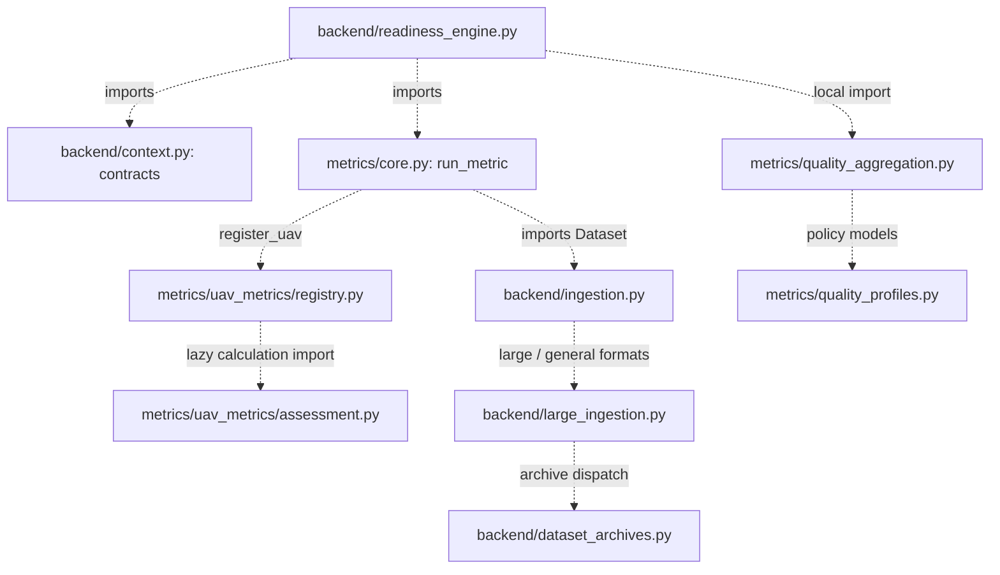

Every dashed edge here means an import dependency, not a claim that the caller executes the imported function on every request. Lazy imports and the metric registry mediate several runtime paths.

Sources: [backend/readiness\_engine.py](../backend/readiness_engine.py), [metrics/core.py](../metrics/core.py), [metrics/quality\_aggregation.py](../metrics/quality_aggregation.py), [backend/ingestion.py](../backend/ingestion.py), [backend/large\_ingestion.py](../backend/large_ingestion.py). [Open SVG](assets/architecture/dependency-core.svg) | [High-resolution PNG](assets/architecture/dependency-core.png)


<a id="diagram-dependency-workbench"></a>
### Figure: Workbench imports and runtime boundaries

<!-- diagram: dependency-workbench -->

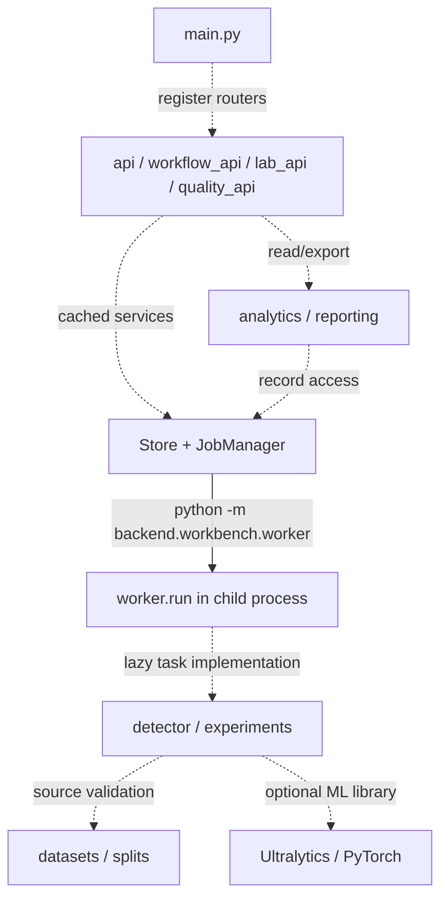

Dashed arrows mean imports. The solid arrow is process creation at runtime. The worker is a subprocess entry point, not a FastAPI endpoint or a second web server.

Sources: [main.py](../main.py), [backend/workbench/api.py](../backend/workbench/api.py), [backend/workbench/jobs.py](../backend/workbench/jobs.py), [backend/workbench/worker.py](../backend/workbench/worker.py), [backend/workbench/detector.py](../backend/workbench/detector.py). [Open SVG](assets/architecture/dependency-workbench.svg) | [High-resolution PNG](assets/architecture/dependency-workbench.png)


[Back to contents](#contents) | [Question map](#understand)


---

<a id="ch03"></a>

# 3. How the application starts

## Backend command and import-time behavior

```powershell
Set-Location C:\DataReadiness
.\.venv\Scripts\python.exe -m uvicorn main:app --host 127.0.0.1 --port 8000
```

Uvicorn imports `main.py` and locates `app`. The module optionally calls `load_dotenv()` unless `PYTHON_DOTENV_DISABLED=1`, declares the legacy in-memory dictionaries, creates the bounded legacy assessment executor, defines middleware/routes and registers the persistent routers. It mounts `frontend/dist` at `/` only if that directory exists at import time. Defining a route is not executing an assessment.

FastAPI then enters `lifespan`. `workbench.api.services()` is a cached singleton factory. `Store()` resolves `WORKBENCH_ROOT` (default `.runtime/workbench`), creates the directory and SQLite table, enables WAL/foreign-key pragmas and returns alongside `JobManager`. `recover()` audits records left running, verifies a retained worker PID before terminating that owned process, marks interrupted work and starts the queue. Shutdown closes the manager, waits for the legacy executor and closes transient datasets. The queue is local; there is no Redis, Celery, broker or distributed scheduler.

## Browser startup

`frontend/index.html` loads `src/main.tsx` during development; a built asset entry does the equivalent in production. The final `createRoot` branch mounts `Workbench` by default. `Workbench` creates one React Query client. `Shell` loads dataset selection and theme preferences, selects a destination from the URL hash, fetches datasets/jobs/compute and renders the guided component or an advanced tool. The guided component restores its selected project ID and requests the saved workflow from the backend.

`GET /api/health` is a light health check. `GET /api/v1/compute` calls the cached detector compute inspection and can take longer on first access because it imports the ML runtime. A physically present graphics device is not equivalent to `torch.cuda.is_available()`.

## Development frontend

```powershell
Set-Location C:\DataReadiness\frontend
npm.cmd run dev
```

Vite binds to loopback and proxies `/api` to `http://127.0.0.1:8000`. The frontend uses relative API URLs, so it works through the Vite proxy or the built FastAPI host. `npm.cmd run build` runs `tsc --noEmit` and Vite. The TypeScript aliases describe expected JSON shapes at development time; backend Pydantic models enforce their own HTTP boundary at runtime. No frontend development server is required to open the documentation HTML export.

<details>
<summary>Analogy: opening the laboratory for the day</summary>

Importing the module puts labels on doors and defines procedures. The lifespan hook unlocks the records room and checks whether yesterday's instrument run stopped unexpectedly. A visitor opening the browser asks reception for the current records. That does not itself start a new experiment.

</details>


<a id="diagram-startup-sequence"></a>
### Figure: Startup and the first browser visit

<!-- diagram: startup-sequence -->

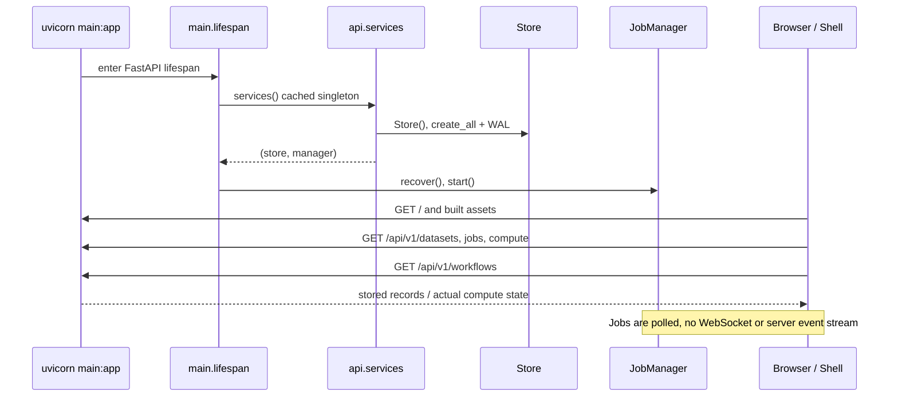

Starting the HTTP server creates the persistent services through lifespan. A production frontend is served only if frontend/dist existed when main.py imported. In development, Vite forwards /api requests instead.

Sources: [main.py](../main.py), [backend/workbench/api.py](../backend/workbench/api.py), [backend/workbench/jobs.py](../backend/workbench/jobs.py), [frontend/src/Workbench.tsx](../frontend/src/Workbench.tsx). [Open SVG](assets/architecture/startup-sequence.svg) | [High-resolution PNG](assets/architecture/startup-sequence.png)


**Chapter evidence:** [main.py](../main.py), [backend/workbench/api.py](../backend/workbench/api.py), [sql/store.py](../sql/store.py), [backend/workbench/jobs.py](../backend/workbench/jobs.py), [frontend/src/main.tsx](../frontend/src/main.tsx), [frontend/src/Workbench.tsx](../frontend/src/Workbench.tsx), [frontend/vite.config.ts](../frontend/vite.config.ts), [frontend/package.json](../frontend/package.json).


[Back to contents](#contents) | [Question map](#understand)


---

<a id="ch04"></a>

# 4. Frontend architecture and user actions

## Component map

`Workbench -> QueryClientProvider -> Shell` is the normal root. `Shell` offers three primary destinations: Dataset & goal, Readiness report and Model Validation Lab. A collapsed Workspace tools section exposes Overview, Datasets, Dataset Evaluation, Advanced Lab, Model Training, Experiments, Model Comparison, Research Analytics, Reports and Settings. Hash changes update navigation; navigation scrolls the document to the top.

`GuidedWorkflow` owns the selected project ID, mutation pending/error state and React Query reads for project lists/current project. It renders `DatasetUpload`, `GoalChat`, `ReadinessStep` or `GuidedValidation`. The top workflow navigation disables later stages until the saved goal and completed report exist. A direct sidebar/hash jump still renders a prerequisite explanation rather than an unlocked action.

`DatasetUpload.upload` sends an `XMLHttpRequest` because upload byte progress is needed. ZIP/file import uses multipart `file` and `metadata`; folder upload uses multiple `files` plus JSON `paths`. A local directory is a JSON POST through `api`. On success, a workflow record is created for the returned dataset ID. Transfer at 100% means bytes arrived; the server can still be parsing. The UI labels this state instead of pretending the analysis is complete.

`GoalChat.send` posts a message and the per-request remote-provider flag. The returned workflow updates the query cache. The interpreted context becomes an editable draft; the user can correct task, classes/target and description, answer questions and inspect all structured fields. A separate confirmation request saves the accepted context. Typing in a chatbox does not change the pipeline until the interpretation/confirmation actions complete. Unsubmitted text lives only in React state.

`ReadinessStep.run` sends assessment scope and split options. Before completion, it shows actual job stage text and optional worker details. After completion, `ReadinessSummary` shows requirement status and six dimensions; `ReportActions` prioritizes unmet requirements and recorded evidence gaps. Tabs reveal `QualityAnalytics` or the technical measurements/audit trail. An unknown dimension remains visibly unscored even when basic requirement checks pass.

`GuidedValidation` derives its phase from saved preparation, readiness and experiment records. The phases are data-change selection, changed-data measurement, training configuration, frozen-protocol review, actual execution and results. `ValidationResults` joins the experiment's evaluation/model IDs, displays original-versus-controlled metrics and passes DTOs to `BenchmarkCharts`. The research tab requests `/research?experiment_id=...`; its CSV export targets the same experiment. Advanced research tools remain an explicit opt-in.

## Requests, cache and local state

`api<T>(path, options)` prefixes `/api/v1`, fetches JSON and throws the backend `detail` on non-OK responses. `json(body, method)` serializes a request body and supplies the content-type header. There is no generated client SDK, GraphQL layer or frontend secret store. `Shell.act` and guided `perform` wrap async actions in busy/error handling and invalidate React Query after successful mutations. The guided uploader creates a new project only after an import returned an ID.

Server records are authoritative for saved goals, job state and results. Component state holds draft inputs, active tabs, selected comparison results and transient upload progress. `localStorage` keeps selected workflow, selected dataset and theme. `sessionStorage` keeps advanced Lab section selection and the original UI's last assessment ID. Existing synchronous storage reads can throw if browser storage is prohibited; the legacy hook guards its storage/history operations, while the guided Shell path has fewer such guards. That is a documented limitation, not a fix made for this guide.

Jobs are polled every two seconds by Shell. Guided project state uses three-second polling; validation/experiment reads use roughly 2.5 seconds. Individual logs/curves poll while running. The original `useAssessment` hook uses a separate 600 ms status loop, a slower retry after read errors and a separate completed-certificate effect so a cancelled polling request cannot discard a report. There are no sockets or streamed token responses.

## Visualizations and errors

Recharts receives plain arrays from saved DTOs: dimension score/weight arrays, actual histogram bins, loss CSV rows, per-class counts, PR curve coordinates and research points. React does not calculate a new dataset score by drawing a bar. `QualityAnalytics` submits recalculation requests; it does not rerun ingestion. `BenchmarkCharts` separates AP curves from operating-threshold error counts. Forms disable invalid/busy actions, `ErrorMessage` or local alerts surface request failures and empty states tell the reader which evidence is unavailable.

<details>
<summary>Analogy: a receptionist's notepad and the official archive</summary>

React state is the notepad while someone is speaking. React Query is a convenient copy of recently retrieved records. SQLite is the official archive. Saving a goal creates an archived record; switching tabs merely changes which page of the notepad is visible. Polling means asking the coordinator whether the instrument has finished.

</details>

## How the newer evidence reaches a chart

`readiness_engine._assess` passes serialized metric results to `uav_metrics.presentation.evidence_sections`. Its result is stored as `Certificate.quality_measurements.research_evidence`. `QualityAnalytics` mounts `ResearchEvidence`; the guided workflow reaches that same component through its **Quality & visual evidence** tab. There is one selected evidence view at a time rather than a separate assessment implementation in the browser.

Eight views cover object scale, local complexity, object clarity/contrast, whole-image degradation, independent audits, target negatives, conditional scenarios and collection independence. A selector chooses the quantity within a view. Each plot identifies its units/denominator, observed evidence type, sample size, coverage and provenance. Tables expose actual backend counts, including real zeros. Unsupported distributions show unavailable instead of an invented empty zero chart. The source/method disclosure retains sampling and calculation versions. Historical certificates remain readable and explicitly say when enhanced evidence was never collected.

Changing a card or plot reads stored evidence; it does not invoke another image scan, a language model or a training run. A newly requested assessment is the operation that recollects evidence. Configuring a scoring preview remains a distinct operation.


<a id="diagram-frontend-backend"></a>
### Figure: A browser action becomes a durable goal

<!-- diagram: frontend-backend -->

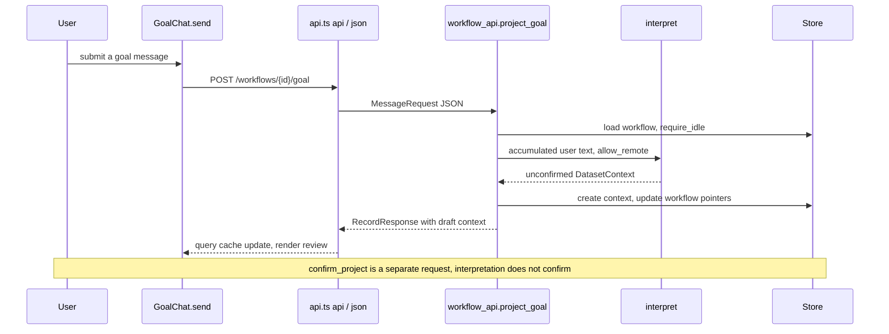

The JSON helper sets headers and serialization. The server saves the draft before returning it. GoalChat updates React Query, but the source of truth for saved goals is the server record.

Sources: [frontend/src/GuidedWorkflow.tsx](../frontend/src/GuidedWorkflow.tsx), [frontend/src/api.ts](../frontend/src/api.ts), [backend/workbench/workflow\_api.py](../backend/workbench/workflow_api.py), [backend/context\_extractor.py](../backend/context_extractor.py). [Open SVG](assets/architecture/frontend-backend.svg) | [High-resolution PNG](assets/architecture/frontend-backend.png)


### Source excerpt: api

[frontend/src/api.ts : api](../frontend/src/api.ts#L19)

```typescript
export async function api<T>(path:string, options:RequestInit={}):Promise<T>{
  const response=await fetch('/api/v1'+path,options);
  if(!response.ok){const body=await response.json().catch(()=>({detail:response.statusText}));throw new Error(typeof body.detail==='string'?body.detail:JSON.stringify(body.detail));}
  return response.json() as Promise<T>;
}
export const json=(body:unknown,method='POST'):RequestInit=>({method,headers:{'Content-Type':'application/json'},body:JSON.stringify(body)});
export const fmt=(value:unknown):string=>value===null||value===undefined?'Unavailable':typeof value==='number'?(Number.isInteger(value)?value.toLocaleString():value.toFixed(4)):typeof value==='object'?JSON.stringify(value):String(value);
```


**Chapter evidence:** [frontend/src/Workbench.tsx](../frontend/src/Workbench.tsx), [frontend/src/GuidedWorkflow.tsx](../frontend/src/GuidedWorkflow.tsx), [frontend/src/GuidedValidation.tsx](../frontend/src/GuidedValidation.tsx), [frontend/src/api.ts](../frontend/src/api.ts), [frontend/src/useAssessment.ts](../frontend/src/useAssessment.ts), [frontend/src/QualityAnalytics.tsx](../frontend/src/QualityAnalytics.tsx), [frontend/src/BenchmarkCharts.tsx](../frontend/src/BenchmarkCharts.tsx), [frontend/src/ResearchEvidence.tsx](../frontend/src/ResearchEvidence.tsx), [metrics/uav\_metrics/presentation.py](../metrics/uav_metrics/presentation.py).


[Back to contents](#contents) | [Question map](#understand)


---

<a id="ch05"></a>

# 5. Backend API and interface map

## Two HTTP families

`main.py` owns the original `/api` routes. Their datasets, interpretations and jobs are process-memory dictionaries, with owned staged files for large inputs. Restarting the backend loses those session IDs. Legacy jobs use `ThreadPoolExecutor(max_workers=2)` and cooperative cancellation through a threading Event.

The persistent workbench is split among four included routers plus the guided router: `workbench.api`, `quality_api`, `lab_api` and `workflow_api`, with `/api/v1` or `/api/v1/quality` prefixes. Their records live in Store. Submitting a persistent job creates a database record and starts an isolated process through JobManager. The static frontend mount comes after all these routers, so it does not intercept their API paths.

## HTTP boundary and error conversion

FastAPI parses multipart bodies or JSON and constructs the declared Pydantic request model. The shared `Model` forbids unknown fields and disallows nonfinite numbers in validated numeric fields. Generic `Any`/dictionary values need their additional domain checks and JSON serialization safeguards. Individual schemas add bounds, enum choices and model validators. This validates shape and some constraints; domain checks such as dataset hashes and train/test independence happen in service code.

`BodyLimitMiddleware` counts streamed request bytes. `ErrorRoute` wraps the persistent handler: missing record keys become 404, and value/filesystem/archive failures become 422. Schema failures also use FastAPI's 422 response. The original routes explicitly convert their own session/import errors and use 409 for unavailable/in-use resources, 429 for capacity and 413 for the middleware's body limit. A worker failure is usually a failed job record returned by a successful GET, not an HTTP 500 at the browser that originally queued it.

The request path is generally `component callback -> api/json or XHR -> FastAPI schema -> handler -> domain service -> Store/files -> JSON response -> React Query/state`. Export links use a direct browser GET and download the returned media type. No browser connects directly to SQLite or loads a checkpoint into the React process.

## Complete declared route map

The following inventory is generated from actual route decorators. Framework-provided `/docs`, `/redoc` and `/openapi.json` are not repository-declared handlers. Path aliases are listed separately. A `response_model` describes FastAPI serialization; handlers returning a Response may instead choose JSON, HTML, CSV, PDF or an image/checkpoint media type. Relevant consumer and service columns are a curated routing map, not an automatic claim that every syntactic callee executes on every branch.

### main.py

| Method / full path | Handler and actual boundary contract | Service calls and frontend consumer |
|---|---|---|
| `POST /api/context/interpret` | [main.py : context\_interpret](../main.py#L131); input `body:  InterpretRequest`; output `InterpretationResponse`; status 200 | Calls: HTTPException, app.post, body.tags.values, cleanup, context.model_copy, interpret, time.monotonic. Consumer: App / useAssessment (original UI). |
| `POST /api/datasets/upload` | [main.py : upload](../main.py#L141); input `file: UploadFile=File(...), metadata: str=Form('{}')`; output `UploadResponse`; status 200 | Calls: File, Form, HTTPException, ValueError, app.post, cleanup, file.file.close. Consumer: App / useAssessment (original UI). |
| `GET /api/datasets/{id}/profile` | [main.py : profile](../main.py#L161); input `id: str`; output `dict`; status 200 | Calls: app.get, get_dataset. Consumer: App / useAssessment (original UI). |
| `POST /api/datasets/{id}/select` | [main.py : select\_dataset](../main.py#L165); input `id: str, body:  DatasetSelection`; output `UploadResponse`; status 200 | Calls: HTTPException, Path, app.post, datasets[id].get, datasets[id].pop, ds.close, ds.profile.get. Consumer: App / useAssessment (original UI). |
| `DELETE /api/datasets/{id}` | [main.py : delete\_dataset](../main.py#L191); input `id: str`; output `Response / handler JSON; see body`; status 200 | Calls: HTTPException, any, app.delete, datasets.pop, datasets[id].get, ds.close, get_dataset. Consumer: App / useAssessment (original UI). |
| `POST /api/assessments` | [main.py : start](../main.py#L225); input `body:  AssessmentRequest`; output `JobResponse`; status 202 | Calls: Event, HTTPException, app.post, body.context.model_copy, cleanup, ds.profile.get, executor.submit. Consumer: App / useAssessment (original UI). |
| `GET /api/assessments/{id}` | [main.py : progress](../main.py#L253); input `id: str`; output `JobResponse`; status 200 | Calls: app.get, job_response. Consumer: App / useAssessment (original UI). |
| `GET /api/assessments/{id}/progress` | [main.py : progress](../main.py#L253); input `id: str`; output `JobResponse`; status 200 | Calls: app.get, job_response. Consumer: App / useAssessment (original UI). |
| `POST /api/assessments/{id}/cancel` | [main.py : cancel](../main.py#L256); input `id: str`; output `Response / handler JSON; see body`; status 200 | Calls: app.post, get_job, job['cancel'].set. Consumer: App / useAssessment (original UI). |
| `GET /api/assessments/{id}/certificate` | [main.py : certificate](../main.py#L262); input `id: str`; output `Certificate`; status 200 | Calls: HTTPException, app.get, get_job. Consumer: App / useAssessment (original UI). |
| `GET /api/assessments/{id}/export` | [main.py : export](../main.py#L268); input `id: str, format: Literal['json', 'html']=Query('json')`; output `Response / handler JSON; see body`; status 200 | Calls: HTMLResponse, JSONResponse, Query, app.get, cert.model_dump, certificate, html_report. Consumer: App / useAssessment (original UI). |
| `GET /api/health` | [main.py : health](../main.py#L274); input ``; output `Response / handler JSON; see body`; status 200 | Calls: app.get. Consumer: Health, upload limits or metric-definition consumers. |
| `GET /api/config` | [main.py : config](../main.py#L277); input ``; output `Response / handler JSON; see body`; status 200 | Calls: app.get, os.getenv. Consumer: Health, upload limits or metric-definition consumers. |
| `GET /api/metrics` | [main.py : metric\_registry](../main.py#L282); input ``; output `Response / handler JSON; see body`; status 200 | Calls: REGISTRY.items, app.get, definition.model_dump. Consumer: Health, upload limits or metric-definition consumers. |

### backend/workbench/api.py

| Method / full path | Handler and actual boundary contract | Service calls and frontend consumer |
|---|---|---|
| `GET /api/v1/compute` | [backend/workbench/api.py : compute\_status](../backend/workbench/api.py#L59); input ``; output `dict`; status 200 | Calls: cached_compute, router.get. Consumer: Shell / training device displays. |
| `GET /api/v1/overview` | [backend/workbench/api.py : overview](../backend/workbench/api.py#L64); input ``; output `dict`; status 200 | Calls: cached_compute, d['payload'].get, router.get, services, store.list. Consumer: Overview. |
| `POST /api/v1/datasets/import` | [backend/workbench/api.py : upload](../backend/workbench/api.py#L74); input `file: UploadFile=File(...), metadata: str=Form('{}')`; output `RecordResponse`; status 201 | Calls: File, Form, ValueError, file.file.close, import_file, router.post, services. Consumer: DatasetUpload / DatasetManager. |
| `POST /api/v1/datasets/directory-upload` | [backend/workbench/api.py : directory\_upload](../backend/workbench/api.py#L85); input `files: list[UploadFile]=File(...), paths: str=Form(...)`; output `RecordResponse`; status 201 | Calls: File, Form, PurePosixPath, PurePosixPath(name).is_absolute, ValueError, archive.open, file.file.close. Consumer: DatasetUpload / DatasetManager. |
| `POST /api/v1/datasets/register` | [backend/workbench/api.py : register](../backend/workbench/api.py#L112); input `body:  RegisterRequest`; output `RecordResponse`; status 201 | Calls: register_directory, router.post, services. Consumer: DatasetUpload / DatasetManager. |
| `GET /api/v1/datasets` | [backend/workbench/api.py : datasets](../backend/workbench/api.py#L117); input ``; output `list[RecordResponse]`; status 200 | Calls: d['payload'].get, router.get, services, services()[0].list. Consumer: Shell / dataset selectors. |
| `GET /api/v1/datasets/{id}` | [backend/workbench/api.py : dataset](../backend/workbench/api.py#L122); input `id: str`; output `RecordResponse`; status 200 | Calls: router.get, services, services()[0].get. Consumer: Dataset/library consumers. |
| `PATCH /api/v1/datasets/{id}` | [backend/workbench/api.py : rename](../backend/workbench/api.py#L127); input `id: str, body:  RenameRequest`; output `RecordResponse`; status 200 | Calls: router.patch, services, services()[0].get, services()[0].update. Consumer: DatasetManager. |
| `DELETE /api/v1/datasets/{id}` | [backend/workbench/api.py : delete](../backend/workbench/api.py#L133); input `id: str`; output `dict`; status 200 | Calls: HTTPException, router.delete, services, store.get, store.list, store.update. Consumer: DatasetManager. |
| `GET /api/v1/datasets/{id}/samples` | [backend/workbench/api.py : samples](../backend/workbench/api.py#L144); input `id: str, offset: int=Query(0, ge=0), limit: int=Query(12, ge=1, le=100)`; output `dict`; status 200 | Calls: Query, ds.frame.iloc[offset:offset + limit].to_json, load, router.get, services. Consumer: DatasetManager / sample viewer. |
| `GET /api/v1/datasets/{id}/image` | [backend/workbench/api.py : image](../backend/workbench/api.py#L156); input `id: str, image: str`; output `Response / handler JSON; see body`; status 200 | Calls: Image.open, Response, image_bytes, io.BytesIO, original.convert, output.getvalue, router.get. Consumer: Boxes / img URLs. |
| `POST /api/v1/datasets/{id}/splits` | [backend/workbench/api.py : split](../backend/workbench/api.py#L168); input `id: str, body:  SplitRequest`; output `RecordResponse`; status 201 | Calls: create_split, router.post, services. Consumer: TrainingPage; guided calls service via assess_project. |
| `GET /api/v1/splits` | [backend/workbench/api.py : splits](../backend/workbench/api.py#L173); input `dataset_id: str \| None=None`; output `list[RecordResponse]`; status 200 | Calls: router.get, services, services()[0].list. Consumer: SplitSelector / lab selection / ReadinessStep. |
| `POST /api/v1/context/interpret` | [backend/workbench/api.py : context](../backend/workbench/api.py#L178); input `body:  ContextRequest`; output `dict`; status 200 | Calls: ValueError, body.tags.values, interpret, result.model_dump, router.post, services, services()[0].create. Consumer: EvaluationPage. |
| `POST /api/v1/readiness` | [backend/workbench/api.py : readiness](../backend/workbench/api.py#L187); input `body:  ReadinessRequest`; output `RecordResponse`; status 202 | Calls: ValueError, body.context.model_dump, body.model_dump, get_split, manager.enqueue, router.post, services. Consumer: EvaluationPage; guided assess_project. |
| `POST /api/v1/context/validate` | [backend/workbench/api.py : validate\_context](../backend/workbench/api.py#L199); input `body:  DatasetContext`; output `DatasetContext`; status 200 | Calls: body.model_copy, reviewed.model_dump, router.post, services, services()[0].create. Consumer: EvaluationPage. |
| `POST /api/v1/training` | [backend/workbench/api.py : training](../backend/workbench/api.py#L206); input `body:  TrainRequest`; output `RecordResponse`; status 202 | Calls: body.model_dump, manager.enqueue, router.post, services, validate_training. Consumer: TrainingPage. |
| `POST /api/v1/evaluations` | [backend/workbench/api.py : model\_evaluation](../backend/workbench/api.py#L214); input `body:  TestRequest`; output `RecordResponse`; status 202 | Calls: assert_independent, body.model_dump, class_mapping, classes_for, manager.enqueue, router.post, services. Consumer: ComparisonPage. |
| `GET /api/v1/jobs` | [backend/workbench/api.py : jobs](../backend/workbench/api.py#L227); input ``; output `list[RecordResponse]`; status 200 | Calls: router.get, services, services()[0].list. Consumer: Shell job polling. |
| `GET /api/v1/jobs/{id}` | [backend/workbench/api.py : job](../backend/workbench/api.py#L232); input `id: str`; output `RecordResponse`; status 200 | Calls: router.get, services, services()[0].get. Consumer: Job consumers / diagnostics. |
| `POST /api/v1/jobs/{id}/cancel` | [backend/workbench/api.py : cancel](../backend/workbench/api.py#L237); input `id: str`; output `RecordResponse`; status 200 | Calls: router.post, services, services()[1].cancel. Consumer: JobPanel. |
| `GET /api/v1/jobs/{id}/logs` | [backend/workbench/api.py : logs](../backend/workbench/api.py#L242); input `id: str`; output `dict`; status 200 | Calls: max, path.exists, path.open, path.stat, router.get, services, source.read. Consumer: JobPanel. |
| `GET /api/v1/jobs/{id}/curves` | [backend/workbench/api.py : curves](../backend/workbench/api.py#L254); input `id: str`; output `list[dict]`; status 200 | Calls: Path, csv.DictReader, job.get, k.strip, path.exists, path.open, router.get. Consumer: JobPanel. |
| `GET /api/v1/models` | [backend/workbench/api.py : models](../backend/workbench/api.py#L265); input ``; output `list[RecordResponse]`; status 200 | Calls: router.get, services, services()[0].list. Consumer: Experiments / ComparisonPage / ValidationResults. |
| `GET /api/v1/models/{id}/artifact` | [backend/workbench/api.py : artifact](../backend/workbench/api.py#L270); input `id: str`; output `Response / handler JSON; see body`; status 200 | Calls: FileResponse, router.get, services, services()[0].get. Consumer: JobPanel checkpoint link. |
| `GET /api/v1/evaluations` | [backend/workbench/api.py : evaluations](../backend/workbench/api.py#L276); input ``; output `list[RecordResponse]`; status 200 | Calls: router.get, services, services()[0].list. Consumer: ComparisonPage / ValidationResults. |
| `GET /api/v1/evaluations/{id}/predictions` | [backend/workbench/api.py : predictions](../backend/workbench/api.py#L281); input `id: str, offset: int=Query(0, ge=0), limit: int=Query(1, ge=1, le=20)`; output `dict`; status 200 | Calls: Path, Query, router.get, services, services()[0].get. Consumer: ComparisonPage. |
| `POST /api/v1/comparisons` | [backend/workbench/api.py : compare](../backend/workbench/api.py#L288); input `evaluation_ids: list[str]`; output `RecordResponse`; status 201 | Calls: ValueError, comparison, router.post, services, store.create. Consumer: ComparisonPage audit. |
| `GET /api/v1/research` | [backend/workbench/api.py : analytics](../backend/workbench/api.py#L296); input `metric: str \| None=None, performance: str='mAP50_95', test_sha256: str \| None=None, configuration: str \| None=None, dataset_id: str \| None=None, scenario: str \| None=None, experiment_id: str \| None=None`; output `dict`; status 200 | Calls: ValueError, research, router.get, services, store.get, store.get(experiment_id, 'experiment')['payload'].get. Consumer: Analytics (optional experiment_id scope). |
| `POST /api/v1/variations` | [backend/workbench/api.py : variations](../backend/workbench/api.py#L305); input `body:  VariantRequest`; output `RecordResponse`; status 201 | Calls: router.post, services, variation. Consumer: Analytics controlled-data tool. |
| `GET /api/v1/reports/{id}` | [backend/workbench/api.py : report](../backend/workbench/api.py#L323); input `id: str, format: str=Query('json', pattern='^(json\|csv\|html\|pdf)$')`; output `Response / handler JSON; see body`; status 200 | Calls: Certificate.model_validate, HTMLResponse, JSONResponse, Query, Response, ValueError, csv_response. Consumer: Report/Export links; original/saved/experiment scopes. |
| `POST /api/v1/reports/{id}/score` | [backend/workbench/api.py : score\_preview](../backend/workbench/api.py#L365); input `id: str, body:  ScorePreviewRequest`; output `dict`; status 200 | Calls: Certificate.model_validate, ValueError, aggregate, calculate, enabled, get_split, load. Consumer: ExperimentalScore. |
| `GET /api/v1/research/export` | [backend/workbench/api.py : research\_export](../backend/workbench/api.py#L388); input `format: str=Query('json', pattern='^(json\|csv\|html\|pdf)$')`; output `Response / handler JSON; see body`; status 200 | Calls: HTMLResponse, JSONResponse, Query, Response, csv_response, document, html_document. Consumer: Reports / advanced Analytics. |
| `GET /api/v1/settings` | [backend/workbench/api.py : settings](../backend/workbench/api.py#L406); input ``; output `dict`; status 200 | Calls: os.getenv, router.get, services. Consumer: SettingsPage. |

### backend/workbench/workflow_api.py

| Method / full path | Handler and actual boundary contract | Service calls and frontend consumer |
|---|---|---|
| `GET /api/v1/context/provider` | [backend/workbench/workflow\_api.py : provider\_status](../backend/workbench/workflow_api.py#L73); input ``; output `dict`; status 200 | Calls: os.getenv, os.getenv('CONTEXT_PROVIDER', '').strip, os.getenv('CONTEXT_PROVIDER', '').strip().lower, os.getenv('GEMINI_API_KEY', '').strip, router.get. Consumer: GoalChat / SettingsPage. |
| `POST /api/v1/workflows` | [backend/workbench/workflow\_api.py : create\_project](../backend/workbench/workflow_api.py#L82); input `body:  ProjectRequest`; output `RecordResponse`; status 201 | Calls: router.post, services, store.create, store.get. Consumer: GuidedWorkflow project create/list/restore. |
| `GET /api/v1/workflows` | [backend/workbench/workflow\_api.py : projects](../backend/workbench/workflow_api.py#L90); input ``; output `list[RecordResponse]`; status 200 | Calls: router.get, services, services()[0].list. Consumer: GuidedWorkflow project create/list/restore. |
| `GET /api/v1/workflows/{id}` | [backend/workbench/workflow\_api.py : get\_project](../backend/workbench/workflow_api.py#L95); input `id: str`; output `RecordResponse`; status 200 | Calls: router.get, services, services()[0].get. Consumer: GuidedWorkflow project create/list/restore. |
| `POST /api/v1/workflows/{id}/goal` | [backend/workbench/workflow\_api.py : project\_goal](../backend/workbench/workflow_api.py#L100); input `id: str, body:  MessageRequest`; output `RecordResponse`; status 200 | Calls: '\n\n'.join, ValueError, body.message.strip, interpret, project, require_idle, result.model_dump. Consumer: GoalChat.send. |
| `POST /api/v1/workflows/{id}/confirm` | [backend/workbench/workflow\_api.py : confirm\_project](../backend/workbench/workflow_api.py#L116); input `id: str, body:  ConfirmRequest`; output `RecordResponse`; status 200 | Calls: ValueError, context.model_dump, data.get, project, require_idle, router.post, services. Consumer: GoalChat review button. |
| `POST /api/v1/workflows/{id}/assess` | [backend/workbench/workflow\_api.py : assess\_project](../backend/workbench/workflow_api.py#L132); input `id: str, body:  AssessRequest`; output `RecordResponse`; status 202 | Calls: DatasetContext.model_validate, ReadinessRequest, ValueError, create_split, data.get, get_split, project. Consumer: ReadinessStep.run. |
| `POST /api/v1/workflows/{id}/validation/prepare` | [backend/workbench/workflow\_api.py : prepare\_validation](../backend/workbench/workflow_api.py#L158); input `id: str, body:  PrepareRequest`; output `RecordResponse`; status 202 | Calls: DatasetContext.model_validate, SplitRequest, ValueError, VariantRequest, body.model_dump, context.model_dump, create_split. Consumer: GuidedValidation.prepare. |
| `GET /api/v1/workflow-validations/{id}` | [backend/workbench/workflow\_api.py : get\_validation](../backend/workbench/workflow_api.py#L184); input `id: str`; output `RecordResponse`; status 200 | Calls: router.get, services, services()[0].get. Consumer: GuidedValidation polling. |
| `POST /api/v1/workflows/{id}/validation/reset` | [backend/workbench/workflow\_api.py : reset\_validation](../backend/workbench/workflow_api.py#L189); input `id: str`; output `RecordResponse`; status 200 | Calls: project, require_idle, router.post, services, store.update. Consumer: GuidedValidation reset buttons. |
| `POST /api/v1/workflows/{id}/validation/protocol` | [backend/workbench/workflow\_api.py : validation\_protocol](../backend/workbench/workflow_api.py#L198); input `id: str, body:  ProtocolRequest`; output `RecordResponse`; status 201 | Calls: ExperimentRequest, TrainRequest, ValueError, create_experiment, data.get, project, router.post. Consumer: GuidedValidation.protocol. |

### backend/workbench/quality_api.py

| Method / full path | Handler and actual boundary contract | Service calls and frontend consumer |
|---|---|---|
| `GET /api/v1/quality/registry` | [backend/workbench/quality\_api.py : registry](../backend/workbench/quality_api.py#L42); input ``; output `dict`; status 200 | Calls: REGISTRY.items, c.model_dump, definition.model_dump, load_profile, router.get. Consumer: QualityAnalytics; AggregationField for history; registry API consumers. |
| `GET /api/v1/quality/profiles` | [backend/workbench/quality\_api.py : profiles](../backend/workbench/quality_api.py#L57); input ``; output `dict`; status 200 | Calls: load_profile, load_profile().model_dump, router.get. Consumer: QualityAnalytics; AggregationField for history; registry API consumers. |
| `POST /api/v1/quality/aggregate` | [backend/workbench/quality\_api.py : aggregate](../backend/workbench/quality_api.py#L62); input `body:  AggregationRequest`; output `dict`; status 200 | Calls: aggregate_quality, body.model_dump, cert.get, cert.get('reproducibility', {}).get, certificate, frozen.get, result.update. Consumer: QualityAnalytics; AggregationField for history; registry API consumers. |
| `GET /api/v1/quality/history` | [backend/workbench/quality\_api.py : history](../backend/workbench/quality_api.py#L78); input `readiness_id: str \| None=None`; output `list[RecordResponse]`; status 200 | Calls: router.get, store, store().list. Consumer: QualityAnalytics; AggregationField for history; registry API consumers. |
| `GET /api/v1/quality/{readiness_id}/dimensions` | [backend/workbench/quality\_api.py : dimensions](../backend/workbench/quality_api.py#L83); input `readiness_id: str`; output `dict`; status 200 | Calls: aggregate_quality, cert.get, certificate, router.get. Consumer: QualityAnalytics; AggregationField for history; registry API consumers. |
| `POST /api/v1/quality/compare` | [backend/workbench/quality\_api.py : compare](../backend/workbench/quality_api.py#L89); input `body:  ComparisonRequest`; output `dict`; status 200 | Calls: ValueError, aggregate, any, c.model_copy, router.post. Consumer: QualityAnalytics; AggregationField for history; registry API consumers. |
| `POST /api/v1/quality/sensitivity` | [backend/workbench/quality\_api.py : sensitivity](../backend/workbench/quality_api.py#L98); input `body:  AggregationRequest`; output `dict`; status 200 | Calls: aggregate, body.dimension_weights.get, body.model_copy, deterioration.append, geometric, metric['definition'].get, results.append. Consumer: QualityAnalytics; AggregationField for history; registry API consumers. |

### backend/workbench/lab_api.py

| Method / full path | Handler and actual boundary contract | Service calls and frontend consumer |
|---|---|---|
| `GET /api/v1/experiments` | [backend/workbench/lab\_api.py : experiments](../backend/workbench/lab_api.py#L20); input ``; output `list[RecordResponse]`; status 200 | Calls: router.get, services, services()[0].list. Consumer: ExperimentBuilder / GuidedValidation. |
| `POST /api/v1/experiments` | [backend/workbench/lab\_api.py : create\_experiment](../backend/workbench/lab_api.py#L25); input `body:  ExperimentRequest`; output `RecordResponse`; status 201 | Calls: body.model_dump, router.post, services, store.create, validate_experiment. Consumer: ExperimentBuilder / GuidedValidation. |
| `GET /api/v1/experiments/{id}` | [backend/workbench/lab\_api.py : experiment](../backend/workbench/lab_api.py#L33); input `id: str`; output `RecordResponse`; status 200 | Calls: router.get, services, services()[0].get. Consumer: ExperimentBuilder / GuidedValidation. |
| `POST /api/v1/experiments/{id}/start` | [backend/workbench/lab\_api.py : start\_experiment](../backend/workbench/lab_api.py#L38); input `id: str`; output `RecordResponse`; status 202 | Calls: ExperimentRequest.model_validate, ValueError, manager.enqueue, router.post, services, store.get, store.update. Consumer: ExperimentBuilder / GuidedValidation. |
| `POST /api/v1/benchmarks/external` | [backend/workbench/lab\_api.py : external\_benchmark](../backend/workbench/lab_api.py#L68); input `body:  ExternalBenchmarkRequest`; output `RecordResponse`; status 201 | Calls: body.model_dump, router.post, services, services()[0].create. Consumer: PublishedBenchmarks. |
| `GET /api/v1/benchmarks/external` | [backend/workbench/lab\_api.py : external\_benchmarks](../backend/workbench/lab_api.py#L75); input ``; output `list[RecordResponse]`; status 200 | Calls: router.get, services, services()[0].list. Consumer: PublishedBenchmarks. |
| `POST /api/v1/models/import` | [backend/workbench/lab\_api.py : import\_model](../backend/workbench/lab_api.py#L87); input `body:  ImportModelRequest`; output `RecordResponse`; status 201 | Calls: Path, ValueError, body.training.model_dump, file_sha, model.names.values, router.post, services. Consumer: ExperimentBuilder checkpoint import. |
| `POST /api/v1/jobs/{id}/resume` | [backend/workbench/lab\_api.py : resume](../backend/workbench/lab_api.py#L118); input `id: str`; output `RecordResponse`; status 202 | Calls: Path, ValueError, any, checkpoint.is_file, j['payload']['config'].get, job.get, manager.enqueue. Consumer: JobPanel resume button. |


**Chapter evidence:** [main.py](../main.py), [backend/workbench/api.py](../backend/workbench/api.py), [backend/workbench/contracts.py](../backend/workbench/contracts.py), [backend/workbench/workflow\_api.py](../backend/workbench/workflow_api.py), [backend/workbench/quality\_api.py](../backend/workbench/quality_api.py), [backend/workbench/lab\_api.py](../backend/workbench/lab_api.py).


[Back to contents](#contents) | [Question map](#understand)


---

<a id="ch06"></a>

# 6. Dataset ingestion and storage

## From bytes to a Dataset

Both APIs ultimately use existing ingestion adapters. The workbench calls `datasets.import_file` with a file handle. It delegates to `load_dataset_stream`, then persists a normalized Dataset and a managed source. Registering a local directory uses `DirectoryArchive`, a read-only archive-like adapter that rejects links/junctions and paths outside the resolved root. It initially copies no images. The parser still decodes/profiles the source; later training materializes verified bytes into managed cache files.

`Dataset` is an in-process dataclass with `name`, `sha256`, `modality`, `frame`, `profile`, metadata, canonical `objects`, issues, hashes, near-duplicate evidence, optional `disk_path`, ownership, source path and an optional runtime-only `image_reader` capability. It is not itself a database row. For ordinary in-memory data, `frame` is the full pandas table. When `disk_path` is set, `frame` is only a bounded display preview, and full-data checks must query DuckDB.

`Dataprofiler.profile()` produces a `DataProfile`; converting it to a dict gives observed row/column counts, missingness, duplicate rows, finite numeric summaries, selected categorical counts and date diagnostics. It keeps missing values distinct from infinity and does not silently coerce invalid measurements into scientific truth. Image loaders extend the profile with format, class counts, declared classes, issues and source interpretation.

## Table and record dispatch

`load_dataset_stream` stages incoming bytes using bounded reads and configured upload limits. Smaller CSV/Parquet inputs can take the in-memory path. Large tables use batches and a private DuckDB table, with an owned spill directory, configurable memory/threads and internally generated SQL column identifiers. `full_profile` queries the entire table. A 100-row frame is for display, not a statistical sample used to replace whole-data calculations.

`record_formats.prepare_records` selects an adapter. CSV/TSV/tab/pipe-like data uses declared or detected delimiters and strict structure. Text can be one line or one document per record. JSON/JSONL rejects invalid constants, duplicate keys and ambiguous structures; nested values are represented consistently with parsing notes. XML uses defused parsing with entity/DTD restrictions and a chosen record path. XLSX reads cells without executing formulas, requires an unambiguous sheet and nonempty unique headers. Arrow/Feather use record batches. Unsupported or ambiguous sources report a selection requirement or ingestion error.

Encoding is evidence too. BOMs identify UTF encodings, otherwise strict UTF-8 is preferred; a recorded Windows-1252 fallback can handle legacy spreadsheet text. An explicit declared encoding is not silently overridden. Invalid bytes, binary controls and oversized logical records fail rather than being discarded. A successfully decoded string does not by itself prove that the language/encoding interpretation is semantically correct.

## Containers and images

`load_container` validates members before choosing a dataset. ZIP/TAR/compressed inputs are inspected without executing bundled code. Member count, expanded size, compression ratios, unsafe names and links are checked. Nested archive depth is bounded. Multiple plausible tables/image layouts require an explicit choice rather than automatically mixing train and test files. The original UI exposes `/datasets/{id}/select`; the workbench import surfaces an error and accepts parser metadata on a new import. This difference is important when troubleshooting a downloaded repository archive.

For labeled images, `image_ingestion.inspect_image` decodes one image, caches dimensions and proxy pixel measurements and hashes original bytes. `parse_yolo` checks class indices and normalized box coordinates. `parse_visdrone` preserves the distinction between ignored regions and target boxes. `universal_images` reads COCO, Pascal VOC, ImageFolder, YAML/names YOLO and unlabelled inputs, resolves image references and converts supported target geometry to normalized `(x_center, y_center, width, height)` boxes. Source-specific crowd/ignore semantics remain documented; canonical conversion does not make final evaluation an official COCO evaluator.

An empty annotation file is an explicit annotated negative. A missing annotation file is unknown label availability. Valid syntax does not establish that every visible object is labelled or the class is correct. ImageFolder names are inferred classification labels and require review. Single unlabelled images can be inspected without inventing labels. These data can support readiness analysis even when detector training is ineligible.

## Persistence and mutability

`persist` writes `frame.json` (pandas table orientation), `evidence.json` and, for disk tables, `table.duckdb`. The dataset record contains source paths/kind, profile, SHA256/version, eligibility/reasons and provenance. `load` reconstructs Dataset from these files. `image_bytes` accepts only a member in the saved manifest and verifies its hash. Training verifies bytes again. A registered external directory is mutable outside the app; a changed source must be imported as another snapshot.

`subset` filters an image Dataset to the exact selected training names, filters objects/hashes/issues, recomputes its profile and records training-only scope and identity. `combined_readiness` constructs a virtual union of both source training subsets, namespaces image paths and reassesses the whole combined population. It retains only compatible common metadata and does not treat one source's independent audit as an audit of the union.

<details>
<summary>Analogy: inventory cards and specimen boxes</summary>

The Dataset object is a working inventory card. A pandas frame is the table written on that card; a disk-backed Dataset instead points to a large ledger and carries a small preview. Store persists the card's serializable evidence and the ledger's location. It does not cram every specimen into a SQLite blob. Hashes are tamper-evidence labels: they reveal changed bytes, but do not authenticate who originally collected them.

</details>

## Cached global pixels, local reads and correctly scoped audits

`inspect_image` stores a hexadecimal `dhash64` derived from the same 9x8 grayscale comparison used by the split service. It also calls `pixel_features` once on the existing <=256-pixel proxy to cache protected `research_*` global fields. Brightness, contrast, entropy, historical Laplacian variance and bytes/pixel keep their earlier semantics. Metadata merging cannot replace these computed fields.

`datasets.load` supplies an in-process reader built from `image_source`. It can read verified managed archives, registered directories or virtual combined sources. The capability is never serialized into evidence.json and never supplied as uploaded executable code. `subset` preserves the reader but filters the frame, objects and hashes to selected images. A local object inspection can therefore obtain only its chosen source members. It checks image hashes/dimensions and decode budgets again, then shares one bounded result across UAV-12/14 within the assessment session.

`subset` deep-copies metadata. A structured independent audit bound to the parent (or not yet bound) is filtered to selected image names, receives the subset fingerprint and records the parent audit/source fingerprint. Whole-population count summaries are removed from that derived audit. An unscoped count-only audit is unavailable for a new subset instead of being extrapolated. Candidate hard-negative image records are similarly filtered. The parent dataset and historical certificate are unchanged. Combined readiness keeps original source audits in provenance and does not promote them into a union-wide audit; local pixel readers can still inspect the union's namespaced sources.

Older frame caches may lack the new global fields or dHash. Their absence is unavailable evidence; the code does not fill it with zero or decode an unbounded archive simply to manufacture a complete result. Reimporting a source collects the new ingestion fields. Reassessment can collect available bounded local evidence under its recorded configuration.


<a id="diagram-dataset-ingestion"></a>
### Figure: Uploaded bytes become a normalized Dataset

<!-- diagram: dataset-ingestion -->

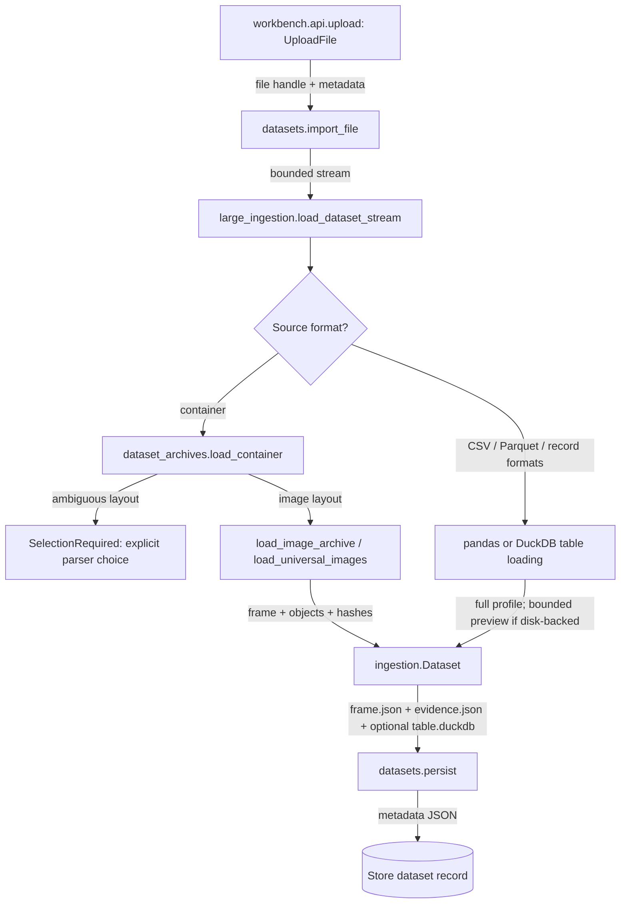

Intake normalizes data without running uploaded source code. The legacy /api route exposes a selection endpoint for ambiguous archives; the persistent workbench requires parser options on import and does not offer that same selection wizard. Inspection now caches dhash64 and global research_* proxies. Scoped dataset metadata preserves independent audit provenance; local crop/ring inspection is a later bounded assessment operation.

Sources: [backend/workbench/api.py](../backend/workbench/api.py), [backend/workbench/datasets.py](../backend/workbench/datasets.py), [backend/large\_ingestion.py](../backend/large_ingestion.py), [backend/dataset\_archives.py](../backend/dataset_archives.py), [backend/universal\_images.py](../backend/universal_images.py). [Open SVG](assets/architecture/dataset-ingestion.svg) | [High-resolution PNG](assets/architecture/dataset-ingestion.png)


<a id="diagram-large-data"></a>
### Figure: Large tables: preview and full-data checks are different

<!-- diagram: large-data -->

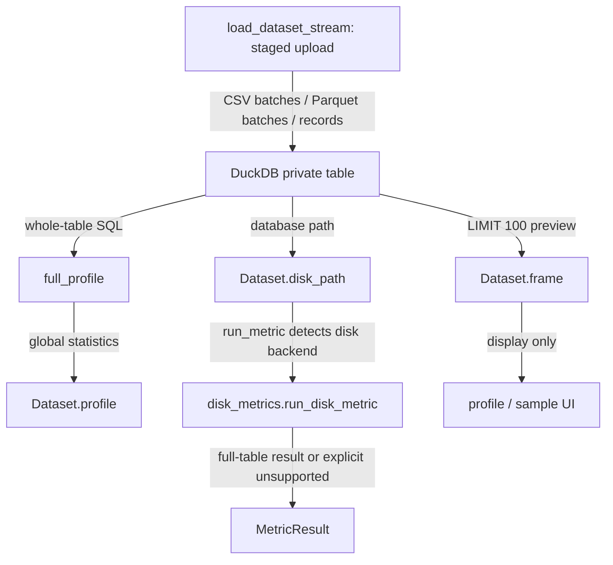

The browser preview is not the statistical population. Disk metrics query the stored table; UAV properties that lack a full-data disk implementation report unsupported evidence rather than scoring the preview.

Sources: [backend/large\_ingestion.py](../backend/large_ingestion.py), [metrics/disk\_metrics.py](../metrics/disk_metrics.py), [metrics/core.py](../metrics/core.py), [metrics/uav\_metrics/assessment.py](../metrics/uav_metrics/assessment.py). [Open SVG](assets/architecture/large-data.svg) | [High-resolution PNG](assets/architecture/large-data.png)


**Chapter evidence:** [backend/ingestion.py](../backend/ingestion.py), [backend/large\_ingestion.py](../backend/large_ingestion.py), [backend/record\_formats.py](../backend/record_formats.py), [backend/dataset\_archives.py](../backend/dataset_archives.py), [backend/image\_ingestion.py](../backend/image_ingestion.py), [backend/universal\_images.py](../backend/universal_images.py), [backend/workbench/datasets.py](../backend/workbench/datasets.py), [backend/workbench/combined.py](../backend/workbench/combined.py).


[Back to contents](#contents) | [Question map](#understand)


---

<a id="ch07"></a>

# 7. Natural language becomes a confirmed goal

## The contract is Goal inside DatasetContext

`Goal` describes the task, target, required/optional/excluded inputs, class requirements, environment, scenarios, units, ranges, missingness constraints, provenance needs, partition/group fields, UAV parameters, performance objectives and quality policy. `DatasetContext` wraps it with `original_text`, selected tags, field-source labels, questions, provider and the `confirmed` flag. Required/optional/excluded inputs cannot overlap, duplicate requirement IDs fail and numerical ranges/fractions are checked by validators.

In the guided workflow, `project_goal` appends the latest user message to the project's saved messages and joins the user texts, bounded to 12,000 characters. It calls `interpret(text, {}, allow_remote=...)`. The advanced and original forms can additionally supply tag categories. No dataset images, full tables or managed source files are passed as provider input. The saved context points back to the wording, not to an imagined perfect outcome.

## Deterministic interpretation and optional providers

`interpret` first rejects a limited set of instruction-override patterns; the code explicitly states that such a filter cannot prove the absence of prompt injection. It builds a conservative fallback from task/tag vocabulary, environment terms, explicit ranges and known targets. Conflicting tasks or tags become questions. Missing target/class information becomes questions. It does not invent a minimum training sample count, altitude range or desired recall value.

Provider selection reads configuration presence from the backend environment. A configured Gemini key/provider selects `GeminiProvider`; explicit or compatible historical model settings can select `OpenAICompatibleProvider`. `allow_remote=False` avoids provider use. `GeminiProvider.extract` sends one REST request with the key in a header, task text/tags serialized as data, zero temperature and JSON output. It validates finish state and parses the response as DatasetContext. The compatible provider sends a schema-oriented chat request. These adapters have no dataset tools or executable capabilities. Their type contract alone does not make every inferred claim correct.

The provider output is reset to the original user text/tags and unconfirmed state. Numerical values in selected requirement-related fields must occur in the user's wording, including percentage equivalents; deterministic conflict questions are retained. Any provider exception or invalid output yields the identified local fallback. The numerical grounding pass covers the listed fields in `interpret`; it is not a universal proof against all possible semantic mistakes in free-form dictionaries. Human review still matters.

## Confirmation and reuse

`confirm_project` requires the latest original text, a concrete task, no unresolved questions and `confirmed=True`. It creates another context record and updates `confirmed_context_id`. The exact confirmed context is later reconstructed with `DatasetContext.model_validate`, placed in the readiness job configuration and embedded in the resulting Certificate. A user revision creates a new context and clears the current assessment/validation pointers. Historical records are preserved. The guided action lock and `require_idle` prevent revising the current study while its analysis or validation compute is active.

The goal is persisted in the existing SQLite JSON records, not in a separate magically discovered goal file. The original transient API instead keeps an interpretation in its session dictionary. Model-performance objectives remain recorded context unless independent training/test evidence establishes them; saying “high accuracy” in chat does not calculate accuracy.

<details>
<summary>Analogy: approving a research brief</summary>

The interpreter is a draft writer. It proposes the question and required conditions. The user is the person who signs the brief. The lab instruments measure against that signed version, even if the user later writes a different draft. Saving the signed brief with the results makes it possible to ask which finish line the experiment actually used.

</details>


<a id="diagram-context-interpretation"></a>
### Figure: Text interpretation, validation and explicit confirmation

<!-- diagram: context-interpretation -->

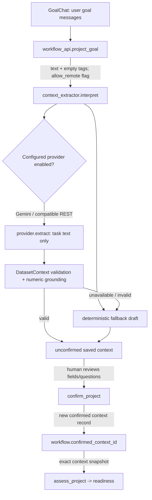

There is no automatic confirmation by a model. The fallback remains explicit, clarification questions can block analysis, and external responses must pass the local schema. No uploaded dataset files are sent to the interpreter.

Sources: [backend/context\_extractor.py](../backend/context_extractor.py), [backend/context.py](../backend/context.py), [backend/workbench/workflow\_api.py](../backend/workbench/workflow_api.py), [frontend/src/GuidedWorkflow.tsx](../frontend/src/GuidedWorkflow.tsx). [Open SVG](assets/architecture/context-interpretation.svg) | [High-resolution PNG](assets/architecture/context-interpretation.png)


<a id="diagram-object-lifecycle"></a>
### Figure: The lifetime of a confirmed goal

<!-- diagram: object-lifecycle -->

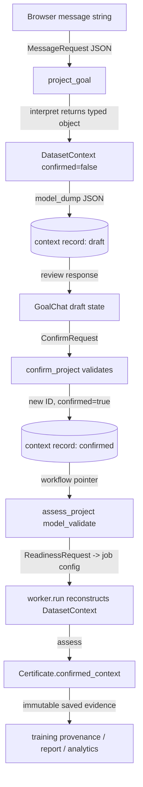

The goal moves through Python validation objects, JSON records and React state. A new interpretation clears current workflow result pointers, but historical context records and jobs remain. Editing is blocked while current compute is active.

Sources: [backend/context.py](../backend/context.py), [backend/workbench/workflow\_api.py](../backend/workbench/workflow_api.py), [backend/workbench/worker.py](../backend/workbench/worker.py), [backend/readiness\_engine.py](../backend/readiness_engine.py). [Open SVG](assets/architecture/object-lifecycle.svg) | [High-resolution PNG](assets/architecture/object-lifecycle.png)


**Chapter evidence:** [backend/context.py](../backend/context.py), [backend/context\_extractor.py](../backend/context_extractor.py), [backend/workbench/workflow\_api.py](../backend/workbench/workflow_api.py), [backend/workbench/api.py](../backend/workbench/api.py).


[Back to contents](#contents) | [Question map](#understand)


---

<a id="ch08"></a>

# 8. Metrics: measurements before decisions

## What a metric returns

A `MetricResult` carries a metric ID, dimension, state, value, reason and `AssessmentEvidence`, with optional measurement status, unit, scope, provenance, estimation method and limitations. Evidence includes the calculation method, sample size, bounded references and details. A plain diagnostic `state='pass'` often means the calculation produced observed evidence without an acceptance threshold. It is not a claim that the dataset meets an unstated requirement. `evaluate` is the separate operation that compares a measured value with an explicit Requirement.

`@metric(...)` stores a `MetricDefinition` in `REGISTRY` and its function in `CALCULATIONS`. UAV property registration creates a closure for each stable ID. `run_metric` is the public dispatcher: it handles unknown IDs, modality applicability, UAV structured output-path extraction, full-data disk dispatch and ordinary calculations. MissingEvidence becomes insufficient evidence. Calculation exceptions become an error result rather than a fabricated number. UAV estimated output paths retain their estimated status. Projection refuses unavailable parent/submeasurements and unverified semantic status leaves; an inspection count of zero is not substituted for an unavailable quality measurement.

## The exact active order

`assess` enters a visual-session context and calls `_assess`. The engine verifies confirmation/questions, compiles Goal requirements and adds relevant image/manifest checks. It evaluates requirements in list order. Then it executes the `DIAGNOSTICS` list below in its declared order. For image datasets, object-detection/tracking/telemetry tasks or explicit UAV parameters, it appends `PROPERTY_IDS`, namely UAV-01 through UAV-20 in registry order. This is the actual check order, not a list of all registered functions sorted by filename.

After measurement, `learning_views` assembles six interpretations supported by property IDs. Modality conflicts add explicit findings. `decide` makes the requirement decision. The engine calculates the provisional scalar, builds the certificate/reproducibility record, collects cached pixel distributions and calculates the adaptive profile. Requirement checks and diagnostics can invoke the same metric more than once; they are not a single globally memoized metric pass. Optional image model work has its own bounded session behavior. New object-local pixel measurements reuse that same assessment-local session cache, so UAV-12 and UAV-14 share their image decodes. After cached ingestion distributions, the engine also stores evidence_sections from the actual metric results before adaptive aggregation.

## Supported evidence by modality

Tables support missingness, finite-value/type/range checks, class/label evidence when a target is declared, duplication, selected leakage/provenance checks and corresponding-reference comparisons. Text documents enter as tabular records such as a `text` column; there is no general-purpose language-model semantic text-quality judge. Image inputs add decode evidence, labels/boxes, image hashes, geometry and cached pixel proxies. Telemetry is represented by declared tabular columns and metadata, not by a proprietary flight-log driver.

UAV properties include recorded scene/weather/time/season/viewpoint/altitude, annotated object geometry and density, clarity proxies, audit evidence, deployment-reference differences, collection independence, sensor mappings and temporal ordering. Optional local ONNX models can provide estimated scene/appearance/embedding evidence only when explicitly configured. No default external model download is used to fabricate missing metadata. Metadata presence is not authentication, sensor calibration presence is not validity and static-image appearance is not recorded capture time.

Disk-backed tables take the SQL path for implemented metrics. `uav_metrics.assessment.calculate` explicitly reports unsupported for its disk-backed metadata/temporal summaries rather than evaluating the small frame preview. Some whole-data reference-distance checks are likewise unavailable in `disk_metrics`. The exact registry and status descriptions below expose those distinctions.

## The older helper analyzers

`Dataprofiler` supplies general observed profile statistics. `FeatureAnalyzer.analyze` detects constant/dominant features, numeric correlations and a feature identical to the target; it records that mutual information requires a declared estimator configuration and does not compute it. `LabelAnalyzer.analyze` computes label proportions, missingness, largest/smallest observed-class ratio and optional raw agreement/Cohen's kappa on paired nonmissing labels. `ISOIECchecker` can calculate profile-only completeness/uniqueness/conformity, but its accuracy, rich consistency and provenance checks deliberately lack enough evidence and return None. It is not the active engine just because its filename sounds authoritative.

## Measurement mathematics in concrete terms

The denominator is part of a result. A column's missing fraction is missing cells divided by rows; a nonfinite rate inspects the selected numeric population; unreadable-image rate divides failed decodes by image count. Duplicate rate counts repeated occurrences after the first, divided by records/images. For 10 observations with two redundant repeats, duplicate rate is 0.2 and criterion uniqueness is 80/100. `bbox_invalid_rate` divides annotated images containing malformed target annotations by images that have annotation files; it is not malformed boxes divided by all boxes. For eight annotated images with two malformed files, that rate is 0.25 even if the archive contains other unlabelled images.

`scenario_count` delegates to the same three-valued scenario_evidence used by UAV-17. Separate daytime and urban counts do not establish any urban-daytime example. Unknown metadata/annotations are kept separate from known nonmatches; false dominates unknown in a conjunction. Object predicates must refer to the same object. A positive observed count is a lower bound when unknown candidates remain: an already-met minimum can pass, while an otherwise unmet minimum remains insufficient evidence. Named scale conditions require explicit confirmed object_size_bins. No universal sample minimum is inferred.

For a normalized box `(x,y,w,h)` in an image of width W and height H, the geometry module derives width `w*W`, height `h*H`, area `w*W*h*H`, aspect `(w*W)/(h*H)` and relative occupancy `w*h`. A width of 0.1 in a 1,000-pixel image is 100 pixels; the same normalized width in a 100-pixel image is 10 pixels. Density divides object count by image megapixels. Pairwise crowding uses IoU and center distance divided by the image diagonal, within a declared bounded pair population.

The image inspector uses grayscale brightness mean and standard deviation for contrast. For a bounded thumbnail, its four-neighbor Laplacian is `L = up + down + left + right - 4*center`; the clarity proxy is the variance of L over valid interior pixels. Luminance entropy is `-sum(p*log2(p))` over nonzero histogram bins. A high entropy can come from texture/noise, and a high Laplacian variance can come from sharp noise, so these proxies are not a semantic object-visibility model. Encoded bytes per pixel does not prove compression quality.

For numeric reference columns with matching declared units, `reference_comparison` delegates to SciPy's one-dimensional Wasserstein distance. Conceptually it is the area between empirical cumulative distributions, in the column's original unit. Moving every value from 10 meters to 15 meters gives distance 5 meters; distances across unrelated units are not averaged into one readiness score. For categorical distributions P and Q, the code squares SciPy's base-2 Jensen-Shannon distance to obtain divergence in bits:

```text
M = (P+Q)/2
JSD(P,Q) = 0.5*KL_base2(P||M) + 0.5*KL_base2(Q||M)
KL_base2(P||M) = sum of P_k*log2(P_k/M_k) over P_k > 0
```

Identical distributions have divergence 0; two disjoint deterministic categories have divergence 1 bit. Reference relevance remains user-declared: a low distance to an irrelevant collection does not prove deployment representativeness.

Paired-label raw agreement is the matching fraction after missing pairs are excluded. Cohen's kappa is delegated to scikit-learn and conceptually adjusts observed agreement p_o for marginal-chance agreement p_e: `(p_o-p_e)/(1-p_e)`. Constant/undefined cases remain unavailable. Separately, `uav_metrics.learning.associations` computes image-level binary class-presence versus nuisance-category mutual information from a contingency table, normalized as `MI/sqrt(H(nuisance)*H(class_presence))`. Constant variables return null; missing/invalid annotations are excluded instead of being treated as absent classes. This descriptive association identifies review candidates, not proof that a trained model learned a shortcut.

The optional visual adapter normalizes nonzero embedding vectors before cosine dot products, reports bounded nearest-neighbor/dispersion summaries and labels model-derived categories as estimates. Its softmax probabilities and predictive entropy are uncalibrated; they do not establish classifier correctness. Temporal checks use differences in recorded row order within sequence, without bridging missing timestamps. They count backwards intervals, repeated times and frame gaps; they do not infer physical motion or identity correctness from static images.

<details>
<summary>Analogy: an instrument reading versus a pass/fail rule</summary>

A thermometer returns 12 degrees and states how it measured that value. Whether 12 is acceptable depends on the signed experiment brief. Likewise, `row_count=100` is an observation; “at least 50 rows” is a criterion. A missing thermometer reading is not zero degrees. A failed instrument and an out-of-range reading also require different follow-up.

</details>

## Enhanced research evidence: complete current definitions

The following specification is incorporated into this textbook from the maintained metric document, after checking the current implementation. These are additional submeasurements under stable IDs, not a replacement for the execution order or decision models above.

## Measurement map

| Stable property / addition | Previous evidence retained | New evidence / source code | Scoring effect |
| --- | --- | --- | --- |
| UAV-08 object scale | Per-class normalized/native box geometry and declared legacy bins | `scale_analysis`: native/model-input distributions, object/image/per-class bins and explicit small-object criteria; `metrics/uav_metrics/research.py` | Descriptive; explicit requirements only |
| UAV-12 clutter | Luminance entropy and historical density semantics | Cached global edges, annotated density/crowding, local background rings, size/entropy cross-tabs and review candidates; `pixels.py` | No universal clutter gate |
| UAV-14 clarity | Resolution, brightness, contrast, thumbnail Laplacian variance, bytes/pixel | Separate global degradation indicators; object-region detail/noise/contrast/exposure and class/size distributions; `pixels.py` | Existing clarity policy unchanged |
| UAV-15 annotation audit | Presence, syntax, manifest diagnostics and older optional counts | `structured_audit`: independent-reference one-to-one matching, eight categories, rates, class/size strata and coverage; `audit.py` | New audit is not substituted into old agreement score |
| UAV-17 deployment | Explicit-reference Wasserstein / categorical JS and optional matching local encoders | Conditional image/object intersections, unknowns, reference fractions/datasets, bounded optional pairwise summaries; `research.py` | Descriptive without meaningful reference; confirmed scenario findings feed existing requirement component |
| UAV-18 independence | Class counts, hashes, legacy duplicates and leakage metrics | Cached dHash/BK-tree candidate groups, declared collection group summaries and cross-split evidence; `independence.py` | No effective sample-size score or invented minimum |
| UAV-14 object visibility proxies | Existing explicitly confirmed minimum box side remains separate | Object/ring luminance difference, normalized contrast, edge separation, texture/detail distributions | No detectability probability |
| UAV-15 negative coverage | Empty label files remain distinct from missing labels | Explicit negatives, other-class-only images, unknown labels, independent negatives, scenario coverage and documented candidate records | No false-positive performance claim |
| Existing `scenario_count` + UAV-17 joint coverage | Explicit task scenarios and requirements | One shared evaluator; class/size/occlusion conjunctions on each object and metadata on its image | Existing confirmed requirements; unknown lower-bound correction |

All additions are CPU-only and use existing NumPy/SciPy/Pillow/Pandas dependencies. No optional model or GPU is required. Optional ONNX integrations remain opt-in and local. No model download, dataset transmission, archive code execution or automatic relabeling/deletion was introduced.

## UAV-08: scale geometry

Inputs: syntactically valid normalized center boxes `(x,y,w,h)`, observed native dimensions `(W,H)` and usable class labels. Reloaded boxes are checked again for finite positive dimensions and containment. Missing class/dimensions or invalid boxes are excluded and counted. Native calculations cover valid observed annotations; they do not count unannotated objects.

For every usable object:

```
width_px = w W                  height_px = h H
area_px2 = w h W H              relative_area = w h
aspect_ratio = (w W)/(h H)      minimum_side_px = min(w W, h H)
```

Model input is unavailable unless `detector_preprocessing` supplies input shape `[Ih,Iw]`, mode and explicit `scaleup`. Ideal letterbox gain is `r=min(Iw/W,Ih/H)`, additionally capped at 1 when scaleup=false. Box sides become `(r w W, r h H)`; padding changes position, not dimensions. Stretch mode uses independent gains `(Iw/W,Ih/H)` and requires scaleup=true. This is the deterministic ideal box transform, not a simulation of training augmentation, integer raster rounding or automatic rectangular batching. Unspecified preprocessing never defaults to square stretching. The geometry follows the explicit distinction in [Ultralytics LetterBox documentation](https://docs.ultralytics.com/reference/data/augment/#ultralytics.data.augment.LetterBox).

Default native-area bins are `[0,1024)`, `[1024,9216)`, `[9216,infinity)`, named small/medium/large. They are transparent descriptive intervals inspired by common pixel-area reporting conventions; they are not a UAV detectability standard, and do not reproduce COCO mask-area evaluation. See the separate official [COCO evaluator](https://github.com/cocodataset/cocoapi/blob/master/PythonAPI/pycocotools/cocoeval.py). `object_size_bins` can replace them with 1-16 ordered disjoint `[lower,upper)` intervals. Gaps appear as `outside_declared_bins`.

Output `scale_analysis`: object count, excluded count, image population, images with valid objects, counts and object percentages by bin, image counts containing each bin, per-class bin counts, native/input distribution summaries and explicit task coverage. Percentages divide by usable **objects**; image counts count each image once per bin and can sum above the number of images. Quantiles are NumPy linear q0/q05/q25/q50/q75/q95/q100 with population mean. Histograms use at most 12 bins, with the last interval including its upper edge.

`small_object_criteria` needs explicit classes, a finite native-area range and optionally `minimum_objects`. Missing annotations/invalid excluded objects retain incomplete-population status; a known observed count can establish an already-met minimum, but missing population cannot prove absence. Class-specific and scene/group diversity must be inspected independently. Geometry never establishes recognizability.

Units: pixels, pixels squared and ratios. Complexity: O(objects + images), plus sorting for quantiles; exact summaries use observed annotation populations, not sampled crops. Integration: `assessment.calculate('UAV-08')`. Tests: native/rectangular input geometry, letterbox scaleup, input omission, invalid/tiny boxes, separate object/image denominators and criterion coverage in `tests/test_research_metrics.py`.

## UAV-12 / UAV-14: global and object-local pixels

Existing global brightness/contrast remain native-image summaries. Existing entropy and Laplacian remain their historical <=256-pixel thumbnail measurements with historical units. New global `research_*` fields reuse that ingestion thumbnail once and normalize gray intensity `a=gray/255`. Local measurements require one additional decode per selected image because ingestion-wide summaries cannot reconstruct target crops. That decode is shared across UAV-12/14 within the assessment's existing vision session. Staged image hashes, native dimensions, 20 MiB/image, single-frame and 20-megapixel limits are checked again. Workbench runtime-only readers support archives, registered directories and virtual combined sources, without serializing read capabilities.

New formulas, using population means/variances:

```
entropy_bits = -sum(p_i log2(p_i))          # 256 gray histogram bins
edge_density = mean(hypot(gradient_x(a), gradient_y(a)) > 0.08)
laplacian = -4a[y,x]+a[y-1,x]+a[y+1,x]+a[y,x-1]+a[y,x+1]
detail_proxy = Var(laplacian)              # interior pixels
residual = a - GaussianFilter(a, sigma=1, reflect)
high_frequency_residual_MAD = median(abs(residual-median(residual)))/0.67448975
local_contrast_RMS = mean(sqrt(max(0, mean_3x3(a^2)-mean_3x3(a)^2)))
underexposed_fraction = mean(a <= 5/255)
saturated_fraction = mean(a >= 250/255)
```

Gradient threshold and endpoint gray cutoffs define indicators; they are not pass/fail criteria. MAD mixes texture, compression and noise and is not a calibrated sensor-noise estimator. Noise can raise Laplacian variance; a higher detail proxy is not automatically better clarity. Local detail/residual/contrast is undefined for crops smaller than three pixels along either side.

A local target uses floor/ceil box edges on an aspect-preserving <=512-pixel grayscale thumbnail by default. Its surrounding window expands box width/height by 2, clips to image borders and excludes the target and other known annotated boxes. A minimum of 16 remaining ring pixels and a complete bounded neighbor scan are required for ring summaries. Global neighbor comparison budget defaults to 100,000; incomplete ring neighborhoods are unavailable. Overlap/crowding counts are separate from semantic clutter. Ring edges are finite-difference gradients of the local window sampled at ring pixels; boundaries can contribute gradients, so this is not a segmentation-based background measurement.

```
luminance_difference = abs(mean(target)-mean(ring))
normalized_local_contrast = difference / max(1/255, mean(target)+mean(ring))
edge_separation = edge_density(target)-edge_density(ring)
```

Ring texture is population gray standard deviation; ring entropy is a histogram over remaining pixels. All denominators are pixels in their respective regions or objects with a defined region, not all dataset objects. Bounding boxes are not masks; unannotated objects can remain in rings. Contrast does not imply semantic visibility, and local entropy does not establish detection difficulty.

Sampling: deterministic SHA-256 bottom-k over `(seed,image path)`, then `(seed,image path,object index)`, default seed 42, at most 128 selected images and 1,024 objects. Configurable hard caps: 512 images, 4,096 objects, thumbnail side 1,024, one million neighbor comparisons. Cache keys include dataset identity, local configuration and size-bin configuration. No random state is borrowed from training. Outputs record selected/inspected images, object population, inspected objects, coverage, seed, exact settings, failures and full-population versus bounded-sample scope. No population confidence interval is fabricated.

Outputs: per-quantity histograms/quantiles, per-class/per-native-size distributions, size versus ring-entropy cross-tabs, and at most 20 ranked review candidates. Cross-tab boundaries are the inspected ring-entropy sample's q25/q75, with ties in the central interval and unavailable rings in an unknown bucket. These relative categories are not calibrated high-clutter labels. Highest ring entropy is a candidate reason, not verified difficulty.

Units: bits, normalized gray intensity, squared normalized intensity, fractions, signed edge-fraction differences, and nearby annotated object counts. Global summaries use all cached readable-image measurements; local summaries are observations on the inspected sample. Complexity: O(images) cached ingestion work; additional local work bounded by image/object/pixel/neighbor budgets. Tests cover uniform/noisy/blurred pixels, exposure endpoints, target exclusion, border/full-image boxes, unavailable rings, deterministic sampling and shared caching.

## UAV-15: independent audit

The old syntax/presence/manifest measurements remain. New semantic evidence requires upload metadata `annotation_audit.images`, `independent=true`, `evidence_type=human_verified|trusted_external`, reviewer, protocol and source ID. Optional `dataset_sha256` must match. Trust is declared, not authenticated. `model_prediction` is ineligible independent reference evidence, regardless of a caller's independent flag. No reference means semantic correctness remains unverified.

Each uniquely named image requires `reference_complete=true` and normalized `reference_objects` with classes. Ignored/uncertain reference objects are explicit; annotations overlapping them above the matching threshold are excluded from error claims. Missing/invalid dataset annotations are syntax/presence failures and **do not** automatically become semantic omissions. Complete reference images with no active/ignored objects can separately carry `negative_verified=true`.

Algorithm: enumerate box/reference IoUs, sort descending with index tie breaks, and match one-to-one. Configurable default `match_iou=.5`, `localization_iou=.1`, requiring `0<localization_iou<match_iou<=1`. Primary matching supports class-aware/class-agnostic mode. A high-IoU unmatched class-agnostic pass identifies wrong classes; a lower-IoU same-class pass identifies localization discrepancies. Remaining annotations overlapping an already matched same-class reference are duplicates; other unmatched annotations are spurious. Unmatched references are missing objects. Very poorly localized boxes below the lower threshold appear as missing + spurious, an explicit matching limitation.

IoU is normalized rectangle intersection area divided by union area. Categories and denominators:

| Category | Numerator | Denominator |
| --- | --- | --- |
| `missing_objects` | Unmatched active references | Active reference objects in semantically assessable audited images |
| `incorrect_classes` | High-IoU matched class discrepancies | Same active reference objects |
| `localization_errors` | Lower-IoU matched same-class boxes | Same active reference objects |
| `duplicate_annotations` | Extra same-class annotations on matched references | Reviewed nonignored dataset annotations |
| `spurious_annotations` | Other unmatched dataset annotations | Same reviewed annotations |
| `incorrect_negative_images` | Valid empty dataset annotations despite active references | Audited images |
| `ignored_uncertain_objects` | Independently ignored/uncertain references | Active + ignored reference objects |
| `invalid_syntax_images` | Present but invalid dataset annotations | Audited images |

Each rate is numerator/denominator; zero denominators give null. Per-class and size strata carry their own object counts and rates. Image-level categories can overlap object errors; summing category rates is invalid. Reports retain images audited, references, annotations reviewed, image/annotation coverage, matching protocol, audit fingerprint, image-level results and declared sampling design. No unreviewed image is counted correct and no subset is extrapolated to the whole dataset.

Budget: at most 512 audited images, 500 reference/annotation objects per image and 200,000 reserved pair-comparison operations; oversized requests fail explicitly. Complexity O(sum A_i R_i) within that fixed cap, plus candidate sorting. Tests cover wrong classes, duplicate one-to-one matching, localization, missing/spurious objects, negative errors, invalid syntax, ignored scope, reference completeness, both matching modes and undefined denominators.

### Negative and hard-negative coverage

`negative_coverage` distinguishes valid empty annotations, missing/invalid labels, valid annotations containing only other classes, independently verified global negatives, and explicitly supplied hard-negative candidates. Explicit-negative proportion divides empty valid annotations by all valid annotated readable images. Target-free per-class counts use that same valid population; missing files never establish absence. Verified-negative population coverage and coverage within the annotated target-free population are separate fractions. An independently verified negative can still have a missing dataset annotation file: those categories deliberately overlap.

Image-metadata scenarios have per-scenario negative counts; object-presence scenarios cannot define an absent-target population and are marked unavailable for that count. Candidate metadata requires an image already known annotation-target-free, a reason and source ID. Model-based candidates additionally require model ID and confidence threshold. Candidates remain unverified; no actual false-positive rate is inferred.

## UAV-17 and shared conditional scenarios

Each confirmed conjunction is evaluated directly; marginal distributions are never multiplied. Image metadata uses explicit column mappings. Reserved object predicates include class, object_size, occlusion, truncation, native area, minimum side and relative area. Class and scale must match the **same** valid object. Weather/time/altitude are never inferred from appearance.

Named `object_size` predicates require explicitly supplied `object_size_bins` in the confirmed goal. Without them, scale predicates remain unknown; descriptive default bins alone do not become task acceptance criteria. Direct numeric native-area/side conditions already specify their own criterion.

Atomic comparison returns true/false/unknown; numeric intervals are inclusive min/max and require finite bounds. In a conjunction, an observed false dominates unknown. An image matches when image conditions and an eligible object match; valid explicit negatives can establish class nonmatch, while missing/invalid labels cannot. Unknown is not absence. Tabular scenarios use recorded rows and the declared prediction target.

For every scenario, output population, known eligible population, matching image count, matching object count, per-class counts, known nonmatching count, missing-metadata count, unknown count, optional minimum, status, provenance and representative references. Unknown and known populations partition images. `matching_image_fraction` is null when unknowns exist; `[matches/N,(matches+unknown)/N]` are identification bounds, **not a confidence interval**. A confirmed minimum passes when observed count already meets it, fails only with a conclusive shortfall, and otherwise remains insufficient evidence.

Optional comparison uses a supplied reference dataset or `scenario_reference_fractions` keyed by scenario name. Differences in fractions are computed only when both image populations are conclusive. Reference relevance and metadata authenticity remain declared. Existing explicit numerical Wasserstein and categorical JS paths are retained. Without a meaningful reference, the output states that deployment representativeness is unverified even when descriptive coverage is available.

Caps: 32 confirmed scenarios, at most 12 predicates each. Optional `scenario_pairwise_limit` is 0-16 (default 0), in deterministic confirmed-scenario order; conflicting predicates are unsupported and require an explicit conjunction. Complexity O((scenarios + selected pairs)*(images + objects)); no automatic combinatorial expansion. Tests cover cross-object false intersections, class conflicts, missing fields, false/unknown conjunction, lower-bound requirements, references and pairwise caps.

## UAV-18: collection groups and duplicate candidates

Full cached SHA-256 evidence gives unique exact hashes, duplicate images (`sum(group_size-1)`), duplicate groups and cross-split duplicate groups. Missing hashes are unavailable. New ingestion stores the existing 64-bit difference hash: 9x8 grayscale resize, 64 comparisons of each pixel with its left neighbor. It is the same perceptual-hash family used by the existing split service.

Near-duplicate analysis reuses the split service's BK-tree with a separate budgeted query method. Defaults: Hamming distance <=4, sorted image order, at most 20,000 images, 200,000 node visits, 128 query results and 100,000 total candidate links. Hard caps: 50,000 images, one million visits, 1,024 results/query and 500,000 candidate links. Exact groups are unioned first; retrieved candidates form transitive components. Result/visit/link truncation explicitly sets incomplete retrieval. Report observed pair counts, cross-split candidates, group-size distributions, bounded examples, signature population/coverage and exact configuration. Zero retrieved pairs under incomplete retrieval is not proof of no near duplicates. Existing strict split safeguards still use the unrestricted exact query and are not weakened.

Group columns are explicit or conventional flight/session/recording/video/camera/location/time-group names. Outputs distinguish missing metadata, group counts, group-size distributions, cross-split group overlap and per-class group coverage. A camera/source group is not automatically an independent flight. Filenames, distinct bytes, declared groups and statistical effective sample size are different concepts. Absent flight/session metadata keeps independence uncertain. No universal sample minimum was added; confirmed count requirements continue defining sufficiency.

Complexity: linear hash/group aggregation; budgeted BK-tree retrieval avoids full all-pairs comparison. Tree storage is O(selected images); quantile summaries sort observed group sizes. dHash collisions and transitive chains require review; group IDs are not authenticated. Older caches without dHash stay unavailable rather than decoding an unbounded archive just for this enhancement. Tests verify exact/candidate groups, cross-split examples, class grouping, absent metadata and budget exhaustion.


### Declared diagnostic execution order

`row_count` -> `missingness` -> `non_finite_rate` -> `unreadable_rate` -> `missing_label_rate` -> `bbox_invalid_rate` -> `duplicate_rate` -> `duplicate_identifiers` -> `conflicting_labels` -> `near_duplicates` -> `class_distribution` -> `label_agreement` -> `verified_label_error` -> `sample_sufficiency` -> `reference_comparison` -> `split_overlap` -> `group_leakage` -> `near_split_overlap` -> `target_leakage` -> `preprocessing_leakage` -> `evidence_summary`

### Registered core checks (selection is separate from registration)

| Metric ID | Implementation | Dimension | Actual calculation declaration |
|---|---|---|---|
| row_count | [metrics/core.py : row\_count](../metrics/core.py#L108) | integrity | Number of dataset rows or image files |
| field_presence | [metrics/core.py : field\_presence](../metrics/core.py#L112) | integrity | Membership of named field in dataset schema |
| missingness | [metrics/core.py : missingness](../metrics/core.py#L118) | integrity | Missing cells / all cells, or missing values / rows for a named field |
| non_finite_rate | [metrics/core.py : non\_finite](../metrics/core.py#L126) | integrity | Positive or negative infinity / numeric cells (NaN reported separately) |
| unreadable_rate | [metrics/core.py : unreadable](../metrics/core.py#L134) | integrity | Unreadable image files / image files |
| missing_label_rate | [metrics/core.py : missing\_label](../metrics/core.py#L139) | integrity | Missing target values / rows, or missing annotation files / images |
| usable_target_count | [metrics/core.py : usable\_targets](../metrics/core.py#L146) | integrity | Observed nonmissing target rows; regression additionally requires finite numeric targets |
| type_validity | [metrics/core.py : type\_validity](../metrics/core.py#L156) | validity | Fraction of nonmissing values conforming to the explicitly declared semantic type |
| range_violations | [metrics/core.py : ranges](../metrics/core.py#L177) | validity | Out-of-declared-range or nonnumeric/nonfinite nonmissing values / nonmissing values |
| allowed_violations | [metrics/core.py : allowed](../metrics/core.py#L189) | validity | Nonmissing values outside an explicit allowed set / nonmissing values |
| unit_consistency | [metrics/core.py : units](../metrics/core.py#L196) | validity | Declared dataset unit equals required unit; no implicit conversions |
| cross_field_validity | [metrics/core.py : cross\_field](../metrics/core.py#L202) | validity | Fraction of complete pairs satisfying left <= right (or left < right) |
| bbox_invalid_rate | [metrics/core.py : bbox](../metrics/core.py#L210) | validity | Images with malformed annotations / images with annotation files |
| duplicate_rate | [metrics/core.py : duplicates](../metrics/core.py#L225) | duplication | Redundant full rows / rows, or repeated exact file SHA256 hashes / images |
| duplicate_identifiers | [metrics/core.py : duplicate\_ids](../metrics/core.py#L230) | duplication | Repeated nonmissing identifier values beyond their first occurrence |
| conflicting_labels | [metrics/core.py : conflicting](../metrics/core.py#L236) | duplication | Feature-identical groups with more than one nonmissing target value |
| near_duplicates | [metrics/core.py : near](../metrics/core.py#L244) | duplication | Candidate image pairs with 64-bit difference-hash Hamming distance <= configured threshold |
| class_distribution | [metrics/core.py : distribution](../metrics/core.py#L258) | label_quality | Class object counts for detection; class row counts for categorical targets |
| label_agreement | [metrics/core.py : agreement](../metrics/core.py#L266) | label_quality | Cohen kappa = (observed agreement - expected agreement)/(1 - expected agreement) |
| verified_label_error | [metrics/core.py : verified](../metrics/core.py#L277) | label_quality | Mismatches / complete target-reference pairs; reference must be explicitly declared trusted |
| required_class_count | [metrics/core.py : required\_class](../metrics/core.py#L287) | coverage | Usable annotated object count or labeled row count for the exact required class |
| annotation_manifest_errors | [metrics/core.py : manifest\_errors](../metrics/core.py#L296) | validity | Count of unresolved image/category references in an annotation manifest |
| scenario_count | [metrics/core.py : scenario](../metrics/core.py#L302) | coverage | Images/rows satisfying all declared conditions and, optionally, containing the required class |
| sample_sufficiency | [metrics/core.py : sufficiency](../metrics/core.py#L313) | coverage | Compare observed counts with an explicitly supplied minimum |
| reference_comparison | [metrics/core.py : reference\_comparison](../metrics/core.py#L317) | representativeness | Per-feature Wasserstein distance for numeric data; base-2 Jensen-Shannon divergence for categorical data |
| split_overlap | [metrics/core.py : split\_overlap](../metrics/core.py#L342) | leakage | Exact duplicate content observed in more than one declared split |
| group_leakage | [metrics/core.py : group\_leakage](../metrics/core.py#L359) | leakage | Flight/session/group identifiers occurring in multiple declared splits |
| near_split_overlap | [metrics/core.py : near\_split](../metrics/core.py#L367) | leakage | Perceptually similar image pairs assigned to different splits |
| target_leakage | [metrics/core.py : target\_leakage](../metrics/core.py#L376) | leakage | Input-target identity and feature heuristics; no proof of causal leakage |
| preprocessing_leakage | [metrics/core.py : preprocessing](../metrics/core.py#L382) | leakage | Inspect explicitly supplied fit-scope metadata |
| provenance | [metrics/core.py : provenance](../metrics/core.py#L388) | evidence_reliability | Availability of an explicitly requested provenance field |
| timeliness | [metrics/core.py : timeliness](../metrics/core.py#L395) | validity | Fraction of parseable nonmissing dates between a fixed declared as_of date minus maximum age and as_of |
| sensor_modality | [metrics/core.py : sensor\_modality](../metrics/core.py#L407) | integrity | Presence of the declared sensor modality in user-supplied sensor_types metadata |
| excluded_input_usage | [metrics/core.py : excluded\_usage](../metrics/core.py#L416) | leakage | Check a declared model-input list against excluded fields |
| evidence_summary | [metrics/core.py : evidence\_summary](../metrics/core.py#L422) | evidence_reliability | Observed evidence availability; no invented confidence intervals for correlated samples |

### Stable UAV properties, in execution order

| ID / property | Required observations | Calculation / limitation |
|---|---|---|
| UAV-01 Lighting diversity | brightness, contrast; optional lighting metadata | Luminance/contrast quantiles and declared category frequencies Brightness does not establish day/night or weather. |
| UAV-02 Weather diversity | weather metadata or configured classifier | Observed category counts and missingness; optional classifier estimates Declared metadata is not independently authenticated; visual predictions remain estimates. |
| UAV-03 Time-of-day coverage | timestamp or recorded time_of_day metadata | UTC timestamp hour counts or declared time categories UTC hour is not solar/local time; appearance cannot establish capture time. |
| UAV-04 Seasonal variation | season metadata or timestamp plus hemisphere | Declared season counts or explicitly configured meteorological month mapping Hemisphere/calendar assumptions may not describe local climate. |
| UAV-05 Scene/background diversity | scene metadata or local scene classifier/encoder | Category counts; bounded normalized embedding centroid dispersion Image embeddings include objects and may encode irrelevant variation. |
| UAV-06 Camera viewpoint diversity | viewpoint or calibrated camera orientation metadata | Category counts or angle quantiles with declared units No precise camera orientation inferred from uncalibrated appearance. |
| UAV-07 Flight altitude coverage | altitude metadata and units | Finite altitude quantiles, missing/invalid counts, declared intervals Altitude datum and units must be declared; object size is not altitude. |
| UAV-08 Object-scale diversity | valid normalized boxes and decoded dimensions | Per-class box width/height/area/aspect/occupancy quantiles and user bins; native/model-input sides and area under explicitly configured letterbox/stretch geometry; separate object/image size-bin denominators Annotation-derived only; unannotated objects are excluded. |
| UAV-09 Object appearance diversity | annotated object crops and configured local encoder | Within-class mean cosine distance to normalized centroid Encoder-dependent estimates; diversity does not prove usefulness. |
| UAV-10 Occlusion coverage | object occlusion annotations | Per-class observed occlusion code counts and missingness Missing annotation is unknown, not zero occlusion. |
| UAV-11 Truncation coverage | truncation annotations or valid boxes | Per-class truncation counts and border-contact fractions Border contact is only a truncation proxy. |
| UAV-12 Background clutter | luminance entropy and valid annotations | Thumbnail entropy and annotated object density summaries; cached global edges and crowding; bounded object-local background-ring entropy/edges/texture; sample-relative candidate ranks Entropy and object density are supporting proxies, not semantic background clutter. |
| UAV-13 Object density and crowding | boxes, decoded dimensions, annotation presence | Objects/image and megapixel; bounded pair IoU and center-distance quantiles Pair and image populations are explicit; no universal sparse/dense cutoffs. |
| UAV-14 Image clarity and visual information | decoded pixels and encoded file sizes | Resolution, luminance, contrast, thumbnail Laplacian variance and bytes/pixel; separate endpoint exposure, high-frequency residual and local contrast indicators; bounded object/ring clarity and contrast distributions No-reference proxies depend on content, sensor and thumbnail scale; bytes/pixel is not compression quality. |
| UAV-15 Annotation correctness and completeness | annotation parser evidence; optional independent audit | Reuse syntax/presence/manifest diagnostics and independently reviewed audit counts; categorized one-to-one annotation comparison against explicitly independent complete references; negative/unknown/candidate evidence separated Syntax is not semantic correctness or exhaustive visible-object annotation. |
| UAV-16 Discriminative and challenging examples | label-aware crop embeddings | Sampled nearest cross-class cosine similarity and candidate review pairs Similarity is model-dependent; difficult examples are not automatically wrong or useful. |
| UAV-17 Deployment representativeness | explicit corresponding reference columns or category distributions | Reuse Wasserstein/JS comparisons; JS divergence for declared categorical references; shared three-valued image/object scenario conjunctions with explicit deployment-reference comparison and unknown coverage Descriptive shift does not predict accuracy loss or prove deployment representativeness. |
| UAV-18 Sample sufficiency and independence | class, hash, split and flight/session identifiers | Reuse class/duplicate/split/group statistics; count known collection groups; cached dHash bounded BK-tree candidates and declared collection group/size/class/cross-split evidence; no effective sample-size estimator Group IDs are declared; total frames are not independent observations; adequacy is unverified. |
| UAV-19 Sensor/modality integrity | sensor_types, units, calibration/alignment metadata | Validate declared mapped fields and units; paired sensor timestamp deltas Calibration presence is not calibration validity; synchronization needs timestamps and explicit tolerance. |
| UAV-20 Motion and temporal integrity | timestamp and sequence/frame/track identifiers | Within-sequence timestamp differences in recorded order, duplicates and frame gaps Static imagery is not video; tracking identity correctness and physical motion require additional evidence. |


<a id="diagram-metrics-pipeline"></a>
### Figure: Actual order inside readiness_engine._assess

<!-- diagram: metrics-pipeline -->

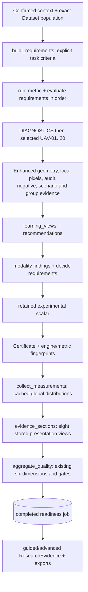

The requirement verdict, raw observations, readable evidence views and adaptive status remain separate outputs. The existing assessment session shares bounded local image work; adding a view does not add a new scoring engine or trigger model training.

Sources: [backend/readiness\_engine.py](../backend/readiness_engine.py), [metrics/core.py](../metrics/core.py), [metrics/uav\_metrics/assessment.py](../metrics/uav_metrics/assessment.py), [metrics/uav\_metrics/presentation.py](../metrics/uav_metrics/presentation.py), [metrics/quality\_aggregation.py](../metrics/quality_aggregation.py), [frontend/src/ResearchEvidence.tsx](../frontend/src/ResearchEvidence.tsx). [Open SVG](assets/architecture/metrics-pipeline.svg) | [High-resolution PNG](assets/architecture/metrics-pipeline.png)


<a id="diagram-metric-dispatch"></a>
### Figure: run_metric: one public dispatcher, several implementations

<!-- diagram: metric-dispatch -->

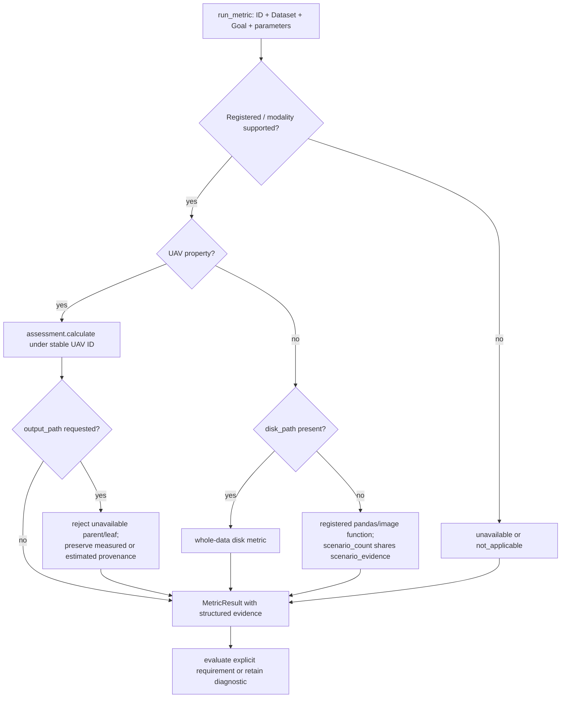

A structured count is usable only with its actual measurement availability and denominator. Unknown local/audit evidence cannot be projected into a zero quality value. Scenario checks reuse the shared three-valued evaluator, including count lower bounds.

Sources: [metrics/core.py](../metrics/core.py), [backend/readiness\_engine.py](../backend/readiness_engine.py), [metrics/uav\_metrics/research.py](../metrics/uav_metrics/research.py), [metrics/uav\_metrics/assessment.py](../metrics/uav_metrics/assessment.py). [Open SVG](assets/architecture/metric-dispatch.svg) | [High-resolution PNG](assets/architecture/metric-dispatch.png)


<a id="diagram-research-evidence"></a>
### Figure: The v2 instruments share one assessment and one evidence ledger

<!-- diagram: research-evidence -->

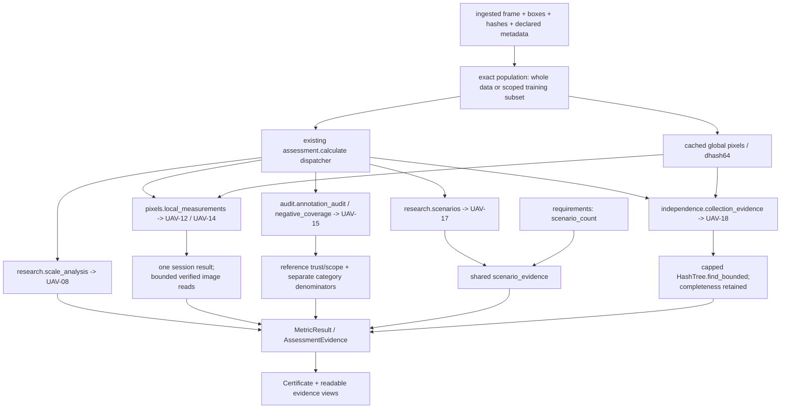

The new modules are instruments inside the stable registry. Exact native geometry, sampled pixels, declared metadata, independent references and incomplete duplicate retrieval retain different provenance and denominators. None is automatically a model-performance predictor or a new primary score.

Sources: [metrics/uav\_metrics/research.py](../metrics/uav_metrics/research.py), [metrics/uav\_metrics/pixels.py](../metrics/uav_metrics/pixels.py), [metrics/uav\_metrics/audit.py](../metrics/uav_metrics/audit.py), [metrics/uav\_metrics/independence.py](../metrics/uav_metrics/independence.py), [metrics/uav\_metrics/assessment.py](../metrics/uav_metrics/assessment.py), [metrics/uav\_metrics/presentation.py](../metrics/uav_metrics/presentation.py). [Open SVG](assets/architecture/research-evidence.svg) | [High-resolution PNG](assets/architecture/research-evidence.png)


<a id="diagram-annotation-audit"></a>
### Figure: Independent audit: scope and one-to-one matching before error rates

<!-- diagram: annotation-audit -->

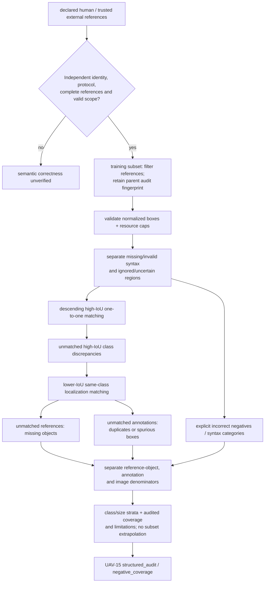

The source labels remain unchanged. Training-set model predictions are not independent reference truth. Syntax failure does not become a semantic missing-object count, and zero denominators remain null. The new category audit does not silently replace the older count-only agreement score.

Sources: [metrics/uav\_metrics/audit.py](../metrics/uav_metrics/audit.py), [backend/workbench/datasets.py](../backend/workbench/datasets.py), [metrics/uav\_metrics/assessment.py](../metrics/uav_metrics/assessment.py), [metrics/quality\_aggregation.py](../metrics/quality_aggregation.py). [Open SVG](assets/architecture/annotation-audit.svg) | [High-resolution PNG](assets/architecture/annotation-audit.png)


**Chapter evidence:** [metrics/core.py](../metrics/core.py), [metrics/disk\_metrics.py](../metrics/disk_metrics.py), [backend/readiness\_engine.py](../backend/readiness_engine.py), [metrics/uav\_metrics/registry.py](../metrics/uav_metrics/registry.py), [metrics/uav\_metrics/assessment.py](../metrics/uav_metrics/assessment.py), [metrics/uav\_metrics/vision.py](../metrics/uav_metrics/vision.py), [metrics/uav\_metrics/learning.py](../metrics/uav_metrics/learning.py), [metrics/dataProfiler.py](../metrics/dataProfiler.py), [metrics/featureAnalyzer.py](../metrics/featureAnalyzer.py), [metrics/labelAnalyzer.py](../metrics/labelAnalyzer.py), [metrics/IsoIecChecker.py](../metrics/IsoIecChecker.py), [metrics/uav\_metrics/research.py](../metrics/uav_metrics/research.py), [metrics/uav\_metrics/pixels.py](../metrics/uav_metrics/pixels.py), [metrics/uav\_metrics/audit.py](../metrics/uav_metrics/audit.py), [metrics/uav\_metrics/independence.py](../metrics/uav_metrics/independence.py), [metrics/uav\_metrics/presentation.py](../metrics/uav_metrics/presentation.py).


[Back to contents](#contents) | [Question map](#understand)


---

<a id="ch09"></a>

# 9. Adaptive normalization, weighting and gates

## The six dimensions

The configured dimensions are Annotation quality; Diversity and required coverage; Signal and image quality; Distribution and sample adequacy; Task and operational suitability; and Data integrity and reliability. Their exact component assignments are generated from `metrics/config/adaptive_quality.json` below. Task policies, scenario multipliers and manually confirmed overrides define priorities. These are engineering hypotheses; the code does not fit them to the user's model test results or claim they are empirically calibrated.

`QualityProfile` validates configuration versions, finite positive base ratios, component IDs, task coverage and scenario compatibility. `_weights` separately validates runtime overrides: known IDs only, finite nonboolean numbers in [0,1000]. Changing a weight requires explicit override confirmation. `load_profile` supplies the default file; a saved assessment carries its full frozen profile. Reaggregation normally reuses that profile. `use_current_profile=True` explicitly requests the current policy.

## From raw values to comparable criteria

Let x be an observed fraction in [0,1]. For a good fraction, `s = 100*x`; for a defect fraction, `s = 100*(1-x)`. A zero-count criterion returns 100 for an observed count of zero and 0 for an observed positive integer count. That all-or-nothing transformation is criterion compliance, not a continuous estimate of defect severity. Nonfinite values, booleans presented as numbers and invalid fractions do not become scores.

Other component measurements are structured. Required-category coverage is `100 * observed_requested_categories / requested_categories`, only after the categories are explicitly declared. Requirement coverage is the fraction of conclusive passing findings; any unknown finding makes that component unknown. Annotation-audit agreement uses the independently reviewed error fraction. Clarity is the fraction of readable images meeting the stored criterion, using cached thumbnail Laplacian variance. Object visibility uses an explicitly confirmed minimum annotated object side in pixels. These are data/criterion measurements, not semantic detectability or predicted accuracy.

Uniform-class balance is calculated only when `goal.uav_parameters.class_balance_target` explicitly equals `uniform` and at least two classes are declared. For class proportions p_k and K declared/required classes, the score is:

```text
H(p) = -sum_k p_k * ln(p_k), taking 0*ln(0) as 0
balance = 100 * H(p) / ln(K)
```

Counts of an unobserved required class still affect K. An 80/20 two-class split has H approximately 0.5004 and normalized balance approximately 72.2/100; a 50/50 split has 100. Uniformity is only a requested reference distribution; actual deployment prevalence need not be uniform.

## Effective weights and coverage

Within a dimension, applicable positive-weight components have raw importance:

```text
a_i = task_component_weight_i * scenario_multiplier_i * confirmed_override_i
w_i = a_i / sum_j(a_j)
coverage = sum of a_i for measured components / sum of a_i for eligible components
```

The sums retain eligible components whose evidence is unknown. Not-applicable components and zero-importance components do not influence the score denominator. If a dimension has two equal-priority eligible components and only one is measured, coverage is 0.5. The measured component can be 100, but the primary dimension score is null. It is not silently renormalized into a perfect dimension score.

Across dimensions, a separate weight is `task_dimension_ratio * scenario_multiplier * confirmed_override`, normalized over applicable dimensions. These dimension weights explain importance and order next actions. They do not produce a primary all-dimensions percentage. Changing dimension importance therefore does not change a dimension's internal score. Component priority overrides can change its internal score if the evidence is complete.

## Weighted geometric mean and masking

For fully covered eligible component scores s_i in [0,100], `geometric` computes:

```text
D = 100 * exp(sum_i w_i * ln(s_i/100))
```

If any positive-weight component has a genuine score of zero, D is exactly zero. The implementation checks this before taking logarithms; it does not substitute a small epsilon. With scores 90 and 40 and weights 0.75 and 0.25, D is approximately 73.5. An arithmetic mean would be 77.5. Geometry penalizes imbalance, but it cannot by itself prevent every weak component from being obscured. Therefore the code also keeps the dimension in warning if any contributing criterion is below `warning_below`, even when D is above it. The default 70 threshold is an uncalibrated review policy.

## Independent gates and two readiness decisions

Critical component gates are evaluated separately from weighting. An observed defect on a block gate can block the adaptive status even if the corresponding score importance is zero. Confirmed hard requirements become block gates; preferred requirements become warning gates. A task/modality incompatibility adds a block failure. A task preview clears context-dependent measurements/findings and adds an evidence gate requiring a fresh task-specific assessment.

Adaptive status is `blocked` for a failed block gate, otherwise `insufficient_evidence` for missing positively weighted dimensions/block evidence, otherwise `conditional` for remaining gate or dimension warnings, otherwise `ready`. This is separate from `Certificate.overall_status`.

The requirement decision follows this actual precedence: a hard failure gives NOT_READY; otherwise a finding/metric error gives ASSESSMENT_ERROR; otherwise an unspecified task or unpassed hard evidence gives INSUFFICIENT_EVIDENCE; object detection without required classes is insufficient; unmet preferred criteria give CONDITIONALLY_READY; otherwise READY. A hard failure remains established even when another check is unknown.

## The retained arithmetic scalar and sensitivity

`experimental_scoring.aggregate` is different. It computes `sum(a_i*s_i) / sum(observed a_i)`, reports observed/applicable coverage and a possible score range that assigns missing components zero or 100 at its ends. It can therefore display a partial observed scalar. It never overrides requirement readiness or the strict-coverage primary dimensions. Its configuration and profile hash are independent of the adaptive quality profile.

`quality_api.sensitivity` perturbs dimension priorities by 0.5 and 2 and reports resulting importance rankings. Its metric-deterioration scenarios multiply measured scores by 0.5 or 0 and recompute a hypothetical geometric score. Those simulations are explicitly not dataset measurements, training outcomes or persisted experimental evidence. Changing a selected task likewise makes a preview, not a new collection of labels.

<details>
<summary>Analogy: six laboratory reports and mandatory checks</summary>

Each quality dimension is a report folder with its own tests. The task determines how much attention each test receives. Missing pages remain missing, so the folder does not get a complete score. A mandatory failed check remains flagged even if the committee assigns its numerical score no importance. The folders stay separate; a pristine file-integrity folder cannot repair wrong labels in the annotation folder.

</details>

## Why the v2 observations do not silently change the scoring model

The six-dimension `adaptive-1.0` definition, engineering weights, normalization and independent gates are retained. A ring-entropy value, contrast ratio or collection-group count does not have a universally justified quality direction. Consequently the additional raw submeasurements are inspectable without automatically entering more weighted components or creating blockers. Explicit confirmed requirements may project measured fields; they continue through existing findings and gates.

The historical annotation-agreement component consumes the older independently reviewed error fraction. The structured audit has separate reference-object, annotation and image denominators; the code does not collapse those categories into that older fraction. A new scored audit component would need an explicit future policy version, scientific rationale and validation. Count-only audits without image scope cannot be reused as a new training-subset audit. Old saved results are not rewritten.

Changing tasks invalidates the new context-dependent UAV evidence as well as older target/requirement evidence. A preview cannot relabel a sampled object analysis, class-specific negative count or a scale scenario as evidence for another task. Historical and new assessments keep their own fingerprints, including engine/metric implementation versions; preserving the policy definition does not mean new measurement fingerprints should equal older ones.


### Exact task dimension ratios

| Task | Annotation quality | Diversity and required coverage | Signal and image quality | Distribution and sample adequacy | Task and operational suitability | Data integrity and reliability |
|---|---|---|---|---|---|---|
| object_detection | 5 | 3 | 2 | 2 | 4 | 4 |
| classification | 4 | 2 | 2 | 4 | 3 | 3 |
| regression | 3 | 2 | 3 | 3 | 3 | 4 |
| anomaly_detection | 1 | 3 | 4 | 3 | 3 | 5 |
| telemetry | 1 | 3 | 4 | 3 | 4 | 5 |
| tracking | 5 | 3 | 2 | 2 | 4 | 5 |

### Components, sources and declared normalization

| Component / dimension | Evidence and normalization | Applicability / gate / limitation |
|---|---|---|
| annotation_validity / annotation_quality | metric; raw ID bbox_invalid_rate; one_minus_fraction | tasks ['object_detection', 'tracking']; modalities ['image']; gate block; Syntax validity does not establish correct boxes or complete visible-object labels. |
| label_availability / annotation_quality | metric; raw ID missing_label_rate; one_minus_fraction | tasks ['object_detection', 'tracking', 'classification', 'regression']; modalities ['image', 'tabular']; gate block; Descriptive criterion compliance only; does not estimate model performance. |
| annotation_audit / annotation_quality | annotation_audit; raw ID UAV-15; one_minus_fraction | tasks ['object_detection', 'tracking']; modalities ['image']; gate None; Only the declared reviewed population is scored; reviewer independence is user declared. |
| verified_labels / annotation_quality | metric; raw ID verified_label_error; one_minus_fraction | tasks ['classification']; modalities ['tabular']; gate None; Descriptive criterion compliance only; does not estimate model performance. |
| scene_coverage / diversity | categories; raw ID UAV-05; criterion_fraction | tasks []; modalities ['image']; gate None; Presence only; not statistical sufficiency or visual appearance diversity. |
| weather_coverage / diversity | categories; raw ID UAV-02; criterion_fraction | tasks []; modalities ['image', 'tabular']; gate None; Descriptive criterion compliance only; does not estimate model performance. |
| clarity / signal_quality | clarity; raw ID UAV-14; criterion_fraction | tasks ['classification', 'object_detection', 'tracking', 'anomaly_detection']; modalities ['image']; gate None; Default threshold 100 is inherited from the existing experimental feature and is illustrative and uncalibrated. Texture and thumbnail scale affect this proxy; no semantic visibility claim. |
| finite_signals / signal_quality | metric; raw ID non_finite_rate; one_minus_fraction | tasks ['telemetry', 'anomaly_detection', 'regression']; modalities ['tabular']; gate None; Descriptive criterion compliance only; does not estimate model performance. |
| class_balance / statistical_adequacy | class_balance; raw ID class_distribution; entropy | tasks ['classification', 'object_detection']; modalities ['image', 'tabular']; gate None; Uniformity is scored only if explicitly requested. A balanced dataset is not necessarily deployment representative; one-class balance is undefined. |
| sample_requirements / statistical_adequacy | findings; raw ID sample_sufficiency; requirement_fraction | tasks []; modalities ['image', 'tabular']; gate None; Descriptive criterion compliance only; does not estimate model performance. |
| required_classes / task_suitability | findings; raw ID required_class_count; requirement_fraction | tasks ['classification', 'object_detection', 'tracking']; modalities ['image', 'tabular']; gate None; Descriptive criterion compliance only; does not estimate model performance. |
| scenario_requirements / task_suitability | findings; raw ID scenario_count; requirement_fraction | tasks []; modalities ['image', 'tabular']; gate None; Descriptive criterion compliance only; does not estimate model performance. |
| readability / integrity | metric; raw ID unreadable_rate; one_minus_fraction | tasks []; modalities ['image']; gate block; Descriptive criterion compliance only; does not estimate model performance. |
| completeness / integrity | metric; raw ID missingness; one_minus_fraction | tasks []; modalities ['tabular']; gate None; Descriptive criterion compliance only; does not estimate model performance. |
| uniqueness / integrity | metric; raw ID duplicate_rate; one_minus_fraction | tasks []; modalities ['image', 'tabular']; gate None; Legitimate repeats require domain review; duplicate frames are not independent observations. |
| split_integrity / integrity | metric; raw ID split_overlap; zero_count | tasks []; modalities ['image', 'tabular']; gate block; Zero exact overlaps does not rule out semantic leakage. |
| group_integrity / integrity | metric; raw ID group_leakage; zero_count | tasks []; modalities ['image', 'tabular']; gate block; Descriptive criterion compliance only; does not estimate model performance. |
| near_split_integrity / integrity | metric; raw ID near_split_overlap; zero_count | tasks []; modalities ['image']; gate warning; Perceptual similarity is a review candidate, not proof of leakage. |
| object_visibility / signal_quality | object_visibility; raw ID UAV-08; criterion_fraction | tasks ['object_detection', 'tracking']; modalities ['image']; gate None; Criterion compliance only; timestamps, sensor metadata and annotations are user supplied. No physical correctness or downstream detectability guarantee. |
| timestamp_completeness / integrity | timestamps; raw ID UAV-20; criterion_fraction | tasks ['telemetry', 'tracking', 'anomaly_detection']; modalities ['image', 'tabular']; gate None; Criterion compliance only; timestamps, sensor metadata and annotations are user supplied. No physical correctness or downstream detectability guarantee. |
| temporal_order / signal_quality | temporal_order; raw ID UAV-20; criterion_fraction | tasks ['telemetry', 'tracking', 'anomaly_detection']; modalities ['image', 'tabular']; gate None; Criterion compliance only; timestamps, sensor metadata and annotations are user supplied. No physical correctness or downstream detectability guarantee. |
| sensor_completeness / integrity | sensor_completeness; raw ID UAV-19; criterion_fraction | tasks ['telemetry', 'anomaly_detection']; modalities ['tabular']; gate None; Criterion compliance only; timestamps, sensor metadata and annotations are user supplied. No physical correctness or downstream detectability guarantee. |

### Scenario policies and provenance

| Scenario | Compatible tasks | Explicit multipliers / explanation |
|---|---|---|
| default | object_detection, classification, regression, anomaly_detection, telemetry, tracking | {"dimension_multipliers": {}, "metric_multipliers": {}, "explanation": "No explicit scenario policy selected; retain the documented task defaults."} |
| airport_drone_detection | object_detection | {"dimension_multipliers": {"annotation_quality": 1.5, "task_suitability": 1.5}, "metric_multipliers": {"annotation_validity": 1.5}, "explanation": "Opt-in engineering sensitivity policy: prioritize object annotation integrity and confirmed airport operating conditions. Does not establish small-drone visibility or distractor coverage."} |
| nighttime_detection | object_detection, tracking | {"dimension_multipliers": {"signal_quality": 1.5, "task_suitability": 1.5}, "metric_multipliers": {}, "explanation": "Opt-in engineering sensitivity policy: prioritize visual-signal criteria and confirmed nighttime evidence. Brightness alone does not establish nighttime coverage."} |


<a id="diagram-adaptive-aggregation"></a>
### Figure: Raw evidence becomes six independent quality dimensions

<!-- diagram: adaptive-aggregation -->

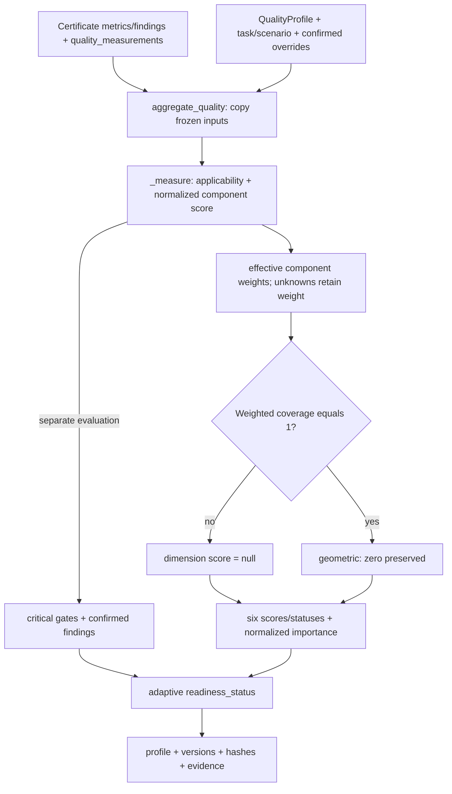

The weights combine components within a dimension. Dimension importance never collapses the six dimensions into a primary percentage. A critical failure survives even when its score weight is zero.

Sources: [metrics/quality\_aggregation.py](../metrics/quality_aggregation.py), [metrics/quality\_profiles.py](../metrics/quality_profiles.py), [metrics/config/adaptive\_quality.json](../metrics/config/adaptive_quality.json). [Open SVG](assets/architecture/adaptive-aggregation.svg) | [High-resolution PNG](assets/architecture/adaptive-aggregation.png)


### Source excerpt: geometric

[metrics/quality\_aggregation.py : geometric](../metrics/quality_aggregation.py#L32)

```python
def geometric(scores, weights):
    if len(scores)!=len(weights) or any(not finite(s) or not 0<=s<=100 for s in scores) or any(not finite(w) or w<0 for w in weights):
        raise ValueError('Geometric aggregation requires matched finite scores in [0,100] and nonnegative weights')
    if not scores or sum(weights) <= 0:
        return None
    # Do not turn a real zero into epsilon, or take log(0).
    if any(s == 0 and w > 0 for s, w in zip(scores, weights)):
        return 0.
    total = sum(weights)
    return 100 * math.exp(sum(w / total * math.log(s / 100) for s, w in zip(scores, weights) if w > 0))
```


**Chapter evidence:** [metrics/quality\_aggregation.py](../metrics/quality_aggregation.py), [metrics/quality\_profiles.py](../metrics/quality_profiles.py), [metrics/config/adaptive\_quality.json](../metrics/config/adaptive_quality.json), [metrics/experimental\_scoring.py](../metrics/experimental_scoring.py), [metrics/config/experimental\_score.json](../metrics/config/experimental_score.json), [backend/workbench/quality\_api.py](../backend/workbench/quality_api.py), [backend/readiness\_engine.py](../backend/readiness_engine.py).


[Back to contents](#contents) | [Question map](#understand)


---

<a id="ch10"></a>

# 10. Model Validation Lab and real training

## Guided preparation versus the advanced builder

The guided lab starts from a completed training-partition readiness assessment. `prepare_validation` creates a recorded training-only variant with blur, resolution reduction, label omission, box perturbation, wrong-class labels, pixel noise or underexposure; creates its split with the existing grouped splitter; and queues readiness under the same confirmed context. Validation/test image and annotation bytes are retained. A `workflow_validation` record links the variant, split, readiness job, intervention and later experiment.

After the changed-data assessment finishes, `validation_protocol` constructs an `ExperimentRequest` with original data as candidate and controlled data as reference. Both configurations share original validation data and the same original held-out test partition. The route calls the existing `create_experiment` domain validation and stores its experiment ID. The browser reviews this immutable protocol before `start_experiment` queues actual work. The name reference here means comparison arm; an artificial comparison dataset is still labelled as related artificial provenance in analytics.

The advanced `ExperimentBuilder` exposes candidate/reference/combined/controlled modes, multiple seeds, shared or per-source validation, class mappings, frozen aggregation versions, matched or natural sizes and an independently selected test. Reference/combined modes require reference configuration. A controlled mode requires artificial provenance. Matched size requires a reference dataset, retains whole recording groups and reassesses the selected training subsets. Combined mode intentionally increases sample count and cannot share that matched-size protocol option.

## Partitions and preflight validation

`create_split` loads hashes and cached/new perceptual signatures, unions exact duplicates, near images and known recording groups, then preserves complete declared partitions or uses a seeded allocation of whole clusters. Partial declared assignments, overlap across declared partitions, fewer than three independent units or an empty partition fail. Without group metadata the user must acknowledge unverified recording independence.

`validate_training` checks training eligibility, exact dataset/split/readiness association, a completed detection-task readiness report, any selected aggregation, nonempty annotated train/validation populations, class schemas and trusted local checkpoint paths. It does not require a READY verdict; a diagnostic research experiment may intentionally train on data with known issues. The relevant invariants are evidence identity and training feasibility, not a hidden readiness pass gate.

`validate_experiment` matches model configurations, validates class mappings and asserts that final-test data are independent of every development manifest. `assert_independent` checks exact image hashes, likely near duplicates and comparable recording groups; missing comparable groups require acknowledgement. These checks cannot prove collection independence if metadata is wrong or near-duplicate heuristics miss a relation. Preflight runs again when an immutable experiment starts.

## Persistent queue and worker execution

`JobManager.enqueue` writes a queued job and starts a coordinator thread. Its loop selects the oldest queued work, creates `jobs/{id}`, launches `python -m backend.workbench.worker {id}` with the same Python executable and local storage root, and redirects stdout/stderr to `worker.log`. One process runs at a time for that manager. This is process isolation for compute and predictable local device scheduling, not a distributed queue or a guarantee across multiple independently started backend instances.

`worker.run` dispatches by `task`: readiness reconstructs Dataset/Context and optional train subset; training calls `detector.train`; evaluation calls `evaluate_models`; experiment calls `execute_experiment`. A parent experiment creates child job records and invokes `run` serially within the same process. It checks each child's terminal state and stops if a child failed. All requested training completes before the final evaluation phase. The browser polls persisted records and epoch callbacks instead of holding one training HTTP request open.

## Real model preparation and training

`device` examines actual PyTorch CUDA availability; `auto` chooses available CUDA or CPU. The selected device is frozen. `gpu_usage` reports actual device memory allocation/reservation, not utilization percentage. `setup_detector` configures local Ultralytics storage and disables integrations/synchronization, with no automatic pretrained download. The supported architectures are YOLO11n and YOLO11s. A trusted `.pt` import is a local user-controlled operation; PyTorch checkpoint files require trust.

`materialize` verifies source bytes, maps classes one-to-one, creates cached image/label inputs and uses hard links where safe for managed bytes. External mutable directory files are copied into verified cache rather than hard-linked. `write_yaml` creates dataset YAML and train/validation lists. Final test images are not supplied to training/checkpoint selection.

The code fixes the initial target-model seed to 0, constructs the requested class head, saves a local initialization checkpoint, hashes the tensor state and verifies that the trainer begins with that exact state. The requested run seed then governs training stochasticity. This separates matched initialization from repeated augmentation/data-order seeds. The `pretrained=True` argument in the library call refers to the explicitly constructed/reloaded model state; it does not by itself imply downloaded COCO weights.

The actual train call uses the requested epochs/batch/image size/learning rate/device, SGD, deterministic mode, no mixed precision, zero loader workers, no cache, no early-stop patience and checkpoint saving. The `on_fit_epoch_end` callback records completed epochs, train losses, validation values and GPU memory, with a guard for a repeated library callback after final validation. The external Ultralytics/PyTorch loop performs gradients and optimization; those internals are not repository-owned Python functions.

## Checkpoints, resume, combined scope and imports

`finish_training` requires `run/weights/best.pt`, validates that checkpoint on validation data and creates a model record with hashes, effective configuration, manifests, code hash, environment, training counts and the exact quality profile. Combined training calls `combined_readiness` for the entire training union and links the model to the resulting virtual combined dataset/report. It does not attach only the candidate's readiness profile to a larger combined population.

`lab_api.resume` accepts only stopped training jobs with usable retained checkpoint/configuration. It queues a new training job with a resume pointer. `resume_training` loads the actual epoch checkpoint and calls library resume so optimizer/epoch state is retained. There is no generic resume-from-midstep implementation for a partially completed named experiment; partial child artifacts remain, and a new protocol is the supported retry path.

Imported checkpoints retain user-declared provenance and are excluded from controlled predictive correlations. External published benchmarks are stored in their own record kind with a comparability warning. They are not inserted as measured local evaluation results and do not establish a fair model ranking.

## Evaluation: operating errors and average precision

`test_manifest` chooses only the selected test partition, or all images in a supplied external test dataset. Its current identity includes image bytes, canonical annotations/classes, class mapping and ground-truth protocol, plus a separate image-only checksum. This prevents two differently labelled test sets from being called identical because their images match. The test is asserted independent from each model's retained development manifests.

`evaluate_models` uses Ultralytics validation at the recorded low AP confidence floor for the PR/AP sweep. It also runs per-image predictions at the declared operating confidence. Repository `detection_errors` greedily matches confidence-ordered predictions to unused ground truth of the same class at the chosen IoU; unmatched predictions are FP, unused truth is FN. With TP, FP and FN:

```text
precision = TP/(TP+FP)      recall = TP/(TP+FN)
F1 = 2*TP/(2*TP+FP+FN)
IoU = intersection_area / union_area
```

A zero denominator produces None, not an invented perfect or zero score. For TP=8, FP=2, FN=4, precision=0.8, recall approximately 0.667 and F1 approximately 0.727. FP per image uses images as denominator; it is not a true-negative-based false-positive rate. Latency is mean model inference time and excludes loading/preprocessing/NMS.

Average precision is delegated to the installed Ultralytics metric implementation. Inspection of that installed dependency shows a precision envelope and 101-point interpolated trapezoidal integration over recall. mAP50 averages class AP at IoU 0.50; mAP50_95 averages across the library's 0.50 through 0.95 thresholds. The repository adapter retrieves these values through `research.experiments._metrics`; it does not implement an alternative AP formula. Library versions are therefore part of reproducibility.

`confusion_counts` uses confidence-ordered spatial matching ignoring class to reveal class confusion, with rows predicted and columns true plus background. It is deliberately distinct from the class-aware TP/FP/FN matching. Canonical boxes treat retained parsed objects as ordinary boxes; the adapter explicitly does not reproduce official COCO crowd-ignore semantics, so published COCO values are not automatically comparable.

## Expanded training-only interventions and native-size outcomes

The guided adapter maps wrong-class changes to existing annotation_noise and maps noise/exposure to image_degradation. Noise is a recorded seeded achromatic Gaussian perturbation broadcast across RGB, clipped/rounded to 8-bit; exposure is a recorded brightness factor. Existing omission and box-center perturbations remain. The manifest records parameters/seed, parent/output hashes, parent/output object counts, removed training images and Python/NumPy/Pillow/Pandas versions. These transformations do not alter independent validation/test image or label bytes.

Advanced variants can also reduce whole training images containing objects below an explicit native-area criterion, retain declared classes or environmental conditions, and reduce explicitly recorded target-free hard-negative candidates. Small-object reduction uses whole-image selection, not selective deletion of small-object labels. Hard-negative reduction requires a complete explicit boolean candidate column and target-free annotations; it does not establish that those images cause false positives. These selections can change image count, class/scene mixture and other quality properties together. Count-matched controls and measured covariates are essential for interpreting an experiment.

`native_size_outcomes` reuses the actual operating-point matching results. For each ground-truth native-area bin, TP equals its labelled-object population minus its missed-object count; recall is TP divided by that population, or null for an empty bin. False positives have no ground-truth size, so their counts are separately binned by predicted native box area. Evaluations store `recall_small_native`, `recall_medium_native` and `recall_large_native`, plus size-stratified counts and a size-evaluation protocol version. The default descriptive area bins are [0,1024), [1024,9216) and [9216,infinity).

Small-object AP remains explicitly unavailable. Native-box operating recall is not official COCO mask-area AP and cannot be used to reconstruct an AP confidence sweep. The research outcome selector exposes these real recall values and false positives per image alongside existing outcomes. No real training/evaluation is automatically triggered by adding a measurement or opening its view.


<a id="diagram-split-safeguards"></a>
### Figure: Prepare partitions before model training

<!-- diagram: split-safeguards -->

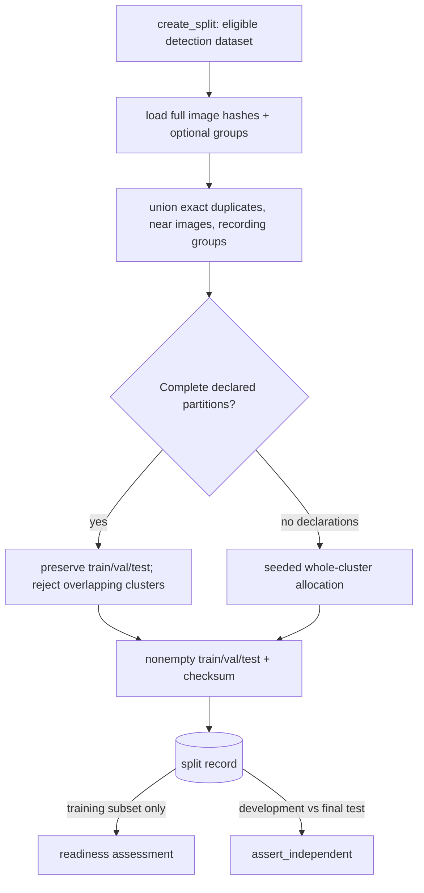

A file named test is not automatically independent. Exact hashes, perceptual signatures and comparable recording-group identifiers are checked. Missing comparable groups require acknowledgement; acknowledgement does not prove independence.

Sources: [backend/workbench/splits.py](../backend/workbench/splits.py), [backend/workbench/workflow\_api.py](../backend/workbench/workflow_api.py), [backend/workbench/detector.py](../backend/workbench/detector.py). [Open SVG](assets/architecture/split-safeguards.svg) | [High-resolution PNG](assets/architecture/split-safeguards.png)


<a id="diagram-training-lifecycle"></a>
### Figure: Persistent job states and recovery

<!-- diagram: training-lifecycle -->

```mermaid
stateDiagram-v2
  [*] --> queued : JobManager.enqueue creates record
  queued --> running : JobManager._run launches worker
  queued --> cancelled : cancel before start
  running --> completed : worker.run saves result
  running --> failed : worker catches exception or exits unexpectedly
  running --> cancelled : manager terminates owning process
  running --> interrupted : recover after backend restart
  interrupted --> queued : new resume job if training checkpoint valid
  cancelled --> queued : new resume job if training checkpoint valid
  failed --> queued : new resume job if training checkpoint valid
  completed --> [*]
  note right of queued: Resume creates another job ID; it does not rewrite history
```

The resumed arrow is a new training record, not mutation of the interrupted run back to queued. Experiments also retain configured/queued/running/completed/failed/cancelled/interrupted status; the parent owns inline child jobs.

Sources: [backend/workbench/jobs.py](../backend/workbench/jobs.py), [backend/workbench/worker.py](../backend/workbench/worker.py), [backend/workbench/lab\_api.py](../backend/workbench/lab_api.py), [backend/workbench/detector.py](../backend/workbench/detector.py). [Open SVG](assets/architecture/training-lifecycle.svg) | [High-resolution PNG](assets/architecture/training-lifecycle.png)


<a id="diagram-training-functions"></a>
### Figure: The actual detector training call chain

<!-- diagram: training-functions -->

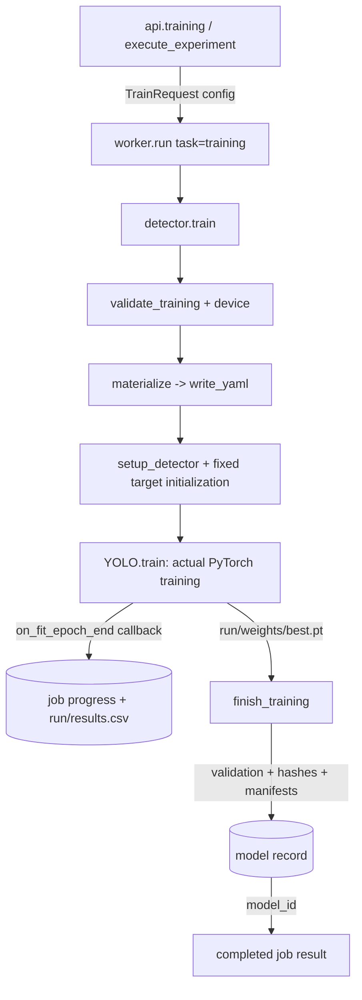

Training performs real library computation. YAML and cached image/label paths describe train and validation inputs; final test images are excluded. Epoch callbacks report actual completion, loss, validation and GPU memory, not fabricated percentages.

Sources: [backend/workbench/detector.py](../backend/workbench/detector.py), [backend/workbench/worker.py](../backend/workbench/worker.py), [backend/workbench/experiments.py](../backend/workbench/experiments.py). [Open SVG](assets/architecture/training-functions.svg) | [High-resolution PNG](assets/architecture/training-functions.png)


<a id="diagram-experiment-data-flow"></a>
### Figure: A guided controlled comparison becomes a named experiment

<!-- diagram: experiment-data-flow -->

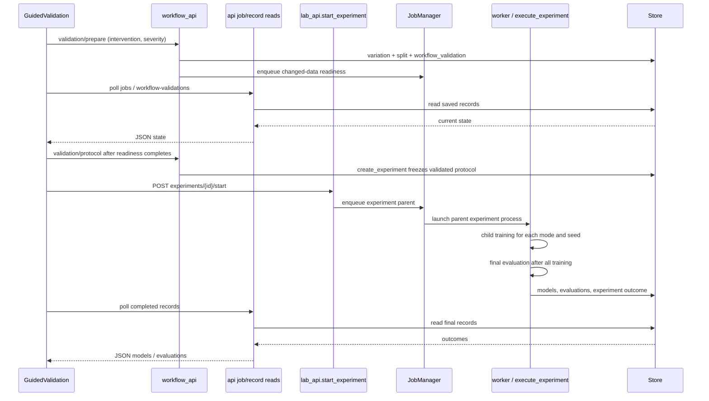

The browser reads records through HTTP handlers and never opens SQLite. Inside a parent worker, child run calls are serial and share the worker process; there is no subprocess per child.

Sources: [frontend/src/GuidedValidation.tsx](../frontend/src/GuidedValidation.tsx), [backend/workbench/workflow\_api.py](../backend/workbench/workflow_api.py), [backend/workbench/experiments.py](../backend/workbench/experiments.py), [backend/workbench/jobs.py](../backend/workbench/jobs.py). [Open SVG](assets/architecture/experiment-data-flow.svg) | [High-resolution PNG](assets/architecture/experiment-data-flow.png)


<a id="diagram-model-evaluation"></a>
### Figure: Two evaluation passes produce complementary metrics

<!-- diagram: model-evaluation -->

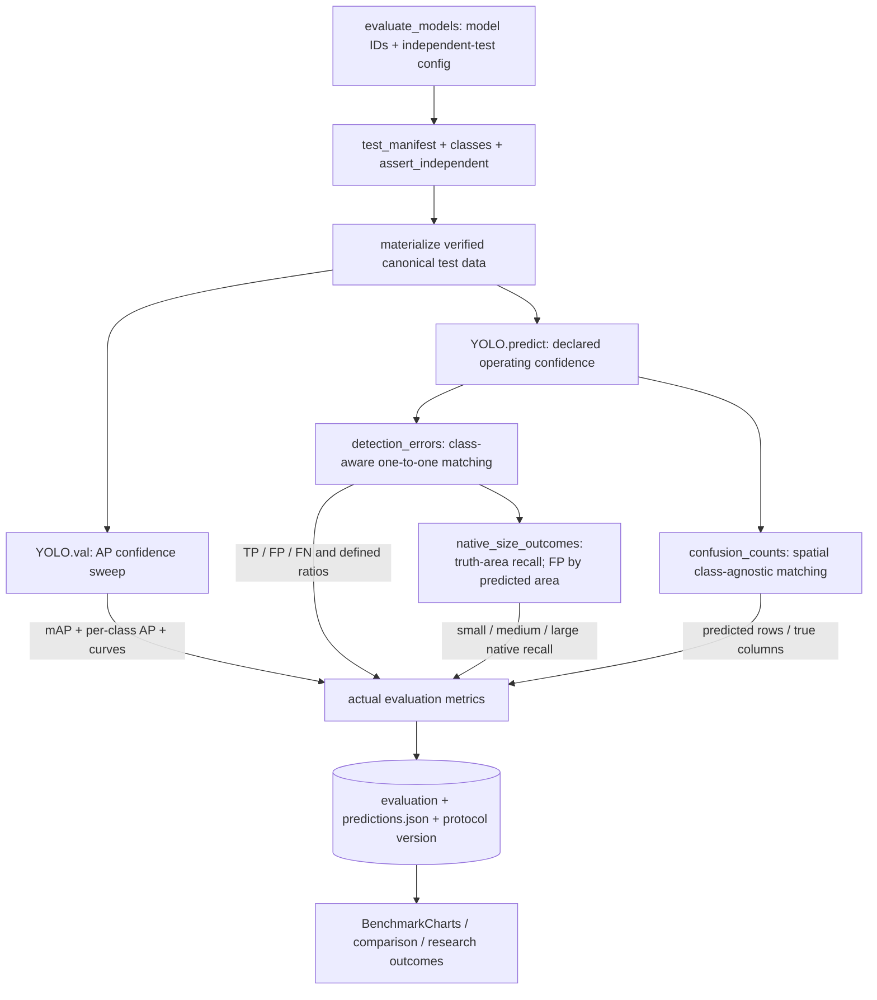

Size-stratified recall uses ground-truth native area and the actual operating matching results. False positives have no true-object size and are binned separately by predicted area. Small-object AP remains unavailable; this is not official COCO area evaluation.

Sources: [backend/workbench/detector.py](../backend/workbench/detector.py), [backend/workbench/analytics.py](../backend/workbench/analytics.py), [frontend/src/Workbench.tsx](../frontend/src/Workbench.tsx), [frontend/src/BenchmarkCharts.tsx](../frontend/src/BenchmarkCharts.tsx). [Open SVG](assets/architecture/model-evaluation.svg) | [High-resolution PNG](assets/architecture/model-evaluation.png)


**Chapter evidence:** [backend/workbench/workflow\_api.py](../backend/workbench/workflow_api.py), [backend/workbench/lab\_api.py](../backend/workbench/lab_api.py), [backend/workbench/experiments.py](../backend/workbench/experiments.py), [backend/workbench/detector.py](../backend/workbench/detector.py), [backend/workbench/jobs.py](../backend/workbench/jobs.py), [backend/workbench/worker.py](../backend/workbench/worker.py), [backend/workbench/splits.py](../backend/workbench/splits.py), [backend/workbench/variations.py](../backend/workbench/variations.py), [backend/workbench/combined.py](../backend/workbench/combined.py), [backend/research/experiments.py](../backend/research/experiments.py), [backend/research/variants.py](../backend/research/variants.py), [backend/workbench/contracts.py](../backend/workbench/contracts.py).


[Back to contents](#contents) | [Question map](#understand)


---

<a id="ch11"></a>

# 11. Research analytics and statistical limits

## How data quality joins model outcomes

`research` walks newest evaluation records, loads the corresponding model, training dataset and readiness record, and optionally filters selected model IDs, dataset, scenario, test or configuration. It keeps the latest matching observation per model/protocol. `numeric_metrics` extracts finite nonboolean numeric leaves from measured diagnostics and available dimension scores. It now skips unavailable nested evidence and sampling/settings/protocol/criteria/bin-definition constants; an unavailable local count is not a numerical zero predictor. It also exposes clearly named research baselines: equal/adaptive arithmetic/geometric dimension combinations only where every required dimension is complete, and training image count. These predictors do not become the application readiness verdict.

The configuration signature includes architecture, matched initialization hash, budget, device, classes, actual test identity/settings, full context, experimental-score profile/observed components and adaptive policy/measurement support. This is deliberately strict: unlike task descriptions or different evidence coverage can prevent pooling. A saved experiment's guided research request passes `experiment_id`; the API restricts rows to that experiment's model IDs. The advanced workspace's default can inspect all stored runs.

## Independent unit and repeated seeds

Natural, non-combined, provenance-verified source rows are grouped by source image identity and comparable configuration. Repeated seed outcomes for that source become one dataset-level observation. If readiness differs across repetitions on the same source/configuration, that source is excluded instead of pretending its x-value is fixed. Sources sharing exact image bytes or declared comparable recording groups are excluded from independent-source correlations. Artificial variants, combined datasets and imported histories remain descriptive or paired evidence, not additional independent datasets.

For n independent training seeds on one source, mean performance is the arithmetic mean; sample standard deviation uses n-1. The reported 95% interval is a t interval:

```text
mean = sum(y_i)/n
sd = sqrt(sum((y_i-mean)^2)/(n-1))
interval = mean +/- t(0.975, n-1) * sd/sqrt(n), when n > 1
```

For seed outcomes 0.4, 0.5 and 0.6, mean=0.5, sd=0.1 and the small-n t interval is approximately [0.252,0.748]. It describes seed variation on that fixed data/protocol, not uncertainty across future deployment domains or independent test sets. With one seed, the interval is unavailable.

## Correlation and predictive checks

Pearson measures linear association; Spearman applies rank association and therefore asks whether values tend to increase together without requiring a linear scale. `research` requires at least three independent comparable sources and variation in both x and y before reporting either coefficient. Pearson's interval is requested for at least four sources. Spearman's interval uses 1,000 independent-source bootstrap draws with seed 42 when n is at least six; constant resamples are excluded, and at least 900 usable draws are required. These are exploratory checks without multiplicity correction.

```text
Pearson r = sum((x_i-x_mean)*(y_i-y_mean)) /
            sqrt(sum((x_i-x_mean)^2) * sum((y_i-y_mean)^2))
Spearman rho = Pearson correlation of the ranked observations
```

For x=(1,2,3) and y=(2,4,6), both coefficients are 1, but three illustrative points do not establish general predictive validity. A constant x or y leaves the coefficient undefined. Source independence, fixed policy and matched protocol are prerequisites, not cosmetic chart filters.

`predictive_comparison` performs leave-one-independent-dataset-out univariate ordinary least squares only with at least six matched sources and sufficient predictor variation. Each fold centers/scales x using its training sources, fits intercept/slope on those sources, predicts the held-out source and compares error with predicting the training-fold mean. The code reports MAE and RMSE. It never fits scoring weights using the held-out performance and does not train a multivariate quality predictor under another name.

```text
MAE = mean(abs(predicted_i - observed_i))
RMSE = sqrt(mean((predicted_i - observed_i)^2))
```

Paired intervention analysis matches a variant to its parent by seed, test identity/settings and training conditions. It reports size matching, performance deltas and compatible quality deltas. If quality policies differ, the affected dimension/baseline deltas are withheld. `ranking_stability` compares the same multiple models over multiple tests under matched evaluation settings, retaining ties so arbitrary model ID order cannot manufacture a reversal.

`comparison` audits protocol differences, imported provenance, legacy annotation-unaware evaluations and training sizes. A side-by-side table can be informative while still being a descriptive, confounded comparison. Empty research plots can therefore be correct: the application refuses to manufacture observations when there are too few independent matched sources.

<details>
<summary>Analogy: repeating an experiment is not recruiting another population</summary>

Training five times on one collection measures how the instrument varies on that collection. It does not turn one collection into five independent towns, flights or cameras. To claim a score predicts performance across datasets, the laboratory needs genuinely different comparable collections. A deliberately blurred copy is valuable for a paired intervention, but it is still related to the original collection.

</details>

## Gates, new outcomes and an explicit pending research state

The research-only predictor `baseline.critical_gates_pass` is 0 when a gate conclusively fails and 1 when all gates conclusively pass; unresolved gate evidence does not receive an invented value. It supports investigating gate compliance alongside existing equal/adaptive arithmetic/geometric baselines while leaving the six product dimensions independent. The implementation does not presume that adaptive weighting or gating wins an empirical comparison.

Recorded native-size recall and false positives/image can be selected as actual outcomes. Individual v2 measurements can join the existing comparable-source analysis only when they are finite and available. Related variants remain paired evidence and do not inflate independent dataset counts. New measurement, scenario and evaluation protocol identities remain part of interpreting comparability; unmatched settings or source overlap must not be ignored merely to populate a plot.

The API returns empirical_validation.status=pending when no actual outcomes exist, and the research UI explicitly says empirical validation is pending. Recorded outcomes change that to outcomes-available, not to scientifically-validated. A useful next study independently audits annotation subsets, freezes preprocessing/scenarios and final tests, applies matched interventions with repeated seeds, then replicates across independent UAV sources. No test-fold performance may be used to tune the reported quality-policy weights.


<a id="diagram-research-analytics"></a>
### Figure: Join results, control comparability, then analyze

<!-- diagram: research-analytics -->

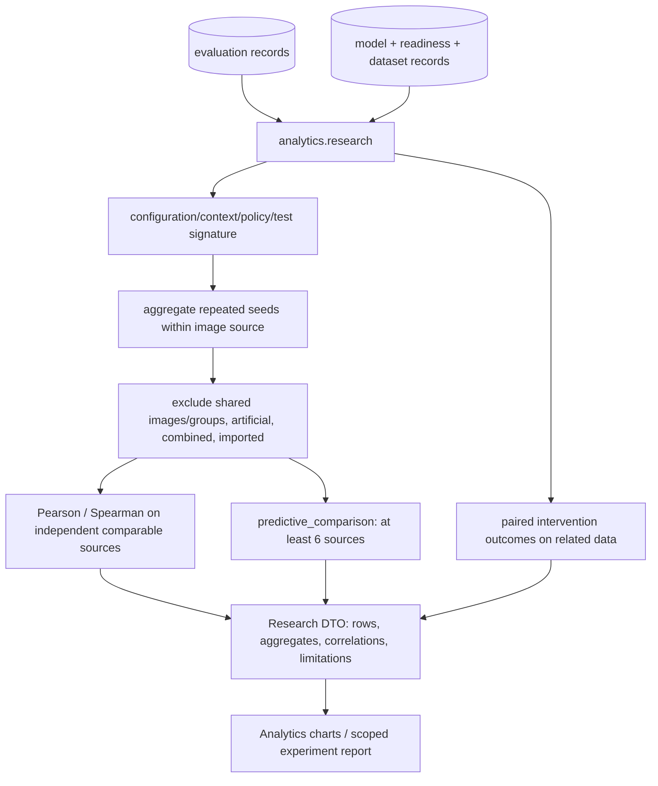

Repeated seeds are not new datasets. Related variants can support paired observations but are excluded from independent-dataset correlations. Missing or unmatched evidence often leaves charts empty for valid reasons.

Sources: [backend/workbench/analytics.py](../backend/workbench/analytics.py), [backend/workbench/api.py](../backend/workbench/api.py), [backend/workbench/reporting.py](../backend/workbench/reporting.py). [Open SVG](assets/architecture/research-analytics.svg) | [High-resolution PNG](assets/architecture/research-analytics.png)


**Chapter evidence:** [backend/workbench/analytics.py](../backend/workbench/analytics.py), [backend/workbench/api.py](../backend/workbench/api.py), [backend/workbench/reporting.py](../backend/workbench/reporting.py), [metrics/uav\_metrics/research.py](../metrics/uav_metrics/research.py), [metrics/uav\_metrics/audit.py](../metrics/uav_metrics/audit.py), [metrics/uav\_metrics/independence.py](../metrics/uav_metrics/independence.py).


[Back to contents](#contents) | [Question map](#understand)


---

<a id="ch12"></a>

# 12. Database, filesystem and data lineage

## The actual database model

There is one declared SQLAlchemy application table, `research_records`, represented by `Record`. Its columns are `id` (primary key), `kind` (indexed), `created_at` and `document` (JSON text). There are no declared foreign-key columns between datasets, jobs and models. IDs inside JSON express logical relationships enforced by application lookups/validation. Enabling SQLite foreign keys does not turn those JSON fields into enforced relational constraints.

`Store.create` serializes with `allow_nan=False`; `get` reconstructs a response wrapper `{id, kind, created_at, payload}`; `list` orders newest first; `update` serializes read-modify-write with an RLock and SQLite `BEGIN IMMEDIATE`; `directory` restricts managed kind/id components to alphanumeric values. Connections use WAL and a timeout. This supports local concurrent HTTP/worker access, but the queue is designed for one local backend instance rather than multiple independent schedulers.

Record kinds used by the workbench include dataset, split, context, workflow, workflow_validation, job, model, evaluation, comparison, aggregation, experiment, external_benchmark and analysis. They share one table. A workflow points to context/readiness/validation IDs; a model points to training job, dataset and readiness IDs; evaluation points to model/test data; a named experiment lists child/model/evaluation IDs.

## Artifact cabinets

The root defaults to `.runtime/workbench` and can be configured. `datasets/{id}` contains managed source files, `frame.json`, `evidence.json` and optional `table.duckdb`. Registered directory sources retain an external path. `jobs/{id}` contains the worker log, frozen configuration, YAML/list inputs, initialization and training run artifacts. The run includes `results.csv`, `weights/best.pt` and retained epoch/last checkpoints as supplied by the training library. Test evaluation stores per-model prediction JSON and references its path from the evaluation record. `cache`, `imagecache` and `variations` hold materialized inputs, shared image bytes and controlled-data manifests. Source code writes each artifact path; the inventory is not an assertion that all possible artifacts exist before a run.

The in-process Dataset can be discarded and reconstructed from evidence. A disk-backed dataset points to DuckDB for full-data calculations. Transient staging owners are cleaned on normal completion/error, and persistent imports copy required files before closing them. Worker processes naturally release their loaded objects when they exit. JSON records preserve paths and evidence, not live Python references or GPU tensors.

## Cleanup and retention differ by interface

The original API's lazy `cleanup` uses a one-hour TTL and protects active datasets/jobs. Explicit deletion or shutdown closes owned Dataset staging, including DuckDB/temp files. Abrupt termination can leave temporary artifacts; cleanup must follow ownership and an inactive process check.

The workbench DELETE dataset endpoint archives it after checking active job use. It intentionally retains artifacts and research provenance rather than deleting the files used by older reports/models. There is no automatic age-based pruning of all durable research artifacts. Renaming changes the visible dataset record name; source hash/version and earlier job evidence remain their own saved data. External registered files are not made immutable by a name or checksum; materialization detects changes to verified image bytes.

Dataset/assessment/configuration hashes describe the byte evidence and selected processing context, not authenticated collection identity. They help replay a particular computation. GPU kernels, library versions, checkpoint files, source changes and declared metadata also affect reproducibility. The code hashes source in `finish_training` even when Git has no commit, and retains both actual source hashing and an optional revision string.

<details>
<summary>Analogy: a catalog entry is not the object on the shelf</summary>

The SQLite row is a catalog card with IDs, evidence and shelf addresses. The image archive, DuckDB ledger, model checkpoint and prediction file are separate objects on disk. Archiving a dataset hides its catalog entry from normal selection while preserving the shelf objects that existing research references. A local directory registration points to a shelf somebody else can still change.

</details>

## Where the v2 evidence lives

New global proxies and dHash are protected frame columns saved in frame.json. Structured audits and hard-negative candidate declarations enter through dataset metadata in evidence.json, with explicit source/reviewer/protocol settings; references are scoped for derived populations. Local crop/ring measurements are bounded in-memory observations during assessment, not a database of every full-resolution crop. The certificate stores distributions, class/size strata, sample sizes, configuration, limitations and bounded candidate references in its metric values.

`quality_measurements.research_evidence` stores a readable derivative of those metric results. It is not a new SQL table or an alternative engine. JSON and readiness CSV carry raw structured values; current HTML/PDF report renderers add readable evidence sections. The application PDF can abbreviate long methodology/raw structures and explicitly points to JSON; this textbook's separate exporter continues retaining the complete book. The runtime-only image_reader is reconstructed by load and cannot be serialized as uploaded code.


## Complete data-lineage reference

| Data object | Created by | Type / schema | Consumed by | Stored where | Final output |
|---|---|---|---|---|---|
| Raw upload | DatasetUpload / FastAPI UploadFile | binary stream + metadata | import_file -> load_dataset_stream | managed source / owned staging | Dataset |
| Parsed samples | ingestion/image/record loaders | Dataset.frame; canonical objects | run_metric, subset, materialize | frame.json/evidence.json; DuckDB when large | metrics and detector inputs |
| Dataset metadata | loader + persist | dataset RecordResponse payload | selectors, split/readiness/training | research_records kind=dataset | version/provenance and source refs |
| Task tags | App / EvaluationPage | dict[str,list[str]] | interpret | DatasetContext.selected_tags | structured draft; guided path uses empty tags |
| User context | interpret / confirm_project | DatasetContext containing Goal | readiness -> worker -> assess | context records and job config snapshots | Certificate.confirmed_context |
| Requirement | build_requirements + manual Goal requirements | Requirement | run_metric + evaluate | inside Certificate/context JSON | AssessmentFinding |
| Raw measurement | run_metric implementation | MetricResult + AssessmentEvidence | evaluate, learning views, aggregation | completed job.result.metrics | findings and displayed evidence |
| Cached pixel evidence | inspect_image / collect_measurements | frame columns; histogram/count dictionaries | clarity/visibility normalization and charts | frame/evidence and Certificate.quality_measurements | observed bins and criterion fractions |
| Policy | quality_profiles.load_profile | QualityProfile | aggregate_quality | configuration plus full frozen profile in result | effective weights, versions and hashes |
| Normalized criteria | quality_aggregation._measure | component row dict with score/status/evidence | within-dimension aggregation and gates | quality_profile.individual_metrics/dimensions | supported scores or null |
| Readiness certificate | assess/_assess | Certificate | reporting, model provenance, research | completed readiness job.result | JSON/HTML/CSV/PDF and UI |
| Split manifest | create_split / _matched_split | record with images/hashes/groups/checksum | subset, validation_source, test_manifest | split record | exact train/val/test membership |
| Training configuration | TrainRequest / ExperimentRequest | validated model then config dict | worker -> train / resume_training | job config and configuration.json | reproducible model procedure |
| Experiment | create_experiment | request + protocol + IDs/status | start_experiment -> execute_experiment | experiment record | models and final evaluations |
| Checkpoint | YOLO.train / model.save | trusted .pt file | finish_training, resume, evaluate_models | jobs/id/run/weights or managed import | model artifact hash and predictions |
| Predictions | YOLO.predict + repository matching | per-image truth/predictions/missed dicts | viewer, metrics, confusion aggregation | predictions.json referenced by evaluation | actual same-image visualization |
| Evaluation | evaluate_models | evaluation payload with metrics/settings/curves | comparison, research, BenchmarkCharts | evaluation record | held-out model evidence |
| Research analysis | analytics.research | rows/aggregates/correlations/pairs dict | Analytics + reporting | calculated on read; export may save analysis | exploratory scoped report |
| Readable application report | reporting.document / reports.html_report | document dict or escaped HTML | HTML/PDF renderer / download | response bytes; analysis snapshot when requested | human-readable evidence export |
| New global pixel cache | inspect_image -> pixel_features | protected research_* columns and hexadecimal dhash64 | UAV-12/14/18, collect_measurements | frame.json; no new SQL table | global degradation and duplicate evidence |
| Runtime image reader | datasets.load / combined_readiness | in-process callable returning image_source context manager | pixels.source_reader -> bounded local inspection | not serialized; reconstructed on load | verified access to selected members |
| Scoped independent audit | dataset metadata -> subset | complete reference images, protocol and parent/subset fingerprints | annotation_audit / negative_coverage | evidence.json and metric values | audited subset categories and meaningful denominators |
| Local pixel observations | local_measurements | bounded per-object scratch records and shared session summary | UAV-12/14 | assessment-local cache; summaries in MetricResult | sampled distributions, class/size strata and candidates |
| Joint scenario evidence | scenario_evidence / scenarios | matching/nonmatching/unknown image and object counts | scenario_count, UAV-17, confirmed requirements | MetricResult.value / evidence.details | lower-bound count checks and reference comparisons |
| Duplicate candidate components | collection_evidence -> HashTree.find_bounded | bounded Hamming candidates plus declared groups | UAV-18 / research evidence views | MetricResult.value | candidate groups, leakage warnings and incomplete-retrieval scope |
| Research presentation views | evidence_sections | eight sections derived from serialized MetricResults | ResearchEvidence, HTML/PDF rendering | Certificate.quality_measurements.research_evidence | charts/tables with actual units, sample sizes and missing states |
| Native-size operating recall | evaluate_models -> native_size_outcomes | ground-truth area counts, missed truth and separately binned FP | evaluation metrics and research outcome selector | evaluation.size_stratified and metric fields | real native-area recall; no invented small-object AP |


<a id="diagram-storage-architecture"></a>
### Figure: Where the application remembers things

<!-- diagram: storage-architecture -->

```mermaid
flowchart TD
  U["Browser"] -->|"IDs, theme, selection"| L["localStorage / sessionStorage"]
  U -->|"HTTP"| A["FastAPI process"]
  A -->|"legacy only"| M["memory: datasets / interpretations / jobs"]
  A -->|"workbench"| S[("metadata.sqlite3: research_records")]
  S -->|"JSON paths/references"| D["datasets/id: frame + evidence + table"]
  S -->|"job IDs"| J["jobs/id: log + config + YAML + checkpoints"]
  S -->|"cached source paths"| C["cache / imagecache / variations"]
  S -->|"prediction path"| E["evaluation JSON on disk"]
  A -->|"temporary intake"| T["owned staging / DuckDB spill directories"]
```

Only one application table exists; references inside JSON are application-managed, not foreign-key columns. Archive/delete semantics differ between transient legacy sessions and durable research records.

Sources: [main.py](../main.py), [sql/store.py](../sql/store.py), [backend/workbench/datasets.py](../backend/workbench/datasets.py), [backend/workbench/detector.py](../backend/workbench/detector.py), [backend/large\_ingestion.py](../backend/large_ingestion.py). [Open SVG](assets/architecture/storage-architecture.svg) | [High-resolution PNG](assets/architecture/storage-architecture.png)


<a id="diagram-dataset-models"></a>
### Figure: Dataset and persistent record are different object types

<!-- diagram: dataset-models -->

```mermaid
classDiagram
  class Dataset {
    name : str
    sha256 : str
    modality : str
    frame : DataFrame
    profile : dict
    objects : list
    disk_path : str or None
    image_reader : runtime callable or None
    close()
  }
  class DataProfile {
    row_count : int
    missing_count : dict
    duplicate_rows : int
    to_dict()
  }
  class Record {
    id : String primary key
    kind : String
    created_at : String
    document : Text
  }
  class Store {
    root : Path
    engine
    create(kind, payload)
    get(id, kind)
    update(id, changes)
    list(kind)
  }
  Dataset --> DataProfile : profile derived from data
  Store --> Record : SQLAlchemy persistence
  Dataset ..> Record : persist serializes selected fields
```

Dataset and DataProfile are dataclasses. Record is the sole SQLAlchemy table model. Store stores a JSON document, not a pandas object or pickled Dataset. The conversion arrow is serialization, not inheritance. The image_reader is a runtime-only capability reconstructed on load; persist does not serialize executable access into evidence JSON.

Sources: [backend/ingestion.py](../backend/ingestion.py), [metrics/dataProfiler.py](../metrics/dataProfiler.py), [backend/workbench/datasets.py](../backend/workbench/datasets.py), [sql/store.py](../sql/store.py). [Open SVG](assets/architecture/dataset-models.svg) | [High-resolution PNG](assets/architecture/dataset-models.png)


### Source excerpt: Store.create

[sql/store.py : Store.create](../sql/store.py#L25)

```python
    def create(self, kind, payload, id=None):
        id = id or uuid.uuid4().hex
        with Session(self.engine) as session:
            session.add(Record(id=id, kind=kind, created_at=datetime.now(timezone.utc).isoformat(), document=json.dumps(payload, allow_nan=False)))
            session.commit()
        return self.get(id, kind)
```


**Chapter evidence:** [sql/models.py](../sql/models.py), [sql/store.py](../sql/store.py), [sql/datasets.py](../sql/datasets.py), [backend/workbench/datasets.py](../backend/workbench/datasets.py), [backend/workbench/detector.py](../backend/workbench/detector.py), [backend/workbench/jobs.py](../backend/workbench/jobs.py), [main.py](../main.py), [backend/large\_ingestion.py](../backend/large_ingestion.py).


[Back to contents](#contents) | [Question map](#understand)


---

<a id="ch13"></a>

# 13. Errors, cancellation and recovery

## Classify the failure before retrying

An invalid HTTP request, unknown evidence, failed compute and cancelled work are different states. Pydantic/request validation catches malformed schemas. Ingestion rejects invalid formats/unsafe structures and can request a layout choice. `MissingEvidence` means the calculation lacks its required observation. A metric exception is an error result. A worker exception marks the persistent job failed and retains a traceback in `worker.log`. The guided frontend exposes the stage/error and lets supported operations be retried without inventing results.

If a remote context response is unavailable, incomplete, invalid JSON, schema-invalid or numerically ungrounded, `interpret` uses the identified deterministic fallback. This is not a model answering successfully; review the provider label and questions. The API key is read by the backend provider and is not returned to the browser. File access permissions for a local environment file are outside this documentation's scope; environment storage is not inherently an access barrier to a process that can read it.

For metric uncertainty, the engine records why evidence is missing, withholds applicable primary dimensions and can return insufficient evidence for a binding requirement. Changing a weight cannot supply observations. A missing checkpoint is a training/import/resume failure. An incompatible label map or test overlap fails domain preflight. A model with no positive predictions can legitimately have undefined precision and zero recall; this is different from an HTTP read error.

## Persistent cancellation and restart

Persistent `cancel` marks queued/running work cancelled and terminates the owning subprocess. Cancelling an inline child resolves to the parent experiment; the parent and still-active child records are marked cancelled so no orphan appears to keep running. Previously completed artifacts stay available. There is no promise that a force-terminated library operation produces a valid final checkpoint.

At startup, `recover` marks running jobs interrupted and updates running experiment status, checking retained PID identity before terminating an owned leftover worker. It can continue the existing queue. Training-only checkpoint resume creates a new job and reuses actual optimizer/epoch state if prerequisites are met. A stopped experiment has partial evidence, not a universal restart-at-any-step mechanism.

The legacy API uses cooperative cancellation: the Event is checked when the assessment progress callback runs. It does not preempt every inner operation immediately. The original UI hook treats a missing session assessment ID as unavailable after backend restart/expiry. Saved persistent workbench IDs have a different lifetime.

## GPU/CPU and reporting failures

`device('0')` rejects unavailable CUDA; `auto` chooses based on the installed PyTorch runtime. A CPU-only build cannot use a physically present GPU. Worker errors containing “out of memory” get a smaller batch/image suggestion; the code does not automatically lower training settings and pretend the protocol was unchanged. A new explicit configuration is required.

Export handlers require compatible record types/states and reuse saved measurements. JSON is the full evidence format for application reports; their readable PDF can explicitly abbreviate large structures. In this visual textbook task, the documentation PDF uses a separate complete-content exporter, so application-report abbreviation is not used to shorten the book. A documentation rendering issue is unrelated to whether a model trained successfully.


<a id="diagram-error-recovery"></a>
### Figure: Failure paths preserve uncertainty and useful evidence

<!-- diagram: error-recovery -->

```mermaid
flowchart TD
  A["User operation"] --> D{"Failure location?"}
  D -->|"input / lookup"| V["ErrorRoute: 422 or 404"]
  D -->|"remote context invalid"| C["interpret: identified local fallback"]
  D -->|"metric evidence absent"| M["run_metric: insufficient_evidence"]
  D -->|"compute exception"| W["worker.run: failed + worker.log"]
  D -->|"backend stopped"| R["JobManager.recover: interrupted"]
  V --> U["frontend shows error; correct request"]
  C --> H["human reviews and confirms"]
  M --> Q["unknown score / requirement; supply evidence"]
  W --> N["new run / checkpoint resume if supported"]
  R --> N
```

No branch turns an error into invented accuracy. Cancellation, provider fallback and metric uncertainty have different meanings. Out-of-memory errors get a specific smaller-batch/image suggestion; checkpoint resume requires a valid retained training checkpoint.

Sources: [backend/workbench/api.py](../backend/workbench/api.py), [backend/context\_extractor.py](../backend/context_extractor.py), [metrics/core.py](../metrics/core.py), [backend/workbench/worker.py](../backend/workbench/worker.py), [backend/workbench/jobs.py](../backend/workbench/jobs.py), [backend/workbench/lab\_api.py](../backend/workbench/lab_api.py). [Open SVG](assets/architecture/error-recovery.svg) | [High-resolution PNG](assets/architecture/error-recovery.png)


### Source excerpt: run

[backend/workbench/worker.py : run](../backend/workbench/worker.py#L11)

```python
def run(store, id):
    job = store.get(id, 'job')['payload']
    config = job['config']
    try:
        if job['task'] == 'readiness':
            ds = load(store, config['dataset_id'])
            if config.get('split_id'):
                manifest = get_split(store, config['split_id'], config['dataset_id'])
                ds = subset(ds, manifest['images']['train'])
            def progress(stage):
                store.update(id, stage=stage)
```


**Chapter evidence:** [main.py](../main.py), [backend/workbench/api.py](../backend/workbench/api.py), [backend/workbench/jobs.py](../backend/workbench/jobs.py), [backend/workbench/worker.py](../backend/workbench/worker.py), [backend/workbench/lab\_api.py](../backend/workbench/lab_api.py), [backend/context\_extractor.py](../backend/context_extractor.py), [metrics/core.py](../metrics/core.py).


[Back to contents](#contents) | [Question map](#understand)


---

<a id="ch14"></a>

# 14. Three complete worked examples

## Example 1: inspect a drone dataset against a declared use

This is an illustrative walkthrough using the real schemas and code paths, not a claim that a real user's dataset has these values. Imagine a small YOLO archive with classes.txt, image files, label files and metadata.csv. It contains 10 images with declared train/val/test assignments of 6/2/2, a `drone` class and recorded flight IDs. The software fixture generator can create such a synthetic source; synthetic imagery checks the software path and does not validate real UAV performance.

1. Open the normal frontend. `main.tsx` mounts Workbench, Shell queries the workbench and GuidedWorkflow renders the upload surface.
2. `DatasetUpload.upload` posts multipart bytes to `/api/v1/datasets/import`. `api.upload -> datasets.import_file -> load_dataset_stream` routes to the image loader. Inspection fills a Dataset frame, canonical objects, hashes and profile.
3. `persist` writes parsed evidence and Store creates a dataset record. The browser receives RecordResponse. GuidedWorkflow creates a workflow with that dataset ID.
4. Enter “Detect drones in images.” `GoalChat.send -> project_goal -> interpret` returns an unconfirmed DatasetContext. The configured provider can propose a draft; local fallback recognizes this simple task. Review the actual `drone` class name and required conditions instead of assuming aliases match.
5. Confirm the goal. `confirm_project` saves a new context record. The Finish line is the goal in that exact record, not a numerical desired accuracy silently inferred from the wording.
6. Continue to analysis with training scope. `assess_project` reuses a selected split or calls `create_split`; complete compatible declared partitions stay 6/2/2. It calls `api.readiness`, which persists the context snapshot and queues a job.
7. `JobManager._run` starts the subprocess. `worker.run` reconstructs the dataset and filters the six training images with `subset`, so test observations do not inflate training quality.
8. `assess -> _assess` compiles class/readability/annotation requirements, runs requirement checks and the declared diagnostics/UAV properties, then generates findings and the requirement verdict.
9. Cached pixel measurements feed `collect_measurements`, and evidence_sections adds eight research views from actual metrics; `aggregate_quality` produces supported normalized criteria and six dimensions. If no independent label audit, target scene/weather categories or object-size criterion was supplied, the relevant components remain unknown. A minimal requirement verdict can still be READY while dimension scores remain null.
10. The completed job stores Certificate. Shell polling finds completion. ReadinessSummary displays the goal, requirement result, evidence gaps, dimension overview and downloadable report. QualityAnalytics uses the saved report for drill-down/reweighting; it does not reread all images merely because a card was clicked.

The interpretation request body below is illustrative and matches MessageRequest; substitute the actual workflow ID in the route:

```json
{
  "message": "Detect drones in images.",
  "enable_remote": false
}
```

This minimal context is valid Pydantic input because omitted fields have defaults. It is an illustrative confirmed manual context, not unreviewed model output:

```json
{
  "original_text": "Detect drones in images.",
  "goal": {
    "task_type": "object_detection",
    "task_description": "Detect drones in images.",
    "required_classes": ["drone"],
    "input_modalities": ["image"]
  },
  "clarification_questions": [],
  "provider": "deterministic",
  "confirmed": true
}
```

To make a real nighttime requirement binding, explicitly state and confirm it and supply recorded lighting evidence. Do not label a dark thumbnail as proof of nighttime capture. To score object-size compliance, confirm the pixel-side criterion through the supported context field and supply annotated geometry. These changes refine what is measured; they do not guarantee a detector's recall.

## Example 2: train original and controlled-data models

Continue from the training-partition report. Choose blur at severity 0.25. This is an intervention magnitude; the variation adapter maps it to a blur radius, not a promised 25% accuracy drop.

1. `GuidedValidation.prepare` posts to `prepare_validation`. `variation` canonicalizes the original split and calls `research.variants.create_variant`, preserving validation/test bytes and marking artificial provenance.
2. The route creates the variant split and queues the changed training-subset readiness job under the same goal. It saves workflow_validation with dataset/split/readiness IDs.
3. After measurement finishes, inspect the actual criterion/dimension changes. A fully unscored dimension remains unknown, while measured component criteria can still show a change. The UI withholds score deltas if policies differ.
4. Select a training budget. The illustrative request below asks for one short CPU run per model, appropriate only to a small software exercise; it is not an accuracy-study recommendation.
5. `validation_protocol` creates candidate and reference TrainRequest objects sharing original validation and final-test partitions. `create_experiment -> validate_experiment` rejects overlap, class mismatch or inconsistent readiness identities before saving the configured record.
6. Review the frozen protocol, then POST `/experiments/{id}/start`. The handler revalidates, updates status and enqueues an experiment job.
7. The parent worker's `execute_experiment` runs original-data and modified-data training children, one mode/seed at a time. `train` verifies inputs, materializes caches, writes YAML, establishes the same target weights and invokes real YOLO training.
8. Training tensors/model/optimizer occupy process memory and the selected compute device. Image/label caches, configuration, logs and checkpoints are on disk. JSON job/model metadata is in SQLite. React stores only the current view and retrieved progress, not training tensors.
9. Epoch callbacks and `results.csv` feed progress/loss curves. `finish_training` validates best.pt and creates each model record with hashes/manifests/profile.
10. Final evaluation starts only after both models finish. If training fails, the parent retains completed child evidence and stops; it does not fabricate the missing second model.

```json
{
  "epochs": 1,
  "image_size": 64,
  "batch": 2,
  "seeds": [42],
  "device": "cpu"
}
```

The advanced direct-training equivalent uses the actual IDs and TrainRequest. These are illustrative placeholder IDs, not working IDs from a personal dataset:

```json
{
  "dataset_id": "DATASET_ID",
  "split_id": "SPLIT_ID",
  "readiness_id": "TRAINING_READINESS_JOB_ID",
  "architecture": "yolo11n",
  "initialization": "scratch",
  "model_type": "candidate",
  "epochs": 10,
  "batch": 4,
  "image_size": 512,
  "learning_rate": 0.001,
  "seed": 42,
  "device": "auto"
}
```

The presence of IDs is not enough: validate_training checks that the saved report belongs to this exact dataset and split. A report of the entire dataset is not accepted as training-only evidence for a chosen split.

## Example 3: compare two models and export the research evidence

1. In a named experiment, model IDs are retained in mode/seed execution order. In the advanced comparison page, the user selects real model records. Model A/B are comparison labels, not universal quality ranks.
2. Select a genuinely independent external test dataset or the held-out test partition. The advanced TestRequest below uses actual-model placeholders and default-compatible thresholds.
3. `api.model_evaluation` obtains the test manifest, validates one-to-one classes and checks every development manifest for overlap before queueing an evaluation job.
4. `evaluate_models` creates the canonical test inputs. Ultralytics validation supplies AP/PR curves; operating predictions supply repository TP/FP/FN and confusion evidence. Predictions are saved as JSON; each evaluation record references its model, test identity, protocol/settings, metrics, curves and environment.
5. `ComparisonPage` can align the same image only when the test protocol/ground truth/settings match. It draws truth, predictions and missed boxes. `BenchmarkCharts` uses saved per-class values and confusion counts.
6. `analytics.comparison` audits differences rather than silently claiming a controlled ranking. Different seeds, initialization, budgets, sizes, test settings or imported provenance are visible confounders.
7. `analytics.research` joins the model's readiness and dataset with the actual evaluation. Seed aggregation and independence/comparability rules determine whether coefficients can be reported. For one original/blur pair, expect a paired observation and insufficient evidence for an independent-source correlation.
8. The guided quality/performance tab requests only its experiment's model IDs through experiment_id. Advanced analytics can look at the whole collection. Exporting that guided tab's CSV targets `/reports/{experiment_id}`.
9. `api.report -> reporting.document` gathers selected evaluations, training configurations and readiness profiles. `html_document` or `pdf_document` renders deterministic stored-evidence reports; JSON keeps full structures. No external language model writes an unsupported empirical conclusion.
10. The browser downloads the response. If the second model never evaluated successfully, the report states incomplete outcomes rather than drawing a fabricated comparison.

```json
{
  "model_ids": ["CANDIDATE_MODEL_ID", "REFERENCE_MODEL_ID"],
  "dataset_id": "INDEPENDENT_TEST_DATASET_ID",
  "confidence": 0.25,
  "iou": 0.7,
  "match_iou": 0.5,
  "device": "auto",
  "acknowledge_missing_groups": false
}
```

Suppose the measured operating outcomes were TP=8, FP=2, FN=4 for A and TP=7, FP=3, FN=5 for B on the same labelled objects. Those illustrative values imply A precision 0.8 versus B 0.7 and A recall 8/12 versus B 7/12. They do not determine either model's AP, which requires the confidence sweep, and do not prove that a quality score predicts performance across independent collections.

## Configuration examples

Confirm these fields as part of the existing goal/context API or the advanced structured-context editor:

```json
{
  "task_type": "object_detection",
  "required_classes": ["drone"],
  "scenarios": [{"name":"small drones in recorded night conditions","conditions":{"lighting":"night","object_size":"small"},"required_class":"drone","minimum_samples":20}],
  "uav_parameters": {
    "detector_preprocessing":{"input_size":[640,640],"mode":"letterbox","scaleup":false},
    "object_size_bins":{"small":[0,1024],"medium":[1024,9216],"large":[9216,null]},
    "small_object_criteria":{"classes":["drone"],"native_area_range":[0,1024],"minimum_objects":40},
    "local_analysis":{"max_images":128,"max_objects":1024,"max_side":512,"seed":42,"ring_expansion":2,"minimum_ring_pixels":16,"max_neighbor_pairs":100000},
    "near_duplicate_analysis":{"distance":4,"max_images":20000,"max_tree_visits":200000,"max_results":128},
    "scenario_pairwise_limit":4,
    "collection_group_columns":["flight_id","video_id","camera_id"]
  }
}
```

The example minimums are user choices for demonstrating configuration, not research-validated UAV sufficiency thresholds.

Independent audit upload metadata example (reference boxes use normalized center coordinates):

```json
{"annotation_audit":{"independent":true,"evidence_type":"human_verified","reviewer":"Your independent reviewers","source_id":"audit-release-1","protocol":"Your documented review and adjudication procedure","sampling_design":"Describe your actual sampling design","matching_mode":"class_agnostic","match_iou":0.5,"localization_iou":0.1,"images":[{"image":"images/example.png","reference_complete":true,"reference_objects":[{"class":"drone","bbox":[0.5,0.5,0.1,0.1]}]}]}}
```

This is a schema example, not supplied audit evidence. Use the existing upload metadata field; no model predictions are promoted to independent truth. Add image-metadata columns through the existing `metadata.csv` convention, not by replacing protected inspection fields.

## Following one new measurement from input to report

Suppose an explicitly configured 100x50 image has one valid box of normalized width/height 0.2/0.2. Its native box is 20x10 pixels, area 200 pixels squared and minimum side 10. Under a confirmed 640x640 letterbox with scaleup=true, gain is 6.4, giving a 128x64 input box; padding does not change those dimensions. With scaleup=false, it remains 20x10. These are illustrative geometry calculations, not measurements of a personal dataset or detectability predictions.

The image loader caches global evidence. A training subset retains only its relevant independent references. UAV-08 calls scale_analysis; UAV-12/14 share local_measurements; UAV-15 returns structured audit/negative evidence; UAV-17 and requirement scenario_count share scenario_evidence; UAV-18 returns bounded collection/duplicate evidence. Their MetricResults enter the same Certificate. presentation.evidence_sections creates chart/table views from those results, and the UI/export reads that stored certificate. A missing ring, independent audit or confirmed scale criterion stays unavailable throughout that journey.

For a new controlled noise/exposure/class intervention, the route still follows prepare -> reassess -> protocol review -> explicitly requested training -> independent evaluation. Compare the intended metric change and any collateral size/class/scenario changes before interpreting performance. With no real run, the research view remains pending. A successful synthetic workflow is software evidence, not a successful UAV experiment.


<a id="diagram-reporting-flow"></a>
### Figure: Reports reuse stored evidence rather than ask a model

<!-- diagram: reporting-flow -->

```mermaid
flowchart TD
  C[("saved Certificate: raw metrics + quality_measurements")]
  C --> V["research_evidence: eight derived views"]
  V --> UI["QualityAnalytics -> ResearchEvidence"]
  U["export selected report ID + format"] --> A["workbench.api.report"]
  A --> D{"Record / format?"}
  D -->|"readiness JSON / CSV"| J["complete saved record / structured metric rows"]
  D -->|"readiness HTML"| H["reports.html_report + research_evidence_html"]
  D -->|"PDF / research HTML"| R["reporting.document: exact saved scope"]
  C --> H
  C --> R
  R --> P["pdf_document / html_document:<br/>evidence tables, units, sampling and limitations"]
  J --> O["download response"]
  H --> O
  P --> O
```

The UI and exports consume saved backend evidence. They do not create substitute measurements or empirical conclusions. Application PDF methodology/raw blocks may be explicitly abbreviated with JSON as the full raw export; this textbook exporter separately preserves the entire guide.

Sources: [backend/workbench/api.py](../backend/workbench/api.py), [backend/workbench/reporting.py](../backend/workbench/reporting.py), [backend/reports.py](../backend/reports.py), [metrics/uav\_metrics/presentation.py](../metrics/uav_metrics/presentation.py), [frontend/src/ResearchEvidence.tsx](../frontend/src/ResearchEvidence.tsx). [Open SVG](assets/architecture/reporting-flow.svg) | [High-resolution PNG](assets/architecture/reporting-flow.png)


**Chapter evidence:** [frontend/src/GuidedWorkflow.tsx](../frontend/src/GuidedWorkflow.tsx), [frontend/src/GuidedValidation.tsx](../frontend/src/GuidedValidation.tsx), [backend/workbench/workflow\_api.py](../backend/workbench/workflow_api.py), [backend/workbench/worker.py](../backend/workbench/worker.py), [backend/workbench/experiments.py](../backend/workbench/experiments.py), [backend/workbench/detector.py](../backend/workbench/detector.py), [backend/workbench/analytics.py](../backend/workbench/analytics.py), [backend/workbench/reporting.py](../backend/workbench/reporting.py), [backend/workbench/synthetic.py](../backend/workbench/synthetic.py).


[Back to contents](#contents) | [Question map](#understand)


---

<a id="ch15"></a>

# 15. Function, class and data-model reference

## How to use the reference

The detailed cards below cover the functions that move information across major boundaries. Each names verified callers, inputs, behavior, output/consumer, side effects and failure paths. The following compact inventory covers the remaining source symbols, including test helpers, nested callbacks and TypeScript type aliases. It is generated with Python AST and the installed TypeScript compiler parser. Its source links resolve to the actual inspected file and line.

Static-call lists are syntactic references, not a complete dynamic call graph. Registry dispatch, callbacks, monkeypatching, runtime dictionary access and external library execution cannot be fully resolved by a simple AST. For nested Python functions, the collected parent subtree can include calls inside its nested definitions; the curated workflow diagrams show the actual mediated execution path. A missing return annotation is labelled as such rather than an invented type. Test functions assert behavior; they are not application handlers.

Data-model field references include actual annotations/default expressions and distinguish dataclasses, Pydantic, SQLAlchemy and TypeScript compile-time types. The Pydantic base's runtime validation does not automatically apply to arbitrary internal dictionaries or TypeScript aliases. JSON record payloads are validated where request/domain models are used; Store itself is a generic JSON store.


## Architecturally important function cards

<a id="fn-frontend-src-guidedworkflow-tsx-datasetupload-upload"></a>

### Function: `DatasetUpload.upload()`

**Location and source:** [frontend/src/GuidedWorkflow.tsx : DatasetUpload.upload](../frontend/src/GuidedWorkflow.tsx#L55)

**Actual declaration:** `DatasetUpload.upload(files:File[], directory=false) -> inferred by TypeScript`

**Purpose:** Transfer a selected dataset and begin a project.

**Who calls it?:** File/folder input and drop callbacks in DatasetUpload.

**What does it receive?:** File[] and a directory flag; parser metadata from component state.

**What happens internally?:** Build multipart fields, stream with XHR byte progress, interpret status/detail, then call the supplied start callback after success.

**What does it return?:** Promise<void>; the backend ID is passed to start.

**Who receives the output?:** GuidedWorkflow.start creates/chooses the saved project.

**Side effects:** HTTP import, upload/progress state and subsequent saved workflow.

**Failure conditions:** Malformed metadata, failed XHR, non-OK or unreadable response; perform surfaces the error.

**Simple analogy:** Deliver specimens and obtain the intake receipt.

**Related diagram:** [Figure: Uploaded bytes become a normalized Dataset](#diagram-dataset-ingestion)

<a id="fn-frontend-src-guidedworkflow-tsx-goalchat-send"></a>

### Function: `GoalChat.send()`

**Location and source:** [frontend/src/GuidedWorkflow.tsx : GoalChat.send](../frontend/src/GuidedWorkflow.tsx#L81)

**Actual declaration:** `GoalChat.send(e:React.FormEvent) -> inferred by TypeScript`

**Purpose:** Turn one chat submission into a saved unconfirmed interpretation.

**Who calls it?:** The goal assistant form onSubmit.

**What does it receive?:** A React form event, message text and the selected provider flag.

**What happens internally?:** Prevent default, run the pending wrapper, POST MessageRequest, update the project cache and clear submitted text.

**What does it return?:** Promise<void>.

**Who receives the output?:** GoalChat renders the returned structured review.

**Side effects:** HTTP context/workflow writes; query cache and text state.

**Failure conditions:** Backend/network errors are shown; the form stays short of confirmation.

**Simple analogy:** Ask the brief writer for a draft.

**Related diagram:** [Figure: A browser action becomes a durable goal](#diagram-frontend-backend)

<a id="fn-frontend-src-guidedworkflow-tsx-readinessstep-run"></a>

### Function: `ReadinessStep.run()`

**Location and source:** [frontend/src/GuidedWorkflow.tsx : ReadinessStep.run](../frontend/src/GuidedWorkflow.tsx#L105)

**Actual declaration:** `ReadinessStep.run() -> inferred by TypeScript`

**Purpose:** Submit the selected assessment scope.

**Who calls it?:** The Analyze dataset and supported retry buttons.

**What does it receive?:** Saved project ID, scope, split ID or grouping/acknowledgement options.

**What happens internally?:** POST the assessment request and invalidate the current saved project query; global job polling observes execution.

**What does it return?:** Promise<void>.

**Who receives the output?:** ReadinessStep switches to processing and then the report.

**Side effects:** Queues server work; cache invalidation.

**Failure conditions:** Missing goal, invalid partition/eligibility or active conditions are returned as visible errors.

**Simple analogy:** Hand the signed brief to the instruments coordinator.

**Related diagram:** [Figure: Actual order inside readiness_engine._assess](#diagram-metrics-pipeline)

<a id="fn-frontend-src-qualityanalytics-tsx-qualityanalytics-calculate"></a>

### Function: `QualityAnalytics.calculate()`

**Location and source:** [frontend/src/QualityAnalytics.tsx : QualityAnalytics.calculate](../frontend/src/QualityAnalytics.tsx#L26)

**Actual declaration:** `QualityAnalytics.calculate(persist=false) -> inferred by TypeScript`

**Purpose:** Reaggregate frozen quality evidence with selected priorities.

**Who calls it?:** Preview/save buttons or the calculate-from-evidence action.

**What does it receive?:** Task/scenario, dimension/component overrides, explicit confirmation and persist flag.

**What happens internally?:** POST /quality/aggregate; verify a dimensions result; replace the current profile and optional saved ID.

**What does it return?:** Promise<void>.

**Who receives the output?:** Quality cards, charts, sensitivity controls and saved-version links.

**Side effects:** May create an aggregation record when persist is true; does not edit the source certificate.

**Failure conditions:** Backend profile/weight validation errors or missing adaptive result.

**Simple analogy:** Rearrange the committee priorities without recollecting specimens.

**Related diagram:** [Figure: Raw evidence becomes six independent quality dimensions](#diagram-adaptive-aggregation)

<a id="fn-frontend-src-guidedvalidation-tsx-guidedvalidation-protocol"></a>

### Function: `GuidedValidation.protocol()`

**Location and source:** [frontend/src/GuidedValidation.tsx : GuidedValidation.protocol](../frontend/src/GuidedValidation.tsx#L31)

**Actual declaration:** `GuidedValidation.protocol() -> inferred by TypeScript`

**Purpose:** Ask the server to validate/freeze the matched training plan.

**Who calls it?:** Review experiment button after changed-data readiness.

**What does it receive?:** Epochs, batch, image size, comma-parsed seeds, device and saved project ID.

**What happens internally?:** POST protocol request inside perform; query invalidation refreshes the linked experiment.

**What does it return?:** Promise<void>.

**Who receives the output?:** The review phase displays the actual frozen protocol.

**Side effects:** Creates a configured experiment through existing server services.

**Failure conditions:** Incomplete changed-data report, invalid settings, mappings or independence fail visibly.

**Simple analogy:** Approve the experiment schedule before switching on equipment.

**Related diagram:** [Figure: A guided controlled comparison becomes a named experiment](#diagram-experiment-data-flow)

<a id="fn-backend-workbench-api-py-services"></a>

### Function: `services()`

**Location and source:** [backend/workbench/api.py : services](../backend/workbench/api.py#L45)

**Actual declaration:** `services()`

**Purpose:** Create/reuse the persistent local service pair.

**Who calls it?:** main.lifespan and persistent route handlers.

**What does it receive?:** No explicit parameters; configured workbench root is read by Store.

**What happens internally?:** Construct Store and JobManager once through lru_cache.

**What does it return?:** Tuple (Store, JobManager).

**Who receives the output?:** API handlers and the lifespan recovery/shutdown hooks.

**Side effects:** Creates SQLite root/table on first use; retains cached service objects.

**Failure conditions:** Filesystem or SQLAlchemy initialization failure.

**Simple analogy:** Open the records room and assign its coordinator.

**Related diagram:** [Figure: Startup and the first browser visit](#diagram-startup-sequence)

<a id="fn-sql-store-py-store-create"></a>

### Function: `Store.create()`

**Location and source:** [sql/store.py : Store.create](../sql/store.py#L25)

**Actual declaration:** `Store.create(self, kind, payload, id=None)`

**Purpose:** Persist one JSON record of a chosen kind.

**Who calls it?:** Dataset/context/job/model/evaluation/experiment and report services.

**What does it receive?:** Kind string, JSON-serializable payload and optional explicit ID.

**What happens internally?:** Choose an ID, serialize with NaN forbidden, insert/commit Record, reload the response wrapper.

**What does it return?:** Dict with id, kind, created_at and payload.

**Who receives the output?:** The calling service stores or returns the ID/wrapper.

**Side effects:** SQLite insert and commit.

**Failure conditions:** Invalid JSON values, duplicate IDs, database/disk errors.

**Simple analogy:** File a new dated catalog card.

**Related diagram:** [Figure: Where the application remembers things](#diagram-storage-architecture)

<a id="fn-sql-store-py-store-update"></a>

### Function: `Store.update()`

**Location and source:** [sql/store.py : Store.update](../sql/store.py#L44)

**Actual declaration:** `Store.update(self, id, **changes)`

**Purpose:** Serialize a read-modify-write change to a saved payload.

**Who calls it?:** HTTP actions, worker stages/epochs and experiment orchestration.

**What does it receive?:** Record ID and keyword changes to merge into the payload.

**What happens internally?:** Hold RLock; begin immediate SQLite transaction; load JSON, merge, commit and reload.

**What does it return?:** Updated RecordResponse-shaped dict.

**Who receives the output?:** Polling endpoints and the calling service.

**Side effects:** Updates JSON document in SQLite.

**Failure conditions:** Missing ID, nonserializable/nonfinite values or database errors.

**Simple analogy:** Amend the active catalog entry while holding its update lock.

**Related diagram:** [Figure: Where the application remembers things](#diagram-storage-architecture)

<a id="fn-backend-large-ingestion-py-load-dataset-stream"></a>

### Function: `load_dataset_stream()`

**Location and source:** [backend/large\_ingestion.py : load\_dataset\_stream](../backend/large_ingestion.py#L210)

**Actual declaration:** `load_dataset_stream(name: str, source: ByteSource, metadata: dict | None=None, *, force_disk=False) -> Dataset`

**Purpose:** Normalize a bounded incoming file stream.

**Who calls it?:** Both upload APIs, import_file and recursive container/member paths.

**What does it receive?:** Source name, binary stream, metadata and optional force_disk flag.

**What happens internally?:** Stage bounded chunks and hash; dispatch formats; use in-memory or batched DuckDB loading; retain a pending selection when needed.

**What does it return?:** Dataset, including a pending Dataset for an explicit layout choice.

**Who receives the output?:** Workbench persist or the original session dataset store.

**Side effects:** Owned temporary staging/database/spill files.

**Failure conditions:** Upload/format/encoding/record-size/disk safety failures become IngestionError; owners are cleaned on failure.

**Simple analogy:** Intake a parcel without opening every specimen in memory at once.

**Related diagram:** [Figure: Uploaded bytes become a normalized Dataset](#diagram-dataset-ingestion)

<a id="fn-backend-dataset-archives-py-load-container"></a>

### Function: `load_container()`

**Location and source:** [backend/dataset\_archives.py : load\_container](../backend/dataset_archives.py#L95)

**Actual declaration:** `load_container(name, path, digest, metadata)`

**Purpose:** Choose and safely open one supported dataset inside a container.

**Who calls it?:** load_dataset_stream for archive/compressed inputs.

**What does it receive?:** Name, staged path, content digest and parser metadata.

**What happens internally?:** Bound nesting, validate members, discover/select source, stream a chosen record member/corpus or image adapter.

**What does it return?:** Normalized Dataset or a SelectionRequired exception handled by the loader.

**Who receives the output?:** The stream loader and its caller.

**Side effects:** Nested staging/owned table work as required; no uploaded code execution.

**Failure conditions:** Unsafe members, missing selection, malformed/corrupt compressed source or limits.

**Simple analogy:** Inspect a crate and label which box is the actual specimen collection.

**Related diagram:** [Figure: Uploaded bytes become a normalized Dataset](#diagram-dataset-ingestion)

<a id="fn-backend-image-ingestion-py-inspect-image"></a>

### Function: `inspect_image()`

**Location and source:** [backend/image\_ingestion.py : inspect\_image](../backend/image_ingestion.py#L76)

**Actual declaration:** `inspect_image(raw, image_name)`

**Purpose:** Decode one image and cache descriptive pixel evidence.

**Who calls it?:** Image archive/universal/single-image loaders.

**What does it receive?:** Encoded image bytes and a display/reference name.

**What happens internally?:** Apply decode/dimension limits; cache native and historical thumbnail statistics, hexadecimal dHash and new normalized global pixel features; return row evidence and perceptual data.

**What does it return?:** Image measurement row plus perceptual representation.

**Who receives the output?:** Image Dataset frame/hash/near-duplicate construction.

**Side effects:** Transient image decoding; no source mutation.

**Failure conditions:** Unsupported/corrupt/oversized images are represented or rejected according to the loader boundary.

**Simple analogy:** Read one specimen under the inspection lamp.

**Related diagram:** [Figure: Uploaded bytes become a normalized Dataset](#diagram-dataset-ingestion)

<a id="fn-backend-workbench-datasets-py-persist"></a>

### Function: `persist()`

**Location and source:** [backend/workbench/datasets.py : persist](../backend/workbench/datasets.py#L116)

**Actual declaration:** `persist(store, ds, source_path, source_kind, source_name, name=None, provenance=None, id=None)`

**Purpose:** Convert a Dataset into durable evidence files and a catalog record.

**Who calls it?:** import_file, register_directory and combined_readiness.

**What does it receive?:** Store, Dataset, source path/kind/name and optional provenance/ID.

**What happens internally?:** Write frame/evidence, copy a disk table if present, determine training eligibility and create dataset record.

**What does it return?:** RecordResponse-shaped dataset dict.

**Who receives the output?:** Import UI, split/readiness/training and future load calls.

**Side effects:** Managed dataset files and SQLite row.

**Failure conditions:** Filesystem, JSON serialization or database failure.

**Simple analogy:** Put the specimen evidence on a shelf and save its shelf address.

**Related diagram:** [Figure: Where the application remembers things](#diagram-storage-architecture)

<a id="fn-backend-workbench-datasets-py-subset"></a>

### Function: `subset()`

**Location and source:** [backend/workbench/datasets.py : subset](../backend/workbench/datasets.py#L217)

**Actual declaration:** `subset(ds, images)`

**Purpose:** Derive exact image-training evidence without using held-out rows.

**Who calls it?:** worker.run readiness and combined_readiness.

**What does it receive?:** An image Dataset and selected image names.

**What happens internally?:** Copy/filter frame, objects, hashes, issues and pairs; recompute identity/profile; deep-copy metadata; scope complete parent audit references/candidates to selected names, retaining source fingerprints; mark unscoped count-only audit unavailable.

**What does it return?:** Derived Dataset.

**Who receives the output?:** assess or combined union construction.

**Side effects:** Derived frame/profile/metadata only; original dataset and historical audit records are unchanged; runtime source reader is retained.

**Failure conditions:** Incompatible image-frame shape or empty/invalid selection can fail downstream validation/profiling.

**Simple analogy:** Take only the approved training tray to the instruments.

**Related diagram:** [Figure: Prepare partitions before model training](#diagram-split-safeguards)

<a id="fn-backend-context-extractor-py-interpret"></a>

### Function: `interpret()`

**Location and source:** [backend/context\_extractor.py : interpret](../backend/context_extractor.py#L82)

**Actual declaration:** `interpret(text: str, tags: dict[str, list[str]], provider: ContextProvider | None=None, *, allow_remote: bool=True) -> DatasetContext`

**Purpose:** Propose a structured task context conservatively.

**Who calls it?:** Original/persistent interpretation routes and workflow project_goal.

**What does it receive?:** Text, tag dictionary, optional ContextProvider, allow_remote flag.

**What happens internally?:** Build local fallback/questions; choose optional provider; validate output/grounded numbers; retain conflicts or return identified fallback.

**What does it return?:** Unconfirmed DatasetContext.

**Who receives the output?:** Saved draft context and human review.

**Side effects:** Optional one provider HTTP request; no dataset upload or saved record by itself.

**Failure conditions:** Suspicious override wording raises ValueError; provider errors fall back; caller supplies HTTP conversion.

**Simple analogy:** Write a draft research brief with open questions.

**Related diagram:** [Figure: Text interpretation, validation and explicit confirmation](#diagram-context-interpretation)

<a id="fn-backend-workbench-workflow-api-py-project-goal"></a>

### Function: `project_goal()`

**Location and source:** [backend/workbench/workflow\_api.py : project\_goal](../backend/workbench/workflow_api.py#L100)

**Actual declaration:** `project_goal(id: str, body: MessageRequest)`

**Purpose:** Append goal wording and save its interpretation for a project.

**Who calls it?:** POST /workflows/{id}/goal from GoalChat.

**What does it receive?:** Workflow ID and MessageRequest.

**What happens internally?:** Acquire action lock, require idle, accumulate bounded user text, interpret, create context and clear current downstream pointers.

**What does it return?:** Updated workflow record.

**Who receives the output?:** GuidedWorkflow query cache/review.

**Side effects:** New context and changed workflow JSON; history is retained.

**Failure conditions:** Missing workflow, active work, blank/oversized accumulated text or interpretation validation.

**Simple analogy:** Attach a revised draft to the project folder.

**Related diagram:** [Figure: The lifetime of a confirmed goal](#diagram-object-lifecycle)

<a id="fn-backend-workbench-workflow-api-py-confirm-project"></a>

### Function: `confirm_project()`

**Location and source:** [backend/workbench/workflow\_api.py : confirm\_project](../backend/workbench/workflow_api.py#L116)

**Actual declaration:** `confirm_project(id: str, body: ConfirmRequest)`

**Purpose:** Save the reviewed finish line as a separate context record.

**Who calls it?:** POST /workflows/{id}/confirm from the review button.

**What does it receive?:** Workflow ID and ConfirmRequest containing DatasetContext.

**What happens internally?:** Require idle/latest text, confirmed concrete task and no questions; create context and update confirmed pointer/reset current result pointers.

**What does it return?:** Updated workflow record.

**Who receives the output?:** assess_project and saved goal UI.

**Side effects:** Immutable context insert plus workflow pointer updates.

**Failure conditions:** Unreviewed/stale original text, missing task/questions or active compute.

**Simple analogy:** Sign the exact brief used for this study.

**Related diagram:** [Figure: The lifetime of a confirmed goal](#diagram-object-lifecycle)

<a id="fn-backend-workbench-workflow-api-py-assess-project"></a>

### Function: `assess_project()`

**Location and source:** [backend/workbench/workflow\_api.py : assess\_project](../backend/workbench/workflow_api.py#L132)

**Actual declaration:** `assess_project(id: str, body: AssessRequest)`

**Purpose:** Prepare scope and queue the confirmed project assessment.

**Who calls it?:** POST /workflows/{id}/assess.

**What does it receive?:** Workflow ID and AssessRequest with training/entire scope and split options.

**What happens internally?:** Return existing active/completed job for duplicate action; reconstruct saved confirmed context; validate/create split; call api.readiness and save job pointer.

**What does it return?:** Readiness job record with 202 HTTP status.

**Who receives the output?:** Browser polling and worker dispatch.

**Side effects:** Optional split insert, context/job write and current workflow update.

**Failure conditions:** No confirmed context, ineligible/mismatched split, grouping or queue failures.

**Simple analogy:** Schedule measurements for the exact signed scope.

**Related diagram:** [Figure: Actual order inside readiness_engine._assess](#diagram-metrics-pipeline)

<a id="fn-backend-readiness-engine-py-build-requirements"></a>

### Function: `build_requirements()`

**Location and source:** [backend/readiness\_engine.py : build\_requirements](../backend/readiness_engine.py#L12)

**Actual declaration:** `build_requirements(g: Goal)`

**Purpose:** Translate Goal fields into explicit checks.

**Who calls it?:** _assess.

**What does it receive?:** Goal object with user/manual requirements and declared conditions.

**What happens internally?:** Copy manual list; append unique AUTO IDs for fields, ranges, classes, scenarios/provenance and task-specific evidence; preserve explicit severities.

**What does it return?:** Ordered list of Requirement objects.

**Who receives the output?:** run_metric/evaluate loop in _assess.

**Side effects:** No mutation of confirmed Goal.

**Failure conditions:** Invalid externally constructed data can fail model/metric checks; generated IDs avoid collisions.

**Simple analogy:** Turn a research brief into an instrument checklist.

**Related diagram:** [Figure: Actual order inside readiness_engine._assess](#diagram-metrics-pipeline)

<a id="fn-metrics-core-py-run-metric"></a>

### Function: `run_metric()`

**Location and source:** [metrics/core.py : run\_metric](../metrics/core.py#L41)

**Actual declaration:** `run_metric(id, ds, goal, parameters=None, reference=None)`

**Purpose:** Dispatch a metric without conflating missing evidence with zero.

**Who calls it?:** _assess, UAV legacy reuse and explicit metric consumers.

**What does it receive?:** Metric ID, Dataset, Goal, parameters and optional reference Dataset.

**What happens internally?:** Check registration/modality; choose UAV/disk/ordinary calculation; optionally project a structured path while refusing unavailable parents/leaves; preserve estimates and convert missing/error states.

**What does it return?:** MetricResult.

**Who receives the output?:** Requirement evaluate or diagnostic list.

**Side effects:** May compute/cache optional visual evidence through the selected implementation; most checks are read-only.

**Failure conditions:** Unknown/missing/unsupported/error states are represented; wrapper catches calculation failures.

**Simple analogy:** Select the correct instrument and retain its measurement notes.

**Related diagram:** [Figure: run_metric: one public dispatcher, several implementations](#diagram-metric-dispatch)

<a id="fn-backend-readiness-engine-py-evaluate"></a>

### Function: `evaluate()`

**Location and source:** [backend/readiness\_engine.py : evaluate](../backend/readiness_engine.py#L81)

**Actual declaration:** `evaluate(req, result)`

**Purpose:** Compare one measured result with one confirmed requirement.

**Who calls it?:** _assess requirement loop.

**What does it receive?:** Requirement and MetricResult.

**What happens internally?:** Respect unavailable/estimated evidence; handle exact structured path; compare equals/lte/gte/contains/between with type safeguards.

**What does it return?:** AssessmentFinding linking criterion and actual result.

**Who receives the output?:** decide, certificate findings and adaptive gates.

**Side effects:** Creates a finding; does not change source data.

**Failure conditions:** Incompatible criterion/evidence types produce an error finding; unaccepted estimates remain insufficient.

**Simple analogy:** Compare the instrument reading with the signed acceptance rule.

**Related diagram:** [Figure: Actual order inside readiness_engine._assess](#diagram-metrics-pipeline)

<a id="fn-backend-readiness-engine-py-decide"></a>

### Function: `decide()`

**Location and source:** [backend/readiness\_engine.py : decide](../backend/readiness_engine.py#L110)

**Actual declaration:** `decide(findings, metrics, goal)`

**Purpose:** Apply requirement-based verdict precedence.

**Who calls it?:** _assess.

**What does it receive?:** Findings, diagnostics and Goal.

**What happens internally?:** Hard failure first, then errors, missing hard evidence/task/classes, preferred conditions, else ready.

**What does it return?:** One of the Certificate overall_status enum strings.

**Who receives the output?:** Certificate and human-readable report.

**Side effects:** No persistence.

**Failure conditions:** Unknown evidence is an outcome; malformed internal data can fail lookup.

**Simple analogy:** Decide whether the signed requirements were established.

**Related diagram:** [Figure: Actual order inside readiness_engine._assess](#diagram-metrics-pipeline)

<a id="fn-backend-readiness-engine-py-assess"></a>

### Function: `assess()`

**Location and source:** [backend/readiness\_engine.py : assess](../backend/readiness_engine.py#L120)

**Actual declaration:** `assess(ds, context, initial=None, reference=None, progress=lambda stage: None)`

**Purpose:** Run the shared assessment within a visual inference session.

**Who calls it?:** worker.run, legacy perform, research assess_variant and combined_readiness.

**What does it receive?:** Dataset, confirmed DatasetContext, optional initial/reference contexts/data and progress callback.

**What happens internally?:** Enter vision_session and delegate to _assess; _assess builds checks, decisions, views, fingerprints and quality evidence.

**What does it return?:** Certificate object.

**Who receives the output?:** Caller serializes/persists it or returns it for reporting.

**Side effects:** Progress callback and optional configured visual inference; assessment reads data and constructs snapshots.

**Failure conditions:** Unconfirmed context/questions reject; metric failures become explicit results; unexpected outer exceptions reach the worker/legacy boundary.

**Simple analogy:** Run the approved checklist and bind its evidence into a report.

**Related diagram:** [Figure: Actual order inside readiness_engine._assess](#diagram-metrics-pipeline)

<a id="fn-metrics-quality-aggregation-py-collect-measurements"></a>

### Function: `collect_measurements()`

**Location and source:** [metrics/quality\_aggregation.py : collect\_measurements](../metrics/quality_aggregation.py#L44)

**Actual declaration:** `collect_measurements(ds, threshold=None, goal=None)`

**Purpose:** Reuse cached pixel data for histograms and explicit criteria.

**Who calls it?:** _assess after certificate construction.

**What does it receive?:** Dataset, optional clarity threshold and Goal.

**What happens internally?:** Filter readable rows; reuse historical and new global research_* pixel fields for finite histograms; count legacy clarity compliance and explicit annotated pixel-side compliance. The caller separately attaches presentation views.

**What does it return?:** JSON-ready quality_measurements dict.

**Who receives the output?:** aggregate_quality and visual histogram UI.

**Side effects:** No image redecoding and no data-file edits.

**Failure conditions:** Nonimage/disk sources return an evidence shell; missing/partial distributions remain absent.

**Simple analogy:** Summarize the inspection ledger instead of examining every specimen again.

**Related diagram:** [Figure: Raw evidence becomes six independent quality dimensions](#diagram-adaptive-aggregation)

<a id="fn-metrics-quality-aggregation-py-geometric"></a>

### Function: `geometric()`

**Location and source:** [metrics/quality\_aggregation.py : geometric](../metrics/quality_aggregation.py#L32)

**Actual declaration:** `geometric(scores, weights)`

**Purpose:** Combine complete supported component scores multiplicatively.

**Who calls it?:** aggregate_quality, sensitivity and research predictor extraction.

**What does it receive?:** Matched score/weight sequences.

**What happens internally?:** Validate finite bounds/nonnegative weights; handle empty/zero totals; preserve positive-weight zero; compute weighted log mean.

**What does it return?:** Float in [0,100] or None for no positive usable weight.

**Who receives the output?:** Dimension score or explicitly hypothetical/research baseline.

**Side effects:** No persistence or input mutation.

**Failure conditions:** Invalid lengths/values raise ValueError.

**Simple analogy:** Summarize a complete folder while making a real zero matter.

**Related diagram:** [Figure: Raw evidence becomes six independent quality dimensions](#diagram-adaptive-aggregation)

<a id="fn-metrics-quality-aggregation-py-aggregate-quality"></a>

### Function: `aggregate_quality()`

**Location and source:** [metrics/quality\_aggregation.py : aggregate\_quality](../metrics/quality_aggregation.py#L185)

**Actual declaration:** `aggregate_quality(certificate, *, task=None, scenario='default', dimension_weights=None, metric_weights=None, overrides_confirmed=False, profile=None)`

**Purpose:** Build an auditable six-dimension profile and independent gates.

**Who calls it?:** _assess, quality API, combined_readiness and research helpers.

**What does it receive?:** Certificate dict, task/scenario, confirmed overrides and optional frozen policy.

**What happens internally?:** Copy inputs; invalidate changed-task evidence; measure applicable components; retain missing weights; aggregate fully covered dimensions; evaluate gates/status; hash full result.

**What does it return?:** JSON dict with dimensions, evidence, gates, policy, versions and calculation hash.

**Who receives the output?:** Certificate, QualityAnalytics, saved aggregation and model/research provenance.

**Side effects:** No source-certificate mutation; persistence belongs to calling API.

**Failure conditions:** Invalid policies/weights/task combinations reject; per-component measurement failures are represented.

**Simple analogy:** Assemble six folders and independently review mandatory checks.

**Related diagram:** [Figure: Raw evidence becomes six independent quality dimensions](#diagram-adaptive-aggregation)

<a id="fn-backend-workbench-splits-py-create-split"></a>

### Function: `create_split()`

**Location and source:** [backend/workbench/splits.py : create\_split](../backend/workbench/splits.py#L105)

**Actual declaration:** `create_split(store, dataset_id, config)`

**Purpose:** Create a reproducible grouped image partition.

**Who calls it?:** Split API, assess_project, variant preparation and tests.

**What does it receive?:** Store, dataset ID and SplitRequest.

**What happens internally?:** Load source/signatures; union exact/near/group clusters; preserve complete declared splits or allocate whole groups; require nonempty partitions and hash manifest.

**What does it return?:** Saved split record.

**Who receives the output?:** Readiness scope, validate_training and test_manifest.

**Side effects:** Computes/caches signatures and inserts split.

**Failure conditions:** Ineligible source, incomplete declarations, cross-split duplicates/groups, missing acknowledgement or too few units.

**Simple analogy:** Keep related specimens together when assigning experimental trays.

**Related diagram:** [Figure: Prepare partitions before model training](#diagram-split-safeguards)

<a id="fn-backend-workbench-splits-py-assert-independent"></a>

### Function: `assert_independent()`

**Location and source:** [backend/workbench/splits.py : assert\_independent](../backend/workbench/splits.py#L201)

**Actual declaration:** `assert_independent(training_manifests, test, test_names, acknowledge=False)`

**Purpose:** Reject detected development/test dependence.

**Who calls it?:** Training/validation/experiment/evaluation validators.

**What does it receive?:** Development manifests, test manifest/names and acknowledgement flag.

**What happens internally?:** Compare exact bytes, perceptual signatures and comparable recording groups; require acknowledgement if group evidence is unavailable.

**What does it return?:** None when checks pass; otherwise raises.

**Who receives the output?:** The validating caller proceeds to enqueue/compute.

**Side effects:** No source mutation.

**Failure conditions:** Exact/near/group overlap or absent required acknowledgement.

**Simple analogy:** Check that the independent laboratory did not receive the same specimens.

**Related diagram:** [Figure: Prepare partitions before model training](#diagram-split-safeguards)

<a id="fn-backend-workbench-jobs-py-jobmanager-enqueue"></a>

### Function: `JobManager.enqueue()`

**Location and source:** [backend/workbench/jobs.py : JobManager.enqueue](../backend/workbench/jobs.py#L38)

**Actual declaration:** `JobManager.enqueue(self, task, config)`

**Purpose:** Register durable work and start local scheduling.

**Who calls it?:** Readiness/training/evaluation/experiment/resume HTTP services.

**What does it receive?:** Task name and JSON-compatible configuration.

**What happens internally?:** Check active queue cap, create queued job with stage/error/result fields, start coordinator.

**What does it return?:** Job record.

**Who receives the output?:** HTTP 202 response and manager loop.

**Side effects:** SQLite job insert and possibly coordinator thread.

**Failure conditions:** Queue full, invalid JSON or storage/thread launch error.

**Simple analogy:** Issue a numbered work order.

**Related diagram:** [Figure: Persistent job states and recovery](#diagram-training-lifecycle)

<a id="fn-backend-workbench-jobs-py-jobmanager-run"></a>

### Function: `JobManager._run()`

**Location and source:** [backend/workbench/jobs.py : JobManager.\_run](../backend/workbench/jobs.py#L54)

**Actual declaration:** `JobManager._run(self)`

**Purpose:** Own one compute subprocess at a time.

**Who calls it?:** Coordinator thread created by JobManager.start.

**What does it receive?:** Uses the manager Store, lock and queued records.

**What happens internally?:** Select oldest queued job; create directory; launch same Python with worker module; record PID/start time; wait; mark unexpected exits.

**What does it return?:** No meaningful return value; loop ends when stopped/no queue.

**Who receives the output?:** Persistent job state observed by clients.

**Side effects:** Process creation, worker.log, PID/progress updates.

**Failure conditions:** Launch/process failure; worker exceptions are normally saved by worker.run; unexpected exit gets failed state.

**Simple analogy:** Operate one large instrument according to the queue.

**Related diagram:** [Figure: The actual detector training call chain](#diagram-training-functions)

<a id="fn-backend-workbench-worker-py-run"></a>

### Function: `run()`

**Location and source:** [backend/workbench/worker.py : run](../backend/workbench/worker.py#L11)

**Actual declaration:** `run(store, id)`

**Purpose:** Dispatch compute and retain terminal result/failure.

**Who calls it?:** python -m backend.workbench.worker or inline execute_experiment children.

**What does it receive?:** Store and saved job ID.

**What happens internally?:** Read task/config; reconstruct needed objects; invoke readiness/train/evaluate/experiment implementation; save result unless cancelled; catch exceptions/traceback and add OOM guidance.

**What does it return?:** No explicit return; job.result holds JSON outcome.

**Who receives the output?:** JobManager, experiment parent and browser polling.

**Side effects:** Stage/result/error updates, output log and task-specific artifacts.

**Failure conditions:** Unknown task or domain/library error gives failed record; cancelled state is not overwritten.

**Simple analogy:** Execute a work order and file its actual outcome.

**Related diagram:** [Figure: The actual detector training call chain](#diagram-training-functions)

<a id="fn-backend-workbench-workflow-api-py-prepare-validation"></a>

### Function: `prepare_validation()`

**Location and source:** [backend/workbench/workflow\_api.py : prepare\_validation](../backend/workbench/workflow_api.py#L158)

**Actual declaration:** `prepare_validation(id: str, body: PrepareRequest)`

**Purpose:** Create and measure a controlled training-data arm.

**Who calls it?:** GuidedValidation preparation POST.

**What does it receive?:** Workflow ID and PrepareRequest intervention/severity/acknowledgement.

**What happens internally?:** Require completed detection train-scope report; reuse existing preparation for duplicate click; create variant/split; enqueue readiness; save workflow_validation.

**What does it return?:** Saved workflow_validation record with readiness ID.

**Who receives the output?:** GuidedValidation polling/configuration phase.

**Side effects:** Variant source/evidence files, split/context job records and workflow pointer.

**Failure conditions:** Missing train scope, wrong task, incomplete analysis, intervention or grouping failure.

**Simple analogy:** Prepare a documented comparison tray.

**Related diagram:** [Figure: A guided controlled comparison becomes a named experiment](#diagram-experiment-data-flow)

<a id="fn-backend-workbench-experiments-py-validate-experiment"></a>

### Function: `validate_experiment()`

**Location and source:** [backend/workbench/experiments.py : validate\_experiment](../backend/workbench/experiments.py#L46)

**Actual declaration:** `validate_experiment(store, request)`

**Purpose:** Preflight the entire named comparison.

**Who calls it?:** create_experiment, start_experiment and execute_experiment.

**What does it receive?:** Store and ExperimentRequest.

**What happens internally?:** Validate configurations/readiness/classes; match shared budgets; include chosen validation manifests; assert final test independence; enforce mode/size rules.

**What does it return?:** Protocol summary with test identity/count, source versions, sizes, budget and control notes.

**Who receives the output?:** Configured experiment record and review UI.

**Side effects:** Reads/caches source signatures as needed; no training.

**Failure conditions:** Incompatible classes, leakage, invalid mode/reference/size or mismatched evidence.

**Simple analogy:** Check that the experiment is fair and feasible before starting equipment.

**Related diagram:** [Figure: A guided controlled comparison becomes a named experiment](#diagram-experiment-data-flow)

<a id="fn-backend-workbench-experiments-py-execute-experiment"></a>

### Function: `execute_experiment()`

**Location and source:** [backend/workbench/experiments.py : execute\_experiment](../backend/workbench/experiments.py#L111)

**Actual declaration:** `execute_experiment(store, parent_job_id, config)`

**Purpose:** Run a frozen protocol serially and evaluate after training.

**Who calls it?:** worker.run task=experiment.

**What does it receive?:** Store, parent job ID and config containing experiment_id.

**What happens internally?:** Reload/revalidate protocol; optionally create matched subsets/reassess; create child job records and invoke worker.run; collect models; run final evaluation batches; complete experiment.

**What does it return?:** Dict with experiment_id, model_ids and evaluation_ids.

**Who receives the output?:** Parent job result and guided/advanced result views.

**Side effects:** Multiple child/model/evaluation/artifact records and actual compute.

**Failure conditions:** Any noncompleted child aborts the protocol; parent/worker retain errors and partial evidence.

**Simple analogy:** Follow the approved research schedule without skipping failed instruments.

**Related diagram:** [Figure: A guided controlled comparison becomes a named experiment](#diagram-experiment-data-flow)

<a id="fn-backend-workbench-detector-py-validate-training"></a>

### Function: `validate_training()`

**Location and source:** [backend/workbench/detector.py : validate\_training](../backend/workbench/detector.py#L192)

**Actual declaration:** `validate_training(store, config)`

**Purpose:** Require exact feasible detection training evidence.

**Who calls it?:** Training API, protocol validators, train/resume and model import.

**What does it receive?:** Store and TrainRequest-shaped dict.

**What happens internally?:** Validate dataset/classes/mapping, matching split/report/aggregation, annotated train/val, controlled/combined restrictions, checkpoint and separate validation independence.

**What does it return?:** Canonical class list and source split manifest.

**Who receives the output?:** Materialization/training and experiment preflight.

**Side effects:** Mostly reads; may compute cached signatures through validation paths.

**Failure conditions:** Missing/mismatched/unsupported evidence, classes, checkpoint or overlap.

**Simple analogy:** Check the specimens and approved procedure before fitting a model.

**Related diagram:** [Figure: The actual detector training call chain](#diagram-training-functions)

<a id="fn-backend-workbench-detector-py-materialize"></a>

### Function: `materialize()`

**Location and source:** [backend/workbench/detector.py : materialize](../backend/workbench/detector.py#L102)

**Actual declaration:** `materialize(store, dataset_id, names, target_classes, mapping)`

**Purpose:** Prepare verified canonical detector inputs on disk.

**Who calls it?:** train, resume-related setup and evaluate_models.

**What does it receive?:** Store, dataset ID, selected image names, target classes and complete mapping.

**What happens internally?:** Load source, validate class mapping/hashes, cache verified images, write normalized YOLO labels and return name/path pairs.

**What does it return?:** List of (source image name, managed Path).

**Who receives the output?:** write_yaml and per-image inference.

**Side effects:** Managed cache images/label files; hard links for safe managed bytes.

**Failure conditions:** Changed source/cache hash, incompatible schema or filesystem failure.

**Simple analogy:** Make the exact labelled trays the instrument expects.

**Related diagram:** [Figure: The actual detector training call chain](#diagram-training-functions)

<a id="fn-backend-workbench-detector-py-train"></a>

### Function: `train()`

**Location and source:** [backend/workbench/detector.py : train](../backend/workbench/detector.py#L247)

**Actual declaration:** `train(store, job_id, config)`

**Purpose:** Perform actual detector training with frozen provenance.

**Who calls it?:** worker.run training branch and experiment children.

**What does it receive?:** Store, job ID and validated training configuration.

**What happens internally?:** Resume if requested; otherwise validate/device/materialize/YAML; assess combined scope if needed; construct/hash/verify target initialization; invoke YOLO.train and finish_training.

**What does it return?:** Dict with model_id, validation and checkpoint hash.

**Who receives the output?:** Worker saves job result; experiment collects model ID.

**Side effects:** Training compute, cached inputs, metrics/config/YAML/logs/checkpoints, epoch updates and model row.

**Failure conditions:** Missing dependencies/device, invalid evidence, initialization mismatch, OOM/library failure or missing best checkpoint.

**Simple analogy:** Operate the training instrument using a recorded setup.

**Related diagram:** [Figure: The actual detector training call chain](#diagram-training-functions)

<a id="fn-backend-workbench-detector-py-finish-training"></a>

### Function: `finish_training()`

**Location and source:** [backend/workbench/detector.py : finish\_training](../backend/workbench/detector.py#L338)

**Actual declaration:** `finish_training(store, job_id, config, directory, frozen, classes, manifests, counts, data, selected_device)`

**Purpose:** Turn a trained artifact into a reproducible model record.

**Who calls it?:** train and resume_training.

**What does it receive?:** Store/job/config, artifact directory, frozen config, classes/manifests/counts/data path/device.

**What happens internally?:** Require best.pt; run validation; hash code/artifact; attach correct original/aggregation/combined quality profile and environment; create model.

**What does it return?:** Model ID, validation metrics and artifact hash.

**Who receives the output?:** Worker/experiment and later independent evaluation.

**Side effects:** Validation output and SQLite model insert.

**Failure conditions:** Missing checkpoint, library validation, package/hash/filesystem errors.

**Simple analogy:** Seal the trained instrument and record exactly how it was made.

**Related diagram:** [Figure: The actual detector training call chain](#diagram-training-functions)

<a id="fn-backend-workbench-combined-py-combined-readiness"></a>

### Function: `combined_readiness()`

**Location and source:** [backend/workbench/combined.py : combined\_readiness](../backend/workbench/combined.py#L16)

**Actual declaration:** `combined_readiness(store, config, classes)`

**Purpose:** Assess the full actual combined training population.

**Who calls it?:** detector.train for combined mode.

**What does it receive?:** Store, combined config and canonical classes.

**What happens internally?:** Load both train subsets; namespace paths/map classes; merge frames/objects; retain common metadata; persist virtual source; assess and apply selected frozen policy; save completed report.

**What does it return?:** Combined dataset ID and combined readiness job ID.

**Who receives the output?:** train config and finish_training model provenance.

**Side effects:** Virtual archived dataset/evidence and readiness job; no duplicated source image archive required.

**Failure conditions:** Source mismatch, invalid mappings, incompatible cached evidence or assessment error.

**Simple analogy:** Write a report for the whole mixed tray, not only its first half.

**Related diagram:** [Figure: The actual detector training call chain](#diagram-training-functions)

<a id="fn-backend-workbench-detector-py-test-manifest"></a>

### Function: `test_manifest()`

**Location and source:** [backend/workbench/detector.py : test\_manifest](../backend/workbench/detector.py#L439)

**Actual declaration:** `test_manifest(store, config)`

**Purpose:** Identify the exact final-test images, labels and protocol.

**Who calls it?:** model_evaluation, validate_experiment, validation_source and evaluate_models.

**What does it receive?:** Store and test configuration with dataset/split/mapping.

**What happens internally?:** Select test names or external whole data; obtain signatures/groups; hash images separately and images+canonical annotations/classes/mapping/protocol together.

**What does it return?:** Manifest dict plus selected names.

**Who receives the output?:** Independence checks, materialization and evaluation record.

**Side effects:** Can populate perceptual signature cache.

**Failure conditions:** Unknown/mismatched split/source or invalid annotation/schema state at adjacent validators.

**Simple analogy:** Seal the independent test packet with an evidence-aware label.

**Related diagram:** [Figure: Two evaluation passes produce complementary metrics](#diagram-model-evaluation)

<a id="fn-backend-workbench-detector-py-detection-errors"></a>

### Function: `detection_errors()`

**Location and source:** [backend/workbench/detector.py : detection\_errors](../backend/workbench/detector.py#L387)

**Actual declaration:** `detection_errors(truth, predictions, threshold)`

**Purpose:** Calculate operating-point class-aware detection errors.

**Who calls it?:** evaluate_models for each image and class subset.

**What does it receive?:** Ground-truth/prediction lists of canonical class/bbox dicts and IoU threshold.

**What happens internally?:** Sort predictions by confidence; match best unused same-class truth; label TP/FP; mark unused truth FN; compute defined ratios.

**What does it return?:** Metrics dict, annotated predictions and missed truth list.

**Who receives the output?:** Aggregated evaluation counts, per-class results and prediction viewer.

**Side effects:** No persistence itself.

**Failure conditions:** Malformed box/classes would fail; zero ratio denominators return None.

**Simple analogy:** Match each claimed object to one unused labelled object.

**Related diagram:** [Figure: Two evaluation passes produce complementary metrics](#diagram-model-evaluation)

<a id="fn-backend-workbench-detector-py-evaluate-models"></a>

### Function: `evaluate_models()`

**Location and source:** [backend/workbench/detector.py : evaluate\_models](../backend/workbench/detector.py#L462)

**Actual declaration:** `evaluate_models(store, job_id, config)`

**Purpose:** Measure selected trained models on independent final data.

**Who calls it?:** worker.run evaluation branch.

**What does it receive?:** Store, evaluation job ID and TestRequest-shaped configuration.

**What happens internally?:** Validate independent manifest/classes; materialize; run actual AP sweep and operating predictions; aggregate errors/confusion/latency and native-size recall with separately binned false positives; save predictions/evaluations.

**What does it return?:** Dict with evaluation_ids.

**Who receives the output?:** Worker/experiments, comparison UI and research joins.

**Side effects:** Real inference, prediction JSON, stage updates and evaluation rows.

**Failure conditions:** Missing artifacts/classes, leakage, device/dependency/library/OOM failures.

**Simple analogy:** Send sealed models to the independent testing laboratory.

**Related diagram:** [Figure: Two evaluation passes produce complementary metrics](#diagram-model-evaluation)

<a id="fn-backend-workbench-analytics-py-research"></a>

### Function: `research()`

**Location and source:** [backend/workbench/analytics.py : research](../backend/workbench/analytics.py#L74)

**Actual declaration:** `research(store, metric=None, performance='mAP50_95', test_sha256=None, configuration=None, dataset_id=None, scenario=None, model_ids=None)`

**Purpose:** Join actual quality/model/test records under comparable evidence.

**Who calls it?:** Research API, reporting.document/research_export and tests.

**What does it receive?:** Store plus optional metric/performance/test/configuration/dataset/scenario/model-ID filters.

**What happens internally?:** Join latest rows; form context/policy/test signatures; aggregate seeds; exclude dependence; compute supported correlations/predictions/pairs/rank stability.

**What does it return?:** Research dict with rows, aggregates, options, correlations, summary, matrix and exploratory analyses.

**Who receives the output?:** Analytics/Recharts and selected-model research reports.

**Side effects:** Read-only analysis; export caller may save an analysis snapshot.

**Failure conditions:** Missing saved references can fail; insufficient/constant/comparability evidence yields explicit empty/unknown analytics.

**Simple analogy:** Compare like-for-like laboratory studies, not every number in the archive.

**Related diagram:** [Figure: Join results, control comparability, then analyze](#diagram-research-analytics)

<a id="fn-backend-workbench-analytics-py-predictive-comparison"></a>

### Function: `predictive_comparison()`

**Location and source:** [backend/workbench/analytics.py : predictive\_comparison](../backend/workbench/analytics.py#L299)

**Actual declaration:** `predictive_comparison(values, signature, performance)`

**Purpose:** Check exploratory out-of-dataset predictive performance.

**Who calls it?:** research for each comparable configuration group.

**What does it receive?:** Independent source aggregates, group signature and selected model-performance key.

**What happens internally?:** Require six sources/variation; for each predictor leave one source out, standardize training fold, fit univariate OLS and compare held-out error to fold-mean baseline.

**What does it return?:** Status/method/limits and per-predictor MAE, RMSE and held-out predictions.

**Who receives the output?:** Research view and reporting.

**Side effects:** No saved scoring weights or model training changes.

**Failure conditions:** Too few/constant/nonfinite data give insufficient evidence/variation.

**Simple analogy:** Test a simple rule on a town it did not learn from.

**Related diagram:** [Figure: Join results, control comparability, then analyze](#diagram-research-analytics)

<a id="fn-backend-workbench-reporting-py-document"></a>

### Function: `document()`

**Location and source:** [backend/workbench/reporting.py : document](../backend/workbench/reporting.py#L48)

**Actual declaration:** `document(store, record)`

**Purpose:** Assemble a readable application report from saved evidence.

**Who calls it?:** api.report and research_export.

**What does it receive?:** Store and a saved record wrapper.

**What happens internally?:** Handle saved aggregation/readiness; otherwise select associated evaluations/models/readiness, recompute scoped research and label completeness.

**What does it return?:** Report document dict with title/status/summary/sections/rows/profiles.

**Who receives the output?:** html_document or pdf_document.

**Side effects:** Reads saved records; does not invoke a context LLM.

**Failure conditions:** Unsupported/missing records or inconsistent references; incomplete outcomes are labelled.

**Simple analogy:** Gather the right archived study pages before printing.

**Related diagram:** [Figure: Reports reuse stored evidence rather than ask a model](#diagram-reporting-flow)

<a id="fn-backend-workbench-reporting-py-pdf-document"></a>

### Function: `pdf_document()`

**Location and source:** [backend/workbench/reporting.py : pdf\_document](../backend/workbench/reporting.py#L133)

**Actual declaration:** `pdf_document(doc)`

**Purpose:** Render an application report as PDF bytes.

**Who calls it?:** api.report and research_export after document.

**What does it receive?:** Report document dict.

**What happens internally?:** Build ReportLab paragraphs/tables/vector quality charts, wrap structured sections, insert page numbering and return buffer.

**What does it return?:** bytes beginning with the PDF format header.

**Who receives the output?:** FastAPI Response and browser download.

**Side effects:** In-memory PDF generation; long structured values may be explicitly abbreviated in this application export.

**Failure conditions:** Layout/rendering/dependency errors; JSON remains the detailed evidence reference.

**Simple analogy:** Print a readable study report from the archived packet.

**Related diagram:** [Figure: Reports reuse stored evidence rather than ask a model](#diagram-reporting-flow)

<a id="fn-metrics-uav-metrics-research-py-object-records"></a>

### Function: `object_records()`

**Location and source:** [metrics/uav\_metrics/research.py : object\_records](../metrics/uav_metrics/research.py#L54)

**Actual declaration:** `object_records(ds, g)`

**Purpose:** Validate and enrich usable canonical boxes.

**Who calls it?:** geometry/scale, local pixels, audit, negatives, scenarios and independence helpers.

**What does it receive?:** Dataset and confirmed Goal.

**What happens internally?:** Index dimensions, reject unusable classes/boxes/dimensions, derive native geometry and configured descriptive size-bin names.

**What does it return?:** List of usable object dicts with native dimensions, geometry, bin and original object index.

**Who receives the output?:** The existing UAV property calculations.

**Side effects:** Only derived in-memory records; no source label editing.

**Failure conditions:** Missing/invalid observations are excluded; invalid bin configuration raises.

**Simple analogy:** Put a measured ruler beside every usable annotation.

**Related diagram:** [Figure: The v2 instruments share one assessment and one evidence ledger](#diagram-research-evidence)

<a id="fn-metrics-uav-metrics-research-py-scale-analysis"></a>

### Function: `scale_analysis()`

**Location and source:** [metrics/uav\_metrics/research.py : scale\_analysis](../metrics/uav_metrics/research.py#L78)

**Actual declaration:** `scale_analysis(ds, g)`

**Purpose:** Summarize native and explicitly configured model-input scale.

**Who calls it?:** assessment.calculate for UAV-08.

**What does it receive?:** Dataset and Goal.uav_parameters bins, preprocessing and optional small-object criteria.

**What happens internally?:** Validate objects/configuration; calculate ideal letterbox/stretch dimensions; summarize quantiles/histograms, object/image/class bins and criterion coverage.

**What does it return?:** Versioned scale_analysis dictionary with explicit missing input/preprocessing status.

**Who receives the output?:** UAV-08 MetricResult, projected requirements and presentation views.

**Side effects:** No image redecoding or scoring-policy mutation.

**Failure conditions:** Missing classes/boxes/dimensions/criteria stay unavailable; invalid preprocessing/bins reject.

**Simple analogy:** Compare specimen sizes before and after a known magnifying procedure.

**Related diagram:** [Figure: The v2 instruments share one assessment and one evidence ledger](#diagram-research-evidence)

<a id="fn-metrics-uav-metrics-pixels-py-pixel-features"></a>

### Function: `pixel_features()`

**Location and source:** [metrics/uav\_metrics/pixels.py : pixel\_features](../metrics/uav_metrics/pixels.py#L15)

**Actual declaration:** `pixel_features(gray)`

**Purpose:** Measure separate normalized grayscale degradation proxies.

**Who calls it?:** inspect_image ingestion and local_measurements object crops.

**What does it receive?:** A grayscale pixel region.

**What happens internally?:** Normalize intensity; calculate entropy/contrast, gradients, interior Laplacian variance, Gaussian-residual MAD, local RMS contrast and exposure endpoint fractions.

**What does it return?:** Dictionary of observed features; tiny regions keep undefined detail fields.

**Who receives the output?:** Protected research_* frame fields or object-region distributions.

**Side effects:** Bounded numerical arrays; no learned model or source mutation.

**Failure conditions:** Empty/tiny regions cannot supply every feature; proxies do not establish semantic clarity.

**Simple analogy:** Use several separate gauges rather than one ambiguous visibility dial.

**Related diagram:** [Figure: The v2 instruments share one assessment and one evidence ledger](#diagram-research-evidence)

<a id="fn-metrics-uav-metrics-pixels-py-source-reader"></a>

### Function: `source_reader()`

**Location and source:** [metrics/uav\_metrics/pixels.py : source\_reader](../metrics/uav_metrics/pixels.py#L53)

**Actual declaration:** `source_reader(ds)`

**Purpose:** Open the verified dataset source through its runtime reader.

**Who calls it?:** local_measurements.

**What does it receive?:** Dataset with an internal reader or staged source path/name.

**What happens internally?:** Use image_reader when reconstructed by the workbench; otherwise open a staged image/archive; yield a read callable under a context manager.

**What does it return?:** Context-managed read capability, or None when bytes are unavailable.

**Who receives the output?:** The bounded local inspection loop.

**Side effects:** Read-only archive/directory/file handles; no extraction or uploaded code execution.

**Failure conditions:** Unavailable source, changed paths or I/O errors become missing/failure evidence at the caller.

**Simple analogy:** Borrow a key to the actual specimen cabinet.

**Related diagram:** [Figure: The v2 instruments share one assessment and one evidence ledger](#diagram-research-evidence)

<a id="fn-metrics-uav-metrics-pixels-py-local-measurements"></a>

### Function: `local_measurements()`

**Location and source:** [metrics/uav\_metrics/pixels.py : local\_measurements](../metrics/uav_metrics/pixels.py#L75)

**Actual declaration:** `local_measurements(ds, g)`

**Purpose:** Collect one bounded, reproducible object/ring observation set.

**Who calls it?:** UAV-12 and UAV-14 through the existing assessment session.

**What does it receive?:** Dataset, Goal sampling/ring/neighbor settings and configured size bins.

**What happens internally?:** Reuse session cache; select SHA256 bottom-k images/objects; verify bytes/dimensions; decode once per selected image; exclude target/known boxes from rings; summarize class/size distributions and unverified candidate ranks.

**What does it return?:** Versioned local evidence with sample sizes, coverage, settings, histograms, failures and limitations.

**Who receives the output?:** Both UAV results, presentation and saved certificate.

**Side effects:** Bounded extra CPU decode and shared assessment-local cache; no source edits.

**Failure conditions:** Missing source, tiny crops, insufficient ring pixels or incomplete neighbor scan remain unavailable; invalid budgets reject.

**Simple analogy:** Inspect a documented sample with the same microscope settings once.

**Related diagram:** [Figure: The v2 instruments share one assessment and one evidence ledger](#diagram-research-evidence)

<a id="fn-metrics-uav-metrics-research-py-scenario-evidence"></a>

### Function: `scenario_evidence()`

**Location and source:** [metrics/uav\_metrics/research.py : scenario\_evidence](../metrics/uav_metrics/research.py#L168)

**Actual declaration:** `scenario_evidence(ds, g, conditions, required_class=None, minimum=None)`

**Purpose:** Count direct image/object conjunctions with unknowns.

**Who calls it?:** metrics.scenario and UAV-17 scenarios; negative coverage for relevant context.

**What does it receive?:** Dataset, Goal, structured conditions, optional required class and minimum.

**What happens internally?:** Evaluate three-valued metadata/object predicates; require the same object for object conditions; partition matching/nonmatching/unknown images; retain object/class counts and identification bounds.

**What does it return?:** Scenario dictionary with count lower bounds, missingness, status and provenance.

**Who receives the output?:** Requirement findings, conditional reference analysis and charts.

**Side effects:** No mutation or inference of weather/time from appearance.

**Failure conditions:** Missing labels/metadata or unconfirmed named size bins stay unknown; invalid predicate/minimum configuration rejects.

**Simple analogy:** Count specimens satisfying the entire signed checklist together.

**Related diagram:** [Figure: The v2 instruments share one assessment and one evidence ledger](#diagram-research-evidence)

<a id="fn-metrics-uav-metrics-research-py-scenarios"></a>

### Function: `scenarios()`

**Location and source:** [metrics/uav\_metrics/research.py : scenarios](../metrics/uav_metrics/research.py#L217)

**Actual declaration:** `scenarios(ds, g, reference=None)`

**Purpose:** Apply shared coverage checks to confirmed scenarios and references.

**Who calls it?:** assessment.calculate for UAV-17.

**What does it receive?:** Dataset, Goal scenarios/environment and optional reference Dataset.

**What happens internally?:** Cap scenarios; run the shared evaluator; attach explicit reference dataset/fraction comparisons; optionally evaluate a capped deterministic set of compatible pairs.

**What does it return?:** Versioned conditional_coverage with explicit representativeness limits.

**Who receives the output?:** UAV-17, reference reports and presentation.

**Side effects:** Read-only bounded aggregation.

**Failure conditions:** No meaningful reference means representativeness is unverified; conflicting pair predicates need an explicit conjunction.

**Simple analogy:** Compare the actual checklist intersections against the declared operating brief.

**Related diagram:** [Figure: The v2 instruments share one assessment and one evidence ledger](#diagram-research-evidence)

<a id="fn-metrics-uav-metrics-audit-py-match-pairs"></a>

### Function: `match_pairs()`

**Location and source:** [metrics/uav\_metrics/audit.py : match\_pairs](../metrics/uav_metrics/audit.py#L22)

**Actual declaration:** `match_pairs(annotations, references, threshold, *, class_aware=False, used_a=None, used_r=None)`

**Purpose:** Create deterministic one-to-one annotation/reference matches.

**Who calls it?:** annotation_audit matching passes.

**What does it receive?:** Annotation/reference lists, IoU threshold, class mode and optional already-used index sets.

**What happens internally?:** Enumerate eligible IoUs; sort descending with index ties; assign each annotation/reference at most once.

**What does it return?:** Matched index pairs with IoU, updating only the supplied local used-index sets.

**Who receives the output?:** Wrong-class/localization/duplicate/missing category calculation.

**Side effects:** Mutates local matching sets, not dataset annotations.

**Failure conditions:** Malformed reference geometry is rejected before matching; threshold choice remains protocol-specific.

**Simple analogy:** Match each claim to one unused independent reference card.

**Related diagram:** [Figure: Independent audit: scope and one-to-one matching before error rates](#diagram-annotation-audit)

<a id="fn-metrics-uav-metrics-audit-py-annotation-audit"></a>

### Function: `annotation_audit()`

**Location and source:** [metrics/uav\_metrics/audit.py : annotation\_audit](../metrics/uav_metrics/audit.py#L42)

**Actual declaration:** `annotation_audit(ds, g)`

**Purpose:** Compare annotations against explicitly independent complete references.

**Who calls it?:** UAV-15 through assessment.calculate.

**What does it receive?:** Dataset metadata audit, Goal and scoped reference images.

**What happens internally?:** Validate declared trust/identity/protocol/bounds; separate syntax/ignored cases; run high-IoU/class and lower-IoU localization passes; classify unmatched items; retain independent category rates, class/size strata and audit coverage/fingerprints.

**What does it return?:** Structured audit evidence for the inspected subset, or an unverified/unavailable result.

**Who receives the output?:** UAV-15 and negative evidence; it does not replace the older count-only score component.

**Side effects:** Bounded CPU matching; no deletion/relabeling or model training.

**Failure conditions:** Absent/untrusted/model-prediction references are ineligible; incomplete references, invalid geometry or comparison-budget violations reject.

**Simple analogy:** Have a separate examiner compare claims against a complete reference tray.

**Related diagram:** [Figure: Independent audit: scope and one-to-one matching before error rates](#diagram-annotation-audit)

<a id="fn-metrics-uav-metrics-audit-py-negative-coverage"></a>

### Function: `negative_coverage()`

**Location and source:** [metrics/uav\_metrics/audit.py : negative\_coverage](../metrics/uav_metrics/audit.py#L175)

**Actual declaration:** `negative_coverage(ds, g, audit)`

**Purpose:** Separate explicit negatives, unknown labels and review candidates.

**Who calls it?:** assessment.calculate for UAV-15 after structured audit.

**What does it receive?:** Dataset, target Goal and structured audit evidence.

**What happens internally?:** Separate valid empty labels, missing/invalid labels and other-class-only images; count independent negative evidence; report class/metadata-scenario scope; validate explicit candidate identities/settings.

**What does it return?:** Versioned negative_coverage with distinct populations, fractions and limitations.

**Who receives the output?:** Raw certificate and negative evidence charts/exports.

**Side effects:** Read-only; never creates negatives from missing files.

**Failure conditions:** Model candidates need model identity/threshold; object-presence scenarios cannot define a negative image population.

**Simple analogy:** Keep blank verified cards separate from cards that never arrived.

**Related diagram:** [Figure: Independent audit: scope and one-to-one matching before error rates](#diagram-annotation-audit)

<a id="fn-backend-workbench-splits-py-hashtree-find-bounded"></a>

### Function: `HashTree.find_bounded()`

**Location and source:** [backend/workbench/splits.py : HashTree.find\_bounded](../backend/workbench/splits.py#L43)

**Actual declaration:** `HashTree.find_bounded(self, value, threshold, *, max_visits, max_results=128)`

**Purpose:** Retrieve Hamming candidates under explicit inspection budgets.

**Who calls it?:** collection_evidence; strict split safeguards continue using find.

**What does it receive?:** Hash value, distance threshold, maximum node visits and result cap.

**What happens internally?:** Traverse only possible Hamming-distance branches; stop at caps and return whether the query completed.

**What does it return?:** Candidate names, visited-node count and completeness flag.

**Who receives the output?:** The descriptive near-duplicate union loop.

**Side effects:** No tree/source mutation.

**Failure conditions:** Exhausted caps mean incomplete evidence, not proven absence of near duplicates.

**Simple analogy:** Search a catalog while retaining a note of the shelves not checked.

**Related diagram:** [Figure: The v2 instruments share one assessment and one evidence ledger](#diagram-research-evidence)

<a id="fn-metrics-uav-metrics-independence-py-collection-evidence"></a>

### Function: `collection_evidence()`

**Location and source:** [metrics/uav\_metrics/independence.py : collection\_evidence](../metrics/uav_metrics/independence.py#L7)

**Actual declaration:** `collection_evidence(ds, g)`

**Purpose:** Describe collection groups and bounded duplicate candidates without claiming ESS.

**Who calls it?:** assessment.calculate for UAV-18.

**What does it receive?:** Dataset hashes/frame/objects and Goal group/duplicate configuration.

**What happens internally?:** Aggregate exact hashes and declared groups; count cross-split/class scope; reuse cached dHash in capped BK-tree queries; union retrieved candidate components and record all resource limits/completeness.

**What does it return?:** Versioned independence_analysis with exact/declared/candidate evidence and unavailable fields.

**Who receives the output?:** UAV-18, presentation views and research inspection.

**Side effects:** Bounded tree/union structures; no image decoding or split-guard weakening.

**Failure conditions:** Absent hashes/signatures/groups stay unavailable; bad caps reject; dHash collisions/transitive groups require review.

**Simple analogy:** Identify potentially related specimens without calling them independent statistical samples.

**Related diagram:** [Figure: The v2 instruments share one assessment and one evidence ledger](#diagram-research-evidence)

<a id="fn-metrics-uav-metrics-presentation-py-evidence-sections"></a>

### Function: `evidence_sections()`

**Location and source:** [metrics/uav\_metrics/presentation.py : evidence\_sections](../metrics/uav_metrics/presentation.py#L5)

**Actual declaration:** `evidence_sections(metrics)`

**Purpose:** Make eight chart/table views of actual metric evidence.

**Who calls it?:** readiness_engine._assess before adaptive aggregation.

**What does it receive?:** Serialized existing MetricResult dictionaries.

**What happens internally?:** Select versioned submeasurements; retain units, denominators, availability, sample/coverage/provenance; form plots and rows without inventing missing values.

**What does it return?:** research_evidence dictionary with eight sections.

**Who receives the output?:** ResearchEvidence and current readable report exports.

**Side effects:** Derived in-memory representation only; no new measurements or readiness verdict.

**Failure conditions:** Historical/unsupported submeasurements produce unavailable views; zero observed values remain zero.

**Simple analogy:** Arrange already-measured instrument readings for a reader.

**Related diagram:** [Figure: Reports reuse stored evidence rather than ask a model](#diagram-reporting-flow)

<a id="fn-frontend-src-researchevidence-tsx-researchevidence"></a>

### Function: `ResearchEvidence()`

**Location and source:** [frontend/src/ResearchEvidence.tsx : ResearchEvidence](../frontend/src/ResearchEvidence.tsx#L10)

**Actual declaration:** `ResearchEvidence({certificate}:{certificate:Certificate}) -> inferred by TypeScript`

**Purpose:** Display the selected stored research-evidence view.

**Who calls it?:** QualityAnalytics in guided and advanced analysis.

**What does it receive?:** Certificate with optional quality_measurements.research_evidence.

**What happens internally?:** Select an evidence section, retain its active chart state and render EvidenceView; identify historical missing evidence.

**What does it return?:** React UI with actual backend charts, tables and method disclosures.

**Who receives the output?:** The user inspecting a completed report.

**Side effects:** Local React view state; no measurement/training/network submission.

**Failure conditions:** Unavailable evidence remains visible with a clear explanation.

**Simple analogy:** Choose one readable laboratory report at a time.

**Related diagram:** [Figure: Reports reuse stored evidence rather than ask a model](#diagram-reporting-flow)

<a id="fn-backend-workbench-detector-py-native-size-outcomes"></a>

### Function: `native_size_outcomes()`

**Location and source:** [backend/workbench/detector.py : native\_size\_outcomes](../backend/workbench/detector.py#L407)

**Actual declaration:** `native_size_outcomes(truth, predictions, missed, width, height)`

**Purpose:** Calculate operating recall by native ground-truth box area.

**Who calls it?:** evaluate_models after actual operating-point matching.

**What does it receive?:** Ground truth, annotated predictions, missed truth and native image width/height.

**What happens internally?:** Bin ground-truth population and missed truth; derive TP/recall; separately bin unmatched predictions by their predicted area.

**What does it return?:** Per-bin counts and recall, null when no labelled objects exist.

**Who receives the output?:** Evaluation metrics/size_stratified and research outcome selector.

**Side effects:** No training or extra inference.

**Failure conditions:** Requires valid native geometry; results are not small-object AP or official COCO area evaluation.

**Simple analogy:** Count which size-labelled reference cards were actually found.

**Related diagram:** [Figure: Two evaluation passes produce complementary metrics](#diagram-model-evaluation)

<a id="fn-backend-workbench-reporting-py-research-evidence-html"></a>

### Function: `research_evidence_html()`

**Location and source:** [backend/workbench/reporting.py : research\_evidence\_html](../backend/workbench/reporting.py#L30)

**Actual declaration:** `research_evidence_html(certificate)`

**Purpose:** Render readable v2 evidence from a saved certificate.

**Who calls it?:** reports.html_report and workbench.reporting.html_document.

**What does it receive?:** Certificate dictionary.

**What happens internally?:** Read derived evidence sections; render quantity/status/unit/denominator tables and escaped method/provenance; identify historical unavailability.

**What does it return?:** HTML string from recorded evidence.

**Who receives the output?:** Existing readiness/aggregation HTML exports.

**Side effects:** String construction only; no external model or new measurement.

**Failure conditions:** Missing historical evidence is displayed; malformed stored records can fail validation/rendering upstream.

**Simple analogy:** Print the existing observation ledger without inventing its contents.

**Related diagram:** [Figure: Reports reuse stored evidence rather than ask a model](#diagram-reporting-flow)


## All inspected Python symbols

### Source reference: backend/\_\_init\_\_.py

Package marker; no declared functions or classes.

### Source reference: backend/context.py

| Symbol / kind | Actual signature / declared return | Description / syntactic evidence |
|---|---|---|
| [backend/context.py : Model](../backend/context.py#L15); class | `(BaseModel)`; return not annotated | Internal or public declaration; see source and selected workflow cards. Syntactic calls: ConfigDict. |
| [backend/context.py : Requirement](../backend/context.py#L18); class | `(Model)`; return not annotated | Internal or public declaration; see source and selected workflow cards. Syntactic calls: Field. |
| [backend/context.py : ScenarioRequirement](../backend/context.py#L29); class | `(Model)`; return not annotated | Internal or public declaration; see source and selected workflow cards. Syntactic calls: Field. |
| [backend/context.py : QualityPolicySettings](../backend/context.py#L36); class | `(Model)`; return not annotated | Internal or public declaration; see source and selected workflow cards. Syntactic calls: Field. |
| [backend/context.py : Goal](../backend/context.py#L42); class | `(Model)`; return not annotated | Internal or public declaration; see source and selected workflow cards. Syntactic calls: Field, ValueError, any, len, map. |
| [backend/context.py : Goal.check\_consistency](../backend/context.py#L81); function | `(self)`; return not annotated | Internal or public declaration; see source and selected workflow cards. Syntactic calls: ValueError, any, len, map, model_validator. |
| [backend/context.py : DatasetContext](../backend/context.py#L95); class | `(Model)`; return not annotated | Internal or public declaration; see source and selected workflow cards. Syntactic calls: Field. |
| [backend/context.py : MetricDefinition](../backend/context.py#L104); class | `(Model)`; return not annotated | Internal or public declaration; see source and selected workflow cards. Syntactic calls: Field. |
| [backend/context.py : AssessmentEvidence](../backend/context.py#L125); class | `(Model)`; return not annotated | Internal or public declaration; see source and selected workflow cards. Syntactic calls: Field. |
| [backend/context.py : MetricResult](../backend/context.py#L132); class | `(Model)`; return not annotated | Internal or public declaration; see source and selected workflow cards. Syntactic calls: Field. |
| [backend/context.py : AssessmentFinding](../backend/context.py#L147); class | `(Model)`; return not annotated | Internal or public declaration; see source and selected workflow cards. |
| [backend/context.py : RemediationRecommendation](../backend/context.py#L153); class | `(Model)`; return not annotated | Internal or public declaration; see source and selected workflow cards. Syntactic calls: Field. |
| [backend/context.py : Certificate](../backend/context.py#L161); class | `(Model)`; return not annotated | Internal or public declaration; see source and selected workflow cards. Syntactic calls: Field. |

### Source reference: backend/context\_extractor.py

| Symbol / kind | Actual signature / declared return | Description / syntactic evidence |
|---|---|---|
| [backend/context\_extractor.py : ContextProvider](../backend/context_extractor.py#L17); class | `(Protocol)`; return not annotated | Internal or public declaration; see source and selected workflow cards. |
| [backend/context\_extractor.py : ContextProvider.extract](../backend/context_extractor.py#L18); function | `(self, text: str, tags: dict)` -> `DatasetContext` | Internal or public declaration; see source and selected workflow cards. |
| [backend/context\_extractor.py : extraction\_instructions](../backend/context_extractor.py#L20); function | `()`; return not annotated | Internal or public declaration; see source and selected workflow cards. Syntactic calls: DatasetContext.model_json_schema, json.dumps. |
| [backend/context\_extractor.py : GeminiProvider](../backend/context_extractor.py#L28); class | `()`; return not annotated | Use Gemini's REST API with the existing HTTP dependency (no SDK needed). Syntactic calls: ''.join, DatasetContext.model_validate_json, ValueError, candidate.get, client.post. |
| [backend/context\_extractor.py : GeminiProvider.extract](../backend/context_extractor.py#L30); function | `(self, text, tags)`; return not annotated | Internal or public declaration; see source and selected workflow cards. Syntactic calls: ''.join, DatasetContext.model_validate_json, ValueError, candidate.get, client.post. |
| [backend/context\_extractor.py : OpenAICompatibleProvider](../backend/context_extractor.py#L60); class | `()`; return not annotated | Internal or public declaration; see source and selected workflow cards. Syntactic calls: DatasetContext.model_json_schema, DatasetContext.model_validate_json, client.post, extraction_instructions, httpx.Client. |
| [backend/context\_extractor.py : OpenAICompatibleProvider.extract](../backend/context_extractor.py#L61); function | `(self, text, tags)`; return not annotated | Internal or public declaration; see source and selected workflow cards. Syntactic calls: DatasetContext.model_json_schema, DatasetContext.model_validate_json, client.post, extraction_instructions, httpx.Client. |
| [backend/context\_extractor.py : suspicious\_instruction](../backend/context_extractor.py#L78); function | `(text)`; return not annotated | Internal or public declaration; see source and selected workflow cards. Syntactic calls: bool, re.search. |
| [backend/context\_extractor.py : interpret](../backend/context_extractor.py#L82); function | `(text: str, tags: dict[str, list[str]], provider: ContextProvider \| None=None, *, allow_remote: bool=True)` -> `DatasetContext` | Internal or public declaration; see source and selected workflow cards. Syntactic calls: DatasetContext, GeminiProvider, Goal, OpenAICompatibleProvider, ScenarioRequirement. |

### Source reference: backend/dataset\_archives.py

| Symbol / kind | Actual signature / declared return | Description / syntactic evidence |
|---|---|---|
| [backend/dataset\_archives.py : TarAdapter](../backend/dataset_archives.py#L23); class | `()`; return not annotated | Internal or public declaration; see source and selected workflow cards. Syntactic calls: IngestionError, hasattr, int, len, member.isdir. |
| [backend/dataset\_archives.py : TarAdapter.\_\_init\_\_](../backend/dataset_archives.py#L24); function | `(self, source)`; return not annotated | Internal or public declaration; see source and selected workflow cards. Syntactic calls: IngestionError, hasattr, int, len, member.isdir. |
| [backend/dataset\_archives.py : TarAdapter.infolist](../backend/dataset_archives.py#L37); function | `(self)`; return not annotated | Internal or public declaration; see source and selected workflow cards. |
| [backend/dataset\_archives.py : TarAdapter.open](../backend/dataset_archives.py#L38); function | `(self, name)`; return not annotated | Internal or public declaration; see source and selected workflow cards. Syntactic calls: IngestionError, self.archive.extractfile. |
| [backend/dataset\_archives.py : TarAdapter.read](../backend/dataset_archives.py#L42); function | `(self, name)`; return not annotated | Internal or public declaration; see source and selected workflow cards. Syntactic calls: self.open, stream.read. |
| [backend/dataset\_archives.py : TarAdapter.close](../backend/dataset_archives.py#L44); function | `(self)`; return not annotated | Internal or public declaration; see source and selected workflow cards. Syntactic calls: self.archive.close. |
| [backend/dataset\_archives.py : open\_archive](../backend/dataset_archives.py#L47); function | `(source, name='dataset.zip')`; return not annotated | Internal or public declaration; see source and selected workflow cards. Syntactic calls: Path, Path(name).suffix.lower, TarAdapter, archive.close, zipfile.ZipFile. |
| [backend/dataset\_archives.py : is\_auxiliary](../backend/dataset_archives.py#L52); function | `(name)`; return not annotated | Internal or public declaration; see source and selected workflow cards. Syntactic calls: PurePosixPath, any, lower.startswith, part.startswith, path.name.lower. |
| [backend/dataset\_archives.py : discover](../backend/dataset_archives.py#L58); function | `(archive, names, metadata)`; return not annotated | Internal or public declaration; see source and selected workflow cards. Syntactic calls: PurePosixPath, PurePosixPath(name).suffix.lower, PurePosixPath(name).with_suffix, any, choice['options'].get. |
| [backend/dataset\_archives.py : \_expanded\_compressed](../backend/dataset_archives.py#L82); function | `(name, path, metadata, digest)`; return not annotated | Internal or public declaration; see source and selected workflow cards. Syntactic calls: IngestionError, Path, Path(name).suffix.lower, len, load_dataset_stream. |
| [backend/dataset\_archives.py : load\_container](../backend/dataset_archives.py#L95); function | `(name, path, digest, metadata)`; return not annotated | Internal or public declaration; see source and selected workflow cards. Syntactic calls: IngestionError, Path, Path(name).suffix.lower, Path(path).stat, PurePosixPath. |

### Source reference: backend/image\_ingestion.py

| Symbol / kind | Actual signature / declared return | Description / syntactic evidence |
|---|---|---|
| [backend/image\_ingestion.py : validate\_members](../backend/image_ingestion.py#L28); function | `(archive)`; return not annotated | Internal or public declaration; see source and selected workflow cards. Syntactic calls: IngestionError, PurePosixPath, archive.infolist, int, len. |
| [backend/image\_ingestion.py : find\_layouts](../backend/image_ingestion.py#L50); function | `(names)`; return not annotated | Use structural folders rather than trusting the uploaded filename. Syntactic calls: '/'.join, PurePosixPath, PurePosixPath(name).suffix.lower, collection.add, len. |
| [backend/image\_ingestion.py : identify\_layout](../backend/image_ingestion.py#L70); function | `(names)`; return not annotated | Internal or public declaration; see source and selected workflow cards. Syntactic calls: IngestionError, find_layouts, len. |
| [backend/image\_ingestion.py : inspect\_image](../backend/image_ingestion.py#L76); function | `(raw, image_name)`; return not annotated | Internal or public declaration; see source and selected workflow cards. Syntactic calls: ''.join, (probability * np.log2(probability)).sum, Image.open, ImageStat.Stat, IngestionError. |
| [backend/image\_ingestion.py : parse\_yolo](../backend/image_ingestion.py#L116); function | `(text, classes, image_name, label_path)`; return not annotated | Internal or public declaration; see source and selected workflow cards. Syntactic calls: ValueError, all, enumerate, int, len. |
| [backend/image\_ingestion.py : merge\_image\_metadata](../backend/image_ingestion.py#L130); function | `(archive, names, frame, root='')`; return not annotated | One metadata convention for all image annotation adapters. Syntactic calls: IngestionError, aliases.get, any, archive.open, decode_csv. |
| [backend/image\_ingestion.py : parse\_visdrone](../backend/image_ingestion.py#L156); function | `(text, image_name, label_path, width, height)`; return not annotated | Native eight-field ground truth; predictions and ten-field MOT are rejected. Syntactic calls: Counter, ValueError, all, csv.reader, enumerate. |
| [backend/image\_ingestion.py : load\_image\_archive](../backend/image_ingestion.py#L199); function | `(name, source, digest, metadata)`; return not annotated | Internal or public declaration; see source and selected workflow cards. Syntactic calls: Counter, Dataprofiler, Dataprofiler(frame).profile, Dataprofiler(frame).profile().to_dict, Dataset. |

### Source reference: backend/ingestion.py

| Symbol / kind | Actual signature / declared return | Description / syntactic evidence |
|---|---|---|
| [backend/ingestion.py : IngestionError](../backend/ingestion.py#L19); class | `(ValueError)`; return not annotated | Internal or public declaration; see source and selected workflow cards. |
| [backend/ingestion.py : SelectionRequired](../backend/ingestion.py#L22); class | `(IngestionError)`; return not annotated | A supported container has several plausible datasets/record layouts. Syntactic calls: super, super().__init__. |
| [backend/ingestion.py : SelectionRequired.\_\_init\_\_](../backend/ingestion.py#L24); function | `(self, message, choices)`; return not annotated | Internal or public declaration; see source and selected workflow cards. Syntactic calls: super, super().__init__. |
| [backend/ingestion.py : decode\_csv](../backend/ingestion.py#L29); function | `(data: bytes, declared_encoding: Any=None)` -> `tuple[str, dict[str, Any]]` | Decode text without dropping bytes or silently inserting replacements. Syntactic calls: IngestionError, any, codecs.lookup, data.decode, data.startswith. |
| [backend/ingestion.py : Dataset](../backend/ingestion.py#L72); class | `()`; return not annotated | Internal or public declaration; see source and selected workflow cards. Syntactic calls: field, self.storage_owner.cleanup. |
| [backend/ingestion.py : Dataset.close](../backend/ingestion.py#L92); function | `(self)`; return not annotated | Internal or public declaration; see source and selected workflow cards. Syntactic calls: self.storage_owner.cleanup. |
| [backend/ingestion.py : load\_dataset](../backend/ingestion.py#L97); function | `(name: str, data: bytes, metadata: dict \| None=None)` -> `Dataset` | Internal or public declaration; see source and selected workflow cards. Syntactic calls: Dataprofiler, Dataprofiler(df).profile, Dataprofiler(df).profile().to_dict, Dataset, IngestionError. |
| [backend/ingestion.py : load\_images](../backend/ingestion.py#L160); function | `(name, data, digest, metadata)`; return not annotated | Compatibility wrapper; large uploads pass their staged path directly. Syntactic calls: io.BytesIO, load_dataset_stream. |

### Source reference: backend/large\_ingestion.py

| Symbol / kind | Actual signature / declared return | Description / syntactic evidence |
|---|---|---|
| [backend/large\_ingestion.py : ByteSource](../backend/large_ingestion.py#L41); class | `(Protocol)`; return not annotated | Internal or public declaration; see source and selected workflow cards. |
| [backend/large\_ingestion.py : ByteSource.read](../backend/large_ingestion.py#L42); function | `(self, size: int=-1, /)` -> `bytes` | Internal or public declaration; see source and selected workflow cards. |
| [backend/large\_ingestion.py : detect\_encoding](../backend/large_ingestion.py#L44); function | `(path: Path, metadata: dict)` -> `dict` | Internal or public declaration; see source and selected workflow cards. Syntactic calls: codecs.getincrementaldecoder, codecs.getincrementaldecoder('utf-8'), decode_csv, decoder.decode, file.read. |
| [backend/large\_ingestion.py : BoundedLines](../backend/large_ingestion.py#L65); class | `()`; return not annotated | Limit physical lines and the total decoded size of a multiline record. Syntactic calls: CONTROLS.search, IngestionError, len, line.encode, self.text.readline. |
| [backend/large\_ingestion.py : BoundedLines.\_\_init\_\_](../backend/large_ingestion.py#L67); function | `(self, text)`; return not annotated | Internal or public declaration; see source and selected workflow cards. |
| [backend/large\_ingestion.py : BoundedLines.\_\_iter\_\_](../backend/large_ingestion.py#L69); function | `(self)`; return not annotated | Internal or public declaration; see source and selected workflow cards. |
| [backend/large\_ingestion.py : BoundedLines.\_\_next\_\_](../backend/large_ingestion.py#L70); function | `(self)`; return not annotated | Internal or public declaration; see source and selected workflow cards. Syntactic calls: CONTROLS.search, IngestionError, len, line.encode, self.text.readline. |
| [backend/large\_ingestion.py : csv\_batches](../backend/large_ingestion.py#L80); function | `(path: Path, metadata: dict)`; return not annotated | Internal or public declaration; see source and selected workflow cards. Syntactic calls: BoundedLines, IngestionError, any, c.strip, csv.reader. |
| [backend/large\_ingestion.py : forced\_text\_fields](../backend/large_ingestion.py#L114); function | `(parsing)`; return not annotated | Internal or public declaration; see source and selected workflow cards. Syntactic calls: forced.add, forced.update, parsing.get, parsing.get('source_type_counts', {}).items, set. |
| [backend/large\_ingestion.py : load\_record\_table](../backend/large_ingestion.py#L121); function | `(name, path, digest, metadata, owner, source_bytes, *, prepared=None)`; return not annotated | Evolving JSON/XML fields become nullable columns, never dropped keys. Syntactic calls: ','.join, Dataset, IngestionError, Path, arrays.append. |
| [backend/large\_ingestion.py : full\_profile](../backend/large_ingestion.py#L165); function | `(connection, columns: list[str], count: int, forced_text=None)` -> `dict` | Internal or public declaration; see source and selected workflow cards. Syntactic calls: ','.join, aggregates.extend, column.lower, column.lower().endswith, connection.execute. |
| [backend/large\_ingestion.py : load\_dataset\_stream](../backend/large_ingestion.py#L210); function | `(name: str, source: ByteSource, metadata: dict \| None=None, *, force_disk=False)` -> `Dataset` | Copy at most 1 MiB per read, hash all bytes, then ingest bounded batches. Syntactic calls: ','.join, Dataset, ExitStack, IngestionError, Path. |

### Source reference: main.py

| Symbol / kind | Actual signature / declared return | Description / syntactic evidence |
|---|---|---|
| [main.py : lifespan](../main.py#L37); async function | `(app)`; return not annotated | Internal or public declaration; see source and selected workflow cards. Syntactic calls: datasets.clear, datasets.values, entry['dataset'].close, executor.shutdown, interpretations.clear. |
| [main.py : BodyLimitMiddleware](../main.py#L50); class | `()`; return not annotated | Count bytes as they stream; never accumulate the request in RAM. Syntactic calls: HTTPException, JSONResponse, JSONResponse({'detail': 'Request exceeds upload size limit'}, status_code=413), dict, headers.get. |
| [main.py : BodyLimitMiddleware.\_\_init\_\_](../main.py#L52); function | `(self, app)`; return not annotated | Internal or public declaration; see source and selected workflow cards. |
| [main.py : BodyLimitMiddleware.\_\_call\_\_](../main.py#L53); async function | `(self, scope, receive, send)`; return not annotated | Internal or public declaration; see source and selected workflow cards. Syntactic calls: HTTPException, JSONResponse, JSONResponse({'detail': 'Request exceeds upload size limit'}, status_code=413), dict, headers.get. |
| [main.py : BodyLimitMiddleware.\_\_call\_\_.bounded\_receive](../main.py#L65); async function | `()`; return not annotated | Internal or public declaration; see source and selected workflow cards. Syntactic calls: HTTPException, len, message.get, receive. |
| [main.py : InterpretRequest](../main.py#L76); class | `(Model)`; return not annotated | Internal or public declaration; see source and selected workflow cards. Syntactic calls: Field. |
| [main.py : InterpretationResponse](../main.py#L81); class | `(Model)`; return not annotated | Internal or public declaration; see source and selected workflow cards. |
| [main.py : UploadResponse](../main.py#L85); class | `(Model)`; return not annotated | Internal or public declaration; see source and selected workflow cards. |
| [main.py : AssessmentRequest](../main.py#L92); class | `(Model)`; return not annotated | Internal or public declaration; see source and selected workflow cards. |
| [main.py : DatasetSelection](../main.py#L98); class | `(Model)`; return not annotated | Internal or public declaration; see source and selected workflow cards. Syntactic calls: Field. |
| [main.py : JobResponse](../main.py#L101); class | `(Model)`; return not annotated | Internal or public declaration; see source and selected workflow cards. |
| [main.py : cleanup](../main.py#L107); function | `()`; return not annotated | Internal or public declaration; see source and selected workflow cards. Syntactic calls: entry.get, entry['dataset'].close, job.get, jobs.values, list. |
| [main.py : get\_dataset](../main.py#L118); function | `(id)`; return not annotated | Internal or public declaration; see source and selected workflow cards. Syntactic calls: HTTPException, datasets.get. |
| [main.py : get\_job](../main.py#L124); function | `(id)`; return not annotated | Internal or public declaration; see source and selected workflow cards. Syntactic calls: HTTPException, jobs.get. |
| [main.py : context\_interpret](../main.py#L131); function | `(body: InterpretRequest)`; return not annotated | Internal or public declaration; see source and selected workflow cards. Syntactic calls: HTTPException, app.post, body.tags.values, cleanup, context.model_copy. |
| [main.py : upload](../main.py#L141); function | `(file: UploadFile=File(...), metadata: str=Form('{}'))`; return not annotated | Internal or public declaration; see source and selected workflow cards. Syntactic calls: File, Form, HTTPException, ValueError, app.post. |
| [main.py : profile](../main.py#L161); function | `(id: str)`; return not annotated | Internal or public declaration; see source and selected workflow cards. Syntactic calls: app.get, get_dataset. |
| [main.py : select\_dataset](../main.py#L165); function | `(id: str, body: DatasetSelection)`; return not annotated | Internal or public declaration; see source and selected workflow cards. Syntactic calls: HTTPException, Path, Path(ds.source_path).open, app.post, datasets[id].get. |
| [main.py : delete\_dataset](../main.py#L191); function | `(id: str)`; return not annotated | Internal or public declaration; see source and selected workflow cards. Syntactic calls: HTTPException, any, app.delete, datasets.pop, datasets[id].get. |
| [main.py : Cancelled](../main.py#L201); class | `(Exception)`; return not annotated | Internal or public declaration; see source and selected workflow cards. |
| [main.py : perform](../main.py#L203); function | `(id, ds, context, initial, reference)`; return not annotated | Internal or public declaration; see source and selected workflow cards. Syntactic calls: Cancelled, assess, get_job, job['cancel'].is_set, job['stages'].append. |
| [main.py : perform.progress](../main.py#L205); function | `(stage)`; return not annotated | Internal or public declaration; see source and selected workflow cards. Syntactic calls: Cancelled, job['cancel'].is_set, job['stages'].append. |
| [main.py : start](../main.py#L225); function | `(body: AssessmentRequest)`; return not annotated | Internal or public declaration; see source and selected workflow cards. Syntactic calls: Event, HTTPException, app.post, body.context.model_copy, cleanup. |
| [main.py : job\_response](../main.py#L247); function | `(id)`; return not annotated | Internal or public declaration; see source and selected workflow cards. Syntactic calls: get_job, list. |
| [main.py : progress](../main.py#L253); function | `(id: str)`; return not annotated | Internal or public declaration; see source and selected workflow cards. Syntactic calls: app.get, job_response. |
| [main.py : cancel](../main.py#L256); function | `(id: str)`; return not annotated | Internal or public declaration; see source and selected workflow cards. Syntactic calls: app.post, get_job, job['cancel'].set. |
| [main.py : certificate](../main.py#L262); function | `(id: str)`; return not annotated | Internal or public declaration; see source and selected workflow cards. Syntactic calls: HTTPException, app.get, get_job. |
| [main.py : export](../main.py#L268); function | `(id: str, format: Literal['json', 'html']=Query('json'))`; return not annotated | Internal or public declaration; see source and selected workflow cards. Syntactic calls: HTMLResponse, JSONResponse, Query, app.get, cert.model_dump. |
| [main.py : health](../main.py#L274); function | `()`; return not annotated | Internal or public declaration; see source and selected workflow cards. Syntactic calls: app.get. |
| [main.py : config](../main.py#L277); function | `()`; return not annotated | Internal or public declaration; see source and selected workflow cards. Syntactic calls: app.get, int, os.getenv. |
| [main.py : metric\_registry](../main.py#L282); function | `()`; return not annotated | Internal or public declaration; see source and selected workflow cards. Syntactic calls: REGISTRY.items, app.get, definition.model_dump. |

### Source reference: backend/readiness\_engine.py

| Symbol / kind | Actual signature / declared return | Description / syntactic evidence |
|---|---|---|
| [backend/readiness\_engine.py : build\_requirements](../backend/readiness_engine.py#L12); function | `(g: Goal)`; return not annotated | Internal or public declaration; see source and selected workflow cards. Syntactic calls: Requirement, add, all, columns.get, g.allowed_values.items. |
| [backend/readiness\_engine.py : build\_requirements.add](../backend/readiness_engine.py#L14); function | `(description: str, id: str, expected_value: Any=True, operator: RequirementOperator='equals', severity: RequirementSeverity='hard', *, metric_parameters: dict[str, Any] \| None=None, **params: Any)`; return not annotated | Internal or public declaration; see source and selected workflow cards. Syntactic calls: Requirement, len, params.update, requirements.append. |
| [backend/readiness\_engine.py : evaluate](../backend/readiness_engine.py#L81); function | `(req, result)`; return not annotated | Internal or public declaration; see source and selected workflow cards. Syntactic calls: AssessmentFinding, ValueError, isinstance, req.metric_id.startswith, req.parameters.get. |
| [backend/readiness\_engine.py : decide](../backend/readiness_engine.py#L110); function | `(findings, metrics, goal)`; return not annotated | Internal or public declaration; see source and selected workflow cards. Syntactic calls: any. |
| [backend/readiness\_engine.py : assess](../backend/readiness_engine.py#L120); function | `(ds, context, initial=None, reference=None, progress=lambda stage: None)`; return not annotated | Internal or public declaration; see source and selected workflow cards. Syntactic calls: _assess, vision_session. |
| [backend/readiness\_engine.py : \_assess](../backend/readiness_engine.py#L126); function | `(ds, context, initial=None, reference=None, progress=lambda stage: None)`; return not annotated | Internal or public declaration; see source and selected workflow cards. Syntactic calls: ', '.join, (ds.sha256 + context_json + json.dumps(config, sort_keys=True) + (reference.sha256 if reference else '') + json.dumps(ds.metadata, sort_keys=True) + json.dumps(versions, sort_keys=True)).encode, (fingerprint + certificate.quality_profile['calculation_sha256']).encode, AssessmentEvidence, AssessmentFinding. |
| [backend/readiness\_engine.py : \_assess.visual\_signatures](../backend/readiness_engine.py#L188); function | `(value)`; return not annotated | Internal or public declaration; see source and selected workflow cards. Syntactic calls: isinstance, k.endswith, value.items, value.values, visual_signatures. |

### Source reference: backend/record\_formats.py

| Symbol / kind | Actual signature / declared return | Description / syntactic evidence |
|---|---|---|
| [backend/record\_formats.py : json\_input](../backend/record_formats.py#L32); function | `(path, encoding)`; return not annotated | Give ijson bytes; transcode legacy/BOM encodings incrementally. Syntactic calls: UTF8Reader, path.open, self.source.read, self.source.read(size if size >= 0 else 65536).encode, source.read. |
| [backend/record\_formats.py : delimiter\_for](../backend/record_formats.py#L46); function | `(sample: str, metadata: dict, suffix='.csv')`; return not annotated | Internal or public declaration; see source and selected workflow cards. Syntactic calls: IngestionError, candidates.append, csv.Sniffer, csv.Sniffer().sniff, csv.reader. |
| [backend/record\_formats.py : \_json\_object](../backend/record_formats.py#L68); function | `(pairs)`; return not annotated | Internal or public declaration; see source and selected workflow cards. Syntactic calls: IngestionError. |
| [backend/record\_formats.py : \_invalid\_constant](../backend/record_formats.py#L75); function | `(value)`; return not annotated | Internal or public declaration; see source and selected workflow cards. Syntactic calls: IngestionError. |
| [backend/record\_formats.py : canonical\_json](../backend/record_formats.py#L77); function | `(value)`; return not annotated | Internal or public declaration; see source and selected workflow cards. Syntactic calls: ','.join, IngestionError, canonical_json, isinstance, json.dumps. |
| [backend/record\_formats.py : normalize\_record](../backend/record_formats.py#L85); function | `(value, parsing)`; return not annotated | Internal or public declaration; see source and selected workflow cards. Syntactic calls: IngestionError, canonical_json, isinstance, json.dumps, json.dumps(result, ensure_ascii=False, default=str).encode. |
| [backend/record\_formats.py : \_preflight\_json](../backend/record_formats.py#L106); function | `(path, encoding, record_path=None)`; return not annotated | Bound nesting and string tokens before ijson materializes a value. Syntactic calls: IngestionError, bounded.append, bounded.pop, containers.append, containers.pop. |
| [backend/record\_formats.py : json\_keys](../backend/record_formats.py#L136); function | `(path, encoding='utf-8')`; return not annotated | Internal or public declaration; see source and selected workflow cards. Syntactic calls: IngestionError, arrays.append, ijson.parse, json_input, len. |
| [backend/record\_formats.py : \_json\_records](../backend/record_formats.py#L150); function | `(path, metadata, parsing)`; return not annotated | Internal or public declaration; see source and selected workflow cards. Syntactic calls: IngestionError, SelectionRequired, _preflight_json, ijson.items, isinstance. |
| [backend/record\_formats.py : local\_tag](../backend/record_formats.py#L175); function | `(tag)`; return not annotated | Internal or public declaration; see source and selected workflow cards. Syntactic calls: tag.rsplit. |
| [backend/record\_formats.py : preflight\_xml](../backend/record_formats.py#L177); function | `(path, selected=None)`; return not annotated | SAX-sized validation bounds text/record growth before tree parsing. Syntactic calls: '/'.join, IngestionError, attrs.items, expat.ParserCreate, len. |
| [backend/record\_formats.py : preflight\_xml.forbidden](../backend/record_formats.py#L180); function | `(*args)`; return not annotated | Internal or public declaration; see source and selected workflow cards. Syntactic calls: IngestionError. |
| [backend/record\_formats.py : preflight\_xml.start](../backend/record_formats.py#L184); function | `(name, attrs)`; return not annotated | Internal or public declaration; see source and selected workflow cards. Syntactic calls: '/'.join, IngestionError, attrs.items, len, local_tag. |
| [backend/record\_formats.py : preflight\_xml.text](../backend/record_formats.py#L196); function | `(value)`; return not annotated | Internal or public declaration; see source and selected workflow cards. Syntactic calls: IngestionError, len, value.encode. |
| [backend/record\_formats.py : preflight\_xml.end](../backend/record_formats.py#L205); function | `(name)`; return not annotated | Internal or public declaration; see source and selected workflow cards. Syntactic calls: len, stack.pop. |
| [backend/record\_formats.py : xml\_candidates](../backend/record_formats.py#L214); function | `(path)`; return not annotated | Internal or public declaration; see source and selected workflow cards. Syntactic calls: '/'.join, Counter, IngestionError, SafeXML.iterparse, counts.items. |
| [backend/record\_formats.py : xml\_value](../backend/record_formats.py#L235); function | `(element)`; return not annotated | Internal or public declaration; see source and selected workflow cards. Syntactic calls: element.attrib.items, element.text.strip, isinstance, list, local_tag. |
| [backend/record\_formats.py : \_xml\_records](../backend/record_formats.py#L248); function | `(path, metadata, parsing)`; return not annotated | Internal or public declaration; see source and selected workflow cards. Syntactic calls: '/'.join, IngestionError, SafeXML.iterparse, SelectionRequired, element.clear. |
| [backend/record\_formats.py : \_xml\_records.records](../backend/record_formats.py#L259); function | `()`; return not annotated | Internal or public declaration; see source and selected workflow cards. Syntactic calls: '/'.join, IngestionError, SafeXML.iterparse, element.clear, len. |
| [backend/record\_formats.py : prepare\_records](../backend/record_formats.py#L278); function | `(path: Path, metadata: dict)`; return not annotated | Return a record iterator and its mutable, evidence-backed parsing notes. Syntactic calls: BoundedLines, IngestionError, SelectionRequired, _json_records, _xml_records. |

### Source reference: backend/reports.py

| Symbol / kind | Actual signature / declared return | Description / syntactic evidence |
|---|---|---|
| [backend/reports.py : html\_report](../backend/reports.py#L5); function | `(certificate)`; return not annotated | Internal or public declaration; see source and selected workflow cards. Syntactic calls: ''.join, c.confirmed_context.model_dump, c.dataset.get, c.initial_context.model_dump, c.model_dump. |
| [backend/reports.py : html\_report.section](../backend/reports.py#L18); function | `(title, items)`; return not annotated | Internal or public declaration; see source and selected workflow cards. Syntactic calls: ''.join, escape, str. |

### Source reference: backend/research/\_\_init\_\_.py

Package marker; no declared functions or classes.

### Source reference: backend/research/\_\_main\_\_.py

| Symbol / kind | Actual signature / declared return | Description / syntactic evidence |
|---|---|---|
| [backend/research/\_\_main\_\_.py : main](../backend/research/__main__.py#L9); function | `()`; return not annotated | Internal or public declaration; see source and selected workflow cards. Syntactic calls: DatasetContext.model_validate_json, Path, Path(args.config).read_text, Path(args.context).read_text, TrainingConfig.model_validate_json. |

### Source reference: backend/research/experiments.py

| Symbol / kind | Actual signature / declared return | Description / syntactic evidence |
|---|---|---|
| [backend/research/experiments.py : TrainingConfig](../backend/research/experiments.py#L15); class | `(Model)`; return not annotated | Internal or public declaration; see source and selected workflow cards. Syntactic calls: Field. |
| [backend/research/experiments.py : assess\_variant](../backend/research/experiments.py#L33); function | `(directory, context: DatasetContext)`; return not annotated | Internal or public declaration; see source and selected workflow cards. Syntactic calls: (directory / 'dataset.zip').open, (directory / 'manifest.json').read_text, (ds.sha256 + json.dumps(sorted(names))).encode, Path, ValueError. |
| [backend/research/experiments.py : \_metrics](../backend/research/experiments.py#L64); function | `(result)`; return not annotated | Internal or public declaration; see source and selected workflow cards. Syntactic calls: float, getattr, int, str, zip. |
| [backend/research/experiments.py : train\_detector](../backend/research/experiments.py#L74); function | `(directory, config: TrainingConfig, *, execute=False)`; return not annotated | No training or imports unless caller explicitly sets execute=True. Syntactic calls: '\n'.join, (directory / 'experiment.json').exists, (directory / 'experiment.json').open, (directory / 'manifest.json').read_text, (directory / 'readiness-features.json').is_file. |
| [backend/research/experiments.py : export\_experiments](../backend/research/experiments.py#L150); function | `(directories, destination)`; return not annotated | One row per variant/evaluation split; absent performance stays null. Syntactic calls: (directory / 'manifest.json').read_text, Path, Path(destination).open, ValueError, csv.DictWriter. |

### Source reference: backend/research/variants.py

| Symbol / kind | Actual signature / declared return | Description / syntactic evidence |
|---|---|---|
| [backend/research/variants.py : VariantConfig](../backend/research/variants.py#L25); class | `(Model)`; return not annotated | Internal or public declaration; see source and selected workflow cards. Syntactic calls: Field. |
| [backend/research/variants.py : sha](../backend/research/variants.py#L38); function | `(raw)`; return not annotated | Internal or public declaration; see source and selected workflow cards. Syntactic calls: hashlib.sha256, hashlib.sha256(raw).hexdigest. |
| [backend/research/variants.py : label\_path](../backend/research/variants.py#L40); function | `(image)`; return not annotated | Internal or public declaration; see source and selected workflow cards. Syntactic calls: PurePosixPath, PurePosixPath(image).relative_to, PurePosixPath(image).relative_to('images').with_suffix, str. |
| [backend/research/variants.py : assign\_split](../backend/research/variants.py#L44); function | `(image, row, c)`; return not annotated | Internal or public declaration; see source and selected workflow cards. Syntactic calls: PurePosixPath, PurePosixPath(image).parts[1].lower, ValueError, aliases.get, len. |
| [backend/research/variants.py : create\_variant](../backend/research/variants.py#L52); function | `(parent_path, output_dir, config: VariantConfig)`; return not annotated | Internal or public declaration; see source and selected workflow cards. Syntactic calls: ' '.join, '\n'.join, ('\n'.join(lines) + '\n' if lines else '').encode, (out / 'manifest.json').write_text, Counter. |
| [backend/research/variants.py : \_file\_sha](../backend/research/variants.py#L251); function | `(path)`; return not annotated | Internal or public declaration; see source and selected workflow cards. Syntactic calls: Path, Path(path).open, h.hexdigest, h.update, hashlib.sha256. |

### Source reference: backend/scripts/\_\_init\_\_.py

Package marker; no declared functions or classes.

### Source reference: backend/scripts/generate\_demos.py

| Symbol / kind | Actual signature / declared return | Description / syntactic evidence |
|---|---|---|
| [backend/scripts/generate\_demos.py : generate](../backend/scripts/generate_demos.py#L9); function | `(output=None)`; return not annotated | Internal or public declaration; see source and selected workflow cards. Syntactic calls: ''.join, (root / name).write_text, Image.new, ImageDraw.Draw, Path. |

### Source reference: backend/scripts/generate\_uav\_example.py

| Symbol / kind | Actual signature / declared return | Description / syntactic evidence |
|---|---|---|
| [backend/scripts/generate\_uav\_example.py : main](../backend/scripts/generate_uav_example.py#L14); function | `()`; return not annotated | Internal or public declaration; see source and selected workflow cards. Syntactic calls: (Path(temporary) / 'detection_valid.zip').read_bytes, (args.output / 'uav-synthetic-report.html').write_text, (args.output / 'uav-synthetic-report.json').write_text, DatasetContext, Goal. |

### Source reference: backend/scripts/preview\_weighted\_scores.py

| Symbol / kind | Actual signature / declared return | Description / syntactic evidence |
|---|---|---|
| [backend/scripts/preview\_weighted\_scores.py : main](../backend/scripts/preview_weighted_scores.py#L12); function | `()`; return not annotated | Internal or public declaration; see source and selected workflow cards. Syntactic calls: (Path(args.store) / 'metadata.sqlite3').is_file, (root / 'scores.csv').open, (root / (job['id'] + '.json')).write_text, Certificate.model_validate, Path. |

### Source reference: backend/scripts/quality\_performance\_experiment.py

| Symbol / kind | Actual signature / declared return | Description / syntactic evidence |
|---|---|---|
| [backend/scripts/quality\_performance\_experiment.py : mock\_dataset](../backend/scripts/quality_performance_experiment.py#L22); function | `(path, seed, domain, clear_fraction=1.0, external=False)`; return not annotated | Internal or public declaration; see source and selected workflow cards. Syntactic calls: '\n'.join, Image.fromarray, ImageDraw.Draw, ImageFilter.GaussianBlur, archive.writestr. |
| [backend/scripts/quality\_performance\_experiment.py : main](../backend/scripts/quality_performance_experiment.py#L57); function | `()`; return not annotated | Internal or public declaration; see source and selected workflow cards. Syntactic calls: ' / '.join, '\n'.join, (root / 'report.md').write_text, (root / 'results.csv').open, (root / 'results.json').write_text. |
| [backend/scripts/quality\_performance\_experiment.py : main.post](../backend/scripts/quality_performance_experiment.py#L77); function | `(client, path, body)`; return not annotated | Internal or public declaration; see source and selected workflow cards. Syntactic calls: RuntimeError, client.post, response.json. |
| [backend/scripts/quality\_performance\_experiment.py : main.wait](../backend/scripts/quality_performance_experiment.py#L83); function | `(client, job, role)`; return not annotated | Internal or public declaration; see source and selected workflow cards. Syntactic calls: RuntimeError, TimeoutError, client.get, int, post. |
| [backend/scripts/quality\_performance\_experiment.py : main.upload](../backend/scripts/quality_performance_experiment.py#L100); function | `(client, path)`; return not annotated | Internal or public declaration; see source and selected workflow cards. Syntactic calls: client.post, path.open, response.json, response.raise_for_status. |

### Source reference: backend/scripts/quick\_accuracy\_experiment.py

| Symbol / kind | Actual signature / declared return | Description / syntactic evidence |
|---|---|---|
| [backend/scripts/quick\_accuracy\_experiment.py : fixture](../backend/scripts/quick_accuracy_experiment.py#L23); function | `(path, seed, external=False)`; return not annotated | Internal or public declaration; see source and selected workflow cards. Syntactic calls: '\n'.join, Image.fromarray, ImageDraw.Draw, archive.writestr, buffer.getvalue. |
| [backend/scripts/quick\_accuracy\_experiment.py : main](../backend/scripts/quick_accuracy_experiment.py#L49); function | `()`; return not annotated | Internal or public declaration; see source and selected workflow cards. Syntactic calls: ' \| '.join, '\n'.join, (directory / 'report.md').write_text, (directory / 'results.csv').open, (directory / 'results.json').write_text. |
| [backend/scripts/quick\_accuracy\_experiment.py : main.post](../backend/scripts/quick_accuracy_experiment.py#L74); function | `(client, path, body)`; return not annotated | Internal or public declaration; see source and selected workflow cards. Syntactic calls: client.post, response.json, response.raise_for_status. |
| [backend/scripts/quick\_accuracy\_experiment.py : main.wait](../backend/scripts/quick_accuracy_experiment.py#L79); function | `(client, job)`; return not annotated | Internal or public declaration; see source and selected workflow cards. Syntactic calls: RuntimeError, TimeoutError, client.get, client.post, print. |
| [backend/scripts/quick\_accuracy\_experiment.py : main.upload](../backend/scripts/quick_accuracy_experiment.py#L97); function | `(client, path)`; return not annotated | Internal or public declaration; see source and selected workflow cards. Syntactic calls: client.post, path.open, response.json, response.raise_for_status. |

### Source reference: backend/scripts/smoke\_adaptive\_lab.py

| Symbol / kind | Actual signature / declared return | Description / syntactic evidence |
|---|---|---|
| [backend/scripts/smoke\_adaptive\_lab.py : main](../backend/scripts/smoke_adaptive_lab.py#L17); function | `()`; return not annotated | Internal or public declaration; see source and selected workflow cards. Syntactic calls: (out / 'verification.json').write_text, (out / f'{kind}.{format}').write_bytes, Path, RuntimeError, TimeoutError. |

### Source reference: backend/scripts/smoke\_resume.py

| Symbol / kind | Actual signature / declared return | Description / syntactic evidence |
|---|---|---|
| [backend/scripts/smoke\_resume.py : main](../backend/scripts/smoke_resume.py#L12); function | `()`; return not annotated | Internal or public declaration; see source and selected workflow cards. Syntactic calls: AssertionError, Path, RuntimeError, TimeoutError, argparse.ArgumentParser. |

### Source reference: backend/scripts/smoke\_workbench.py

| Symbol / kind | Actual signature / declared return | Description / syntactic evidence |
|---|---|---|
| [backend/scripts/smoke\_workbench.py : main](../backend/scripts/smoke_workbench.py#L13); function | `()`; return not annotated | Internal or public declaration; see source and selected workflow cards. Syntactic calls: (directory / 'verification.json').write_text, (directory / ('research.' + format)).write_bytes, DatasetContext.model_validate, Goal, Path. |
| [backend/scripts/smoke\_workbench.py : main.post](../backend/scripts/smoke_workbench.py#L29); function | `(client, path, body)`; return not annotated | Internal or public declaration; see source and selected workflow cards. Syntactic calls: RuntimeError, client.post, response.json. |
| [backend/scripts/smoke\_workbench.py : main.wait](../backend/scripts/smoke_workbench.py#L34); function | `(client, job)`; return not annotated | Internal or public declaration; see source and selected workflow cards. Syntactic calls: RuntimeError, TimeoutError, client.get, client.get('/api/v1/jobs/' + job['id'] + '/logs').json, print. |

### Source reference: backend/scripts/uav\_api\_example.py

| Symbol / kind | Actual signature / declared return | Description / syntactic evidence |
|---|---|---|
| [backend/scripts/uav\_api\_example.py : main](../backend/scripts/uav_api_example.py#L12); function | `()`; return not annotated | Internal or public declaration; see source and selected workflow cards. Syntactic calls: (directory / 'context.json').read_text, (directory / 'context.json').write_text, (directory / 'state.json').read_text, (directory / 'state.json').write_text, (directory / ('report.' + format)).open. |

### Source reference: backend/scripts/validate\_image\_archive.py

| Symbol / kind | Actual signature / declared return | Description / syntactic evidence |
|---|---|---|
| [backend/scripts/validate\_image\_archive.py : validate](../backend/scripts/validate_image_archive.py#L20); function | `(source: Path)`; return not annotated | Internal or public declaration; see source and selected workflow cards. Syntactic calls: (work / 'visdrone-validation.json').write_text, DatasetContext, Goal, Path, RuntimeError. |

### Source reference: backend/scripts/validate\_large\_upload.py

| Symbol / kind | Actual signature / declared return | Description / syntactic evidence |
|---|---|---|
| [backend/scripts/validate\_large\_upload.py : validate](../backend/scripts/validate_large_upload.py#L25); function | `(mebibytes=2048)`; return not annotated | Internal or public declaration; see source and selected workflow cards. Syntactic calls: (work / 'large-upload-validation.json').write_text, DatasetContext, Goal, Path, RuntimeError. |

### Source reference: backend/universal\_images.py

| Symbol / kind | Actual signature / declared return | Description / syntactic evidence |
|---|---|---|
| [backend/universal\_images.py : GuardedJSONReader](../backend/universal_images.py#L27); class | `()`; return not annotated | Bound COCO token/container growth before the streaming parser allocates it. Syntactic calls: IngestionError, data.startswith, min, self.bounded.append, self.bounded.pop. |
| [backend/universal\_images.py : GuardedJSONReader.\_\_init\_\_](../backend/universal_images.py#L29); function | `(self, source)`; return not annotated | Internal or public declaration; see source and selected workflow cards. |
| [backend/universal\_images.py : GuardedJSONReader.read](../backend/universal_images.py#L32); function | `(self, size=-1)`; return not annotated | Internal or public declaration; see source and selected workflow cards. Syntactic calls: IngestionError, data.startswith, min, self.bounded.append, self.bounded.pop. |
| [backend/universal\_images.py : coco\_source](../backend/universal_images.py#L59); function | `(archive, name)`; return not annotated | Internal or public declaration; see source and selected workflow cards. Syntactic calls: GuardedJSONReader, archive.open. |
| [backend/universal\_images.py : folder\_labels](../backend/universal_images.py#L62); function | `(images)`; return not annotated | Internal or public declaration; see source and selected workflow cards. Syntactic calls: PurePosixPath, all, enumerate, label.lower, len. |
| [backend/universal\_images.py : \_small\_read](../backend/universal_images.py#L74); function | `(archive, name, maximum=8 * 1024 ** 2)`; return not annotated | Internal or public declaration; see source and selected workflow cards. Syntactic calls: IngestionError, archive.open, len, source.read. |
| [backend/universal\_images.py : coco\_keys](../backend/universal_images.py#L79); function | `(archive, name)`; return not annotated | Internal or public declaration; see source and selected workflow cards. Syntactic calls: coco_source, ijson.parse, keys.add, set. |
| [backend/universal\_images.py : image\_choices](../backend/universal_images.py#L89); function | `(archive, names, metadata)`; return not annotated | Internal or public declaration; see source and selected workflow cards. Syntactic calls: IngestionError, PurePosixPath, PurePosixPath(n).name.lower, PurePosixPath(n).suffix.lower, PurePosixPath(n).with_suffix. |
| [backend/universal\_images.py : resolver](../backend/universal_images.py#L125); function | `(image_names)`; return not annotated | Internal or public declaration; see source and selected workflow cards. Syntactic calls: IngestionError, PurePosixPath, basenames.get, basenames[PurePosixPath(name).name].append, defaultdict. |
| [backend/universal\_images.py : resolver.resolve](../backend/universal_images.py#L128); function | `(value, parent='')`; return not annotated | Internal or public declaration; see source and selected workflow cards. Syntactic calls: IngestionError, PurePosixPath, basenames.get, isinstance, len. |
| [backend/universal\_images.py : \_coco](../backend/universal_images.py#L140); function | `(archive, name, resolve)`; return not annotated | Internal or public declaration; see source and selected workflow cards. Syntactic calls: IngestionError, PurePosixPath, annotation_ids.add, bool, by_id.get. |
| [backend/universal\_images.py : \_voc](../backend/universal_images.py#L184); function | `(archive, names, resolve)`; return not annotated | Internal or public declaration; see source and selected workflow cards. Syntactic calls: IngestionError, PurePosixPath, SafeXML.fromstring, _small_read, box.findtext. |
| [backend/universal\_images.py : \_yolo\_classes](../backend/universal_images.py#L202); function | `(archive, metadata)`; return not annotated | Internal or public declaration; see source and selected workflow cards. Syntactic calls: IngestionError, PurePosixPath, PurePosixPath(metadata['class_file']).suffix.lower, _small_read, any. |
| [backend/universal\_images.py : \_normal\_box](../backend/universal_images.py#L223); function | `(box, width, height)`; return not annotated | Internal or public declaration; see source and selected workflow cards. Syntactic calls: ValueError, all, isinstance, len, map. |
| [backend/universal\_images.py : load\_universal\_images](../backend/universal_images.py#L230); function | `(name, archive, names, digest, metadata)`; return not annotated | Internal or public declaration; see source and selected workflow cards. Syntactic calls: '/'.join, Counter, Dataprofiler, Dataprofiler(frame).profile, Dataprofiler(frame).profile().to_dict. |
| [backend/universal\_images.py : load\_single\_image](../backend/universal_images.py#L333); function | `(name, path, digest, metadata)`; return not annotated | A standalone image is inspectable without inventing annotations. Syntactic calls: Dataprofiler, Dataprofiler(frame).profile, Dataprofiler(frame).profile().to_dict, Dataset, IngestionError. |

### Source reference: backend/workbench/\_\_init\_\_.py

Package marker; no declared functions or classes.

### Source reference: backend/workbench/analytics.py

| Symbol / kind | Actual signature / declared return | Description / syntactic evidence |
|---|---|---|
| [backend/workbench/analytics.py : numeric\_metrics](../backend/workbench/analytics.py#L10); function | `(certificate)`; return not annotated | Internal or public declaration; see source and selected workflow cards. Syntactic calls: all, any, certificate.get, float, geometric. |
| [backend/workbench/analytics.py : numeric\_metrics.visit](../backend/workbench/analytics.py#L12); function | `(prefix, value)`; return not annotated | Internal or public declaration; see source and selected workflow cards. Syntactic calls: float, isinstance, math.isfinite, value.get, value.items. |
| [backend/workbench/analytics.py : comparison](../backend/workbench/analytics.py#L50); function | `(store, evaluation_ids)`; return not annotated | Internal or public declaration; see source and selected workflow cards. Syntactic calls: any, len, m['payload'].get, m['payload']['configuration'].get, r['payload'].get. |
| [backend/workbench/analytics.py : research](../backend/workbench/analytics.py#L74); function | `(store, metric=None, performance='mAP50_95', test_sha256=None, configuration=None, dataset_id=None, scenario=None, model_ids=None)`; return not annotated | Internal or public declaration; see source and selected workflow cards. Syntactic calls: ', '.join, abs, aggregated.append, all, any. |
| [backend/workbench/analytics.py : ranking\_stability](../backend/workbench/analytics.py#L267); function | `(rows, performance)`; return not annotated | Internal or public declaration; see source and selected workflow cards. Syntactic calls: any, defaultdict, fingerprint_settings, groups.append, len. |
| [backend/workbench/analytics.py : fingerprint\_settings](../backend/workbench/analytics.py#L295); function | `(settings)`; return not annotated | Internal or public declaration; see source and selected workflow cards. Syntactic calls: hashlib.sha256, hashlib.sha256(json.dumps(settings, sort_keys=True).encode()).hexdigest, json.dumps, json.dumps(settings, sort_keys=True).encode. |
| [backend/workbench/analytics.py : predictive\_comparison](../backend/workbench/analytics.py#L299); function | `(values, signature, performance)`; return not annotated | Leave-one-independent-dataset-out OLS; scoring policies are never fitted here. Syntactic calls: (errors ** 2).mean, baselines.append, float, k.startswith, len. |

### Source reference: backend/workbench/api.py

| Symbol / kind | Actual signature / declared return | Description / syntactic evidence |
|---|---|---|
| [backend/workbench/api.py : ErrorRoute](../backend/workbench/api.py#L26); class | `(APIRoute)`; return not annotated | Internal or public declaration; see source and selected workflow cards. Syntactic calls: HTTPException, int, original, os.getenv, request.form. |
| [backend/workbench/api.py : ErrorRoute.get\_route\_handler](../backend/workbench/api.py#L27); function | `(self)`; return not annotated | Internal or public declaration; see source and selected workflow cards. Syntactic calls: HTTPException, int, original, os.getenv, request.form. |
| [backend/workbench/api.py : ErrorRoute.get\_route\_handler.handler](../backend/workbench/api.py#L29); async function | `(request)`; return not annotated | Internal or public declaration; see source and selected workflow cards. Syntactic calls: HTTPException, int, original, os.getenv, request.form. |
| [backend/workbench/api.py : services](../backend/workbench/api.py#L45); function | `()`; return not annotated | Internal or public declaration; see source and selected workflow cards. Syntactic calls: JobManager, Store, lru_cache. |
| [backend/workbench/api.py : cached\_compute](../backend/workbench/api.py#L54); function | `()`; return not annotated | Internal or public declaration; see source and selected workflow cards. Syntactic calls: compute, lru_cache. |
| [backend/workbench/api.py : compute\_status](../backend/workbench/api.py#L59); function | `()`; return not annotated | Internal or public declaration; see source and selected workflow cards. Syntactic calls: cached_compute, router.get. |
| [backend/workbench/api.py : overview](../backend/workbench/api.py#L64); function | `()`; return not annotated | Internal or public declaration; see source and selected workflow cards. Syntactic calls: cached_compute, d['payload'].get, len, router.get, services. |
| [backend/workbench/api.py : upload](../backend/workbench/api.py#L74); function | `(file: UploadFile=File(...), metadata: str=Form('{}'))`; return not annotated | Internal or public declaration; see source and selected workflow cards. Syntactic calls: File, Form, ValueError, file.file.close, import_file. |
| [backend/workbench/api.py : directory\_upload](../backend/workbench/api.py#L85); function | `(files: list[UploadFile]=File(...), paths: str=Form(...))`; return not annotated | Internal or public declaration; see source and selected workflow cards. Syntactic calls: File, Form, PurePosixPath, PurePosixPath(name).is_absolute, ValueError. |
| [backend/workbench/api.py : register](../backend/workbench/api.py#L112); function | `(body: RegisterRequest)`; return not annotated | Internal or public declaration; see source and selected workflow cards. Syntactic calls: register_directory, router.post, services. |
| [backend/workbench/api.py : datasets](../backend/workbench/api.py#L117); function | `()`; return not annotated | Internal or public declaration; see source and selected workflow cards. Syntactic calls: d['payload'].get, router.get, services, services()[0].list. |
| [backend/workbench/api.py : dataset](../backend/workbench/api.py#L122); function | `(id: str)`; return not annotated | Internal or public declaration; see source and selected workflow cards. Syntactic calls: router.get, services, services()[0].get. |
| [backend/workbench/api.py : rename](../backend/workbench/api.py#L127); function | `(id: str, body: RenameRequest)`; return not annotated | Internal or public declaration; see source and selected workflow cards. Syntactic calls: router.patch, services, services()[0].get, services()[0].update. |
| [backend/workbench/api.py : delete](../backend/workbench/api.py#L133); function | `(id: str)`; return not annotated | Internal or public declaration; see source and selected workflow cards. Syntactic calls: HTTPException, json.dumps, router.delete, services, store.get. |
| [backend/workbench/api.py : samples](../backend/workbench/api.py#L144); function | `(id: str, offset: int=Query(0, ge=0), limit: int=Query(12, ge=1, le=100))`; return not annotated | Internal or public declaration; see source and selected workflow cards. Syntactic calls: Query, __import__, __import__('urllib.parse', fromlist=['quote']).quote, ds.frame.iloc[offset:offset + limit].to_json, json.loads. |
| [backend/workbench/api.py : image](../backend/workbench/api.py#L156); function | `(id: str, image: str)`; return not annotated | Internal or public declaration; see source and selected workflow cards. Syntactic calls: Image.open, Response, image_bytes, io.BytesIO, original.convert. |
| [backend/workbench/api.py : split](../backend/workbench/api.py#L168); function | `(id: str, body: SplitRequest)`; return not annotated | Internal or public declaration; see source and selected workflow cards. Syntactic calls: create_split, router.post, services. |
| [backend/workbench/api.py : splits](../backend/workbench/api.py#L173); function | `(dataset_id: str \| None=None)`; return not annotated | Internal or public declaration; see source and selected workflow cards. Syntactic calls: router.get, services, services()[0].list. |
| [backend/workbench/api.py : context](../backend/workbench/api.py#L178); function | `(body: ContextRequest)`; return not annotated | Internal or public declaration; see source and selected workflow cards. Syntactic calls: ValueError, body.tags.values, interpret, len, result.model_dump. |
| [backend/workbench/api.py : readiness](../backend/workbench/api.py#L187); function | `(body: ReadinessRequest)`; return not annotated | Internal or public declaration; see source and selected workflow cards. Syntactic calls: ValueError, body.context.model_dump, body.model_dump, get_split, manager.enqueue. |
| [backend/workbench/api.py : validate\_context](../backend/workbench/api.py#L199); function | `(body: DatasetContext)`; return not annotated | Internal or public declaration; see source and selected workflow cards. Syntactic calls: body.model_copy, reviewed.model_dump, router.post, services, services()[0].create. |
| [backend/workbench/api.py : training](../backend/workbench/api.py#L206); function | `(body: TrainRequest)`; return not annotated | Internal or public declaration; see source and selected workflow cards. Syntactic calls: body.model_dump, manager.enqueue, router.post, services, validate_training. |
| [backend/workbench/api.py : model\_evaluation](../backend/workbench/api.py#L214); function | `(body: TestRequest)`; return not annotated | Internal or public declaration; see source and selected workflow cards. Syntactic calls: assert_independent, body.model_dump, class_mapping, classes_for, manager.enqueue. |
| [backend/workbench/api.py : jobs](../backend/workbench/api.py#L227); function | `()`; return not annotated | Internal or public declaration; see source and selected workflow cards. Syntactic calls: router.get, services, services()[0].list. |
| [backend/workbench/api.py : job](../backend/workbench/api.py#L232); function | `(id: str)`; return not annotated | Internal or public declaration; see source and selected workflow cards. Syntactic calls: router.get, services, services()[0].get. |
| [backend/workbench/api.py : cancel](../backend/workbench/api.py#L237); function | `(id: str)`; return not annotated | Internal or public declaration; see source and selected workflow cards. Syntactic calls: router.post, services, services()[1].cancel. |
| [backend/workbench/api.py : logs](../backend/workbench/api.py#L242); function | `(id: str)`; return not annotated | Internal or public declaration; see source and selected workflow cards. Syntactic calls: max, path.exists, path.open, path.stat, router.get. |
| [backend/workbench/api.py : curves](../backend/workbench/api.py#L254); function | `(id: str)`; return not annotated | Internal or public declaration; see source and selected workflow cards. Syntactic calls: Path, csv.DictReader, float, job.get, k.strip. |
| [backend/workbench/api.py : models](../backend/workbench/api.py#L265); function | `()`; return not annotated | Internal or public declaration; see source and selected workflow cards. Syntactic calls: router.get, services, services()[0].list. |
| [backend/workbench/api.py : artifact](../backend/workbench/api.py#L270); function | `(id: str)`; return not annotated | Internal or public declaration; see source and selected workflow cards. Syntactic calls: FileResponse, router.get, services, services()[0].get. |
| [backend/workbench/api.py : evaluations](../backend/workbench/api.py#L276); function | `()`; return not annotated | Internal or public declaration; see source and selected workflow cards. Syntactic calls: router.get, services, services()[0].list. |
| [backend/workbench/api.py : predictions](../backend/workbench/api.py#L281); function | `(id: str, offset: int=Query(0, ge=0), limit: int=Query(1, ge=1, le=20))`; return not annotated | Internal or public declaration; see source and selected workflow cards. Syntactic calls: Path, Path(payload['predictions_path']).read_text, Query, json.loads, len. |
| [backend/workbench/api.py : compare](../backend/workbench/api.py#L288); function | `(evaluation_ids: list[str])`; return not annotated | Internal or public declaration; see source and selected workflow cards. Syntactic calls: ValueError, comparison, len, router.post, services. |
| [backend/workbench/api.py : analytics](../backend/workbench/api.py#L296); function | `(metric: str \| None=None, performance: str='mAP50_95', test_sha256: str \| None=None, configuration: str \| None=None, dataset_id: str \| None=None, scenario: str \| None=None, experiment_id: str \| None=None)`; return not annotated | Internal or public declaration; see source and selected workflow cards. Syntactic calls: ValueError, research, router.get, services, set. |
| [backend/workbench/api.py : variations](../backend/workbench/api.py#L305); function | `(body: VariantRequest)`; return not annotated | Internal or public declaration; see source and selected workflow cards. Syntactic calls: router.post, services, variation. |
| [backend/workbench/api.py : csv\_response](../backend/workbench/api.py#L310); function | `(rows, filename)`; return not annotated | Internal or public declaration; see source and selected workflow cards. Syntactic calls: Response, csv.DictWriter, encoded.items, io.StringIO, isinstance. |
| [backend/workbench/api.py : report](../backend/workbench/api.py#L323); function | `(id: str, format: str=Query('json', pattern='^(json\|csv\|html\|pdf)$'))`; return not annotated | Internal or public declaration; see source and selected workflow cards. Syntactic calls: Certificate.model_validate, HTMLResponse, JSONResponse, Query, Response. |
| [backend/workbench/api.py : score\_preview](../backend/workbench/api.py#L365); function | `(id: str, body: ScorePreviewRequest)`; return not annotated | Read-only score preview. Historical assessment and training inputs stay immutable. Syntactic calls: Certificate.model_validate, ValueError, aggregate, calculate, enabled. |
| [backend/workbench/api.py : research\_export](../backend/workbench/api.py#L388); function | `(format: str=Query('json', pattern='^(json\|csv\|html\|pdf)$'))`; return not annotated | Internal or public declaration; see source and selected workflow cards. Syntactic calls: HTMLResponse, JSONResponse, Query, Response, csv_response. |
| [backend/workbench/api.py : settings](../backend/workbench/api.py#L406); function | `()`; return not annotated | Internal or public declaration; see source and selected workflow cards. Syntactic calls: int, os.getenv, router.get, services, str. |

### Source reference: backend/workbench/combined.py

| Symbol / kind | Actual signature / declared return | Description / syntactic evidence |
|---|---|---|
| [backend/workbench/combined.py : combined\_readiness](../backend/workbench/combined.py#L16); function | `(store, config, classes)`; return not annotated | Internal or public declaration; see source and selected workflow cards. Syntactic calls: ' + '.join, (certificate.reproducibility['assessment_fingerprint'] + certificate.quality_profile['calculation_sha256']).encode, Counter, Dataprofiler, Dataprofiler(frame).profile. |

### Source reference: backend/workbench/contracts.py

| Symbol / kind | Actual signature / declared return | Description / syntactic evidence |
|---|---|---|
| [backend/workbench/contracts.py : ContextRequest](../backend/workbench/contracts.py#L6); class | `(Model)`; return not annotated | Internal or public declaration; see source and selected workflow cards. Syntactic calls: Field. |
| [backend/workbench/contracts.py : RegisterRequest](../backend/workbench/contracts.py#L12); class | `(Model)`; return not annotated | Internal or public declaration; see source and selected workflow cards. Syntactic calls: Field. |
| [backend/workbench/contracts.py : RenameRequest](../backend/workbench/contracts.py#L18); class | `(Model)`; return not annotated | Internal or public declaration; see source and selected workflow cards. Syntactic calls: Field. |
| [backend/workbench/contracts.py : SplitRequest](../backend/workbench/contracts.py#L22); class | `(Model)`; return not annotated | Internal or public declaration; see source and selected workflow cards. Syntactic calls: Field. |
| [backend/workbench/contracts.py : ReadinessRequest](../backend/workbench/contracts.py#L31); class | `(Model)`; return not annotated | Internal or public declaration; see source and selected workflow cards. |
| [backend/workbench/contracts.py : TrainRequest](../backend/workbench/contracts.py#L37); class | `(Model)`; return not annotated | Internal or public declaration; see source and selected workflow cards. Syntactic calls: Field. |
| [backend/workbench/contracts.py : TestRequest](../backend/workbench/contracts.py#L62); class | `(Model)`; return not annotated | Internal or public declaration; see source and selected workflow cards. Syntactic calls: Field. |
| [backend/workbench/contracts.py : VariantRequest](../backend/workbench/contracts.py#L74); class | `(Model)`; return not annotated | Internal or public declaration; see source and selected workflow cards. Syntactic calls: Field. |
| [backend/workbench/contracts.py : RecordResponse](../backend/workbench/contracts.py#L87); class | `(Model)`; return not annotated | Internal or public declaration; see source and selected workflow cards. |
| [backend/workbench/contracts.py : ScorePreviewRequest](../backend/workbench/contracts.py#L94); class | `(Model)`; return not annotated | Internal or public declaration; see source and selected workflow cards. Syntactic calls: Field. |

### Source reference: backend/workbench/datasets.py

| Symbol / kind | Actual signature / declared return | Description / syntactic evidence |
|---|---|---|
| [backend/workbench/datasets.py : file\_sha](../backend/workbench/datasets.py#L21); function | `(path)`; return not annotated | Internal or public declaration; see source and selected workflow cards. Syntactic calls: Path, Path(path).open, digest.hexdigest, digest.update, hashlib.sha256. |
| [backend/workbench/datasets.py : DirectoryArchive](../backend/workbench/datasets.py#L29); class | `()`; return not annotated | Read-only archive interface; registering a local directory copies no images. Syntactic calls: IngestionError, Path, Path(root).resolve, getattr, getattr(path, 'is_junction', lambda: False). |
| [backend/workbench/datasets.py : DirectoryArchive.\_\_init\_\_](../backend/workbench/datasets.py#L31); function | `(self, root)`; return not annotated | Internal or public declaration; see source and selected workflow cards. Syntactic calls: IngestionError, Path, Path(root).resolve, getattr, getattr(path, 'is_junction', lambda: False). |
| [backend/workbench/datasets.py : DirectoryArchive.infolist](../backend/workbench/datasets.py#L48); function | `(self)`; return not annotated | Internal or public declaration; see source and selected workflow cards. Syntactic calls: path.stat, result.append, self.paths.items, zipfile.ZipInfo. |
| [backend/workbench/datasets.py : DirectoryArchive.open](../backend/workbench/datasets.py#L57); function | `(self, name)`; return not annotated | Internal or public declaration; see source and selected workflow cards. Syntactic calls: IngestionError, path.is_relative_to, path.open, self.paths[name].resolve. |
| [backend/workbench/datasets.py : DirectoryArchive.read](../backend/workbench/datasets.py#L63); function | `(self, name)`; return not annotated | Internal or public declaration; see source and selected workflow cards. Syntactic calls: self.open, source.read. |
| [backend/workbench/datasets.py : image\_source](../backend/workbench/datasets.py#L69); function | `(payload)`; return not annotated | Internal or public declaration; see source and selected workflow cards. Syntactic calls: CombinedArchive, DirectoryArchive, ExitStack, ValueError, archive.stack.close. |
| [backend/workbench/datasets.py : training\_eligibility](../backend/workbench/datasets.py#L99); function | `(ds)`; return not annotated | Internal or public declaration; see source and selected workflow cards. Syntactic calls: column.replace, ds.frame[column].fillna, ds.frame[column].fillna(False).all, ds.profile.get, reasons.append. |
| [backend/workbench/datasets.py : persist](../backend/workbench/datasets.py#L116); function | `(store, ds, source_path, source_kind, source_name, name=None, provenance=None, id=None)`; return not annotated | Internal or public declaration; see source and selected workflow cards. Syntactic calls: (directory / 'evidence.json').write_text, ds.frame.to_json, json.dumps, shutil.copy2, store.create. |
| [backend/workbench/datasets.py : load](../backend/workbench/datasets.py#L134); function | `(store, id)`; return not annotated | Internal or public declaration; see source and selected workflow cards. Syntactic calls: (directory / 'evidence.json').read_text, (directory / 'frame.json').read_text, Dataset, Path, image_source. |
| [backend/workbench/datasets.py : import\_file](../backend/workbench/datasets.py#L144); function | `(store, name, stream, metadata=None)`; return not annotated | Internal or public declaration; see source and selected workflow cards. Syntactic calls: IngestionError, Path, Path(effective_name).suffix.lower, Path(name).suffix.lower, bool. |
| [backend/workbench/datasets.py : register\_directory](../backend/workbench/datasets.py#L177); function | `(store, path, name='', metadata=None)`; return not annotated | Internal or public declaration; see source and selected workflow cards. Syntactic calls: DirectoryArchive, IngestionError, Path, Path(path).resolve, bytes.fromhex. |
| [backend/workbench/datasets.py : image\_bytes](../backend/workbench/datasets.py#L202); function | `(store, dataset_id, image)`; return not annotated | Internal or public declaration; see source and selected workflow cards. Syntactic calls: Path, Path(record['source_path']).read_bytes, ValueError, archive.read, hashlib.sha256. |
| [backend/workbench/datasets.py : subset](../backend/workbench/datasets.py#L217); function | `(ds, images)`; return not annotated | Recompute train-only profiles so whole-dataset metrics never masquerade as training evidence. Syntactic calls: Counter, Dataprofiler, Dataprofiler(selected.frame).profile, Dataprofiler(selected.frame).profile().to_dict, any. |

### Source reference: backend/workbench/detector.py

| Symbol / kind | Actual signature / declared return | Description / syntactic evidence |
|---|---|---|
| [backend/workbench/detector.py : compute](../backend/workbench/detector.py#L18); function | `()`; return not annotated | Internal or public declaration; see source and selected workflow cards. Syntactic calls: bool, importlib.util.find_spec, result.update, str, torch.cuda.get_device_name. |
| [backend/workbench/detector.py : device](../backend/workbench/detector.py#L34); function | `(value)`; return not annotated | Internal or public declaration; see source and selected workflow cards. Syntactic calls: ValueError, compute. |
| [backend/workbench/detector.py : gpu\_usage](../backend/workbench/detector.py#L44); function | `(torch, selected)`; return not annotated | Internal or public declaration; see source and selected workflow cards. Syntactic calls: torch.cuda.get_device_properties, torch.cuda.is_available, torch.cuda.memory_allocated, torch.cuda.memory_reserved. |
| [backend/workbench/detector.py : resume\_training](../backend/workbench/detector.py#L52); function | `(store, job_id, config)`; return not annotated | Resume only an existing epoch checkpoint, retaining optimizer/EMA state. Syntactic calls: (directory / 'configuration.json').read_text, Path, ValueError, checkpoint.is_file, config.get. |
| [backend/workbench/detector.py : resume\_training.update](../backend/workbench/detector.py#L68); function | `(trainer)`; return not annotated | Internal or public declaration; see source and selected workflow cards. Syntactic calls: gpu_usage, int, store.update. |
| [backend/workbench/detector.py : classes\_for](../backend/workbench/detector.py#L87); function | `(store, id)`; return not annotated | Internal or public declaration; see source and selected workflow cards. Syntactic calls: '; '.join, ValueError, list, payload['profile'].get, store.get. |
| [backend/workbench/detector.py : class\_mapping](../backend/workbench/detector.py#L94); function | `(source, target, mapping)`; return not annotated | Internal or public declaration; see source and selected workflow cards. Syntactic calls: ValueError, len, mapping.values, set. |
| [backend/workbench/detector.py : materialize](../backend/workbench/detector.py#L102); function | `(store, dataset_id, names, target_classes, mapping)`; return not annotated | Cache one decoded-source copy; reuse image bytes with filesystem hard links. Syntactic calls: ' '.join, '\n'.join, (root / 'images').mkdir, (root / 'labels' / (stem + '.txt')).write_text, (root / 'labels').mkdir. |
| [backend/workbench/detector.py : write\_yaml](../backend/workbench/detector.py#L144); function | `(directory, classes, splits)`; return not annotated | Internal or public declaration; see source and selected workflow cards. Syntactic calls: '\n'.join, listing.write_text, path.write_text, splits.items, str. |
| [backend/workbench/detector.py : setup\_detector](../backend/workbench/detector.py#L155); function | `()`; return not annotated | Internal or public declaration; see source and selected workflow cards. Syntactic calls: Path, Path(os.getenv('WORKBENCH_ROOT', '.runtime/workbench')).resolve, config_directory.mkdir, os.getenv, settings.update. |
| [backend/workbench/detector.py : validation\_source](../backend/workbench/detector.py#L165); function | `(store, config, classes)`; return not annotated | An optional separate validation source; never substitute the final test. Syntactic calls: ValueError, any, class_mapping, classes_for, config.get. |
| [backend/workbench/detector.py : training\_only\_manifest](../backend/workbench/detector.py#L188); function | `(manifest)`; return not annotated | Internal or public declaration; see source and selected workflow cards. |
| [backend/workbench/detector.py : validate\_training](../backend/workbench/detector.py#L192); function | `(store, config)`; return not annotated | Internal or public declaration; see source and selected workflow cards. Syntactic calls: Path, Path(config.get('weights_path') or '').resolve, ValueError, any, assert_development_disjoint. |
| [backend/workbench/detector.py : train](../backend/workbench/detector.py#L247); function | `(store, job_id, config)`; return not annotated | Internal or public declaration; see source and selected workflow cards. Syntactic calls: (directory / 'configuration.json').write_text, DetectionModel, Path, Path(config['weights_path']).resolve, ValueError. |
| [backend/workbench/detector.py : train.tensor\_hash](../backend/workbench/detector.py#L302); function | `(network)`; return not annotated | Internal or public declaration; see source and selected workflow cards. Syntactic calls: digest.hexdigest, digest.update, hashlib.sha256, name.encode, network.state_dict. |
| [backend/workbench/detector.py : train.epoch\_end](../backend/workbench/detector.py#L313); function | `(trainer)`; return not annotated | Internal or public declaration; see source and selected workflow cards. Syntactic calls: float, gpu_usage, int, isinstance, json.dumps. |
| [backend/workbench/detector.py : train.verify\_initialization](../backend/workbench/detector.py#L321); function | `(trainer)`; return not annotated | Internal or public declaration; see source and selected workflow cards. Syntactic calls: ValueError, actual_state[k].detach, actual_state[k].detach().cpu, differences.extend, initial_state.items. |
| [backend/workbench/detector.py : finish\_training](../backend/workbench/detector.py#L338); function | `(store, job_id, config, directory, frozen, classes, manifests, counts, data, selected_device)`; return not annotated | Internal or public declaration; see source and selected workflow cards. Syntactic calls: (root / folder).rglob, Path, Path(__file__).resolve, ValueError, YOLO. |
| [backend/workbench/detector.py : iou](../backend/workbench/detector.py#L376); function | `(a, b)`; return not annotated | Internal or public declaration; see source and selected workflow cards. Syntactic calls: max, min, xy. |
| [backend/workbench/detector.py : iou.xy](../backend/workbench/detector.py#L377); function | `(box)`; return not annotated | Internal or public declaration; see source and selected workflow cards. |
| [backend/workbench/detector.py : detection\_errors](../backend/workbench/detector.py#L387); function | `(truth, predictions, threshold)`; return not annotated | Internal or public declaration; see source and selected workflow cards. Syntactic calls: annotations.append, enumerate, iou, len, max. |
| [backend/workbench/detector.py : native\_size\_outcomes](../backend/workbench/detector.py#L407); function | `(truth, predictions, missed, width, height)`; return not annotated | Operating-point recall by ground-truth area, not small-object AP. Syntactic calls: Counter, bin_name, size. |
| [backend/workbench/detector.py : confusion\_counts](../backend/workbench/detector.py#L422); function | `(truth, predictions, classes, threshold)`; return not annotated | Confidence-ordered spatial matching, ignoring class to expose confusion. Syntactic calls: classes.index, enumerate, iou, len, max. |
| [backend/workbench/detector.py : test\_manifest](../backend/workbench/detector.py#L439); function | `(store, config)`; return not annotated | Internal or public declaration; see source and selected workflow cards. Syntactic calls: classes_for, config.get, ds.frame.to_dict, ds.frame[c].isna, ds.frame[c].isna().any. |
| [backend/workbench/detector.py : evaluate\_models](../backend/workbench/detector.py#L462); function | `(store, job_id, config)`; return not annotated | Internal or public declaration; see source and selected workflow cards. Syntactic calls: Counter, ValueError, YOLO, _metrics, any. |

### Source reference: backend/workbench/experiments.py

| Symbol / kind | Actual signature / declared return | Description / syntactic evidence |
|---|---|---|
| [backend/workbench/experiments.py : ExperimentRequest](../backend/workbench/experiments.py#L13); class | `(Model)`; return not annotated | Internal or public declaration; see source and selected workflow cards. Syntactic calls: Field, ValueError, any, isinstance, len. |
| [backend/workbench/experiments.py : ExperimentRequest.valid](../backend/workbench/experiments.py#L32); function | `(self)`; return not annotated | Internal or public declaration; see source and selected workflow cards. Syntactic calls: ValueError, any, isinstance, len, model_validator. |
| [backend/workbench/experiments.py : validate\_experiment](../backend/workbench/experiments.py#L46); function | `(store, request)`; return not annotated | Internal or public declaration; see source and selected workflow cards. Syntactic calls: TestRequest, ValueError, assert_independent, class_mapping, classes_for. |
| [backend/workbench/experiments.py : \_matched\_split](../backend/workbench/experiments.py#L89); function | `(store, config, count, selection_seed)`; return not annotated | Internal or public declaration; see source and selected workflow cards. Syntactic calls: ValueError, copy.deepcopy, fingerprint, get_split, groups.setdefault. |
| [backend/workbench/experiments.py : execute\_experiment](../backend/workbench/experiments.py#L111); function | `(store, parent_job_id, config)`; return not annotated | Internal or public declaration; see source and selected workflow cards. Syntactic calls: DatasetContext.model_validate, ExperimentRequest.model_validate, TestRequest, ValueError, _matched_split. |
| [backend/workbench/experiments.py : execute\_experiment.execute](../backend/workbench/experiments.py#L119); function | `(task, configuration)`; return not annotated | Internal or public declaration; see source and selected workflow cards. Syntactic calls: ValueError, children.append, finished.get, len, run. |

### Source reference: backend/workbench/jobs.py

| Symbol / kind | Actual signature / declared return | Description / syntactic evidence |
|---|---|---|
| [backend/workbench/jobs.py : JobManager](../backend/workbench/jobs.py#L10); class | `()`; return not annotated | Internal or public declaration; see source and selected workflow cards. Syntactic calls: (directory / 'worker.log').open, Path, Path(__file__).resolve, RLock, Thread. |
| [backend/workbench/jobs.py : JobManager.\_\_init\_\_](../backend/workbench/jobs.py#L11); function | `(self, store)`; return not annotated | Internal or public declaration; see source and selected workflow cards. Syntactic calls: RLock. |
| [backend/workbench/jobs.py : JobManager.recover](../backend/workbench/jobs.py#L18); function | `(self)`; return not annotated | Internal or public declaration; see source and selected workflow cards. Syntactic calls: abs, any, payload.get, process.cmdline, process.create_time. |
| [backend/workbench/jobs.py : JobManager.enqueue](../backend/workbench/jobs.py#L38); function | `(self, task, config)`; return not annotated | Internal or public declaration; see source and selected workflow cards. Syntactic calls: ValueError, self.start, self.store.create, self.store.list, sum. |
| [backend/workbench/jobs.py : JobManager.start](../backend/workbench/jobs.py#L46); function | `(self)`; return not annotated | Internal or public declaration; see source and selected workflow cards. Syntactic calls: Thread, self.thread.is_alive, self.thread.start. |
| [backend/workbench/jobs.py : JobManager.\_run](../backend/workbench/jobs.py#L54); function | `(self)`; return not annotated | Internal or public declaration; see source and selected workflow cards. Syntactic calls: (directory / 'worker.log').open, Path, Path(__file__).resolve, getattr, psutil.Process. |
| [backend/workbench/jobs.py : JobManager.cancel](../backend/workbench/jobs.py#L82); function | `(self, id)`; return not annotated | Internal or public declaration; see source and selected workflow cards. Syntactic calls: child['payload'].get, payload.get, self.cancel, self.process.terminate, self.store.get. |
| [backend/workbench/jobs.py : JobManager.close](../backend/workbench/jobs.py#L100); function | `(self)`; return not annotated | Internal or public declaration; see source and selected workflow cards. Syntactic calls: self.process.terminate, self.thread.join. |

### Source reference: backend/workbench/lab\_api.py

| Symbol / kind | Actual signature / declared return | Description / syntactic evidence |
|---|---|---|
| [backend/workbench/lab\_api.py : experiments](../backend/workbench/lab_api.py#L20); function | `()`; return not annotated | Internal or public declaration; see source and selected workflow cards. Syntactic calls: router.get, services, services()[0].list. |
| [backend/workbench/lab\_api.py : create\_experiment](../backend/workbench/lab_api.py#L25); function | `(body: ExperimentRequest)`; return not annotated | Internal or public declaration; see source and selected workflow cards. Syntactic calls: body.model_dump, router.post, services, store.create, validate_experiment. |
| [backend/workbench/lab\_api.py : experiment](../backend/workbench/lab_api.py#L33); function | `(id: str)`; return not annotated | Internal or public declaration; see source and selected workflow cards. Syntactic calls: router.get, services, services()[0].get. |
| [backend/workbench/lab\_api.py : start\_experiment](../backend/workbench/lab_api.py#L38); function | `(id: str)`; return not annotated | Internal or public declaration; see source and selected workflow cards. Syntactic calls: ExperimentRequest.model_validate, ValueError, manager.enqueue, router.post, services. |
| [backend/workbench/lab\_api.py : ExternalBenchmarkRequest](../backend/workbench/lab_api.py#L55); class | `(Model)`; return not annotated | Internal or public declaration; see source and selected workflow cards. Syntactic calls: Field. |
| [backend/workbench/lab\_api.py : external\_benchmark](../backend/workbench/lab_api.py#L68); function | `(body: ExternalBenchmarkRequest)`; return not annotated | Internal or public declaration; see source and selected workflow cards. Syntactic calls: body.model_dump, router.post, services, services()[0].create. |
| [backend/workbench/lab\_api.py : external\_benchmarks](../backend/workbench/lab_api.py#L75); function | `()`; return not annotated | Internal or public declaration; see source and selected workflow cards. Syntactic calls: router.get, services, services()[0].list. |
| [backend/workbench/lab\_api.py : ImportModelRequest](../backend/workbench/lab_api.py#L79); class | `(Model)`; return not annotated | Internal or public declaration; see source and selected workflow cards. Syntactic calls: Field. |
| [backend/workbench/lab\_api.py : import\_model](../backend/workbench/lab_api.py#L87); function | `(body: ImportModelRequest)`; return not annotated | Internal or public declaration; see source and selected workflow cards. Syntactic calls: Path, Path(body.path).resolve, ValueError, body.training.model_dump, file_sha. |
| [backend/workbench/lab\_api.py : resume](../backend/workbench/lab_api.py#L118); function | `(id: str)`; return not annotated | Internal or public declaration; see source and selected workflow cards. Syntactic calls: Path, ValueError, any, checkpoint.is_file, j['payload']['config'].get. |

### Source reference: backend/workbench/quality\_api.py

| Symbol / kind | Actual signature / declared return | Description / syntactic evidence |
|---|---|---|
| [backend/workbench/quality\_api.py : AggregationRequest](../backend/workbench/quality_api.py#L13); class | `(Model)`; return not annotated | Internal or public declaration; see source and selected workflow cards. Syntactic calls: Field. |
| [backend/workbench/quality\_api.py : ComparisonRequest](../backend/workbench/quality_api.py#L24); class | `(Model)`; return not annotated | Internal or public declaration; see source and selected workflow cards. Syntactic calls: Field. |
| [backend/workbench/quality\_api.py : store](../backend/workbench/quality_api.py#L29); function | `()`; return not annotated | Internal or public declaration; see source and selected workflow cards. Syntactic calls: services. |
| [backend/workbench/quality\_api.py : certificate](../backend/workbench/quality_api.py#L34); function | `(id)`; return not annotated | Internal or public declaration; see source and selected workflow cards. Syntactic calls: ValueError, store, store().get. |
| [backend/workbench/quality\_api.py : registry](../backend/workbench/quality_api.py#L42); function | `()`; return not annotated | Internal or public declaration; see source and selected workflow cards. Syntactic calls: REGISTRY.items, c.model_dump, definition.model_dump, load_profile, router.get. |
| [backend/workbench/quality\_api.py : profiles](../backend/workbench/quality_api.py#L57); function | `()`; return not annotated | Internal or public declaration; see source and selected workflow cards. Syntactic calls: load_profile, load_profile().model_dump, router.get. |
| [backend/workbench/quality\_api.py : aggregate](../backend/workbench/quality_api.py#L62); function | `(body: AggregationRequest)`; return not annotated | Internal or public declaration; see source and selected workflow cards. Syntactic calls: aggregate_quality, body.model_dump, cert.get, cert.get('reproducibility', {}).get, certificate. |
| [backend/workbench/quality\_api.py : history](../backend/workbench/quality_api.py#L78); function | `(readiness_id: str \| None=None)`; return not annotated | Internal or public declaration; see source and selected workflow cards. Syntactic calls: router.get, store, store().list. |
| [backend/workbench/quality\_api.py : dimensions](../backend/workbench/quality_api.py#L83); function | `(readiness_id: str)`; return not annotated | Internal or public declaration; see source and selected workflow cards. Syntactic calls: aggregate_quality, cert.get, certificate, router.get. |
| [backend/workbench/quality\_api.py : compare](../backend/workbench/quality_api.py#L89); function | `(body: ComparisonRequest)`; return not annotated | Internal or public declaration; see source and selected workflow cards. Syntactic calls: ValueError, aggregate, any, c.model_copy, router.post. |
| [backend/workbench/quality\_api.py : sensitivity](../backend/workbench/quality_api.py#L98); function | `(body: AggregationRequest)`; return not annotated | Internal or public declaration; see source and selected workflow cards. Syntactic calls: aggregate, body.dimension_weights.get, body.model_copy, bool, deterioration.append. |

### Source reference: backend/workbench/reporting.py

| Symbol / kind | Actual signature / declared return | Description / syntactic evidence |
|---|---|---|
| [backend/workbench/reporting.py : text](../backend/workbench/reporting.py#L9); function | `(value, limit=None)`; return not annotated | Internal or public declaration; see source and selected workflow cards. Syntactic calls: isinstance, json.dumps, len, str. |
| [backend/workbench/reporting.py : quality\_html](../backend/workbench/reporting.py#L14); function | `(profile)`; return not annotated | Internal or public declaration; see source and selected workflow cards. Syntactic calls: ' '.join, ''.join, bars.append, enumerate, escape. |
| [backend/workbench/reporting.py : research\_evidence\_html](../backend/workbench/reporting.py#L30); function | `(certificate)`; return not annotated | Internal or public declaration; see source and selected workflow cards. Syntactic calls: ' '.join, ''.join, certificate.get, certificate.get('quality_measurements', {}).get, escape. |
| [backend/workbench/reporting.py : document](../backend/workbench/reporting.py#L48); function | `(store, record)`; return not annotated | Internal or public declaration; see source and selected workflow cards. Syntactic calls: (cert.get('quality_profile') or {}).get, (payload.get('result') or {}).get, bool, cert.get, copy.deepcopy. |
| [backend/workbench/reporting.py : html\_document](../backend/workbench/reporting.py#L120); function | `(doc)`; return not annotated | Internal or public declaration; see source and selected workflow cards. Syntactic calls: ''.join, doc.get, escape, json.dumps, quality_html. |
| [backend/workbench/reporting.py : pdf\_document](../backend/workbench/reporting.py#L133); function | `(doc)`; return not annotated | Internal or public declaration; see source and selected workflow cards. Syntactic calls: ' '.join, Drawing, Paragraph, ParagraphStyle, Rect. |
| [backend/workbench/reporting.py : pdf\_document.p](../backend/workbench/reporting.py#L146); function | `(value, style='BodyText')`; return not annotated | Internal or public declaration; see source and selected workflow cards. Syntactic calls: Paragraph, escape, escape(safe).replace, text, text(value).encode. |
| [backend/workbench/reporting.py : pdf\_document.heading](../backend/workbench/reporting.py#L150); function | `(title)`; return not annotated | Internal or public declaration; see source and selected workflow cards. Syntactic calls: Spacer, p, story.extend. |
| [backend/workbench/reporting.py : pdf\_document.table](../backend/workbench/reporting.py#L151); function | `(headings, values, widths)`; return not annotated | Internal or public declaration; see source and selected workflow cards. Syntactic calls: Table, TableStyle, colors.HexColor, p, result.setStyle. |
| [backend/workbench/reporting.py : pdf\_document.footer](../backend/workbench/reporting.py#L238); function | `(canvas, document)`; return not annotated | Internal or public declaration; see source and selected workflow cards. Syntactic calls: canvas.drawRightString, canvas.drawString, canvas.setFillColor, canvas.setFont, colors.HexColor. |

### Source reference: backend/workbench/splits.py

| Symbol / kind | Actual signature / declared return | Description / syntactic evidence |
|---|---|---|
| [backend/workbench/splits.py : HashTree](../backend/workbench/splits.py#L13); class | `()`; return not annotated | Internal or public declaration; see source and selected workflow cards. Syntactic calls: (value ^ node[0]).bit_count, len, node[1].append, node[2].items, queue.extend. |
| [backend/workbench/splits.py : HashTree.\_\_init\_\_](../backend/workbench/splits.py#L14); function | `(self)`; return not annotated | Internal or public declaration; see source and selected workflow cards. |
| [backend/workbench/splits.py : HashTree.add](../backend/workbench/splits.py#L17); function | `(self, value, name)`; return not annotated | Internal or public declaration; see source and selected workflow cards. Syntactic calls: (value ^ node[0]).bit_count, node[1].append. |
| [backend/workbench/splits.py : HashTree.find](../backend/workbench/splits.py#L32); function | `(self, value, threshold)`; return not annotated | Internal or public declaration; see source and selected workflow cards. Syntactic calls: (value ^ node[0]).bit_count, node[2].items, queue.extend, queue.pop, result.extend. |
| [backend/workbench/splits.py : HashTree.find\_bounded](../backend/workbench/splits.py#L43); function | `(self, value, threshold, *, max_visits, max_results=128)`; return not annotated | Read-only, explicitly budgeted BK-tree query for descriptive analysis. Syntactic calls: (value ^ node[0]).bit_count, len, node[2].items, queue.extend, queue.pop. |
| [backend/workbench/splits.py : perceptual](../backend/workbench/splits.py#L64); function | `(raw)`; return not annotated | Internal or public declaration; see source and selected workflow cards. Syntactic calls: Image.open, image.convert, image.convert('L').resize, int, io.BytesIO. |
| [backend/workbench/splits.py : signatures](../backend/workbench/splits.py#L73); function | `(store, dataset_id)`; return not annotated | Internal or public declaration; see source and selected workflow cards. Syntactic calls: ValueError, archive.read, ds.image_hashes.items, hashlib.sha256, hashlib.sha256(raw).hexdigest. |
| [backend/workbench/splits.py : assert\_development\_disjoint](../backend/workbench/splits.py#L89); function | `(a, b)`; return not annotated | Combining sources must not move either source's training data into validation. Syntactic calls: HashTree, ValueError, left.get, max, right.get. |
| [backend/workbench/splits.py : create\_split](../backend/workbench/splits.py#L105); function | `(store, dataset_id, config)`; return not annotated | Internal or public declaration; see source and selected workflow cards. Syntactic calls: HashTree, ValueError, aliases.get, any, clusters.values. |
| [backend/workbench/splits.py : create\_split.root](../backend/workbench/splits.py#L113); function | `(name)`; return not annotated | Internal or public declaration; see source and selected workflow cards. |
| [backend/workbench/splits.py : create\_split.union](../backend/workbench/splits.py#L118); function | `(a, b)`; return not annotated | Internal or public declaration; see source and selected workflow cards. Syntactic calls: root. |
| [backend/workbench/splits.py : get\_split](../backend/workbench/splits.py#L194); function | `(store, id, dataset_id)`; return not annotated | Internal or public declaration; see source and selected workflow cards. Syntactic calls: ValueError, store.get. |
| [backend/workbench/splits.py : assert\_independent](../backend/workbench/splits.py#L201); function | `(training_manifests, test, test_names, acknowledge=False)`; return not annotated | Both training and validation are development data, excluded from final testing. Syntactic calls: HashTree, ValueError, any, development.get, max. |

### Source reference: backend/workbench/synthetic.py

| Symbol / kind | Actual signature / declared return | Description / syntactic evidence |
|---|---|---|
| [backend/workbench/synthetic.py : detection\_fixture](../backend/workbench/synthetic.py#L9); function | `(path, seed=1, external=False)`; return not annotated | Internal or public declaration; see source and selected workflow cards. Syntactic calls: '\n'.join, Image.fromarray, ImageDraw.Draw, Path, draw.line. |

### Source reference: backend/workbench/variations.py

| Symbol / kind | Actual signature / declared return | Description / syntactic evidence |
|---|---|---|
| [backend/workbench/variations.py : variation](../backend/workbench/variations.py#L14); function | `(store, request)`; return not annotated | Internal or public declaration; see source and selected workflow cards. Syntactic calls: ' '.join, '\n'.join, (directory / 'variant' / 'dataset.zip').open, Path, Path(name).suffix.lower. |

### Source reference: backend/workbench/worker.py

| Symbol / kind | Actual signature / declared return | Description / syntactic evidence |
|---|---|---|
| [backend/workbench/worker.py : run](../backend/workbench/worker.py#L11); function | `(store, id)`; return not annotated | Internal or public declaration; see source and selected workflow cards. Syntactic calls: DatasetContext.model_validate, ValueError, assess, assess(ds, DatasetContext.model_validate(config['context']), progress=progress).model_dump, config.get. |

### Source reference: backend/workbench/workflow\_api.py

| Symbol / kind | Actual signature / declared return | Description / syntactic evidence |
|---|---|---|
| [backend/workbench/workflow\_api.py : ProjectRequest](../backend/workbench/workflow_api.py#L22); class | `(Model)`; return not annotated | Internal or public declaration; see source and selected workflow cards. |
| [backend/workbench/workflow\_api.py : MessageRequest](../backend/workbench/workflow_api.py#L26); class | `(Model)`; return not annotated | Internal or public declaration; see source and selected workflow cards. Syntactic calls: Field. |
| [backend/workbench/workflow\_api.py : ConfirmRequest](../backend/workbench/workflow_api.py#L31); class | `(Model)`; return not annotated | Internal or public declaration; see source and selected workflow cards. |
| [backend/workbench/workflow\_api.py : AssessRequest](../backend/workbench/workflow_api.py#L35); class | `(Model)`; return not annotated | Internal or public declaration; see source and selected workflow cards. Syntactic calls: Field. |
| [backend/workbench/workflow\_api.py : PrepareRequest](../backend/workbench/workflow_api.py#L41); class | `(Model)`; return not annotated | Internal or public declaration; see source and selected workflow cards. Syntactic calls: Field. |
| [backend/workbench/workflow\_api.py : ProtocolRequest](../backend/workbench/workflow_api.py#L47); class | `(Model)`; return not annotated | Internal or public declaration; see source and selected workflow cards. Syntactic calls: Field. |
| [backend/workbench/workflow\_api.py : project](../backend/workbench/workflow_api.py#L55); function | `(store, id)`; return not annotated | Internal or public declaration; see source and selected workflow cards. Syntactic calls: store.get. |
| [backend/workbench/workflow\_api.py : require\_idle](../backend/workbench/workflow_api.py#L59); function | `(store, data)`; return not annotated | Internal or public declaration; see source and selected workflow cards. Syntactic calls: ValueError, data.get, store.get, val.get. |
| [backend/workbench/workflow\_api.py : provider\_status](../backend/workbench/workflow_api.py#L73); function | `()`; return not annotated | Internal or public declaration; see source and selected workflow cards. Syntactic calls: bool, os.getenv, os.getenv('CONTEXT_PROVIDER', '').strip, os.getenv('CONTEXT_PROVIDER', '').strip().lower, os.getenv('GEMINI_API_KEY', '').strip. |
| [backend/workbench/workflow\_api.py : create\_project](../backend/workbench/workflow_api.py#L82); function | `(body: ProjectRequest)`; return not annotated | Internal or public declaration; see source and selected workflow cards. Syntactic calls: router.post, services, store.create, store.get. |
| [backend/workbench/workflow\_api.py : projects](../backend/workbench/workflow_api.py#L90); function | `()`; return not annotated | Internal or public declaration; see source and selected workflow cards. Syntactic calls: router.get, services, services()[0].list. |
| [backend/workbench/workflow\_api.py : get\_project](../backend/workbench/workflow_api.py#L95); function | `(id: str)`; return not annotated | Internal or public declaration; see source and selected workflow cards. Syntactic calls: router.get, services, services()[0].get. |
| [backend/workbench/workflow\_api.py : project\_goal](../backend/workbench/workflow_api.py#L100); function | `(id: str, body: MessageRequest)`; return not annotated | Internal or public declaration; see source and selected workflow cards. Syntactic calls: '\n\n'.join, ValueError, body.message.strip, interpret, len. |
| [backend/workbench/workflow\_api.py : confirm\_project](../backend/workbench/workflow_api.py#L116); function | `(id: str, body: ConfirmRequest)`; return not annotated | Internal or public declaration; see source and selected workflow cards. Syntactic calls: ValueError, context.model_dump, data.get, project, require_idle. |
| [backend/workbench/workflow\_api.py : assess\_project](../backend/workbench/workflow_api.py#L132); function | `(id: str, body: AssessRequest)`; return not annotated | Internal or public declaration; see source and selected workflow cards. Syntactic calls: DatasetContext.model_validate, ReadinessRequest, ValueError, create_split, data.get. |
| [backend/workbench/workflow\_api.py : prepare\_validation](../backend/workbench/workflow_api.py#L158); function | `(id: str, body: PrepareRequest)`; return not annotated | Internal or public declaration; see source and selected workflow cards. Syntactic calls: DatasetContext.model_validate, SplitRequest, ValueError, VariantRequest, body.model_dump. |
| [backend/workbench/workflow\_api.py : get\_validation](../backend/workbench/workflow_api.py#L184); function | `(id: str)`; return not annotated | Internal or public declaration; see source and selected workflow cards. Syntactic calls: router.get, services, services()[0].get. |
| [backend/workbench/workflow\_api.py : reset\_validation](../backend/workbench/workflow_api.py#L189); function | `(id: str)`; return not annotated | Internal or public declaration; see source and selected workflow cards. Syntactic calls: project, require_idle, router.post, services, store.update. |
| [backend/workbench/workflow\_api.py : validation\_protocol](../backend/workbench/workflow_api.py#L198); function | `(id: str, body: ProtocolRequest)`; return not annotated | Internal or public declaration; see source and selected workflow cards. Syntactic calls: ExperimentRequest, TrainRequest, ValueError, create_experiment, data.get. |

### Source reference: metrics/\_\_init\_\_.py

Package marker; no declared functions or classes.

### Source reference: metrics/core.py

| Symbol / kind | Actual signature / declared return | Description / syntactic evidence |
|---|---|---|
| [metrics/core.py : metric](../metrics/core.py#L23); function | `(id, dimension, method, modalities=('tabular', 'image'), **kwargs)`; return not annotated | Internal or public declaration; see source and selected workflow cards. Syntactic calls: MetricDefinition, list. |
| [metrics/core.py : metric.register](../metrics/core.py#L24); function | `(fn)`; return not annotated | Internal or public declaration; see source and selected workflow cards. Syntactic calls: MetricDefinition, list. |
| [metrics/core.py : MissingEvidence](../metrics/core.py#L31); class | `(Exception)`; return not annotated | Internal or public declaration; see source and selected workflow cards. |
| [metrics/core.py : result](../metrics/core.py#L34); function | `(id, value=None, reason='Observed diagnostic; no acceptance threshold specified', state: State='pass', n=None, refs=None, details=None)`; return not annotated | Internal or public declaration; see source and selected workflow cards. Syntactic calls: AssessmentEvidence, MetricResult, REGISTRY.get. |
| [metrics/core.py : run\_metric](../metrics/core.py#L41); function | `(id, ds, goal, parameters=None, reference=None)`; return not annotated | Internal or public declaration; see source and selected workflow cards. Syntactic calls: (parameters or {}).get, CALCULATIONS[id], MissingEvidence, any, id.startswith. |
| [metrics/core.py : need\_column](../metrics/core.py#L94); function | `(ds: Dataset, column: str \| None)` -> `pd.Series` | Internal or public declaration; see source and selected workflow cards. Syntactic calls: MissingEvidence, isinstance. |
| [metrics/core.py : references](../metrics/core.py#L104); function | `(ds, mask)`; return not annotated | Internal or public declaration; see source and selected workflow cards. Syntactic calls: str. |
| [metrics/core.py : row\_count](../metrics/core.py#L108); function | `(ds, g, p, r)`; return not annotated | Internal or public declaration; see source and selected workflow cards. Syntactic calls: len, metric, result. |
| [metrics/core.py : field\_presence](../metrics/core.py#L112); function | `(ds, g, p, r)`; return not annotated | Internal or public declaration; see source and selected workflow cards. Syntactic calls: MissingEvidence, metric, p.get, result. |
| [metrics/core.py : missingness](../metrics/core.py#L118); function | `(ds, g, p, r)`; return not annotated | Internal or public declaration; see source and selected workflow cards. Syntactic calls: df.isna, df.isna().sum, df.isna().sum().sum, float, len. |
| [metrics/core.py : non\_finite](../metrics/core.py#L126); function | `(ds, g, p, r)`; return not annotated | Internal or public declaration; see source and selected workflow cards. Syntactic calls: ds.frame.select_dtypes, float, mask.any, mask.mean, metric. |
| [metrics/core.py : unreadable](../metrics/core.py#L134); function | `(ds, g, p, r)`; return not annotated | Internal or public declaration; see source and selected workflow cards. Syntactic calls: float, len, mask.mean, metric, references. |
| [metrics/core.py : missing\_label](../metrics/core.py#L139); function | `(ds, g, p, r)`; return not annotated | Internal or public declaration; see source and selected workflow cards. Syntactic calls: float, len, mask.mean, metric, need_column. |
| [metrics/core.py : usable\_targets](../metrics/core.py#L146); function | `(ds, g, p, r)`; return not annotated | Internal or public declaration; see source and selected workflow cards. Syntactic calls: int, len, mask.sum, metric, need_column. |
| [metrics/core.py : type\_validity](../metrics/core.py#L156); function | `(ds, g, p, r)`; return not annotated | Internal or public declaration; see source and selected workflow cards. Syntactic calls: MissingEvidence, float, isinstance, len, metric. |
| [metrics/core.py : ranges](../metrics/core.py#L177); function | `(ds, g, p, r)`; return not annotated | Internal or public declaration; see source and selected workflow cards. Syntactic calls: MissingEvidence, bad.mean, float, len, metric. |
| [metrics/core.py : allowed](../metrics/core.py#L189); function | `(ds, g, p, r)`; return not annotated | Internal or public declaration; see source and selected workflow cards. Syntactic calls: MissingEvidence, bad.mean, float, len, metric. |
| [metrics/core.py : units](../metrics/core.py#L196); function | `(ds, g, p, r)`; return not annotated | Internal or public declaration; see source and selected workflow cards. Syntactic calls: MissingEvidence, ds.metadata.get, ds.metadata.get('units', {}).get, metric, result. |
| [metrics/core.py : cross\_field](../metrics/core.py#L202); function | `(ds, g, p, r)`; return not annotated | Internal or public declaration; see source and selected workflow cards. Syntactic calls: MissingEvidence, float, good.mean, len, metric. |
| [metrics/core.py : bbox](../metrics/core.py#L210); function | `(ds, g, p, r)`; return not annotated | Internal or public declaration; see source and selected workflow cards. Syntactic calls: MissingEvidence, annotated.loc[bad, 'image'].tolist, bad.mean, bad.sum, ds.profile.get. |
| [metrics/core.py : duplicates](../metrics/core.py#L225); function | `(ds, g, p, r)`; return not annotated | Internal or public declaration; see source and selected workflow cards. Syntactic calls: ds.frame.duplicated, ds.frame.sha256.duplicated, ds.frame.sha256.notna, float, len. |
| [metrics/core.py : duplicate\_ids](../metrics/core.py#L230); function | `(ds, g, p, r)`; return not annotated | Internal or public declaration; see source and selected workflow cards. Syntactic calls: int, len, mask.sum, metric, need_column. |
| [metrics/core.py : conflicting](../metrics/core.py#L236); function | `(ds, g, p, r)`; return not annotated | Internal or public declaration; see source and selected workflow cards. Syntactic calls: (counts > 1).sum, MissingEvidence, ds.frame.groupby, ds.frame.groupby(features, dropna=False)[g.prediction_target].nunique, int. |
| [metrics/core.py : near](../metrics/core.py#L244); function | `(ds, g, p, r)`; return not annotated | Internal or public declaration; see source and selected workflow cards. Syntactic calls: MissingEvidence, ds.profile.get, len, metric, result. |
| [metrics/core.py : class\_counts](../metrics/core.py#L248); function | `(ds, g)`; return not annotated | Internal or public declaration; see source and selected workflow cards. Syntactic calls: Counter, dict, int, labels[ds.frame.readable].value_counts, labels[ds.frame.readable].value_counts().items. |
| [metrics/core.py : distribution](../metrics/core.py#L258); function | `(ds, g, p, r)`; return not annotated | Internal or public declaration; see source and selected workflow cards. Syntactic calls: class_counts, counts.items, counts.values, max, metric. |
| [metrics/core.py : agreement](../metrics/core.py#L266); function | `(ds, g, p, r)`; return not annotated | Internal or public declaration; see source and selected workflow cards. Syntactic calls: LabelAnalyzer, LabelAnalyzer(ds.frame, g.prediction_target, second).analyze, MissingEvidence, ds.frame[[g.prediction_target, second]].dropna, ds.metadata.get. |
| [metrics/core.py : verified](../metrics/core.py#L277); function | `(ds, g, p, r)`; return not annotated | Internal or public declaration; see source and selected workflow cards. Syntactic calls: (a[mask] != b[mask]).mean, MissingEvidence, a.notna, b.notna, ds.metadata.get. |
| [metrics/core.py : required\_class](../metrics/core.py#L287); function | `(ds, g, p, r)`; return not annotated | Internal or public declaration; see source and selected workflow cards. Syntactic calls: MissingEvidence, any, class_counts, counts.get, counts.values. |
| [metrics/core.py : manifest\_errors](../metrics/core.py#L296); function | `(ds, g, p, r)`; return not annotated | Internal or public declaration; see source and selected workflow cards. Syntactic calls: ds.profile.get, metric, result. |
| [metrics/core.py : scenario](../metrics/core.py#L302); function | `(ds, g, p, r)`; return not annotated | Internal or public declaration; see source and selected workflow cards. Syntactic calls: MissingEvidence, len, metric, p.get, result. |
| [metrics/core.py : sufficiency](../metrics/core.py#L313); function | `(ds, g, p, r)`; return not annotated | Internal or public declaration; see source and selected workflow cards. Syntactic calls: MissingEvidence, metric. |
| [metrics/core.py : reference\_comparison](../metrics/core.py#L317); function | `(ds, g, p, r)`; return not annotated | Internal or public declaration; see source and selected workflow cards. Syntactic calls: MissingEvidence, a.astype, a.astype(str).value_counts, aa.get, b.astype. |
| [metrics/core.py : split\_overlap](../metrics/core.py#L342); function | `(ds, g, p, r)`; return not annotated | Internal or public declaration; see source and selected workflow cards. Syntactic calls: MissingEvidence, grouped.map, hash_pandas_object, hash_pandas_object(ds.frame[columns], index=False).astype, len. |
| [metrics/core.py : group\_leakage](../metrics/core.py#L359); function | `(ds, g, p, r)`; return not annotated | Internal or public declaration; see source and selected workflow cards. Syntactic calls: (counts > 1).sum, MissingEvidence, ds.frame.groupby, ds.frame.groupby(g.group_column)[g.split_column].nunique, group.isna. |
| [metrics/core.py : near\_split](../metrics/core.py#L367); function | `(ds, g, p, r)`; return not annotated | Internal or public declaration; see source and selected workflow cards. Syntactic calls: MissingEvidence, dict, len, metric, need_column. |
| [metrics/core.py : target\_leakage](../metrics/core.py#L376); function | `(ds, g, p, r)`; return not annotated | Internal or public declaration; see source and selected workflow cards. Syntactic calls: FeatureAnalyzer, FeatureAnalyzer(ds.frame, g.prediction_target).analyze, len, metric, need_column. |
| [metrics/core.py : preprocessing](../metrics/core.py#L382); function | `(ds, g, p, r)`; return not annotated | Internal or public declaration; see source and selected workflow cards. Syntactic calls: MissingEvidence, ds.metadata.get, metric, result. |
| [metrics/core.py : provenance](../metrics/core.py#L388); function | `(ds, g, p, r)`; return not annotated | Internal or public declaration; see source and selected workflow cards. Syntactic calls: MissingEvidence, ds.metadata.get, metric, p.get, result. |
| [metrics/core.py : timeliness](../metrics/core.py#L395); function | `(ds, g, p, r)`; return not annotated | Internal or public declaration; see source and selected workflow cards. Syntactic calls: MissingEvidence, dates.between, ds.metadata.get, float, len. |
| [metrics/core.py : sensor\_modality](../metrics/core.py#L407); function | `(ds, g, p, r)`; return not annotated | Internal or public declaration; see source and selected workflow cards. Syntactic calls: MissingEvidence, all, ds.metadata.get, isinstance, metric. |
| [metrics/core.py : excluded\_usage](../metrics/core.py#L416); function | `(ds, g, p, r)`; return not annotated | Internal or public declaration; see source and selected workflow cards. Syntactic calls: MissingEvidence, ds.metadata.get, isinstance, metric, result. |
| [metrics/core.py : evidence\_summary](../metrics/core.py#L422); function | `(ds, g, p, r)`; return not annotated | Internal or public declaration; see source and selected workflow cards. Syntactic calls: ds.frame[g.group_column].nunique, ds.metadata.get, int, len, metric. |

### Source reference: metrics/dataProfiler.py

| Symbol / kind | Actual signature / declared return | Description / syntactic evidence |
|---|---|---|
| [metrics/dataProfiler.py : DataProfile](../metrics/dataProfiler.py#L7); class | `()`; return not annotated | Internal or public declaration; see source and selected workflow cards. Syntactic calls: asdict, field. |
| [metrics/dataProfiler.py : DataProfile.to\_dict](../metrics/dataProfiler.py#L26); function | `(self)`; return not annotated | Internal or public declaration; see source and selected workflow cards. Syntactic calls: asdict. |
| [metrics/dataProfiler.py : Dataprofiler](../metrics/dataProfiler.py#L29); class | `()`; return not annotated | Internal or public declaration; see source and selected workflow cards. Syntactic calls: (dates.isna() & s.notna()).sum, DataProfile, ValueError, c.lower, c.lower().endswith. |
| [metrics/dataProfiler.py : Dataprofiler.\_\_init\_\_](../metrics/dataProfiler.py#L30); function | `(self, dataframe)`; return not annotated | Internal or public declaration; see source and selected workflow cards. |
| [metrics/dataProfiler.py : Dataprofiler.profile](../metrics/dataProfiler.py#L33); function | `(self)` -> `DataProfile` | Internal or public declaration; see source and selected workflow cards. Syntactic calls: (dates.isna() & s.notna()).sum, DataProfile, ValueError, c.lower, c.lower().endswith. |

### Source reference: metrics/disk\_metrics.py

| Symbol / kind | Actual signature / declared return | Description / syntactic evidence |
|---|---|---|
| [metrics/disk\_metrics.py : run\_disk\_metric](../metrics/disk_metrics.py#L15); function | `(id, ds, g, p, reference=None)`; return not annotated | Internal or public declaration; see source and selected workflow cards. Syntactic calls: ' AND '.join, ' OR '.join, ','.join, CALCULATIONS[id], MissingEvidence. |
| [metrics/disk\_metrics.py : run\_disk\_metric.col](../metrics/disk_metrics.py#L18); function | `(name)`; return not annotated | Internal or public declaration; see source and selected workflow cards. Syntactic calls: MissingEvidence, columns.index. |
| [metrics/disk\_metrics.py : run\_disk\_metric.label\_text](../metrics/disk_metrics.py#L22); function | `(name)`; return not annotated | Internal or public declaration; see source and selected workflow cards. Syntactic calls: col. |
| [metrics/disk\_metrics.py : run\_disk\_metric.emit](../metrics/disk_metrics.py#L25); function | `(value=None, reason='Exact whole-dataset calculation; no acceptance threshold specified', state: State='pass', refs=None, details=None)`; return not annotated | Internal or public declaration; see source and selected workflow cards. Syntactic calls: result. |

### Source reference: metrics/experimental\_scoring.py

| Symbol / kind | Actual signature / declared return | Description / syntactic evidence |
|---|---|---|
| [metrics/experimental\_scoring.py : Component](../metrics/experimental_scoring.py#L21); class | `(BaseModel)`; return not annotated | Internal or public declaration; see source and selected workflow cards. Syntactic calls: ConfigDict, Field, ValueError, model_validator. |
| [metrics/experimental\_scoring.py : Component.coherent](../metrics/experimental_scoring.py#L37); function | `(self)`; return not annotated | Internal or public declaration; see source and selected workflow cards. Syntactic calls: ValueError, model_validator. |
| [metrics/experimental\_scoring.py : Profile](../metrics/experimental_scoring.py#L47); class | `(BaseModel)`; return not annotated | Internal or public declaration; see source and selected workflow cards. Syntactic calls: ConfigDict, Field, ValueError, len, model_validator. |
| [metrics/experimental\_scoring.py : Profile.unique\_ids](../metrics/experimental_scoring.py#L54); function | `(self)`; return not annotated | Internal or public declaration; see source and selected workflow cards. Syntactic calls: ValueError, len, model_validator. |
| [metrics/experimental\_scoring.py : enabled](../metrics/experimental_scoring.py#L60); function | `()`; return not annotated | Internal or public declaration; see source and selected workflow cards. Syntactic calls: os.getenv, os.getenv('EXPERIMENTAL_DATASET_SCORE_ENABLED', 'true').strip, os.getenv('EXPERIMENTAL_DATASET_SCORE_ENABLED', 'true').strip().lower. |
| [metrics/experimental\_scoring.py : load\_profile](../metrics/experimental_scoring.py#L64); function | `()`; return not annotated | Internal or public declaration; see source and selected workflow cards. Syntactic calls: Path, Profile.model_validate_json, ValueError, os.getenv, path.read_text. |
| [metrics/experimental\_scoring.py : \_finite](../metrics/experimental_scoring.py#L71); function | `(value)`; return not annotated | Internal or public declaration; see source and selected workflow cards. Syntactic calls: isinstance, math.isfinite. |
| [metrics/experimental\_scoring.py : \_metric\_value](../metrics/experimental_scoring.py#L75); function | `(metric)`; return not annotated | Internal or public declaration; see source and selected workflow cards. Syntactic calls: ValueError. |
| [metrics/experimental\_scoring.py : \_normalize](../metrics/experimental_scoring.py#L84); function | `(value, component)`; return not annotated | Internal or public declaration; see source and selected workflow cards. Syntactic calls: ValueError, _finite, float, isinstance, max. |
| [metrics/experimental\_scoring.py : \_finding\_fraction](../metrics/experimental_scoring.py#L95); function | `(findings, metric_id)`; return not annotated | Internal or public declaration; see source and selected workflow cards. Syntactic calls: ValueError, any, len, sum. |
| [metrics/experimental\_scoring.py : \_measure](../metrics/experimental_scoring.py#L103); function | `(component, ds, goal, metrics, findings)`; return not annotated | Internal or public declaration; see source and selected workflow cards. Syntactic calls: (values >= component.threshold).mean, (values >= component.threshold).sum, ValueError, _finding_fraction, _finite. |
| [metrics/experimental\_scoring.py : \_empty](../metrics/experimental_scoring.py#L145); function | `(status, reason)`; return not annotated | Internal or public declaration; see source and selected workflow cards. |
| [metrics/experimental\_scoring.py : aggregate](../metrics/experimental_scoring.py#L150); function | `(snapshot, weights=None)`; return not annotated | Reweight frozen component measurements without mutating a report or evidence. Syntactic calls: ', '.join, ValueError, _finite, copy.deepcopy, float. |
| [metrics/experimental\_scoring.py : calculate](../metrics/experimental_scoring.py#L185); function | `(ds, goal, metrics, findings, profile=None)`; return not annotated | Internal or public declaration; see source and selected workflow cards. Syntactic calls: _empty, _measure, aggregate, ds.profile.get, enabled. |

### Source reference: metrics/featureAnalyzer.py

| Symbol / kind | Actual signature / declared return | Description / syntactic evidence |
|---|---|---|
| [metrics/featureAnalyzer.py : FeatureAnalysisResult](../metrics/featureAnalyzer.py#L6); class | `()`; return not annotated | Internal or public declaration; see source and selected workflow cards. Syntactic calls: field. |
| [metrics/featureAnalyzer.py : FeaturAnalyzer](../metrics/featureAnalyzer.py#L16); class | `()`; return not annotated | Internal or public declaration; see source and selected workflow cards. Syntactic calls: FeatureAnalysisResult, ValueError, abs, c.lower, c.lower().endswith. |
| [metrics/featureAnalyzer.py : FeaturAnalyzer.\_\_init\_\_](../metrics/featureAnalyzer.py#L17); function | `(self, dataframe, target_column, dominance_threshold=0.99, correlation_threshold=0.95)`; return not annotated | Internal or public declaration; see source and selected workflow cards. Syntactic calls: ValueError. |
| [metrics/featureAnalyzer.py : FeaturAnalyzer.analyze\_missingness](../metrics/featureAnalyzer.py#L26); function | `(self)`; return not annotated | Internal or public declaration; see source and selected workflow cards. Syntactic calls: float, self.data[c].isna, self.data[c].isna().mean. |
| [metrics/featureAnalyzer.py : FeaturAnalyzer.analyze](../metrics/featureAnalyzer.py#L29); function | `(self)`; return not annotated | Internal or public declaration; see source and selected workflow cards. Syntactic calls: FeatureAnalysisResult, abs, c.lower, c.lower().endswith, enumerate. |

### Source reference: metrics/IsoIecChecker.py

| Symbol / kind | Actual signature / declared return | Description / syntactic evidence |
|---|---|---|
| [metrics/IsoIecChecker.py : ISOIECresult](../metrics/IsoIecChecker.py#L11); class | `()`; return not annotated | Internal or public declaration; see source and selected workflow cards. |
| [metrics/IsoIecChecker.py : ISOIECchecker](../metrics/IsoIecChecker.py#L22); class | `()`; return not annotated | Internal or public declaration; see source and selected workflow cards. Syntactic calls: ISOIECresult, actual_type.lower, expected_type.lower, len, self.check_accuracy. |
| [metrics/IsoIecChecker.py : ISOIECchecker.\_\_init\_\_](../metrics/IsoIecChecker.py#L23); function | `(self, profile: DataProfile, goal: Goal)`; return not annotated | Internal or public declaration; see source and selected workflow cards. |
| [metrics/IsoIecChecker.py : ISOIECchecker.check\_accuracy](../metrics/IsoIecChecker.py#L28); function | `(self)` -> `Optional[float]` | Accuracy requires trusted/reference values. |
| [metrics/IsoIecChecker.py : ISOIECchecker.check\_completeness](../metrics/IsoIecChecker.py#L41); function | `(self)` -> `float` | Internal or public declaration; see source and selected workflow cards. Syntactic calls: self.profile.missing_count.values, sum. |
| [metrics/IsoIecChecker.py : ISOIECchecker.check\_consistency](../metrics/IsoIecChecker.py#L53); function | `(self)` -> `Optional[float]` | Proper consistency checking requires things such as: |
| [metrics/IsoIecChecker.py : ISOIECchecker.check\_timeliness](../metrics/IsoIecChecker.py#L66); function | `(self)` -> `Optional[float]` | Internal or public declaration; see source and selected workflow cards. |
| [metrics/IsoIecChecker.py : ISOIECchecker.check\_validity](../metrics/IsoIecChecker.py#L85); function | `(self)` -> `Optional[float]` | Internal or public declaration; see source and selected workflow cards. Syntactic calls: actual_type.lower, expected_type.lower, self.goal.expected_types.items. |
| [metrics/IsoIecChecker.py : ISOIECchecker.check\_uniqueness](../metrics/IsoIecChecker.py#L112); function | `(self)` -> `float` | Internal or public declaration; see source and selected workflow cards. |
| [metrics/IsoIecChecker.py : ISOIECchecker.check\_conformity](../metrics/IsoIecChecker.py#L124); function | `(self)` -> `Optional[float]` | Internal or public declaration; see source and selected workflow cards. Syntactic calls: len, set. |
| [metrics/IsoIecChecker.py : ISOIECchecker.check\_traceability](../metrics/IsoIecChecker.py#L140); function | `(self)` -> `Optional[float]` | Internal or public declaration; see source and selected workflow cards. |
| [metrics/IsoIecChecker.py : ISOIECchecker.check](../metrics/IsoIecChecker.py#L164); function | `(self)` -> `ISOIECresult` | Internal or public declaration; see source and selected workflow cards. Syntactic calls: ISOIECresult, self.check_accuracy, self.check_completeness, self.check_conformity, self.check_consistency. |

### Source reference: metrics/labelAnalyzer.py

| Symbol / kind | Actual signature / declared return | Description / syntactic evidence |
|---|---|---|
| [metrics/labelAnalyzer.py : LabelAnalysisResult](../metrics/labelAnalyzer.py#L9); class | `()`; return not annotated | Internal or public declaration; see source and selected workflow cards. Syntactic calls: field. |
| [metrics/labelAnalyzer.py : LabelAnalyzer](../metrics/labelAnalyzer.py#L26); class | `()`; return not annotated | Internal or public declaration; see source and selected workflow cards. Syntactic calls: (counts / counts.sum()).to_dict, (pair.iloc[:, 0] == pair.iloc[:, 1]).mean, LabelAnalysisResult, ValueError, class_counts.values. |
| [metrics/labelAnalyzer.py : LabelAnalyzer.\_\_init\_\_](../metrics/labelAnalyzer.py#L27); function | `(self, dataframe, label_column: str, second_label_column: str \| None=None)`; return not annotated | Internal or public declaration; see source and selected workflow cards. |
| [metrics/labelAnalyzer.py : LabelAnalyzer.analyze\_distribution](../metrics/labelAnalyzer.py#L32); function | `(self)`; return not annotated | Internal or public declaration; see source and selected workflow cards. Syntactic calls: (counts / counts.sum()).to_dict, counts.sum, counts.to_dict, labels.value_counts. |
| [metrics/labelAnalyzer.py : LabelAnalyzer.analyze\_missing\_labels](../metrics/labelAnalyzer.py#L39); function | `(self)`; return not annotated | Internal or public declaration; see source and selected workflow cards. Syntactic calls: int, len, self.data[self.label_column].isna, self.data[self.label_column].isna().sum. |
| [metrics/labelAnalyzer.py : LabelAnalyzer.calculate\_imbalance](../metrics/labelAnalyzer.py#L45); function | `(self, class_counts)`; return not annotated | Internal or public declaration; see source and selected workflow cards. Syntactic calls: class_counts.values, max, min. |
| [metrics/labelAnalyzer.py : LabelAnalyzer.analyze](../metrics/labelAnalyzer.py#L56); function | `(self)` -> `LabelAnalysisResult` | Internal or public declaration; see source and selected workflow cards. Syntactic calls: (pair.iloc[:, 0] == pair.iloc[:, 1]).mean, LabelAnalysisResult, ValueError, cohen_kappa_score, float. |

### Source reference: metrics/quality\_aggregation.py

| Symbol / kind | Actual signature / declared return | Description / syntactic evidence |
|---|---|---|
| [metrics/quality\_aggregation.py : finite](../metrics/quality_aggregation.py#L14); function | `(value)`; return not annotated | Internal or public declaration; see source and selected workflow cards. Syntactic calls: isinstance, math.isfinite. |
| [metrics/quality\_aggregation.py : normalize](../metrics/quality_aggregation.py#L18); function | `(value, method)`; return not annotated | Internal or public declaration; see source and selected workflow cards. Syntactic calls: ValueError, finite, int. |
| [metrics/quality\_aggregation.py : geometric](../metrics/quality_aggregation.py#L32); function | `(scores, weights)`; return not annotated | Internal or public declaration; see source and selected workflow cards. Syntactic calls: ValueError, any, finite, len, math.exp. |
| [metrics/quality\_aggregation.py : collect\_measurements](../metrics/quality_aggregation.py#L44); function | `(ds, threshold=None, goal=None)`; return not annotated | Reuse ingestion pixel measurements, never decode/reprocess image files. Syntactic calls: (known >= threshold).sum, ds.profile.get, enumerate, finite, float. |
| [metrics/quality\_aggregation.py : \_observed](../metrics/quality_aggregation.py#L82); function | `(metric)`; return not annotated | Internal or public declaration; see source and selected workflow cards. Syntactic calls: metric.get. |
| [metrics/quality\_aggregation.py : \_measure](../metrics/quality_aggregation.py#L95); function | `(spec, certificate, context, profile)`; return not annotated | Internal or public declaration; see source and selected workflow cards. Syntactic calls: (evidence or {}).get, ValueError, _observed, any, certificate.get. |
| [metrics/quality\_aggregation.py : \_weights](../metrics/quality_aggregation.py#L178); function | `(overrides, allowed)`; return not annotated | Internal or public declaration; see source and selected workflow cards. Syntactic calls: ', '.join, ValueError, any, finite, overrides.values. |
| [metrics/quality\_aggregation.py : aggregate\_quality](../metrics/quality_aggregation.py#L185); function | `(certificate, *, task=None, scenario='default', dimension_weights=None, metric_weights=None, overrides_confirmed=False, profile=None)`; return not annotated | Internal or public declaration; see source and selected workflow cards. Syntactic calls: QualityProfile.model_validate, ValueError, _measure, _weights, any. |

### Source reference: metrics/quality\_profiles.py

| Symbol / kind | Actual signature / declared return | Description / syntactic evidence |
|---|---|---|
| [metrics/quality\_profiles.py : StrictModel](../metrics/quality_profiles.py#L9); class | `(BaseModel)`; return not annotated | Internal or public declaration; see source and selected workflow cards. Syntactic calls: ConfigDict. |
| [metrics/quality\_profiles.py : QualityComponent](../metrics/quality_profiles.py#L13); class | `(StrictModel)`; return not annotated | Internal or public declaration; see source and selected workflow cards. Syntactic calls: Field. |
| [metrics/quality\_profiles.py : TaskPolicy](../metrics/quality_profiles.py#L31); class | `(StrictModel)`; return not annotated | Internal or public declaration; see source and selected workflow cards. Syntactic calls: Field. |
| [metrics/quality\_profiles.py : ScenarioPolicy](../metrics/quality_profiles.py#L37); class | `(StrictModel)`; return not annotated | Internal or public declaration; see source and selected workflow cards. Syntactic calls: Field. |
| [metrics/quality\_profiles.py : QualityProfile](../metrics/quality_profiles.py#L44); class | `(StrictModel)`; return not annotated | Internal or public declaration; see source and selected workflow cards. Syntactic calls: Field, ValueError, any, dw.values, getattr. |
| [metrics/quality\_profiles.py : QualityProfile.validate\_policy](../metrics/quality_profiles.py#L57); function | `(self)`; return not annotated | Internal or public declaration; see source and selected workflow cards. Syntactic calls: ValueError, any, dw.values, getattr, isinstance. |
| [metrics/quality\_profiles.py : load\_profile](../metrics/quality_profiles.py#L78); function | `()`; return not annotated | Internal or public declaration; see source and selected workflow cards. Syntactic calls: (Path(__file__).parent / 'config' / 'adaptive_quality.json').read_text, Path, QualityProfile.model_validate_json. |
| [metrics/quality\_profiles.py : fingerprint](../metrics/quality_profiles.py#L82); function | `(value)`; return not annotated | Internal or public declaration; see source and selected workflow cards. Syntactic calls: hashlib.sha256, hashlib.sha256(json.dumps(value, sort_keys=True, separators=(',', ':'), allow_nan=False).encode()).hexdigest, json.dumps, json.dumps(value, sort_keys=True, separators=(',', ':'), allow_nan=False).encode. |

### Source reference: metrics/uav\_metrics/\_\_init\_\_.py

Package marker; no declared functions or classes.

### Source reference: metrics/uav\_metrics/assessment.py

| Symbol / kind | Actual signature / declared return | Description / syntactic evidence |
|---|---|---|
| [metrics/uav\_metrics/assessment.py : summary](../metrics/uav_metrics/assessment.py#L16); function | `(values, unit=None)`; return not annotated | Internal or public declaration; see source and selected workflow cards. Syntactic calls: a.mean, dict, float, len, list. |
| [metrics/uav\_metrics/assessment.py : numeric](../metrics/uav_metrics/assessment.py#L24); function | `(frame, column, unit=None)`; return not annotated | Internal or public declaration; see source and selected workflow cards. Syntactic calls: (s.notna() & ~finite).sum, int, len, np.isfinite, parsed.notna. |
| [metrics/uav\_metrics/assessment.py : categories](../metrics/uav_metrics/assessment.py#L31); function | `(values, total=None)`; return not annotated | Internal or public declaration; see source and selected workflow cards. Syntactic calls: counts.items, int, len, list, pd.Series. |
| [metrics/uav\_metrics/assessment.py : column](../metrics/uav_metrics/assessment.py#L39); function | `(g, key, default=None)`; return not annotated | Internal or public declaration; see source and selected workflow cards. Syntactic calls: g.uav_parameters.get, g.uav_parameters.get('columns', {}).get. |
| [metrics/uav\_metrics/assessment.py : emit](../metrics/uav_metrics/assessment.py#L42); function | `(mid, ds, value=None, status='measured', reason=None, n=None, scope='full_ingested_dataset', details=None, estimation=None)`; return not annotated | Internal or public declaration; see source and selected workflow cards. Syntactic calls: AssessmentEvidence, MetricResult, {'measured': 'warning', 'estimated': 'warning', 'unsupported': 'insufficient_evidence'}.get. |
| [metrics/uav\_metrics/assessment.py : unavailable](../metrics/uav_metrics/assessment.py#L57); function | `(mid, ds, reason, status='insufficient_evidence')`; return not annotated | Internal or public declaration; see source and selected workflow cards. Syntactic calls: emit. |
| [metrics/uav\_metrics/assessment.py : observed\_category](../metrics/uav_metrics/assessment.py#L60); function | `(mid, ds, g, key)`; return not annotated | Internal or public declaration; see source and selected workflow cards. Syntactic calls: categories, column, ds.frame[c].dropna, emit, g.target_environment.get. |
| [metrics/uav\_metrics/assessment.py : valid\_objects](../metrics/uav_metrics/assessment.py#L69); function | `(ds)`; return not annotated | Internal or public declaration; see source and selected workflow cards. Syntactic calls: Goal, object_records. |
| [metrics/uav\_metrics/assessment.py : bins](../metrics/uav_metrics/assessment.py#L75); function | `(values, bounds)`; return not annotated | Explicit [lower,upper) bins; null bounds represent open ends. Syntactic calls: ValueError, bounds.items, len, sum. |
| [metrics/uav\_metrics/assessment.py : geometry](../metrics/uav_metrics/assessment.py#L85); function | `(ds, g)`; return not annotated | Internal or public declaration; see source and selected workflow cards. Syntactic calls: ValueError, bins, defaultdict, dict, dict(width_pixels=width, height_pixels=height, area_pixels=width * height, aspect_ratio=w / h * size['width'] / size['height'], relative_occupancy=w * h).items. |
| [metrics/uav\_metrics/assessment.py : density](../metrics/uav_metrics/assessment.py#L102); function | `(ds, g)`; return not annotated | Internal or public declaration; see source and selected workflow cards. Syntactic calls: Counter, ValueError, annotated.itertuples, bins, by_class.items. |
| [metrics/uav\_metrics/assessment.py : legacy](../metrics/uav_metrics/assessment.py#L137); function | `(ds, g, mid, r=None, p=None)`; return not annotated | Internal or public declaration; see source and selected workflow cards. Syntactic calls: run_metric. |
| [metrics/uav\_metrics/assessment.py : calculate](../metrics/uav_metrics/assessment.py#L143); function | `(mid, ds, g, p, r)`; return not annotated | Internal or public declaration; see source and selected workflow cards. Syntactic calls: (ds.frame[c].notna() & times.isna()).sum, Counter, ValueError, annotation_audit, any. |
| [metrics/uav\_metrics/assessment.py : sensor](../metrics/uav_metrics/assessment.py#L324); function | `(mid, ds, g)`; return not annotated | Internal or public declaration; see source and selected workflow cards. Syntactic calls: (delta <= tolerance).sum, (ta - tb).dt.total_seconds, (ta - tb).dt.total_seconds().abs, (ta - tb).dt.total_seconds().abs().dropna, ValueError. |
| [metrics/uav\_metrics/assessment.py : temporal](../metrics/uav_metrics/assessment.py#L351); function | `(mid, ds, g)`; return not annotated | Internal or public declaration; see source and selected workflow cards. Syntactic calls: (d < 0).sum, (data[c].notna() & data['_time'].isna()).sum, (f <= 0).sum, (f > 1).sum, column. |

### Source reference: metrics/uav\_metrics/audit.py

| Symbol / kind | Actual signature / declared return | Description / syntactic evidence |
|---|---|---|
| [metrics/uav\_metrics/audit.py : iou](../metrics/uav_metrics/audit.py#L15); function | `(a, b)`; return not annotated | Internal or public declaration; see source and selected workflow cards. Syntactic calls: max, min. |
| [metrics/uav\_metrics/audit.py : match\_pairs](../metrics/uav_metrics/audit.py#L22); function | `(annotations, references, threshold, *, class_aware=False, used_a=None, used_r=None)`; return not annotated | Internal or public declaration; see source and selected workflow cards. Syntactic calls: candidates.append, enumerate, iou, matches.append, set. |
| [metrics/uav\_metrics/audit.py : annotation\_audit](../metrics/uav_metrics/audit.py#L42); function | `(ds, g)`; return not annotated | Internal or public declaration; see source and selected workflow cards. Syntactic calls: (ignored if obj.get('ignored') or obj.get('uncertain') else active).append, Counter, ValueError, all, annotations[obj['image']].append. |
| [metrics/uav\_metrics/audit.py : annotation\_audit.strata](../metrics/uav_metrics/audit.py#L147); function | `(groups)`; return not annotated | Internal or public declaration; see source and selected workflow cards. Syntactic calls: dict, groups.items. |
| [metrics/uav\_metrics/audit.py : negative\_coverage](../metrics/uav_metrics/audit.py#L175); function | `(ds, g, audit)`; return not annotated | Internal or public declaration; see source and selected workflow cards. Syntactic calls: ValueError, accepted.append, audit.get, by_image[obj['image']].add, condition. |

### Source reference: metrics/uav\_metrics/independence.py

| Symbol / kind | Actual signature / declared return | Description / syntactic evidence |
|---|---|---|
| [metrics/uav\_metrics/independence.py : collection\_evidence](../metrics/uav_metrics/independence.py#L7); function | `(ds, g)`; return not annotated | Internal or public declaration; see source and selected workflow cards. Syntactic calls: HashTree, ValueError, any, bounded, clusters.values. |
| [metrics/uav\_metrics/independence.py : collection\_evidence.root](../metrics/uav_metrics/independence.py#L54); function | `(name)`; return not annotated | Internal or public declaration; see source and selected workflow cards. |
| [metrics/uav\_metrics/independence.py : collection\_evidence.union](../metrics/uav_metrics/independence.py#L59); function | `(a, b)`; return not annotated | Internal or public declaration; see source and selected workflow cards. Syntactic calls: root. |

### Source reference: metrics/uav\_metrics/learning.py

| Symbol / kind | Actual signature / declared return | Description / syntactic evidence |
|---|---|---|
| [metrics/uav\_metrics/learning.py : associations](../metrics/uav_metrics/learning.py#L6); function | `(ds, g)`; return not annotated | Image-level label PRESENCE vs nuisance category normalized mutual information. Syntactic calls: defaultdict, entropy, float, frame[c].notna, g.uav_parameters.get. |
| [metrics/uav\_metrics/learning.py : learning\_views](../metrics/uav_metrics/learning.py#L45); function | `(ds, g, results)`; return not annotated | Internal or public declaration; see source and selected workflow cards. Syntactic calls: associations, by_class.items, by_class[o['class']][str(value)].add, defaultdict, ds.frame.set_index. |
| [metrics/uav\_metrics/learning.py : learning\_views.view](../metrics/uav_metrics/learning.py#L47); function | `(ids, interpretation)`; return not annotated | Internal or public declaration; see source and selected workflow cards. |
| [metrics/uav\_metrics/learning.py : recommendations](../metrics/uav_metrics/learning.py#L76); function | `(results)`; return not annotated | Internal or public declaration; see source and selected workflow cards. Syntactic calls: RemediationRecommendation, isinstance, m.metric_id.startswith, m.value.items, out.append. |

### Source reference: metrics/uav\_metrics/pixels.py

| Symbol / kind | Actual signature / declared return | Description / syntactic evidence |
|---|---|---|
| [metrics/uav\_metrics/pixels.py : pixel\_features](../metrics/uav_metrics/pixels.py#L15); function | `(gray)`; return not annotated | All intensities normalized to [0,1]; tiny regions keep undefined values. Syntactic calls: (a <= 5 / 255).mean, (a >= 250 / 255).mean, (np.hypot(gx, gy) > 0.08).mean, (p[p > 0] * np.log2(p[p > 0])).sum, a.mean. |
| [metrics/uav\_metrics/pixels.py : settings](../metrics/uav_metrics/pixels.py#L39); function | `(g)`; return not annotated | Internal or public declaration; see source and selected workflow cards. Syntactic calls: ValueError, bounded, finite, g.uav_parameters.get, isinstance. |
| [metrics/uav\_metrics/pixels.py : source\_reader](../metrics/uav_metrics/pixels.py#L53); function | `(ds)`; return not annotated | Internal or public declaration; see source and selected workflow cards. Syntactic calls: Path, Path(ds.name).suffix.lower, Path(ds.source_path).read_bytes, ds.image_reader, getattr. |
| [metrics/uav\_metrics/pixels.py : crop\_box](../metrics/uav_metrics/pixels.py#L69); function | `(obj, width, height, expansion=1)`; return not annotated | Internal or public declaration; see source and selected workflow cards. Syntactic calls: int, max, min, np.ceil, np.floor. |
| [metrics/uav\_metrics/pixels.py : local\_measurements](../metrics/uav_metrics/pixels.py#L75); function | `(ds, g)`; return not annotated | Internal or public declaration; see source and selected workflow cards. Syntactic calls: (np.hypot(gx, gy)[mask] > 0.08).mean, (p[p > 0] * np.log2(p[p > 0])).sum, Image.open, ValueError, _job.get. |
| [metrics/uav\_metrics/pixels.py : local\_measurements.summarize](../metrics/uav_metrics/pixels.py#L166); function | `(items)`; return not annotated | Internal or public declaration; see source and selected workflow cards. Syntactic calls: distribution, r.get, r[region].get. |

### Source reference: metrics/uav\_metrics/presentation.py

| Symbol / kind | Actual signature / declared return | Description / syntactic evidence |
|---|---|---|
| [metrics/uav\_metrics/presentation.py : evidence\_sections](../metrics/uav_metrics/presentation.py#L5); function | `(metrics)`; return not annotated | Internal or public declaration; see source and selected workflow cards. Syntactic calls: any, audit.get, audit.get('error_rates', {}).items, audit.get(level, {}).items, by_id.get. |
| [metrics/uav\_metrics/presentation.py : evidence\_sections.section](../metrics/uav_metrics/presentation.py#L8); function | `(id, title, mid, raw, evidence_type, sample=None, coverage=None, denominator=None)`; return not annotated | Internal or public declaration; see source and selected workflow cards. Syntactic calls: by_id.get, metric.get, raw.get, sections.append. |
| [metrics/uav\_metrics/presentation.py : evidence\_sections.rows](../metrics/uav_metrics/presentation.py#L17); function | `(item, values, unit, denominator=None)`; return not annotated | Internal or public declaration; see source and selected workflow cards. Syntactic calls: item['rows'].extend, values.items. |
| [metrics/uav\_metrics/presentation.py : evidence\_sections.plot](../metrics/uav_metrics/presentation.py#L19); function | `(item, title, values, unit, denominator, status='measured')`; return not annotated | Internal or public declaration; see source and selected workflow cards. Syntactic calls: any, isinstance, item['plots'].append, str, values.items. |
| [metrics/uav\_metrics/presentation.py : evidence\_sections.histogram](../metrics/uav_metrics/presentation.py#L23); function | `(item, title, raw)`; return not annotated | Internal or public declaration; see source and selected workflow cards. Syntactic calls: plot, raw.get, str. |
| [metrics/uav\_metrics/presentation.py : evidence\_sections.value](../metrics/uav_metrics/presentation.py#L26); function | `(mid)`; return not annotated | Internal or public declaration; see source and selected workflow cards. Syntactic calls: by_id.get, by_id.get(mid, {}).get. |

### Source reference: metrics/uav\_metrics/registry.py

| Symbol / kind | Actual signature / declared return | Description / syntactic evidence |
|---|---|---|
| [metrics/uav\_metrics/registry.py : register](../metrics/uav_metrics/registry.py#L38); function | `(metric, calculations, registry)`; return not annotated | Internal or public declaration; see source and selected workflow cards. Syntactic calls: calculate, inputs.split, metric, metric(mid, dimension, method, modalities=('image',) if mid in image_only else ('image', 'tabular'), name=name, assessment_category='UAV dataset property', required_dataset_fields=inputs.split('; '), applicable_tasks=['object_detection', 'tracking'] if mid in detection_only else ['object_detection', 'tracking', 'telemetry', 'classification'], measurement_type='mixed observed/declared/proxy/optional estimated', output_type='object', applicability='Selected according to task, modality and available evidence; missing evidence is explicit', evidence_requirements=inputs, limitations=[limits], implementation_version='2.0' if mid in ('UAV-08', 'UAV-12', 'UAV-14', 'UAV-15', 'UAV-17', 'UAV-18') else '1.0', implementation_status='optional_local_model_adapter' if mid in ('UAV-09', 'UAV-16') else 'implemented'). |

### Source reference: metrics/uav\_metrics/research.py

| Symbol / kind | Actual signature / declared return | Description / syntactic evidence |
|---|---|---|
| [metrics/uav\_metrics/research.py : finite](../metrics/uav_metrics/research.py#L14); function | `(x)`; return not annotated | Internal or public declaration; see source and selected workflow cards. Syntactic calls: isinstance, math.isfinite. |
| [metrics/uav\_metrics/research.py : bounded](../metrics/uav_metrics/research.py#L18); function | `(value, low, high, name)`; return not annotated | Internal or public declaration; see source and selected workflow cards. Syntactic calls: ValueError, finite, int. |
| [metrics/uav\_metrics/research.py : distribution](../metrics/uav_metrics/research.py#L24); function | `(values, unit)`; return not annotated | Internal or public declaration; see source and selected workflow cards. Syntactic calls: a.mean, dict, enumerate, finite, float. |
| [metrics/uav\_metrics/research.py : size\_bins](../metrics/uav_metrics/research.py#L35); function | `(g)`; return not annotated | Internal or public declaration; see source and selected workflow cards. Syntactic calls: ValueError, bins.items, finite, g.uav_parameters.get, isinstance. |
| [metrics/uav\_metrics/research.py : bin\_name](../metrics/uav_metrics/research.py#L50); function | `(area, bins)`; return not annotated | Internal or public declaration; see source and selected workflow cards. Syntactic calls: bins.items, next. |
| [metrics/uav\_metrics/research.py : object\_records](../metrics/uav_metrics/research.py#L54); function | `(ds, g)`; return not annotated | Validate normalized center boxes again, including reloaded/legacy evidence. Syntactic calls: all, bin_name, ds.frame.set_index, ds.frame.set_index('image').to_dict, enumerate. |
| [metrics/uav\_metrics/research.py : scale\_analysis](../metrics/uav_metrics/research.py#L78); function | `(ds, g)`; return not annotated | Internal or public declaration; see source and selected workflow cards. Syntactic calls: Counter, ValueError, all, bounded, criteria.get. |
| [metrics/uav\_metrics/research.py : scale\_analysis.stats](../metrics/uav_metrics/research.py#L107); function | `(items)`; return not annotated | Internal or public declaration; see source and selected workflow cards. Syntactic calls: distribution. |
| [metrics/uav\_metrics/research.py : condition](../metrics/uav_metrics/research.py#L140); function | `(value, expected)`; return not annotated | Three-valued atomic comparison; false dominates unknown in conjunctions. Syntactic calls: ValueError, expected.get, expected.values, finite, float. |
| [metrics/uav\_metrics/research.py : conjunction](../metrics/uav_metrics/research.py#L163); function | `(states)`; return not annotated | Internal or public declaration; see source and selected workflow cards. Syntactic calls: list. |
| [metrics/uav\_metrics/research.py : scenario\_evidence](../metrics/uav_metrics/research.py#L168); function | `(ds, g, conditions, required_class=None, minimum=None)`; return not annotated | Internal or public declaration; see source and selected workflow cards. Syntactic calls: Counter, ValueError, any, bool, bounded. |
| [metrics/uav\_metrics/research.py : scenarios](../metrics/uav_metrics/research.py#L217); function | `(ds, g, reference=None)`; return not annotated | Internal or public declaration; see source and selected workflow cards. Syntactic calls: ValueError, any, bounded, combinations, definitions.append. |

### Source reference: metrics/uav\_metrics/vision.py

| Symbol / kind | Actual signature / declared return | Description / syntactic evidence |
|---|---|---|
| [metrics/uav\_metrics/vision.py : vision\_session](../metrics/uav_metrics/vision.py#L22); function | `(progress=lambda stage: None)`; return not annotated | Internal or public declaration; see source and selected workflow cards. Syntactic calls: _job.reset, _job.set. |
| [metrics/uav\_metrics/vision.py : configuration](../metrics/uav_metrics/vision.py#L27); function | `()`; return not annotated | Internal or public declaration; see source and selected workflow cards. Syntactic calls: Path, ValueError, config.get, json.loads, os.getenv. |
| [metrics/uav\_metrics/vision.py : fingerprint](../metrics/uav_metrics/vision.py#L37); function | `(path)`; return not annotated | Internal or public declaration; see source and selected workflow cards. Syntactic calls: Path, Path(path).open, digest.hexdigest, digest.update, hashlib.sha256. |
| [metrics/uav\_metrics/vision.py : \_source\_images](../metrics/uav_metrics/vision.py#L43); function | `(ds, records)`; return not annotated | Internal or public declaration; see source and selected workflow cards. Syntactic calls: Image.open, Path, Path(ds.name).suffix.lower, Path(ds.source_path).read_bytes, ValueError. |
| [metrics/uav\_metrics/vision.py : \_source\_images.source](../metrics/uav_metrics/vision.py#L49); function | `()`; return not annotated | Internal or public declaration; see source and selected workflow cards. Syntactic calls: Path, Path(ds.source_path).read_bytes, open_archive. |
| [metrics/uav\_metrics/vision.py : infer](../metrics/uav_metrics/vision.py#L69); function | `(ds, g, kind, objects=False)`; return not annotated | Internal or public declaration; see source and selected workflow cards. Syntactic calls: ((pixels - mean) / std).transpose, (record['sha256'] + signature + json.dumps(record.get('bbox'))).encode, (std <= 0).any, NamedTemporaryFile, Path. |
| [metrics/uav\_metrics/vision.py : infer.flush](../metrics/uav_metrics/vision.py#L114); function | `()`; return not annotated | Internal or public declaration; see source and selected workflow cards. Syntactic calls: NamedTemporaryFile, Path, ValueError, int, job['progress']. |
| [metrics/uav\_metrics/vision.py : public](../metrics/uav_metrics/vision.py#L148); function | `(data)`; return not annotated | Internal or public declaration; see source and selected workflow cards. Syntactic calls: data.items. |
| [metrics/uav\_metrics/vision.py : normalized](../metrics/uav_metrics/vision.py#L151); function | `(v)`; return not annotated | Internal or public declaration; see source and selected workflow cards. Syntactic calls: (norm == 0).any, ValueError, np.linalg.norm. |
| [metrics/uav\_metrics/vision.py : dispersion](../metrics/uav_metrics/vision.py#L156); function | `(v)`; return not annotated | Internal or public declaration; see source and selected workflow cards. Syntactic calls: (1 - v @ (center / norm)).mean, float, normalized, np.linalg.norm, v.mean. |
| [metrics/uav\_metrics/vision.py : nearest\_within](../metrics/uav_metrics/vision.py#L160); function | `(vectors, indices)`; return not annotated | One-query working memory, exact neighbors within the bounded sample. Syntactic calls: float, int, len, np.argmax, pairs.append. |
| [metrics/uav\_metrics/vision.py : visual\_summary](../metrics/uav_metrics/vision.py#L171); function | `(ds, g, kind)`; return not annotated | Internal or public declaration; see source and selected workflow cards. Syntactic calls: (prob * np.log2(np.maximum(prob, 1e-30))).sum, ValueError, categories, configuration, configuration()['models'][kind].get. |
| [metrics/uav\_metrics/vision.py : object\_analysis](../metrics/uav_metrics/vision.py#L192); function | `(ds, g, discriminative=False)`; return not annotated | Internal or public declaration; see source and selected workflow cards. Syntactic calls: _job.get, by_class.items, by_class[o['class']].append, defaultdict, dict. |

### Source reference: sql/\_\_init\_\_.py

Package marker; no declared functions or classes.

### Source reference: sql/datasets.py

| Symbol / kind | Actual signature / declared return | Description / syntactic evidence |
|---|---|---|
| [sql/datasets.py : connect](../sql/datasets.py#L8); function | `(path: str, read_only: bool=True)`; return not annotated | Internal or public declaration; see source and selected workflow cards. Syntactic calls: IngestionError, Path, connection.execute, duckdb.connect, int. |

### Source reference: sql/models.py

| Symbol / kind | Actual signature / declared return | Description / syntactic evidence |
|---|---|---|
| [sql/models.py : Base](../sql/models.py#L6); class | `(DeclarativeBase)`; return not annotated | Internal or public declaration; see source and selected workflow cards. |
| [sql/models.py : Record](../sql/models.py#L10); class | `(Base)`; return not annotated | Internal or public declaration; see source and selected workflow cards. Syntactic calls: Column. |

### Source reference: sql/store.py

| Symbol / kind | Actual signature / declared return | Description / syntactic evidence |
|---|---|---|
| [sql/store.py : Store](../sql/store.py#L13); class | `()`; return not annotated | Internal or public declaration; see source and selected workflow cards. Syntactic calls: (self.root / 'metadata.sqlite3').as_posix, Base.metadata.create_all, KeyError, Path, Path(root or os.getenv('WORKBENCH_ROOT', '.runtime/workbench')).resolve. |
| [sql/store.py : Store.\_\_init\_\_](../sql/store.py#L14); function | `(self, root=None)`; return not annotated | Internal or public declaration; see source and selected workflow cards. Syntactic calls: (self.root / 'metadata.sqlite3').as_posix, Base.metadata.create_all, Path, Path(root or os.getenv('WORKBENCH_ROOT', '.runtime/workbench')).resolve, RLock. |
| [sql/store.py : Store.\_\_init\_\_.configure](../sql/store.py#L20); function | `(connection, _)`; return not annotated | Internal or public declaration; see source and selected workflow cards. Syntactic calls: connection.execute, event.listens_for. |
| [sql/store.py : Store.create](../sql/store.py#L25); function | `(self, kind, payload, id=None)`; return not annotated | Internal or public declaration; see source and selected workflow cards. Syntactic calls: Record, Session, datetime.now, datetime.now(timezone.utc).isoformat, json.dumps. |
| [sql/store.py : Store.get](../sql/store.py#L32); function | `(self, id, kind=None)`; return not annotated | Internal or public declaration; see source and selected workflow cards. Syntactic calls: KeyError, Session, json.loads, session.get. |
| [sql/store.py : Store.list](../sql/store.py#L39); function | `(self, kind)`; return not annotated | Internal or public declaration; see source and selected workflow cards. Syntactic calls: Record.created_at.desc, Session, select, select(Record.id).where, select(Record.id).where(Record.kind == kind).order_by. |
| [sql/store.py : Store.update](../sql/store.py#L44); function | `(self, id, **changes)`; return not annotated | Internal or public declaration; see source and selected workflow cards. Syntactic calls: KeyError, Session, json.dumps, json.loads, payload.update. |
| [sql/store.py : Store.delete](../sql/store.py#L57); function | `(self, id)`; return not annotated | Internal or public declaration; see source and selected workflow cards. Syntactic calls: Session, session.commit, session.delete, session.get. |
| [sql/store.py : Store.directory](../sql/store.py#L64); function | `(self, kind, id)`; return not annotated | Internal or public declaration; see source and selected workflow cards. Syntactic calls: ValueError, id.isalnum, kind.isalnum, path.mkdir. |

### Source reference: tests/test\_adaptive\_quality.py

| Symbol / kind | Actual signature / declared return | Description / syntactic evidence |
|---|---|---|
| [tests/test\_adaptive\_quality.py : cert](../tests/test_adaptive_quality.py#L12); function | `()`; return not annotated | Test/fixture/helper declaration; inspect assertions for behavior. Syntactic calls: DatasetContext, DatasetContext(original_text='Detect drones', confirmed=True, goal=Goal(task_type='object_detection')).model_dump, Goal. |
| [tests/test\_adaptive\_quality.py : test\_normalizations\_and\_true\_zero](../tests/test_adaptive_quality.py#L22); function | `()`; return not annotated | Test/fixture/helper declaration; inspect assertions for behavior. Syntactic calls: float, geometric, normalize, pytest.approx, pytest.raises. |
| [tests/test\_adaptive\_quality.py : test\_normalized\_weights\_include\_unobserved\_evidence](../tests/test_adaptive_quality.py#L32); function | `()`; return not annotated | Test/fixture/helper declaration; inspect assertions for behavior. Syntactic calls: aggregate_quality, cert, next, pytest.approx, sum. |
| [tests/test\_adaptive\_quality.py : test\_critical\_failure\_survives\_perfect\_other\_dimensions\_and\_zero\_weight](../tests/test_adaptive_quality.py#L45); function | `()`; return not annotated | Test/fixture/helper declaration; inspect assertions for behavior. Syntactic calls: aggregate_quality, any, cert, next. |
| [tests/test\_adaptive\_quality.py : test\_poor\_audit\_is\_flagged\_even\_when\_geometric\_mean\_exceeds\_warning\_threshold](../tests/test_adaptive_quality.py#L55); function | `()`; return not annotated | Test/fixture/helper declaration; inspect assertions for behavior. Syntactic calls: aggregate_quality, cert, next, source['metrics'].append. |
| [tests/test\_adaptive\_quality.py : test\_task\_applicability\_scenario\_policy\_and\_missing\_new\_measurements](../tests/test_adaptive_quality.py#L66); function | `()`; return not annotated | Test/fixture/helper declaration; inspect assertions for behavior. Syntactic calls: aggregate_quality, any, cert, copy.deepcopy, importance. |
| [tests/test\_adaptive\_quality.py : test\_task\_applicability\_scenario\_policy\_and\_missing\_new\_measurements.importance](../tests/test_adaptive_quality.py#L70); function | `(result, id)`; return not annotated | Test/fixture/helper declaration; inspect assertions for behavior. Syntactic calls: next. |
| [tests/test\_adaptive\_quality.py : test\_frozen\_profiles\_reproduce\_results\_and\_do\_not\_mutate\_sources](../tests/test_adaptive_quality.py#L86); function | `()`; return not annotated | Test/fixture/helper declaration; inspect assertions for behavior. Syntactic calls: aggregate_quality, cert, copy.deepcopy. |
| [tests/test\_adaptive\_quality.py : test\_invalid\_overrides\_fail\_clearly](../tests/test_adaptive_quality.py#L96); function | `(weights)`; return not annotated | Test/fixture/helper declaration; inspect assertions for behavior. Syntactic calls: aggregate_quality, cert, pytest.mark.parametrize, pytest.raises. |
| [tests/test\_adaptive\_quality.py : test\_confirmation\_and\_nonzero\_dimension\_importance\_required](../tests/test_adaptive_quality.py#L100); function | `()`; return not annotated | Test/fixture/helper declaration; inspect assertions for behavior. Syntactic calls: aggregate_quality, cert, load_profile, pytest.raises. |
| [tests/test\_adaptive\_quality.py : test\_existing\_assessment\_keeps\_all\_raw\_metrics\_and\_adds\_quality\_evidence](../tests/test_adaptive_quality.py#L106); function | `()`; return not annotated | Test/fixture/helper declaration; inspect assertions for behavior. Syntactic calls: DatasetContext, Goal, assess, len, load_dataset. |
| [tests/test\_adaptive\_quality.py : test\_histograms\_are\_actual\_image\_measurements\_not\_dimension\_scores](../tests/test_adaptive_quality.py#L116); function | `()`; return not annotated | Test/fixture/helper declaration; inspect assertions for behavior. Syntactic calls: SimpleNamespace, collect_measurements, pd.DataFrame, sum. |

### Source reference: tests/test\_csv\_encodings.py

| Symbol / kind | Actual signature / declared return | Description / syntactic evidence |
|---|---|---|
| [tests/test\_csv\_encodings.py : test\_windows\_1252\_csv\_preserves\_smart\_punctuation\_and\_all\_rows](../tests/test_csv_encodings.py#L11); function | `()`; return not annotated | Test/fixture/helper declaration; inspect assertions for behavior. Syntactic calls: load_dataset, text.encode. |
| [tests/test\_csv\_encodings.py : test\_unicode\_csv\_encodings](../tests/test_csv_encodings.py#L23); function | `(encoding)`; return not annotated | Test/fixture/helper declaration; inspect assertions for behavior. Syntactic calls: load_dataset, pytest.mark.parametrize, text.encode. |
| [tests/test\_csv\_encodings.py : test\_explicit\_csv\_encoding\_overrides\_fallback](../tests/test_csv_encodings.py#L31); function | `()`; return not annotated | Test/fixture/helper declaration; inspect assertions for behavior. Syntactic calls: load_dataset. |
| [tests/test\_csv\_encodings.py : test\_wrong\_declared\_encoding\_is\_not\_silently\_overridden](../tests/test_csv_encodings.py#L38); function | `()`; return not annotated | Test/fixture/helper declaration; inspect assertions for behavior. Syntactic calls: load_dataset, pytest.raises. |
| [tests/test\_csv\_encodings.py : test\_unsupported\_declared\_encoding\_is\_rejected](../tests/test_csv_encodings.py#L44); function | `(encoding)`; return not annotated | Test/fixture/helper declaration; inspect assertions for behavior. Syntactic calls: load_dataset, pytest.mark.parametrize, pytest.raises. |
| [tests/test\_csv\_encodings.py : test\_binary\_controls\_and\_undecodable\_bytes\_are\_rejected](../tests/test_csv_encodings.py#L50); function | `(data)`; return not annotated | Test/fixture/helper declaration; inspect assertions for behavior. Syntactic calls: load_dataset, pytest.mark.parametrize, pytest.raises. |
| [tests/test\_csv\_encodings.py : test\_legacy\_encoding\_does\_not\_disable\_structural\_checks](../tests/test_csv_encodings.py#L55); function | `()`; return not annotated | Test/fixture/helper declaration; inspect assertions for behavior. Syntactic calls: 'id,label\n1,it’s,extra\n'.encode, load_dataset, pytest.raises. |
| [tests/test\_csv\_encodings.py : test\_upload\_api\_accepts\_windows\_1252\_and\_exposes\_encoding](../tests/test_csv_encodings.py#L60); function | `()`; return not annotated | Test/fixture/helper declaration; inspect assertions for behavior. Syntactic calls: TestClient, client.delete, client.post, response.json. |

### Source reference: tests/test\_dataset\_formats.py

| Symbol / kind | Actual signature / declared return | Description / syntactic evidence |
|---|---|---|
| [tests/test\_dataset\_formats.py : datasets](../tests/test_dataset_formats.py#L23); function | `()`; return not annotated | Test/fixture/helper declaration; inspect assertions for behavior. Syntactic calls: data.encode, ds.close, isinstance, load_dataset, opened.append. |
| [tests/test\_dataset\_formats.py : datasets.load](../tests/test_dataset_formats.py#L25); function | `(name, data, metadata=None)`; return not annotated | Test/fixture/helper declaration; inspect assertions for behavior. Syntactic calls: data.encode, isinstance, load_dataset, opened.append. |
| [tests/test\_dataset\_formats.py : context](../tests/test_dataset_formats.py#L31); function | `(**overrides)`; return not annotated | Test/fixture/helper declaration; inspect assertions for behavior. Syntactic calls: DatasetContext, Goal, values.update. |
| [tests/test\_dataset\_formats.py : zipped](../tests/test_dataset_formats.py#L36); function | `(files)`; return not annotated | Test/fixture/helper declaration; inspect assertions for behavior. Syntactic calls: files.items, io.BytesIO, isinstance, out.getvalue, value.encode. |
| [tests/test\_dataset\_formats.py : image](../tests/test_dataset_formats.py#L42); function | `()`; return not annotated | Test/fixture/helper declaration; inspect assertions for behavior. Syntactic calls: Image.new, Image.new('RGB', (16, 16), (40, 120, 60)).save, io.BytesIO, out.getvalue. |
| [tests/test\_dataset\_formats.py : test\_delimited\_text\_formats](../tests/test_dataset_formats.py#L53); function | `(datasets, name, text, meta)`; return not annotated | Test/fixture/helper declaration; inspect assertions for behavior. Syntactic calls: assess, context, datasets, pytest.mark.parametrize. |
| [tests/test\_dataset\_formats.py : test\_plain\_text\_is\_not\_arbitrarily\_split\_into\_features](../tests/test_dataset_formats.py#L59); function | `(datasets)`; return not annotated | Test/fixture/helper declaration; inspect assertions for behavior. Syntactic calls: assess, context, datasets. |
| [tests/test\_dataset\_formats.py : test\_plain\_numeric\_text\_preserves\_text\_representation](../tests/test_dataset_formats.py#L67); function | `(datasets)`; return not annotated | Test/fixture/helper declaration; inspect assertions for behavior. Syntactic calls: datasets, ds.frame['text'].tolist. |
| [tests/test\_dataset\_formats.py : test\_tabular\_txt\_detection\_and\_explicit\_format\_override](../tests/test_dataset_formats.py#L71); function | `(datasets)`; return not annotated | Test/fixture/helper declaration; inspect assertions for behavior. Syntactic calls: datasets, pytest.raises. |
| [tests/test\_dataset\_formats.py : test\_json\_bom\_legacy\_and\_boolean\_source\_types](../tests/test_dataset_formats.py#L78); function | `(datasets)`; return not annotated | Test/fixture/helper declaration; inspect assertions for behavior. Syntactic calls: context, datasets, raw.encode, run_metric. |
| [tests/test\_dataset\_formats.py : test\_json\_rows\_preserve\_schema\_and\_typed\_strings](../tests/test_dataset_formats.py#L86); function | `(datasets, suffix)`; return not annotated | Test/fixture/helper declaration; inspect assertions for behavior. Syntactic calls: '\n'.join, context, datasets, ds.frame['id'].tolist, json.dumps. |
| [tests/test\_dataset\_formats.py : test\_nested\_json\_is\_retained\_and\_not\_reported\_as\_scalar\_evidence](../tests/test_dataset_formats.py#L96); function | `(datasets)`; return not annotated | Test/fixture/helper declaration; inspect assertions for behavior. Syntactic calls: context, datasets, json.loads, run_metric. |
| [tests/test\_dataset\_formats.py : test\_json\_missing\_optional\_and\_dynamic\_late\_fields](../tests/test_dataset_formats.py#L102); function | `(datasets)`; return not annotated | Test/fixture/helper declaration; inspect assertions for behavior. Syntactic calls: '\n'.join, context, datasets, json.dumps, range. |
| [tests/test\_dataset\_formats.py : test\_json\_record\_path\_selection](../tests/test_dataset_formats.py#L108); function | `(datasets)`; return not annotated | Test/fixture/helper declaration; inspect assertions for behavior. Syntactic calls: datasets, len. |
| [tests/test\_dataset\_formats.py : test\_invalid\_json\_not\_silently\_repaired](../tests/test_dataset_formats.py#L115); function | `(datasets, raw)`; return not annotated | Test/fixture/helper declaration; inspect assertions for behavior. Syntactic calls: datasets, pytest.mark.parametrize, pytest.raises. |
| [tests/test\_dataset\_formats.py : test\_xml\_records\_and\_attributes](../tests/test_dataset_formats.py#L119); function | `(datasets)`; return not annotated | Test/fixture/helper declaration; inspect assertions for behavior. Syntactic calls: assess, context, datasets, ds.frame['@id'].tolist. |
| [tests/test\_dataset\_formats.py : test\_nested\_xml\_and\_explicit\_record\_path](../tests/test_dataset_formats.py#L125); function | `(datasets)`; return not annotated | Test/fixture/helper declaration; inspect assertions for behavior. Syntactic calls: datasets. |
| [tests/test\_dataset\_formats.py : test\_xml\_entities\_and\_external\_files\_are\_rejected](../tests/test_dataset_formats.py#L129); function | `(datasets)`; return not annotated | Test/fixture/helper declaration; inspect assertions for behavior. Syntactic calls: datasets, pytest.raises. |
| [tests/test\_dataset\_formats.py : test\_structured\_record\_depth\_and\_text\_limits](../tests/test_dataset_formats.py#L133); function | `(datasets)`; return not annotated | Test/fixture/helper declaration; inspect assertions for behavior. Syntactic calls: datasets, pytest.raises. |
| [tests/test\_dataset\_formats.py : test\_excel\_sheet\_selection\_and\_formula\_preservation](../tests/test_dataset_formats.py#L139); function | `(datasets)`; return not annotated | Test/fixture/helper declaration; inspect assertions for behavior. Syntactic calls: Workbook, data.getvalue, datasets, io.BytesIO, sheet.append. |
| [tests/test\_dataset\_formats.py : test\_feather\_records](../tests/test_dataset_formats.py#L150); function | `(datasets)`; return not annotated | Test/fixture/helper declaration; inspect assertions for behavior. Syntactic calls: assess, context, datasets, frame.to_feather, io.BytesIO. |
| [tests/test\_dataset\_formats.py : test\_gzip\_csv\_records](../tests/test_dataset_formats.py#L155); function | `(datasets)`; return not annotated | Test/fixture/helper declaration; inspect assertions for behavior. Syntactic calls: datasets, gzip.compress. |
| [tests/test\_dataset\_formats.py : test\_github\_archive\_multiple\_files\_is\_a\_selection\_not\_a\_parse\_failure](../tests/test_dataset_formats.py#L159); function | `(datasets)`; return not annotated | Test/fixture/helper declaration; inspect assertions for behavior. Syntactic calls: datasets, len, zipped. |
| [tests/test\_dataset\_formats.py : test\_text\_corpus\_and\_traceable\_folder\_labels](../tests/test_dataset_formats.py#L168); function | `(datasets)`; return not annotated | Test/fixture/helper declaration; inspect assertions for behavior. Syntactic calls: assess, context, datasets, set, zipped. |
| [tests/test\_dataset\_formats.py : test\_tar\_dataset\_and\_tar\_symlink\_security](../tests/test_dataset_formats.py#L175); function | `(datasets)`; return not annotated | Test/fixture/helper declaration; inspect assertions for behavior. Syntactic calls: datasets, io.BytesIO, len, output.getvalue, pytest.raises. |
| [tests/test\_dataset\_formats.py : test\_imagefolder\_classification\_is\_not\_detection](../tests/test_dataset_formats.py#L186); function | `(datasets)`; return not annotated | Test/fixture/helper declaration; inspect assertions for behavior. Syntactic calls: assess, context, datasets, image, run_metric. |
| [tests/test\_dataset\_formats.py : test\_nested\_class\_folders\_are\_not\_relabelled\_as\_camera\_directories](../tests/test_dataset_formats.py#L195); function | `(datasets)`; return not annotated | Test/fixture/helper declaration; inspect assertions for behavior. Syntactic calls: datasets, image, zipped. |
| [tests/test\_dataset\_formats.py : test\_corrupt\_classification\_image\_cannot\_be\_ready](../tests/test_dataset_formats.py#L199); function | `(datasets)`; return not annotated | Test/fixture/helper declaration; inspect assertions for behavior. Syntactic calls: assess, context, datasets, image, run_metric. |
| [tests/test\_dataset\_formats.py : test\_unlabelled\_and\_single\_images\_never\_invent\_labels](../tests/test_dataset_formats.py#L204); function | `(datasets)`; return not annotated | Test/fixture/helper declaration; inspect assertions for behavior. Syntactic calls: assess, context, datasets, image, single.frame['annotation_present'].any. |
| [tests/test\_dataset\_formats.py : test\_multiframe\_images\_require\_explicit\_frame\_handling](../tests/test_dataset_formats.py#L212); function | `(datasets)`; return not annotated | Test/fixture/helper declaration; inspect assertions for behavior. Syntactic calls: Image.new, datasets, first.save, io.BytesIO, output.getvalue. |
| [tests/test\_dataset\_formats.py : coco\_archive](../tests/test_dataset_formats.py#L219); function | `(annotations=None, images=None)`; return not annotated | Test/fixture/helper declaration; inspect assertions for behavior. Syntactic calls: image, json.dumps, zipped. |
| [tests/test\_dataset\_formats.py : detection](../tests/test_dataset_formats.py#L224); function | `()`; return not annotated | Test/fixture/helper declaration; inspect assertions for behavior. Syntactic calls: context. |
| [tests/test\_dataset\_formats.py : test\_coco\_category\_ids\_boxes\_crowds\_and\_ready\_workflow](../tests/test_dataset_formats.py#L226); function | `(datasets)`; return not annotated | Test/fixture/helper declaration; inspect assertions for behavior. Syntactic calls: assess, coco_archive, datasets, detection. |
| [tests/test\_dataset\_formats.py : test\_coco\_orphans\_missing\_files\_and\_invalid\_boxes](../tests/test_dataset_formats.py#L233); function | `(datasets)`; return not annotated | Test/fixture/helper declaration; inspect assertions for behavior. Syntactic calls: assess, coco_archive, datasets, detection, run_metric. |
| [tests/test\_dataset\_formats.py : test\_coco\_declared\_negative\_images\_are\_distinct\_from\_missing\_labels](../tests/test_dataset_formats.py#L242); function | `(datasets)`; return not annotated | Test/fixture/helper declaration; inspect assertions for behavior. Syntactic calls: coco_archive, datasets, detection, run_metric. |
| [tests/test\_dataset\_formats.py : voc\_xml](../tests/test_dataset_formats.py#L247); function | `(xmin=1)`; return not annotated | Test/fixture/helper declaration; inspect assertions for behavior. |
| [tests/test\_dataset\_formats.py : test\_pascal\_voc\_coordinate\_convention](../tests/test_dataset_formats.py#L250); function | `(datasets)`; return not annotated | Test/fixture/helper declaration; inspect assertions for behavior. Syntactic calls: assess, datasets, detection, image, voc_xml. |
| [tests/test\_dataset\_formats.py : test\_yaml\_yolo\_and\_unknown\_class\_mappings](../tests/test_dataset_formats.py#L256); function | `(datasets)`; return not annotated | Test/fixture/helper declaration; inspect assertions for behavior. Syntactic calls: assess, datasets, detection, files.pop, image. |
| [tests/test\_dataset\_formats.py : test\_unsafe\_yaml\_tags\_are\_not\_executed](../tests/test_dataset_formats.py#L266); function | `(datasets)`; return not annotated | Test/fixture/helper declaration; inspect assertions for behavior. Syntactic calls: datasets, image, pytest.raises, zipped. |
| [tests/test\_dataset\_formats.py : test\_api\_selection\_reuses\_staged\_upload\_and\_exports\_report](../tests/test_dataset_formats.py#L270); function | `()`; return not annotated | Test/fixture/helper declaration; inspect assertions for behavior. Syntactic calls: TestClient, assessment.json, client.delete, client.get, client.get('/api/assessments/' + job + '/certificate').json. |

### Source reference: tests/test\_experimental\_scoring.py

| Symbol / kind | Actual signature / declared return | Description / syntactic evidence |
|---|---|---|
| [tests/test\_experimental\_scoring.py : dataset](../tests/test_experimental_scoring.py#L16); function | `()`; return not annotated | Test/fixture/helper declaration; inspect assertions for behavior. Syntactic calls: SimpleNamespace, pd.DataFrame. |
| [tests/test\_experimental\_scoring.py : metric](../tests/test_experimental_scoring.py#L21); function | `(id, value, state='pass', **kwargs)`; return not annotated | Test/fixture/helper declaration; inspect assertions for behavior. Syntactic calls: AssessmentEvidence, MetricResult. |
| [tests/test\_experimental\_scoring.py : profile](../tests/test_experimental_scoring.py#L26); function | `(*components)`; return not annotated | Test/fixture/helper declaration; inspect assertions for behavior. Syntactic calls: Profile. |
| [tests/test\_experimental\_scoring.py : test\_weighted\_mean\_contributions\_and\_scale\_invariance](../tests/test_experimental_scoring.py#L31); function | `()`; return not annotated | Test/fixture/helper declaration; inspect assertions for behavior. Syntactic calls: Goal, aggregate, calculate, dataset, metric. |
| [tests/test\_experimental\_scoring.py : test\_unknown\_evidence\_is\_not\_zero\_and\_bounds\_expose\_it](../tests/test_experimental_scoring.py#L45); function | `()`; return not annotated | Test/fixture/helper declaration; inspect assertions for behavior. Syntactic calls: Goal, calculate, dataset, metric, profile. |
| [tests/test\_experimental\_scoring.py : test\_not\_applicable\_and\_zero\_weights\_are\_excluded](../tests/test_experimental_scoring.py#L56); function | `()`; return not annotated | Test/fixture/helper declaration; inspect assertions for behavior. Syntactic calls: Goal, aggregate, all, calculate, dataset. |
| [tests/test\_experimental\_scoring.py : test\_invalid\_weights\_rejected\_without\_changing\_evidence](../tests/test_experimental_scoring.py#L65); function | `(value)`; return not annotated | Test/fixture/helper declaration; inspect assertions for behavior. Syntactic calls: Goal, aggregate, calculate, dataset, float. |
| [tests/test\_experimental\_scoring.py : test\_invalid\_fraction\_evidence\_never\_becomes\_a\_score](../tests/test_experimental_scoring.py#L73); function | `(value)`; return not annotated | Test/fixture/helper declaration; inspect assertions for behavior. Syntactic calls: Goal, SimpleNamespace, calculate, dataset, float. |
| [tests/test\_experimental\_scoring.py : test\_clarity\_is\_fraction\_of\_images\_not\_mean\_sharpness](../tests/test_experimental_scoring.py#L81); function | `()`; return not annotated | Test/fixture/helper declaration; inspect assertions for behavior. Syntactic calls: Goal, Profile, calculate, dataset. |
| [tests/test\_experimental\_scoring.py : test\_custom\_normalization\_has\_explicit\_direction\_and\_anchors](../tests/test_experimental_scoring.py#L91); function | `()`; return not annotated | Test/fixture/helper declaration; inspect assertions for behavior. Syntactic calls: Goal, Profile, calculate, dataset, metric. |
| [tests/test\_experimental\_scoring.py : test\_overlap\_checks\_exclude\_non\_applicable\_but\_keep\_unknown\_evidence](../tests/test_experimental_scoring.py#L102); function | `()`; return not annotated | Test/fixture/helper declaration; inspect assertions for behavior. Syntactic calls: Goal, Profile, calculate, dataset, metric. |
| [tests/test\_experimental\_scoring.py : test\_class\_coverage\_missing\_classes\_and\_unconfigured\_scenarios](../tests/test_experimental_scoring.py#L111); function | `()`; return not annotated | Test/fixture/helper declaration; inspect assertions for behavior. Syntactic calls: AssessmentFinding, Goal, Profile, Requirement, calculate. |
| [tests/test\_experimental\_scoring.py : test\_disabled\_bad\_config\_and\_high\_score\_never\_override\_not\_ready](../tests/test_experimental_scoring.py#L123); function | `(monkeypatch, tmp_path)`; return not annotated | Test/fixture/helper declaration; inspect assertions for behavior. Syntactic calls: DatasetContext, Goal, assess, config.write_text, html_report. |
| [tests/test\_experimental\_scoring.py : test\_historical\_score\_preview\_uses\_training\_subset\_and\_preserves\_report](../tests/test_experimental_scoring.py#L150); function | `(tmp_path, monkeypatch)`; return not annotated | Test/fixture/helper declaration; inspect assertions for behavior. Syntactic calls: DatasetContext, Goal, ScorePreviewRequest, SplitRequest, Store. |
| [tests/test\_experimental\_scoring.py : test\_analytics\_never\_pools\_partial\_scores\_with\_different\_evidence](../tests/test_experimental_scoring.py#L185); function | `(tmp_path)`; return not annotated | Test/fixture/helper declaration; inspect assertions for behavior. Syntactic calls: Store, all, pytest.approx, range, readiness_ids.append. |

### Source reference: tests/test\_gemini\_provider.py

| Symbol / kind | Actual signature / declared return | Description / syntactic evidence |
|---|---|---|
| [tests/test\_gemini\_provider.py : gemini](../tests/test_gemini_provider.py#L11); function | `(monkeypatch)`; return not annotated | Test/fixture/helper declaration; inspect assertions for behavior. Syntactic calls: monkeypatch.setenv. |
| [tests/test\_gemini\_provider.py : mock\_api](../tests/test_gemini_provider.py#L16); function | `(monkeypatch, handler)`; return not annotated | Test/fixture/helper declaration; inspect assertions for behavior. Syntactic calls: client, httpx.MockTransport, monkeypatch.setattr. |
| [tests/test\_gemini\_provider.py : reply](../tests/test_gemini_provider.py#L21); function | `(content, finish='STOP')`; return not annotated | Test/fixture/helper declaration; inspect assertions for behavior. Syntactic calls: json.dumps. |
| [tests/test\_gemini\_provider.py : valid\_context](../tests/test_gemini_provider.py#L24); function | `()`; return not annotated | Test/fixture/helper declaration; inspect assertions for behavior. |
| [tests/test\_gemini\_provider.py : test\_gemini\_request\_and\_untrusted\_response](../tests/test_gemini_provider.py#L28); function | `(gemini, monkeypatch)`; return not annotated | Test/fixture/helper declaration; inspect assertions for behavior. Syntactic calls: calls.append, extractor.interpret, httpx.Response, json.loads, len. |
| [tests/test\_gemini\_provider.py : test\_gemini\_request\_and\_untrusted\_response.handler](../tests/test_gemini_provider.py#L30); function | `(request)`; return not annotated | Test/fixture/helper declaration; inspect assertions for behavior. Syntactic calls: calls.append, httpx.Response, json.loads, reply, str. |
| [tests/test\_gemini\_provider.py : test\_gemini\_failure\_falls\_back\_once](../tests/test_gemini_provider.py#L54); function | `(gemini, monkeypatch, status, body)`; return not annotated | Test/fixture/helper declaration; inspect assertions for behavior. Syntactic calls: calls.append, extractor.interpret, httpx.Response, len, mock_api. |
| [tests/test\_gemini\_provider.py : test\_gemini\_failure\_falls\_back\_once.handler](../tests/test_gemini_provider.py#L56); function | `(request)`; return not annotated | Test/fixture/helper declaration; inspect assertions for behavior. Syntactic calls: calls.append, httpx.Response. |
| [tests/test\_gemini\_provider.py : test\_missing\_key\_and\_disabled\_provider\_never\_request](../tests/test_gemini_provider.py#L66); function | `(gemini, monkeypatch)`; return not annotated | Test/fixture/helper declaration; inspect assertions for behavior. Syntactic calls: extractor.interpret, extractor.interpret(TEXT, TAGS).provider.startswith, mock_api, monkeypatch.delenv, monkeypatch.setenv. |
| [tests/test\_gemini\_provider.py : test\_missing\_key\_and\_disabled\_provider\_never\_request.fail](../tests/test_gemini_provider.py#L67); function | `(request)`; return not annotated | Test/fixture/helper declaration; inspect assertions for behavior. Syntactic calls: pytest.fail. |
| [tests/test\_gemini\_provider.py : test\_legacy\_provider\_selection\_is\_preserved](../tests/test_gemini_provider.py#L76); function | `(monkeypatch)`; return not annotated | Test/fixture/helper declaration; inspect assertions for behavior. Syntactic calls: extractor.DatasetContext, extractor.Goal, extractor.interpret, monkeypatch.delenv, monkeypatch.setattr. |

### Source reference: tests/test\_guided\_workflow.py

| Symbol / kind | Actual signature / declared return | Description / syntactic evidence |
|---|---|---|
| [tests/test\_guided\_workflow.py : guided](../tests/test_guided_workflow.py#L13); function | `(tmp_path, monkeypatch)`; return not annotated | Test/fixture/helper declaration; inspect assertions for behavior. Syntactic calls: FastAPI, Queue, Store, TestClient, app.include_router. |
| [tests/test\_guided\_workflow.py : guided.Queue](../tests/test_guided_workflow.py#L16); class | `()`; return not annotated | Test/fixture/helper declaration; inspect assertions for behavior. Syntactic calls: store.create. |
| [tests/test\_guided\_workflow.py : guided.Queue.enqueue](../tests/test_guided_workflow.py#L17); function | `(self, task, config)`; return not annotated | Test/fixture/helper declaration; inspect assertions for behavior. Syntactic calls: store.create. |
| [tests/test\_guided\_workflow.py : confirm](../tests/test_guided_workflow.py#L34); function | `(client, workflow)`; return not annotated | Test/fixture/helper declaration; inspect assertions for behavior. Syntactic calls: client.post, response.json. |
| [tests/test\_guided\_workflow.py : assess](../tests/test_guided_workflow.py#L46); function | `(client, workflow)`; return not annotated | Test/fixture/helper declaration; inspect assertions for behavior. Syntactic calls: client.post, confirm, response.json. |
| [tests/test\_guided\_workflow.py : test\_goal\_is\_required\_saved\_immutably\_and\_reused\_by\_pipeline](../tests/test_guided_workflow.py#L53); function | `(guided)`; return not annotated | Test/fixture/helper declaration; inspect assertions for behavior. Syntactic calls: Store, client.post, confirm, response.json, restored.engine.dispose. |
| [tests/test\_guided\_workflow.py : test\_repeated\_assessment\_is\_idempotent\_and\_changes\_blocked\_during\_processing](../tests/test_guided_workflow.py#L74); function | `(guided)`; return not annotated | Test/fixture/helper declaration; inspect assertions for behavior. Syntactic calls: assess, client.post, client.post(endpoint + '/assess', json={}).json, len, retry.json. |
| [tests/test\_guided\_workflow.py : test\_conversation\_keeps\_user\_text\_and\_remote\_opt\_in\_without\_dataset\_content](../tests/test_guided_workflow.py#L88); function | `(guided, monkeypatch)`; return not annotated | Test/fixture/helper declaration; inspect assertions for behavior. Syntactic calls: calls.append, client.post, len, local, monkeypatch.setattr. |
| [tests/test\_guided\_workflow.py : test\_conversation\_keeps\_user\_text\_and\_remote\_opt\_in\_without\_dataset\_content.extract](../tests/test_guided_workflow.py#L93); function | `(text, tags, *, allow_remote)`; return not annotated | Test/fixture/helper declaration; inspect assertions for behavior. Syntactic calls: calls.append, local. |
| [tests/test\_guided\_workflow.py : test\_goal\_revision\_resets\_current\_results\_but\_keeps\_previous\_records](../tests/test_guided_workflow.py#L106); function | `(guided)`; return not annotated | Test/fixture/helper declaration; inspect assertions for behavior. Syntactic calls: assess, client.post, copy.deepcopy, response.json, store.get. |
| [tests/test\_guided\_workflow.py : test\_controlled\_validation\_measures\_real\_data\_and\_freezes\_shared\_protocol](../tests/test_guided_workflow.py#L121); function | `(guided)`; return not annotated | Test/fixture/helper declaration; inspect assertions for behavior. Syntactic calls: assess, client.post, client.post(endpoint + '/validation/prepare', json={'intervention': 'resolution'}).json, client.post(endpoint + '/validation/protocol', json={'epochs': 100}).json, image_bytes. |
| [tests/test\_guided\_workflow.py : test\_provider\_status\_exposes\_only\_presence\_and\_name](../tests/test_guided_workflow.py#L155); function | `(guided, monkeypatch)`; return not annotated | Test/fixture/helper declaration; inspect assertions for behavior. Syntactic calls: client.get, client.get('/api/v1/context/provider').json, monkeypatch.delenv, monkeypatch.setenv, response.json. |
| [tests/test\_guided\_workflow.py : test\_entire\_dataset\_assessment\_does\_not\_create\_training\_evidence](../tests/test_guided_workflow.py#L166); function | `(guided)`; return not annotated | Test/fixture/helper declaration; inspect assertions for behavior. Syntactic calls: client.post, client.post(endpoint + '/assess', json={'scope': 'entire'}).json, confirm, run, store.list. |

### Source reference: tests/test\_large\_datasets.py

| Symbol / kind | Actual signature / declared return | Description / syntactic evidence |
|---|---|---|
| [tests/test\_large\_datasets.py : large](../tests/test_large_datasets.py#L18); function | `(monkeypatch)`; return not annotated | Test/fixture/helper declaration; inspect assertions for behavior. Syntactic calls: ds.close, io.BytesIO, isinstance, load_dataset_stream, monkeypatch.setenv. |
| [tests/test\_large\_datasets.py : large.create](../tests/test_large_datasets.py#L21); function | `(text, metadata=None, name='test.csv')`; return not annotated | Test/fixture/helper declaration; inspect assertions for behavior. Syntactic calls: io.BytesIO, isinstance, load_dataset_stream, owned.append, text.encode. |
| [tests/test\_large\_datasets.py : context](../tests/test_large_datasets.py#L29); function | `(**kwargs)`; return not annotated | Test/fixture/helper declaration; inspect assertions for behavior. Syntactic calls: DatasetContext, Goal, values.update. |
| [tests/test\_large\_datasets.py : test\_disk\_backend\_and\_complete\_counts](../tests/test_large_datasets.py#L34); function | `(large)`; return not annotated | Test/fixture/helper declaration; inspect assertions for behavior. Syntactic calls: ''.join, Path, Path(ds.disk_path).exists, assess, cert.model_dump. |
| [tests/test\_large\_datasets.py : test\_late\_bad\_row\_cannot\_hide\_outside\_preview](../tests/test_large_datasets.py#L47); function | `(large)`; return not annotated | Test/fixture/helper declaration; inspect assertions for behavior. Syntactic calls: ''.join, assess, context, large, range. |
| [tests/test\_large\_datasets.py : test\_missingness\_and\_duplicates\_across\_batches](../tests/test_large_datasets.py#L56); function | `(large)`; return not annotated | Test/fixture/helper declaration; inspect assertions for behavior. Syntactic calls: assess, context, large, pytest.approx, run_metric. |
| [tests/test\_large\_datasets.py : test\_numeric\_types\_ranges\_and\_nonfinite](../tests/test_large_datasets.py#L62); function | `(large)`; return not annotated | Test/fixture/helper declaration; inspect assertions for behavior. Syntactic calls: assess, context, large, pytest.approx, run_metric. |
| [tests/test\_large\_datasets.py : test\_boolean\_types\_and\_allowed\_values](../tests/test_large_datasets.py#L69); function | `(large)`; return not annotated | Test/fixture/helper declaration; inspect assertions for behavior. Syntactic calls: assess, context, large. |
| [tests/test\_large\_datasets.py : test\_sql\_values\_and\_headers\_are\_not\_executed](../tests/test_large_datasets.py#L75); function | `(large)`; return not annotated | Test/fixture/helper declaration; inspect assertions for behavior. Syntactic calls: assess, context, large, run_metric. |
| [tests/test\_large\_datasets.py : test\_coverage\_unknown\_and\_exact\_late\_scenarios](../tests/test_large_datasets.py#L81); function | `(large)`; return not annotated | Test/fixture/helper declaration; inspect assertions for behavior. Syntactic calls: ScenarioRequirement, assess, context, large. |
| [tests/test\_large\_datasets.py : test\_group\_and\_content\_overlap](../tests/test_large_datasets.py#L88); function | `(large)`; return not annotated | Test/fixture/helper declaration; inspect assertions for behavior. Syntactic calls: context, large, run_metric. |
| [tests/test\_large\_datasets.py : test\_kappa\_and\_verified\_errors](../tests/test_large_datasets.py#L94); function | `(large)`; return not annotated | Test/fixture/helper declaration; inspect assertions for behavior. Syntactic calls: context, large, run_metric. |
| [tests/test\_large\_datasets.py : test\_unsupported\_large\_metric\_never\_uses\_preview](../tests/test_large_datasets.py#L101); function | `(large)`; return not annotated | Test/fixture/helper declaration; inspect assertions for behavior. Syntactic calls: Requirement, assess, context, large. |
| [tests/test\_large\_datasets.py : test\_encoding\_and\_malformed\_csv](../tests/test_large_datasets.py#L106); function | `(large)`; return not annotated | Test/fixture/helper declaration; inspect assertions for behavior. Syntactic calls: 'x,label\n1,witness’s account\n'.encode, large, pytest.raises. |
| [tests/test\_large\_datasets.py : test\_stream\_reads\_are\_bounded](../tests/test_large_datasets.py#L112); function | `(large)`; return not annotated | Test/fixture/helper declaration; inspect assertions for behavior. Syntactic calls: Guarded, ds.close, load_dataset_stream, super, super().read. |
| [tests/test\_large\_datasets.py : test\_stream\_reads\_are\_bounded.Guarded](../tests/test_large_datasets.py#L113); class | `(io.BytesIO)`; return not annotated | Test/fixture/helper declaration; inspect assertions for behavior. Syntactic calls: super, super().read. |
| [tests/test\_large\_datasets.py : test\_stream\_reads\_are\_bounded.Guarded.read](../tests/test_large_datasets.py#L114); function | `(self, size=-1)`; return not annotated | Test/fixture/helper declaration; inspect assertions for behavior. Syntactic calls: super, super().read. |
| [tests/test\_large\_datasets.py : test\_stream\_size\_limit\_and\_cleanup](../tests/test_large_datasets.py#L121); function | `(monkeypatch, tmp_path)`; return not annotated | Test/fixture/helper declaration; inspect assertions for behavior. Syntactic calls: io.BytesIO, list, load_dataset_stream, monkeypatch.setattr, monkeypatch.setenv. |
| [tests/test\_large\_datasets.py : test\_disk\_deletion\_removes\_owned\_directory](../tests/test_large_datasets.py#L129); function | `(large)`; return not annotated | Test/fixture/helper declaration; inspect assertions for behavior. Syntactic calls: Path, directory.exists, ds.close, large. |
| [tests/test\_large\_datasets.py : test\_disk\_parquet](../tests/test_large_datasets.py#L135); function | `(large)`; return not annotated | Test/fixture/helper declaration; inspect assertions for behavior. Syntactic calls: buf.getvalue, context, frame.to_parquet, io.BytesIO, large. |
| [tests/test\_large\_datasets.py : test\_disk\_api\_and\_limits](../tests/test_large_datasets.py#L143); function | `(large)`; return not annotated | Test/fixture/helper declaration; inspect assertions for behavior. Syntactic calls: TestClient, client.delete, client.get, client.get('/api/config').json, client.get(f'/api/datasets/{id}/profile').json. |
| [tests/test\_large\_datasets.py : test\_size\_policy\_does\_not\_raise\_image\_limits](../tests/test_large_datasets.py#L154); function | `(large, monkeypatch)`; return not annotated | Test/fixture/helper declaration; inspect assertions for behavior. Syntactic calls: io.BytesIO, load_dataset_stream, monkeypatch.setenv, pytest.raises. |
| [tests/test\_large\_datasets.py : test\_repeatable\_disk\_metrics](../tests/test_large_datasets.py#L158); function | `(large)`; return not annotated | Test/fixture/helper declaration; inspect assertions for behavior. Syntactic calls: assess, assess(a, context()).model_dump, assess(b, context()).model_dump, context, large. |

### Source reference: tests/test\_readiness.py

| Symbol / kind | Actual signature / declared return | Description / syntactic evidence |
|---|---|---|
| [tests/test\_readiness.py : dataset](../tests/test_readiness.py#L25); function | `(text='x,label\n1,car\n2,pedestrian\n3,car\n')`; return not annotated | Test/fixture/helper declaration; inspect assertions for behavior. Syntactic calls: load_dataset, text.encode. |
| [tests/test\_readiness.py : confirmed](../tests/test_readiness.py#L28); function | `(**kwargs)`; return not annotated | Test/fixture/helper declaration; inspect assertions for behavior. Syntactic calls: DatasetContext, Goal, defaults.update. |
| [tests/test\_readiness.py : image\_zip](../tests/test_readiness.py#L33); function | `(label='0 0.5 0.5 0.4 0.4\n', metadata=None, missing=False, extra=None)`; return not annotated | Test/fixture/helper declaration; inspect assertions for behavior. Syntactic calls: (extra or {}).items, Image.new, Image.new('RGB', (16, 16), color=(60, 100, 30)).save, image.getvalue, io.BytesIO. |
| [tests/test\_readiness.py : test\_schema\_validation](../tests/test_readiness.py#L50); function | `()`; return not annotated | Test/fixture/helper declaration; inspect assertions for behavior. Syntactic calls: Goal, Goal.model_validate, dict, pytest.raises. |
| [tests/test\_readiness.py : test\_profiler\_regression\_missing\_unique\_numeric](../tests/test_readiness.py#L55); function | `()`; return not annotated | Test/fixture/helper declaration; inspect assertions for behavior. Syntactic calls: Dataprofiler, Dataprofiler(pd.DataFrame({'x': [1, 1, None, np.inf], 'label': ['a', 'a', 'b', 'c']})).profile, json.dumps, p.to_dict, pd.DataFrame. |
| [tests/test\_readiness.py : test\_empty\_profile\_rejected](../tests/test_readiness.py#L64); function | `()`; return not annotated | Test/fixture/helper declaration; inspect assertions for behavior. Syntactic calls: Dataprofiler, Dataprofiler(pd.DataFrame({'x': []})).profile, pd.DataFrame, pytest.raises. |
| [tests/test\_readiness.py : test\_feature\_methods\_not\_nested](../tests/test_readiness.py#L67); function | `()`; return not annotated | Test/fixture/helper declaration; inspect assertions for behavior. Syntactic calls: FeatureAnalyzer, a.analyze, a.analyze_missingness, pd.DataFrame. |
| [tests/test\_readiness.py : test\_label\_distribution\_kappa](../tests/test_readiness.py#L72); function | `()`; return not annotated | Test/fixture/helper declaration; inspect assertions for behavior. Syntactic calls: LabelAnalyzer, LabelAnalyzer(df, 'a', 'b').analyze, pd.DataFrame. |
| [tests/test\_readiness.py : test\_empty\_labels\_and\_degenerate\_kappa](../tests/test_readiness.py#L80); function | `()`; return not annotated | Test/fixture/helper declaration; inspect assertions for behavior. Syntactic calls: LabelAnalyzer, LabelAnalyzer(pd.DataFrame({'a': ['x'], 'b': ['x']}), 'a', 'b').analyze, LabelAnalyzer(pd.DataFrame({'a': []}), 'a').analyze, pd.DataFrame. |
| [tests/test\_readiness.py : test\_traceability\_unknown\_not\_zero](../tests/test_readiness.py#L84); function | `()`; return not annotated | Test/fixture/helper declaration; inspect assertions for behavior. Syntactic calls: Dataprofiler, Dataprofiler(dataset().frame).profile, ISOIECchecker, ISOIECchecker(Dataprofiler(dataset().frame).profile(), g).check_traceability, confirmed. |
| [tests/test\_readiness.py : test\_A\_same\_dataset\_different\_goals](../tests/test_readiness.py#L89); function | `()`; return not annotated | Test/fixture/helper declaration; inspect assertions for behavior. Syntactic calls: assess, confirmed, dataset. |
| [tests/test\_readiness.py : test\_B\_missing\_hard\_target](../tests/test_readiness.py#L94); function | `()`; return not annotated | Test/fixture/helper declaration; inspect assertions for behavior. Syntactic calls: assess, confirmed, dataset. |
| [tests/test\_readiness.py : test\_all\_targets\_missing\_or\_unspecified](../tests/test_readiness.py#L97); function | `()`; return not annotated | Test/fixture/helper declaration; inspect assertions for behavior. Syntactic calls: assess, confirmed, dataset. |
| [tests/test\_readiness.py : test\_C\_unknown\_altitude\_coverage](../tests/test_readiness.py#L101); function | `()`; return not annotated | Test/fixture/helper declaration; inspect assertions for behavior. Syntactic calls: ScenarioRequirement, any, assess, confirmed, dataset. |
| [tests/test\_readiness.py : test\_D\_missing\_optional\_input](../tests/test_readiness.py#L107); function | `()`; return not annotated | Test/fixture/helper declaration; inspect assertions for behavior. Syntactic calls: assess, confirmed, dataset. |
| [tests/test\_readiness.py : test\_E\_clean\_data\_poor\_mission\_coverage](../tests/test_readiness.py#L110); function | `()`; return not annotated | Test/fixture/helper declaration; inspect assertions for behavior. Syntactic calls: ScenarioRequirement, assess, confirmed, dataset. |
| [tests/test\_readiness.py : test\_F\_rare\_events\_not\_corruption](../tests/test_readiness.py#L116); function | `()`; return not annotated | Test/fixture/helper declaration; inspect assertions for behavior. Syntactic calls: assess, confirmed, dataset. |
| [tests/test\_readiness.py : test\_G\_agreement\_not\_correctness](../tests/test_readiness.py#L119); function | `()`; return not annotated | Test/fixture/helper declaration; inspect assertions for behavior. Syntactic calls: assess, confirmed, dataset, next. |
| [tests/test\_readiness.py : test\_H\_conflicting\_requirements](../tests/test_readiness.py#L127); function | `()`; return not annotated | Test/fixture/helper declaration; inspect assertions for behavior. Syntactic calls: interpret, len. |
| [tests/test\_readiness.py : test\_each\_required\_lighting\_condition\_has\_coverage](../tests/test_readiness.py#L132); function | `()`; return not annotated | Test/fixture/helper declaration; inspect assertions for behavior. Syntactic calls: assess, dataset, interpret. |
| [tests/test\_readiness.py : test\_provider\_invented\_threshold\_rejected](../tests/test_readiness.py#L137); function | `()`; return not annotated | Test/fixture/helper declaration; inspect assertions for behavior. Syntactic calls: DatasetContext, Goal, Invented, c.provider.startswith, interpret. |
| [tests/test\_readiness.py : test\_provider\_invented\_threshold\_rejected.Invented](../tests/test_readiness.py#L138); class | `()`; return not annotated | Test/fixture/helper declaration; inspect assertions for behavior. Syntactic calls: DatasetContext, Goal. |
| [tests/test\_readiness.py : test\_provider\_invented\_threshold\_rejected.Invented.extract](../tests/test_readiness.py#L139); function | `(self, text: str, tags: dict)` -> `DatasetContext` | Test/fixture/helper declaration; inspect assertions for behavior. Syntactic calls: DatasetContext, Goal. |
| [tests/test\_readiness.py : test\_I\_provider\_unavailable\_manual\_fallback](../tests/test_readiness.py#L144); function | `()`; return not annotated | Test/fixture/helper declaration; inspect assertions for behavior. Syntactic calls: ConnectionError, Offline, assess, c.provider.startswith, confirmed. |
| [tests/test\_readiness.py : test\_I\_provider\_unavailable\_manual\_fallback.Offline](../tests/test_readiness.py#L145); class | `()`; return not annotated | Test/fixture/helper declaration; inspect assertions for behavior. Syntactic calls: ConnectionError. |
| [tests/test\_readiness.py : test\_I\_provider\_unavailable\_manual\_fallback.Offline.extract](../tests/test_readiness.py#L146); function | `(self, text: str, tags: dict)` -> `DatasetContext` | Test/fixture/helper declaration; inspect assertions for behavior. Syntactic calls: ConnectionError. |
| [tests/test\_readiness.py : test\_J\_unsupported\_metric\_and\_modality](../tests/test_readiness.py#L154); function | `()`; return not annotated | Test/fixture/helper declaration; inspect assertions for behavior. Syntactic calls: Requirement, assess, confirmed, dataset, run_metric. |
| [tests/test\_readiness.py : test\_K\_zip\_traversal](../tests/test_readiness.py#L161); function | `(path)`; return not annotated | Test/fixture/helper declaration; inspect assertions for behavior. Syntactic calls: image_zip, load_dataset, pytest.mark.parametrize, pytest.raises. |
| [tests/test\_readiness.py : test\_K\_oversized\_invalid\_and\_malformed](../tests/test_readiness.py#L164); function | `(monkeypatch)`; return not annotated | Test/fixture/helper declaration; inspect assertions for behavior. Syntactic calls: Goal, dataset, image_zip, load_dataset, monkeypatch.setenv. |
| [tests/test\_readiness.py : test\_K\_bomb\_and\_symlink](../tests/test_readiness.py#L175); function | `(monkeypatch)`; return not annotated | Test/fixture/helper declaration; inspect assertions for behavior. Syntactic calls: image_zip, io.BytesIO, load_dataset, monkeypatch.setenv, output.getvalue. |
| [tests/test\_readiness.py : test\_L\_repeatability](../tests/test_readiness.py#L185); function | `()`; return not annotated | Test/fixture/helper declaration; inspect assertions for behavior. Syntactic calls: a.model_dump, assess, b.model_dump, confirmed, dataset. |
| [tests/test\_readiness.py : test\_real\_parquet](../tests/test_readiness.py#L189); function | `()`; return not annotated | Test/fixture/helper declaration; inspect assertions for behavior. Syntactic calls: dataset, dataset().frame.to_parquet, io.BytesIO, load_dataset, output.getvalue. |
| [tests/test\_readiness.py : test\_invalid\_bounding\_boxes](../tests/test_readiness.py#L195); function | `(annotation)`; return not annotated | Test/fixture/helper declaration; inspect assertions for behavior. Syntactic calls: Goal, image_zip, load_dataset, pytest.mark.parametrize, run_metric. |
| [tests/test\_readiness.py : test\_missing\_vs\_negative\_annotations](../tests/test_readiness.py#L200); function | `()`; return not annotated | Test/fixture/helper declaration; inspect assertions for behavior. Syntactic calls: Goal, image_zip, load_dataset, run_metric. |
| [tests/test\_readiness.py : test\_valid\_detection\_workflow](../tests/test_readiness.py#L206); function | `()`; return not annotated | Test/fixture/helper declaration; inspect assertions for behavior. Syntactic calls: ScenarioRequirement, assess, confirmed, image_zip, load_dataset. |
| [tests/test\_readiness.py : test\_unknown\_scenario\_cells](../tests/test_readiness.py#L211); function | `()`; return not annotated | Test/fixture/helper declaration; inspect assertions for behavior. Syntactic calls: ScenarioRequirement, assess, confirmed, dataset. |
| [tests/test\_readiness.py : test\_joint\_coverage\_not\_marginal](../tests/test_readiness.py#L216); function | `()`; return not annotated | Test/fixture/helper declaration; inspect assertions for behavior. Syntactic calls: ScenarioRequirement, assess, confirmed, dataset. |
| [tests/test\_readiness.py : test\_preferred\_cannot\_override\_hard](../tests/test_readiness.py#L221); function | `()`; return not annotated | Test/fixture/helper declaration; inspect assertions for behavior. Syntactic calls: Requirement, assess, confirmed, dataset. |
| [tests/test\_readiness.py : test\_false\_zero\_and\_error\_precedence](../tests/test_readiness.py#L226); function | `()`; return not annotated | Test/fixture/helper declaration; inspect assertions for behavior. Syntactic calls: Goal, Requirement, dataset, evaluate, run_metric. |
| [tests/test\_readiness.py : test\_preferred\_environment\_not\_promoted\_to\_hard](../tests/test_readiness.py#L231); function | `()`; return not annotated | Test/fixture/helper declaration; inspect assertions for behavior. Syntactic calls: assess, dataset, interpret. |
| [tests/test\_readiness.py : test\_generated\_requirement\_ids\_avoid\_user\_collisions](../tests/test_readiness.py#L236); function | `()`; return not annotated | Test/fixture/helper declaration; inspect assertions for behavior. Syntactic calls: Requirement, assess, confirmed, dataset, len. |
| [tests/test\_readiness.py : test\_required\_calculation\_crash](../tests/test_readiness.py#L242); function | `(monkeypatch)`; return not annotated | Test/fixture/helper declaration; inspect assertions for behavior. Syntactic calls: RuntimeError, assess, confirmed, dataset, monkeypatch.setitem. |
| [tests/test\_readiness.py : test\_required\_calculation\_crash.crash](../tests/test_readiness.py#L243); function | `(*a)`; return not annotated | Test/fixture/helper declaration; inspect assertions for behavior. Syntactic calls: RuntimeError. |
| [tests/test\_readiness.py : test\_reference\_comparison\_and\_group\_leakage](../tests/test_readiness.py#L247); function | `()`; return not annotated | Test/fixture/helper declaration; inspect assertions for behavior. Syntactic calls: confirmed, dataset, run_metric. |
| [tests/test\_readiness.py : test\_exact\_cross\_split\_overlap](../tests/test_readiness.py#L253); function | `()`; return not annotated | Test/fixture/helper declaration; inspect assertions for behavior. Syntactic calls: confirmed, dataset, run_metric. |
| [tests/test\_readiness.py : test\_explicit\_ranges\_units\_missingness](../tests/test_readiness.py#L257); function | `()`; return not annotated | Test/fixture/helper declaration; inspect assertions for behavior. Syntactic calls: assess, confirmed, dataset. |
| [tests/test\_readiness.py : test\_expected\_type\_requirement\_does\_not\_collide\_with\_helper\_argument](../tests/test_readiness.py#L263); function | `()`; return not annotated | Test/fixture/helper declaration; inspect assertions for behavior. Syntactic calls: assess, confirmed, dataset, next. |
| [tests/test\_readiness.py : test\_timestamp\_sensor\_and\_exclusion\_requirements](../tests/test_readiness.py#L274); function | `()`; return not annotated | Test/fixture/helper declaration; inspect assertions for behavior. Syntactic calls: assess, confirmed, dataset. |
| [tests/test\_readiness.py : test\_raw\_body\_upload\_limit](../tests/test_readiness.py#L280); function | `(monkeypatch)`; return not annotated | Test/fixture/helper declaration; inspect assertions for behavior. Syntactic calls: TestClient, client.post, monkeypatch.setenv. |
| [tests/test\_readiness.py : test\_near\_duplicate\_cross\_split\_candidates](../tests/test_readiness.py#L286); function | `(monkeypatch)`; return not annotated | Test/fixture/helper declaration; inspect assertions for behavior. Syntactic calls: Goal, archive.getvalue, image_zip, io.BytesIO, load_dataset. |
| [tests/test\_readiness.py : test\_injection\_text\_and\_report\_escape](../tests/test_readiness.py#L298); function | `()`; return not annotated | Test/fixture/helper declaration; inspect assertions for behavior. Syntactic calls: assess, confirmed, dataset, html_report, interpret. |
| [tests/test\_readiness.py : test\_complete\_api\_workflow\_and\_exports](../tests/test_readiness.py#L304); function | `()`; return not annotated | Test/fixture/helper declaration; inspect assertions for behavior. Syntactic calls: TestClient, client.get, client.get(f'/api/assessments/{job}/certificate').json, client.get(f'/api/assessments/{job}/progress').json, client.get(f'/api/datasets/{id}/profile').json. |

### Source reference: tests/test\_research.py

| Symbol / kind | Actual signature / declared return | Description / syntactic evidence |
|---|---|---|
| [tests/test\_research.py : parent](../tests/test_research.py#L15); function | `(tmp_path)`; return not annotated | Test/fixture/helper declaration; inspect assertions for behavior. Syntactic calls: '\n'.join, Image.new, Image.new('RGB', (16, 16), color=(i * 30, 40, 40)).save, archive.writestr, io.BytesIO. |
| [tests/test\_research.py : test\_new\_pixel\_interventions\_reproducible\_and\_test\_immutable](../tests/test_research.py#L31); function | `(parent, tmp_path, parameters)`; return not annotated | Test/fixture/helper declaration; inspect assertions for behavior. Syntactic calls: VariantConfig, all, create_variant, original.namelist, original.read. |
| [tests/test\_research.py : test\_small\_object\_reduction\_is\_whole\_image\_train\_only](../tests/test_research.py#L42); function | `(parent, tmp_path)`; return not annotated | Test/fixture/helper declaration; inspect assertions for behavior. Syntactic calls: VariantConfig, all, create_variant, len. |
| [tests/test\_research.py : test\_hard\_negative\_reduction\_requires\_explicit\_metadata\_and\_preserves\_test](../tests/test_research.py#L49); function | `(parent, tmp_path)`; return not annotated | Test/fixture/helper declaration; inspect assertions for behavior. Syntactic calls: '\n'.join, ('\n'.join([lines[0] + ',candidate'] + [line + ',true' for line in lines[1:]]) + '\n').encode, VariantConfig, create_variant, name.endswith. |
| [tests/test\_research.py : test\_variants\_reproducible\_immutable\_evaluation](../tests/test_research.py#L74); function | `(parent, tmp_path, intervention, parameters, target)`; return not annotated | Test/fixture/helper declaration; inspect assertions for behavior. Syntactic calls: VariantConfig, _file_sha, changed.read, create_variant, hashlib.sha256. |
| [tests/test\_research.py : test\_group\_and\_content\_overlap\_rejected\_before\_writing](../tests/test_research.py#L90); function | `(parent, tmp_path)`; return not annotated | Test/fixture/helper declaration; inspect assertions for behavior. Syntactic calls: (tmp_path / 'blocked').exists, VariantConfig, archive.writestr, create_variant, data.replace. |
| [tests/test\_research.py : test\_feature\_export\_has\_no\_invented\_training\_results](../tests/test_research.py#L106); function | `(parent, tmp_path)`; return not annotated | Test/fixture/helper declaration; inspect assertions for behavior. Syntactic calls: (tmp_path / 'experiments.csv').open, DatasetContext, Goal, VariantConfig, all. |
| [tests/test\_research.py : test\_training\_requires\_separate\_explicit\_invocation](../tests/test_research.py#L119); function | `(tmp_path)`; return not annotated | Test/fixture/helper declaration; inspect assertions for behavior. Syntactic calls: TrainingConfig, pytest.raises, train_detector. |
| [tests/test\_research.py : test\_matched\_size\_cannot\_silently\_duplicate](../tests/test_research.py#L125); function | `(parent, tmp_path)`; return not annotated | Test/fixture/helper declaration; inspect assertions for behavior. Syntactic calls: VariantConfig, create_variant, pytest.raises. |
| [tests/test\_research.py : test\_optional\_detector\_orchestration\_with\_test\_double](../tests/test_research.py#L130); function | `(parent, tmp_path, monkeypatch)`; return not annotated | Known fake outputs exercise export plumbing, never a detector benchmark. Syntactic calls: (directory / 'readiness-features.json').write_text, (weights / 'best.pt').write_bytes, Path, Path(path).is_file, TrainingConfig. |
| [tests/test\_research.py : test\_optional\_detector\_orchestration\_with\_test\_double.Detector](../tests/test_research.py#L139); class | `()`; return not annotated | Test/fixture/helper declaration; inspect assertions for behavior. Syntactic calls: (weights / 'best.pt').write_bytes, Path, Path(path).is_file, calls.append, types.SimpleNamespace. |
| [tests/test\_research.py : test\_optional\_detector\_orchestration\_with\_test\_double.Detector.\_\_init\_\_](../tests/test_research.py#L140); function | `(self, path, **kwargs)`; return not annotated | Test/fixture/helper declaration; inspect assertions for behavior. Syntactic calls: Path, Path(path).is_file. |
| [tests/test\_research.py : test\_optional\_detector\_orchestration\_with\_test\_double.Detector.train](../tests/test_research.py#L141); function | `(self, **kwargs)`; return not annotated | Test/fixture/helper declaration; inspect assertions for behavior. Syntactic calls: (weights / 'best.pt').write_bytes, Path, calls.append, weights.mkdir. |
| [tests/test\_research.py : test\_optional\_detector\_orchestration\_with\_test\_double.Detector.val](../tests/test_research.py#L144); function | `(self, **kwargs)`; return not annotated | Test/fixture/helper declaration; inspect assertions for behavior. Syntactic calls: types.SimpleNamespace. |

### Source reference: tests/test\_research\_metrics.py

| Symbol / kind | Actual signature / declared return | Description / syntactic evidence |
|---|---|---|
| [tests/test\_research\_metrics.py : make\_images](../tests/test_research_metrics.py#L24); function | `()`; return not annotated | Test/fixture/helper declaration; inspect assertions for behavior. Syntactic calls: Image.fromarray, Image.fromarray(a).save, ds.close, enumerate, image.getvalue. |
| [tests/test\_research\_metrics.py : make\_images.make](../tests/test_research_metrics.py#L26); function | `(labels=None, pixels=None, metadata=None, extra=None)`; return not annotated | Test/fixture/helper declaration; inspect assertions for behavior. Syntactic calls: Image.fromarray, Image.fromarray(a).save, enumerate, image.getvalue, io.BytesIO. |
| [tests/test\_research\_metrics.py : goal](../tests/test_research_metrics.py#L44); function | `(**kwargs)`; return not annotated | Test/fixture/helper declaration; inspect assertions for behavior. Syntactic calls: Goal. |
| [tests/test\_research\_metrics.py : test\_native\_model\_geometry](../tests/test_research_metrics.py#L49); function | `(make_images, mode, scaleup, expected)`; return not annotated | Test/fixture/helper declaration; inspect assertions for behavior. Syntactic calls: goal, make_images, pytest.approx, pytest.mark.parametrize, scale_analysis. |
| [tests/test\_research\_metrics.py : test\_rectangular\_letterbox\_missing\_geometry\_and\_denominators](../tests/test_research_metrics.py#L59); function | `(make_images)`; return not annotated | Test/fixture/helper declaration; inspect assertions for behavior. Syntactic calls: goal, make_images, pytest.approx, scale_analysis. |
| [tests/test\_research\_metrics.py : test\_reloaded\_invalid\_boxes\_not\_measured](../tests/test_research_metrics.py#L72); function | `(make_images, box)`; return not annotated | Test/fixture/helper declaration; inspect assertions for behavior. Syntactic calls: float, goal, make_images, object_records, pytest.mark.parametrize. |
| [tests/test\_research\_metrics.py : test\_preprocessing\_requires\_explicit\_geometry](../tests/test_research_metrics.py#L78); function | `(make_images, spec)`; return not annotated | Test/fixture/helper declaration; inspect assertions for behavior. Syntactic calls: float, goal, make_images, pytest.mark.parametrize, pytest.raises. |
| [tests/test\_research\_metrics.py : test\_uniform\_noise\_blur\_exposure\_are\_distinct](../tests/test_research_metrics.py#L82); function | `()`; return not annotated | Test/fixture/helper declaration; inspect assertions for behavior. Syntactic calls: Image.fromarray, Image.fromarray(noise).filter, ImageFilter.GaussianBlur, a.astype, np.asarray. |
| [tests/test\_research\_metrics.py : test\_local\_ring\_excludes\_target\_border\_and\_sampling](../tests/test_research_metrics.py#L96); function | `(make_images)`; return not annotated | Test/fixture/helper declaration; inspect assertions for behavior. Syntactic calls: goal, local_measurements, make_images, np.zeros. |
| [tests/test\_research\_metrics.py : test\_local\_budgets\_reproducible\_shared\_cache](../tests/test_research_metrics.py#L111); function | `(make_images, monkeypatch)`; return not annotated | Test/fixture/helper declaration; inspect assertions for behavior. Syntactic calls: goal, local_measurements, make_images, run_metric, vision_session. |
| [tests/test\_research\_metrics.py : test\_local\_unavailable\_cannot\_project\_fake\_zero](../tests/test_research_metrics.py#L126); function | `(make_images)`; return not annotated | Test/fixture/helper declaration; inspect assertions for behavior. Syntactic calls: goal, make_images, run_metric. |
| [tests/test\_research\_metrics.py : test\_local\_ring\_excludes\_other\_annotations](../tests/test_research_metrics.py#L132); function | `(make_images)`; return not annotated | Test/fixture/helper declaration; inspect assertions for behavior. Syntactic calls: goal, local_measurements, make_images, np.zeros. |
| [tests/test\_research\_metrics.py : test\_missing\_staged\_pixels\_never\_draws\_zero\_distribution](../tests/test_research_metrics.py#L140); function | `(make_images)`; return not annotated | Test/fixture/helper declaration; inspect assertions for behavior. Syntactic calls: all, evidence_sections, goal, make_images, metric.model_dump. |
| [tests/test\_research\_metrics.py : test\_pixel\_resource\_configuration\_rejects\_invalid\_values](../tests/test_research_metrics.py#L151); function | `(make_images, settings)`; return not annotated | Test/fixture/helper declaration; inspect assertions for behavior. Syntactic calls: float, goal, local_measurements, make_images, pytest.mark.parametrize. |
| [tests/test\_research\_metrics.py : audit\_input](../tests/test_research_metrics.py#L155); function | `(images, **extra)`; return not annotated | Test/fixture/helper declaration; inspect assertions for behavior. |
| [tests/test\_research\_metrics.py : obj](../tests/test_research_metrics.py#L159); function | `(cls, box)`; return not annotated | Test/fixture/helper declaration; inspect assertions for behavior. |
| [tests/test\_research\_metrics.py : test\_audit\_categories\_one\_to\_one\_and\_denominators](../tests/test_research_metrics.py#L162); function | `(make_images)`; return not annotated | Test/fixture/helper declaration; inspect assertions for behavior. Syntactic calls: annotation_audit, audit_input, goal, make_images, obj. |
| [tests/test\_research\_metrics.py : test\_class\_audit\_modes\_and\_unverified\_model\_reference](../tests/test_research_metrics.py#L177); function | `(make_images, mode)`; return not annotated | Test/fixture/helper declaration; inspect assertions for behavior. Syntactic calls: annotation_audit, audit_input, goal, make_images, obj. |
| [tests/test\_research\_metrics.py : test\_audit\_incomplete\_reference\_and\_zero\_denominators](../tests/test_research_metrics.py#L185); function | `(make_images)`; return not annotated | Test/fixture/helper declaration; inspect assertions for behavior. Syntactic calls: annotation_audit, audit_input, ds.metadata['annotation_audit']['images'][0].update, goal, make_images. |
| [tests/test\_research\_metrics.py : test\_ignored\_reference\_does\_not\_become\_verified\_correct\_or\_spurious](../tests/test_research_metrics.py#L195); function | `(make_images)`; return not annotated | Test/fixture/helper declaration; inspect assertions for behavior. Syntactic calls: annotation_audit, audit_input, goal, make_images, obj. |
| [tests/test\_research\_metrics.py : test\_semantic\_unverified\_is\_not\_a\_failed\_observed\_requirement](../tests/test_research_metrics.py#L204); function | `(make_images)`; return not annotated | Test/fixture/helper declaration; inspect assertions for behavior. Syntactic calls: goal, make_images, run_metric. |
| [tests/test\_research\_metrics.py : test\_training\_subset\_scopes\_audits\_without\_rewriting\_parent](../tests/test_research_metrics.py#L209); function | `(make_images)`; return not annotated | Test/fixture/helper declaration; inspect assertions for behavior. Syntactic calls: annotation_audit, audit_input, copy.deepcopy, goal, make_images. |
| [tests/test\_research\_metrics.py : test\_unscoped\_legacy\_audit\_not\_promoted\_to\_training\_subset](../tests/test_research_metrics.py#L221); function | `(make_images)`; return not annotated | Test/fixture/helper declaration; inspect assertions for behavior. Syntactic calls: goal, make_images, run_metric, subset. |
| [tests/test\_research\_metrics.py : test\_negative\_categories\_never\_fill\_missing\_labels](../tests/test_research_metrics.py#L230); function | `(make_images)`; return not annotated | Test/fixture/helper declaration; inspect assertions for behavior. Syntactic calls: ScenarioRequirement, goal, make_images, negative_coverage, pytest.approx. |
| [tests/test\_research\_metrics.py : test\_model\_hard\_negative\_requires\_identity\_and\_settings](../tests/test_research_metrics.py#L243); function | `(make_images)`; return not annotated | Test/fixture/helper declaration; inspect assertions for behavior. Syntactic calls: ds.metadata['hard_negative_candidates'][0].update, goal, make_images, negative_coverage, pytest.raises. |
| [tests/test\_research\_metrics.py : test\_scenario\_same\_object\_intersection\_and\_unknown](../tests/test_research_metrics.py#L251); function | `(make_images)`; return not annotated | Test/fixture/helper declaration; inspect assertions for behavior. Syntactic calls: goal, make_images, scenario_evidence. |
| [tests/test\_research\_metrics.py : test\_false\_overrides\_unknown\_but\_unknown\_never\_proves\_absence](../tests/test_research_metrics.py#L264); function | `(make_images)`; return not annotated | Test/fixture/helper declaration; inspect assertions for behavior. Syntactic calls: conjunction, goal, make_images, scenario_evidence. |
| [tests/test\_research\_metrics.py : test\_observed\_scenario\_lower\_bound\_cannot\_fail\_unknown\_minimum](../tests/test_research_metrics.py#L271); function | `(make_images)`; return not annotated | Test/fixture/helper declaration; inspect assertions for behavior. Syntactic calls: Requirement, evaluate, goal, make_images, run_metric. |
| [tests/test\_research\_metrics.py : test\_independence\_cached\_hash\_bounded\_and\_cross\_split](../tests/test_research_metrics.py#L280); function | `(make_images)`; return not annotated | Test/fixture/helper declaration; inspect assertions for behavior. Syntactic calls: collection_evidence, goal, make_images, np.zeros. |
| [tests/test\_research\_metrics.py : test\_old\_cached\_dataset\_near\_evidence\_stays\_unknown](../tests/test_research_metrics.py#L295); function | `(make_images)`; return not annotated | Test/fixture/helper declaration; inspect assertions for behavior. Syntactic calls: collection_evidence, ds.frame.drop, goal, make_images, out['independence_status'].startswith. |
| [tests/test\_research\_metrics.py : test\_global\_candidate\_pair\_budget\_is\_bounded](../tests/test_research_metrics.py#L302); function | `(make_images)`; return not annotated | Test/fixture/helper declaration; inspect assertions for behavior. Syntactic calls: collection_evidence, goal, make_images. |
| [tests/test\_research\_metrics.py : test\_new\_evidence\_no\_implicit\_score\_changes\_or\_historical\_rewrite](../tests/test_research_metrics.py#L308); function | `(make_images)`; return not annotated | Test/fixture/helper declaration; inspect assertions for behavior. Syntactic calls: DatasetContext, aggregate_quality, all, assess, cert.model_dump. |
| [tests/test\_research\_metrics.py : test\_analytics\_does\_not\_correlate\_unavailable\_zero\_counts](../tests/test_research_metrics.py#L324); function | `()`; return not annotated | Test/fixture/helper declaration; inspect assertions for behavior. Syntactic calls: numeric_metrics. |
| [tests/test\_research\_metrics.py : test\_size\_condition\_does\_not\_override\_required\_class](../tests/test_research_metrics.py#L330); function | `(make_images)`; return not annotated | Test/fixture/helper declaration; inspect assertions for behavior. Syntactic calls: goal, make_images, scenario_evidence. |
| [tests/test\_research\_metrics.py : test\_audit\_syntax\_failure\_does\_not\_become\_semantic\_omissions](../tests/test_research_metrics.py#L336); function | `(make_images)`; return not annotated | Test/fixture/helper declaration; inspect assertions for behavior. Syntactic calls: annotation_audit, audit_input, goal, make_images, obj. |
| [tests/test\_research\_metrics.py : test\_pairwise\_cap\_and\_reference\_missingness](../tests/test_research_metrics.py#L345); function | `(make_images)`; return not annotated | Test/fixture/helper declaration; inspect assertions for behavior. Syntactic calls: ScenarioRequirement, goal, len, make_images, scenarios. |
| [tests/test\_research\_metrics.py : test\_native\_area\_recall\_uses\_truth\_size\_not\_prediction\_size](../tests/test_research_metrics.py#L356); function | `()`; return not annotated | Test/fixture/helper declaration; inspect assertions for behavior. Syntactic calls: detection_errors, native_size_outcomes, obj. |
| [tests/test\_research\_metrics.py : test\_public\_upload\_readiness\_and\_exports](../tests/test_research_metrics.py#L367); function | `(make_images, tmp_path, monkeypatch)`; return not annotated | Test/fixture/helper declaration; inspect assertions for behavior. Syntactic calls: DatasetContext, FastAPI, Path, Path(ds.source_path).read_bytes, Queue. |
| [tests/test\_research\_metrics.py : test\_public\_upload\_readiness\_and\_exports.Queue](../tests/test_research_metrics.py#L374); class | `()`; return not annotated | Test/fixture/helper declaration; inspect assertions for behavior. Syntactic calls: store.create. |
| [tests/test\_research\_metrics.py : test\_public\_upload\_readiness\_and\_exports.Queue.enqueue](../tests/test_research_metrics.py#L375); function | `(self, task, config)`; return not annotated | Test/fixture/helper declaration; inspect assertions for behavior. Syntactic calls: store.create. |
| [tests/test\_research\_metrics.py : test\_persistence\_report\_formats\_and\_full\_pipeline](../tests/test_research_metrics.py#L401); function | `(make_images, tmp_path)`; return not annotated | Test/fixture/helper declaration; inspect assertions for behavior. Syntactic calls: ''.join, DatasetContext, Path, Path(ds.source_path).open, Store. |

### Source reference: tests/test\_uav\_metrics.py

| Symbol / kind | Actual signature / declared return | Description / syntactic evidence |
|---|---|---|
| [tests/test\_uav\_metrics.py : image\_dataset](../tests/test_uav_metrics.py#L25); function | `()`; return not annotated | Test/fixture/helper declaration; inspect assertions for behavior. Syntactic calls: Image.new, Image.new('RGB', size, color=color).save, archive.writestr, ds.close, enumerate. |
| [tests/test\_uav\_metrics.py : image\_dataset.make](../tests/test_uav_metrics.py#L27); function | `(metadata='', labels=None, sizes=None, colors=None, extra=None)`; return not annotated | Test/fixture/helper declaration; inspect assertions for behavior. Syntactic calls: Image.new, Image.new('RGB', size, color=color).save, archive.writestr, enumerate, io.BytesIO. |
| [tests/test\_uav\_metrics.py : goal](../tests/test_uav_metrics.py#L42); function | `(**kwargs)`; return not annotated | Test/fixture/helper declaration; inspect assertions for behavior. Syntactic calls: Goal. |
| [tests/test\_uav\_metrics.py : test\_registry\_has\_all\_properties\_and\_contracts](../tests/test_uav_metrics.py#L45); function | `(image_dataset)`; return not annotated | Test/fixture/helper declaration; inspect assertions for behavior. Syntactic calls: MetricResult.model_validate_json, goal, image_dataset, len, m.model_dump_json. |
| [tests/test\_uav\_metrics.py : test\_luminance\_resolution\_and\_clarity](../tests/test_uav_metrics.py#L57); function | `(image_dataset)`; return not annotated | Test/fixture/helper declaration; inspect assertions for behavior. Syntactic calls: goal, image_dataset, run_metric. |
| [tests/test\_uav\_metrics.py : test\_metadata\_categories\_and\_missing\_denominator](../tests/test_uav_metrics.py#L71); function | `(image_dataset, mid, key)`; return not annotated | Test/fixture/helper declaration; inspect assertions for behavior. Syntactic calls: goal, image_dataset, pytest.approx, pytest.mark.parametrize, run_metric. |
| [tests/test\_uav\_metrics.py : test\_timestamps\_are\_not\_inferred\_and\_seasons\_need\_hemisphere](../tests/test_uav_metrics.py#L79); function | `(image_dataset)`; return not annotated | Test/fixture/helper declaration; inspect assertions for behavior. Syntactic calls: goal, image_dataset, run_metric. |
| [tests/test\_uav\_metrics.py : test\_altitude\_units\_invalid\_and\_explicit\_bins](../tests/test_uav_metrics.py#L88); function | `(image_dataset)`; return not annotated | Test/fixture/helper declaration; inspect assertions for behavior. Syntactic calls: goal, image_dataset, run_metric. |
| [tests/test\_uav\_metrics.py : test\_geometry\_known\_boxes\_and\_projection\_denominator](../tests/test_uav_metrics.py#L96); function | `(image_dataset)`; return not annotated | Test/fixture/helper declaration; inspect assertions for behavior. Syntactic calls: goal, image_dataset, run_metric. |
| [tests/test\_uav\_metrics.py : test\_occlusion\_missing\_is\_not\_none\_and\_border\_is\_proxy](../tests/test_uav_metrics.py#L107); function | `(image_dataset)`; return not annotated | Test/fixture/helper declaration; inspect assertions for behavior. Syntactic calls: goal, image_dataset, run_metric. |
| [tests/test\_uav\_metrics.py : test\_density\_valid\_negatives\_missing\_and\_bounded\_pairs](../tests/test_uav_metrics.py#L120); function | `(image_dataset)`; return not annotated | Test/fixture/helper declaration; inspect assertions for behavior. Syntactic calls: goal, image_dataset, pytest.approx, run_metric. |
| [tests/test\_uav\_metrics.py : test\_annotation\_audit\_does\_not\_claim\_full\_correctness](../tests/test_uav_metrics.py#L130); function | `(image_dataset)`; return not annotated | Test/fixture/helper declaration; inspect assertions for behavior. Syntactic calls: goal, image_dataset, pytest.approx, run_metric. |
| [tests/test\_uav\_metrics.py : test\_reference\_distribution\_shift\_without\_accuracy\_claim](../tests/test_uav_metrics.py#L141); function | `(image_dataset)`; return not annotated | Test/fixture/helper declaration; inspect assertions for behavior. Syntactic calls: goal, image_dataset, pytest.approx, run_metric. |
| [tests/test\_uav\_metrics.py : test\_independence\_reuses\_existing\_metrics](../tests/test_uav_metrics.py#L150); function | `(image_dataset)`; return not annotated | Test/fixture/helper declaration; inspect assertions for behavior. Syntactic calls: goal, image_dataset, m.value['sample_adequacy'].startswith, run_metric. |
| [tests/test\_uav\_metrics.py : test\_sensor\_schema\_units\_and\_sync](../tests/test_uav_metrics.py#L160); function | `()`; return not annotated | Test/fixture/helper declaration; inspect assertions for behavior. Syntactic calls: Dataset, Goal, pd.DataFrame, run_metric. |
| [tests/test\_uav\_metrics.py : test\_temporal\_checks\_record\_order\_without\_crossing\_sequences](../tests/test_uav_metrics.py#L171); function | `()`; return not annotated | Test/fixture/helper declaration; inspect assertions for behavior. Syntactic calls: Dataset, Goal, pd.DataFrame, run_metric. |
| [tests/test\_uav\_metrics.py : test\_inapplicable\_unknown\_and\_disk\_preview](../tests/test_uav_metrics.py#L182); function | `(image_dataset, tmp_path)`; return not annotated | Test/fixture/helper declaration; inspect assertions for behavior. Syntactic calls: Goal, goal, image_dataset, load_dataset, run_metric. |
| [tests/test\_uav\_metrics.py : test\_success\_is\_not\_a\_requirement\_pass\_and\_estimates\_opt\_in](../tests/test_uav_metrics.py#L192); function | `(image_dataset)`; return not annotated | Test/fixture/helper declaration; inspect assertions for behavior. Syntactic calls: Requirement, evaluate, goal, image_dataset, run_metric. |
| [tests/test\_uav\_metrics.py : test\_learning\_associations\_and\_no\_invariance\_claim](../tests/test_uav_metrics.py#L201); function | `(image_dataset)`; return not annotated | Test/fixture/helper declaration; inspect assertions for behavior. Syntactic calls: DatasetContext, assess, goal, html_report, image_dataset. |
| [tests/test\_uav\_metrics.py : test\_absent\_model\_and\_no\_remote\_enable](../tests/test_uav_metrics.py#L216); function | `(image_dataset, monkeypatch)`; return not annotated | Test/fixture/helper declaration; inspect assertions for behavior. Syntactic calls: goal, image_dataset, monkeypatch.delenv, run_metric. |
| [tests/test\_uav\_metrics.py : test\_local\_encoder\_classifier\_batches\_cache\_and\_discriminative](../tests/test_uav_metrics.py#L222); function | `(image_dataset, tmp_path, monkeypatch)`; return not annotated | Fake model is only a unit-test double, never estimated-metric ground truth. Syntactic calls: calls.append, goal, hashlib.sha256, hashlib.sha256(model.read_bytes()).hexdigest, image_dataset. |
| [tests/test\_uav\_metrics.py : test\_local\_encoder\_classifier\_batches\_cache\_and\_discriminative.Session](../tests/test_uav_metrics.py#L226); class | `()`; return not annotated | Test/fixture/helper declaration; inspect assertions for behavior. Syntactic calls: calls.append, len, np.tile, types.SimpleNamespace. |
| [tests/test\_uav\_metrics.py : test\_local\_encoder\_classifier\_batches\_cache\_and\_discriminative.Session.\_\_init\_\_](../tests/test_uav_metrics.py#L227); function | `(self, path, providers)`; return not annotated | Test/fixture/helper declaration; inspect assertions for behavior. |
| [tests/test\_uav\_metrics.py : test\_local\_encoder\_classifier\_batches\_cache\_and\_discriminative.Session.get\_inputs](../tests/test_uav_metrics.py#L228); function | `(self)`; return not annotated | Test/fixture/helper declaration; inspect assertions for behavior. Syntactic calls: types.SimpleNamespace. |
| [tests/test\_uav\_metrics.py : test\_local\_encoder\_classifier\_batches\_cache\_and\_discriminative.Session.get\_providers](../tests/test_uav_metrics.py#L229); function | `(self)`; return not annotated | Test/fixture/helper declaration; inspect assertions for behavior. |
| [tests/test\_uav\_metrics.py : test\_local\_encoder\_classifier\_batches\_cache\_and\_discriminative.Session.run](../tests/test_uav_metrics.py#L230); function | `(self, _, inputs)`; return not annotated | Test/fixture/helper declaration; inspect assertions for behavior. Syntactic calls: calls.append, len, np.tile. |
| [tests/test\_uav\_metrics.py : test\_helpers\_known\_quantiles\_and\_explicit\_bins](../tests/test_uav_metrics.py#L251); function | `()`; return not annotated | Test/fixture/helper declaration; inspect assertions for behavior. Syntactic calls: bins, float, len, nearest_within, np.array. |
| [tests/test\_uav\_metrics.py : test\_uav\_context\_and\_registry\_api](../tests/test_uav_metrics.py#L259); function | `(monkeypatch)`; return not annotated | Test/fixture/helper declaration; inspect assertions for behavior. Syntactic calls: TestClient, TestClient(app).get, all, interpret, monkeypatch.setenv. |
| [tests/test\_uav\_metrics.py : test\_uav\_api\_confirmation\_to\_certificate\_and\_html](../tests/test_uav_metrics.py#L270); function | `(image_dataset)`; return not annotated | Test/fixture/helper declaration; inspect assertions for behavior. Syntactic calls: DatasetContext, Goal, Path, Path(ds.source_path).read_bytes, Requirement. |
| [tests/test\_uav\_metrics.py : test\_unavailable\_runtime\_with\_config\_returns\_insufficient](../tests/test_uav_metrics.py#L302); function | `(image_dataset, tmp_path, monkeypatch)`; return not annotated | Test/fixture/helper declaration; inspect assertions for behavior. Syntactic calls: config.write_text, goal, image_dataset, json.dumps, model.write_bytes. |
| [tests/test\_uav\_metrics.py : test\_invalid\_model\_and\_projection\_keep\_uav\_status\_contract](../tests/test_uav_metrics.py#L309); function | `(image_dataset, tmp_path, monkeypatch)`; return not annotated | Test/fixture/helper declaration; inspect assertions for behavior. Syntactic calls: config.write_text, goal, image_dataset, json.dumps, model.write_bytes. |
| [tests/test\_uav\_metrics.py : test\_uav\_reference\_numeric\_units\_and\_weather\_brightness\_separation](../tests/test_uav_metrics.py#L319); function | `(image_dataset)`; return not annotated | Test/fixture/helper declaration; inspect assertions for behavior. Syntactic calls: Goal, goal, image_dataset, load_dataset, run_metric. |
| [tests/test\_uav\_metrics.py : test\_metadata\_cannot\_override\_pixel\_measurements](../tests/test_uav_metrics.py#L327); function | `(image_dataset)`; return not annotated | Test/fixture/helper declaration; inspect assertions for behavior. Syntactic calls: image_dataset, pytest.raises. |
| [tests/test\_uav\_metrics.py : test\_family\_requirement\_needs\_explicit\_structured\_criterion](../tests/test_uav_metrics.py#L332); function | `(image_dataset)`; return not annotated | Test/fixture/helper declaration; inspect assertions for behavior. Syntactic calls: Requirement, evaluate, goal, image_dataset, run_metric. |
| [tests/test\_uav\_metrics.py : test\_provider\_cannot\_invent\_uav\_thresholds](../tests/test_uav_metrics.py#L338); function | `()`; return not annotated | Test/fixture/helper declaration; inspect assertions for behavior. Syntactic calls: DatasetContext, Provider, goal, interpret. |
| [tests/test\_uav\_metrics.py : test\_provider\_cannot\_invent\_uav\_thresholds.Provider](../tests/test_uav_metrics.py#L340); class | `()`; return not annotated | Test/fixture/helper declaration; inspect assertions for behavior. Syntactic calls: DatasetContext, goal. |
| [tests/test\_uav\_metrics.py : test\_provider\_cannot\_invent\_uav\_thresholds.Provider.extract](../tests/test_uav_metrics.py#L341); function | `(self, text, tags)`; return not annotated | Test/fixture/helper declaration; inspect assertions for behavior. Syntactic calls: DatasetContext, goal. |
| [tests/test\_uav\_metrics.py : test\_provenance\_does\_not\_export\_private\_source\_location](../tests/test_uav_metrics.py#L347); function | `(image_dataset)`; return not annotated | Test/fixture/helper declaration; inspect assertions for behavior. Syntactic calls: DatasetContext, assess, certificate.model_dump_json, goal, image_dataset. |

### Source reference: tests/test\_validation\_lab.py

| Symbol / kind | Actual signature / declared return | Description / syntactic evidence |
|---|---|---|
| [tests/test\_validation\_lab.py : lab](../tests/test_validation_lab.py#L21); function | `(tmp_path, monkeypatch)`; return not annotated | Test/fixture/helper declaration; inspect assertions for behavior. Syntactic calls: DatasetContext, ExperimentRequest, FastAPI, Goal, Queue. |
| [tests/test\_validation\_lab.py : lab.Queue](../tests/test_validation_lab.py#L25); class | `()`; return not annotated | Test/fixture/helper declaration; inspect assertions for behavior. Syntactic calls: store.create. |
| [tests/test\_validation\_lab.py : lab.Queue.enqueue](../tests/test_validation_lab.py#L26); function | `(self, task, config)`; return not annotated | Test/fixture/helper declaration; inspect assertions for behavior. Syntactic calls: store.create. |
| [tests/test\_validation\_lab.py : test\_quality\_api\_records\_auditable\_versions\_and\_preserves\_source](../tests/test_validation_lab.py#L48); function | `(lab)`; return not annotated | Test/fixture/helper declaration; inspect assertions for behavior. Syntactic calls: client.get, client.get('/api/v1/quality/history', params={'readiness_id': original['id']}).json, client.get('/api/v1/quality/registry').json, client.post, compare.json. |
| [tests/test\_validation\_lab.py : test\_sensitivity\_never\_changes\_original\_or\_reports\_simulations\_as\_measurements](../tests/test_validation_lab.py#L75); function | `(lab)`; return not annotated | Test/fixture/helper declaration; inspect assertions for behavior. Syntactic calls: client.post, client.post('/api/v1/quality/sensitivity', json={'readiness_id': original['id']}).json, store.get. |
| [tests/test\_validation\_lab.py : test\_experiment\_protocol\_validation\_and\_single\_start](../tests/test_validation_lab.py#L86); function | `(lab)`; return not annotated | Test/fixture/helper declaration; inspect assertions for behavior. Syntactic calls: client.post, created.json, request.model_dump, store.get, validate_experiment. |
| [tests/test\_validation\_lab.py : test\_concurrent\_start\_requests\_create\_only\_one\_parent\_job](../tests/test_validation_lab.py#L99); function | `(lab)`; return not annotated | Test/fixture/helper declaration; inspect assertions for behavior. Syntactic calls: ThreadPoolExecutor, client.post, client.post('/api/v1/experiments', json=request.model_dump()).json, list, pool.map. |
| [tests/test\_validation\_lab.py : test\_concurrent\_start\_requests\_create\_only\_one\_parent\_job.start](../tests/test_validation_lab.py#L104); function | `()`; return not annotated | Test/fixture/helper declaration; inspect assertions for behavior. Syntactic calls: start_experiment. |
| [tests/test\_validation\_lab.py : test\_final\_test\_overlap\_rejected\_before\_protocol\_creation](../tests/test_validation_lab.py#L113); function | `(lab)`; return not annotated | Test/fixture/helper declaration; inspect assertions for behavior. Syntactic calls: client.post, request.model_dump. |
| [tests/test\_validation\_lab.py : test\_shared\_validation\_source\_is\_checked\_against\_training\_and\_final\_test](../tests/test_validation_lab.py#L120); function | `(lab)`; return not annotated | Test/fixture/helper declaration; inspect assertions for behavior. Syntactic calls: len, pytest.raises, request.candidate.model_dump, validate_experiment, validate_training. |
| [tests/test\_validation\_lab.py : test\_test\_identity\_includes\_annotations\_not\_only\_identical\_image\_bytes](../tests/test_validation_lab.py#L142); function | `(lab, tmp_path)`; return not annotated | Test/fixture/helper declaration; inspect assertions for behavior. Syntactic calls: import_file, incoming.namelist, incoming.read, output.writestr, path.open. |
| [tests/test\_validation\_lab.py : test\_matched\_size\_manifests\_are\_reproducible\_and\_keep\_validation](../tests/test_validation_lab.py#L160); function | `(lab)`; return not annotated | Test/fixture/helper declaration; inspect assertions for behavior. Syntactic calls: ExperimentRequest.model_validate, _matched_split, len, pytest.raises, request.model_dump. |
| [tests/test\_validation\_lab.py : test\_combined\_readiness\_measures\_both\_training\_sources\_and\_preserves\_image\_provenance](../tests/test_validation_lab.py#L174); function | `(lab)`; return not annotated | Test/fixture/helper declaration; inspect assertions for behavior. Syntactic calls: client.get, combined_readiness, image_bytes, iter, len. |
| [tests/test\_validation\_lab.py : test\_incomplete\_experiment\_reports\_stay\_incomplete\_and\_escape\_html](../tests/test_validation_lab.py#L193); function | `(lab)`; return not annotated | Test/fixture/helper declaration; inspect assertions for behavior. Syntactic calls: ''.join, PdfReader, client.get, client.post, client.post('/api/v1/experiments', json=request.model_dump()).json. |
| [tests/test\_validation\_lab.py : test\_external\_published\_values\_are\_separate\_from\_local\_evaluations](../tests/test_validation_lab.py#L212); function | `(lab)`; return not annotated | Test/fixture/helper declaration; inspect assertions for behavior. Syntactic calls: client.get, client.get('/api/v1/research').json, client.post, len, result.json. |
| [tests/test\_validation\_lab.py : test\_spatial\_confusion\_counts\_expose\_class\_errors\_without\_changing\_primary\_matching](../tests/test_validation_lab.py#L225); function | `()`; return not annotated | Test/fixture/helper declaration; inspect assertions for behavior. Syntactic calls: confusion_counts, matrix.sum. |
| [tests/test\_validation\_lab.py : test\_rank\_stability\_never\_confuses\_protocol\_changes\_or\_ties\_with\_domain\_effects](../tests/test_validation_lab.py#L232); function | `()`; return not annotated | Test/fixture/helper declaration; inspect assertions for behavior. Syntactic calls: list, ranking_stability, reversed, zip. |
| [tests/test\_validation\_lab.py : test\_predictive\_analysis\_uses\_held\_out\_datasets\_and\_honest\_small\_sample\_state](../tests/test_validation_lab.py#L243); function | `()`; return not annotated | Test/fixture/helper declaration; inspect assertions for behavior. Syntactic calls: all, predictive_comparison, range, str. |
| [tests/test\_validation\_lab.py : test\_cancelling\_an\_experiment\_child\_cancels\_its\_owning\_protocol](../tests/test_validation_lab.py#L253); function | `(tmp_path)`; return not annotated | Test/fixture/helper declaration; inspect assertions for behavior. Syntactic calls: JobManager, Store, manager.cancel, store.create, store.engine.dispose. |

### Source reference: tests/test\_visdrone.py

| Symbol / kind | Actual signature / declared return | Description / syntactic evidence |
|---|---|---|
| [tests/test\_visdrone.py : archive](../tests/test_visdrone.py#L15); function | `(annotations='2,3,4,5,1,1,0,1\n', root='VisDrone2019-DET-train/', image_count=1, yolo=False)`; return not annotated | Test/fixture/helper declaration; inspect assertions for behavior. Syntactic calls: Image.new, Image.new('RGB', (16, 16), (25, 120, 70)).save, data.getvalue, image.getvalue, io.BytesIO. |
| [tests/test\_visdrone.py : goal](../tests/test_visdrone.py#L25); function | `(classes=None)`; return not annotated | Test/fixture/helper declaration; inspect assertions for behavior. Syntactic calls: Goal. |
| [tests/test\_visdrone.py : test\_native\_visdrone\_wrapped\_and\_pixel\_normalization](../tests/test_visdrone.py#L28); function | `()`; return not annotated | Test/fixture/helper declaration; inspect assertions for behavior. Syntactic calls: DatasetContext, archive, assess, goal, load_dataset. |
| [tests/test\_visdrone.py : test\_ignored\_regions\_other\_classes\_and\_flags\_are\_separate](../tests/test_visdrone.py#L39); function | `()`; return not annotated | Test/fixture/helper declaration; inspect assertions for behavior. Syntactic calls: archive, goal, len, load_dataset, run_metric. |
| [tests/test\_visdrone.py : test\_zero\_area\_ignored\_region\_does\_not\_invalidate\_target\_boxes](../tests/test_visdrone.py#L48); function | `()`; return not annotated | Test/fixture/helper declaration; inspect assertions for behavior. Syntactic calls: archive, bool, goal, len, load_dataset. |
| [tests/test\_visdrone.py : test\_invalid\_target\_annotations\_are\_findings\_not\_upload\_crashes](../tests/test_visdrone.py#L56); function | `(line)`; return not annotated | Test/fixture/helper declaration; inspect assertions for behavior. Syntactic calls: DatasetContext, archive, assess, goal, load_dataset. |
| [tests/test\_visdrone.py : test\_valid\_rows\_retained\_but\_invalid\_target\_is\_reported](../tests/test_visdrone.py#L63); function | `()`; return not annotated | Test/fixture/helper declaration; inspect assertions for behavior. Syntactic calls: archive, bool, finding.evidence.references[0].endswith, goal, len. |
| [tests/test\_visdrone.py : test\_trailing\_comma\_and\_unwrapped\_root\_supported](../tests/test_visdrone.py#L72); function | `()`; return not annotated | Test/fixture/helper declaration; inspect assertions for behavior. Syntactic calls: archive, len, load_dataset. |
| [tests/test\_visdrone.py : test\_wrapped\_yolo\_preserves\_original\_support](../tests/test_visdrone.py#L76); function | `()`; return not annotated | Test/fixture/helper declaration; inspect assertions for behavior. Syntactic calls: archive, load_dataset. |
| [tests/test\_visdrone.py : test\_archive\_staging\_never\_reads\_whole\_zip\_into\_memory](../tests/test_visdrone.py#L81); function | `(monkeypatch)`; return not annotated | Test/fixture/helper declaration; inspect assertions for behavior. Syntactic calls: archive, io.BytesIO, load_dataset_stream, monkeypatch.setattr, original. |
| [tests/test\_visdrone.py : test\_archive\_staging\_never\_reads\_whole\_zip\_into\_memory.guarded](../tests/test_visdrone.py#L83); function | `(path)`; return not annotated | Test/fixture/helper declaration; inspect assertions for behavior. Syntactic calls: original, path.suffix.lower. |
| [tests/test\_visdrone.py : test\_many\_entries\_are\_supported\_and\_pairwise\_detection\_is\_bounded](../tests/test_visdrone.py#L90); function | `(monkeypatch)`; return not annotated | Test/fixture/helper declaration; inspect assertions for behavior. Syntactic calls: archive, goal, load_dataset, monkeypatch.setenv, run_metric. |
| [tests/test\_visdrone.py : test\_object\_and\_expansion\_limits\_still\_enforced](../tests/test_visdrone.py#L98); function | `(monkeypatch)`; return not annotated | Test/fixture/helper declaration; inspect assertions for behavior. Syntactic calls: archive, load_dataset, monkeypatch.setenv, pytest.raises. |
| [tests/test\_visdrone.py : test\_api\_recognizes\_native\_archive\_and\_new\_image\_limit](../tests/test_visdrone.py#L105); function | `()`; return not annotated | Test/fixture/helper declaration; inspect assertions for behavior. Syntactic calls: TestClient, archive, client.delete, client.get, client.get('/api/config').json. |
| [tests/test\_visdrone.py : test\_corrupt\_archive\_returns\_meaningful\_http\_error](../tests/test_visdrone.py#L114); function | `()`; return not annotated | Test/fixture/helper declaration; inspect assertions for behavior. Syntactic calls: TestClient, TestClient(app).post, response.json. |

### Source reference: tests/test\_workbench.py

| Symbol / kind | Actual signature / declared return | Description / syntactic evidence |
|---|---|---|
| [tests/test\_workbench.py : store](../tests/test_workbench.py#L24); function | `(tmp_path)`; return not annotated | Test/fixture/helper declaration; inspect assertions for behavior. Syntactic calls: Store, value.engine.dispose. |
| [tests/test\_workbench.py : dataset](../tests/test_workbench.py#L31); function | `(store, tmp_path)`; return not annotated | Test/fixture/helper declaration; inspect assertions for behavior. Syntactic calls: detection_fixture, import_file, path.open. |
| [tests/test\_workbench.py : confirmed](../tests/test_workbench.py#L37); function | `()`; return not annotated | Test/fixture/helper declaration; inspect assertions for behavior. Syntactic calls: DatasetContext, Goal. |
| [tests/test\_workbench.py : test\_import\_persistence\_parser\_preview](../tests/test_workbench.py#L42); function | `(store, dataset)`; return not annotated | Test/fixture/helper declaration; inspect assertions for behavior. Syntactic calls: Store, image_bytes, len, load, pytest.raises. |
| [tests/test\_workbench.py : test\_local\_directory\_no\_copy\_and\_source\_mutation](../tests/test_workbench.py#L55); function | `(store, tmp_path)`; return not annotated | Test/fixture/helper declaration; inspect assertions for behavior. Syntactic calls: Path, Path(record['payload']['directory']).glob, archive.namelist, archive.read, detection_fixture. |
| [tests/test\_workbench.py : test\_archive\_paths\_rejected](../tests/test_workbench.py#L69); function | `(store, name)`; return not annotated | Test/fixture/helper declaration; inspect assertions for behavior. Syntactic calls: archive.writestr, import_file, io.BytesIO, pytest.mark.parametrize, pytest.raises. |
| [tests/test\_workbench.py : test\_deterministic\_split\_and\_train\_only\_metrics](../tests/test_workbench.py#L79); function | `(store, dataset)`; return not annotated | Test/fixture/helper declaration; inspect assertions for behavior. Syntactic calls: SplitRequest, a['payload']['images'].items, confirmed, confirmed().model_dump, create_split. |
| [tests/test\_workbench.py : test\_overlap\_and\_external\_independence](../tests/test_workbench.py#L95); function | `(store, dataset, tmp_path)`; return not annotated | Test/fixture/helper declaration; inspect assertions for behavior. Syntactic calls: SplitRequest, assert_independent, create_split, detection_fixture, import_file. |
| [tests/test\_workbench.py : test\_declared\_duplicate\_overlap\_rejected](../tests/test_workbench.py#L110); function | `(store, tmp_path)`; return not annotated | Test/fixture/helper declaration; inspect assertions for behavior. Syntactic calls: SplitRequest, archive.namelist, archive.read, create_split, detection_fixture. |
| [tests/test\_workbench.py : test\_class\_mapping\_and\_detection\_error\_calculations](../tests/test_workbench.py#L121); function | `()`; return not annotated | Test/fixture/helper declaration; inspect assertions for behavior. Syntactic calls: class_mapping, detection_errors, len, pytest.approx, pytest.raises. |
| [tests/test\_workbench.py : test\_controlled\_variations\_preserve\_test](../tests/test_workbench.py#L137); function | `(store, dataset, intervention)`; return not annotated | Test/fixture/helper declaration; inspect assertions for behavior. Syntactic calls: SplitRequest, VariantRequest, archive.read, create_split, hashlib.sha256. |
| [tests/test\_workbench.py : test\_real\_subprocess\_queue\_and\_restart](../tests/test_workbench.py#L150); function | `(store, dataset)`; return not annotated | Test/fixture/helper declaration; inspect assertions for behavior. Syntactic calls: JobManager, confirmed, confirmed().model_dump, manager.cancel, manager.close. |
| [tests/test\_workbench.py : test\_api\_context\_errors\_exports\_and\_archive](../tests/test_workbench.py#L170); function | `(store, dataset, monkeypatch)`; return not annotated | Test/fixture/helper declaration; inspect assertions for behavior. Syntactic calls: FastAPI, JobManager, TestClient, app.include_router, client.delete. |
| [tests/test\_workbench.py : test\_analytics\_seed\_independence\_and\_comparable\_groups](../tests/test_workbench.py#L191); function | `(store)`; return not annotated | Test/fixture/helper declaration; inspect assertions for behavior. Syntactic calls: all, enumerate, len, pytest.approx, research. |
| [tests/test\_workbench.py : test\_coco\_import\_declared\_classes\_and\_split\_metadata](../tests/test_workbench.py#L208); function | `(store, tmp_path)`; return not annotated | Test/fixture/helper declaration; inspect assertions for behavior. Syntactic calls: '\n'.join, SplitRequest, annotations.append, classes_for, create_split. |
| [tests/test\_workbench.py : test\_worker\_oom\_error\_is\_actionable](../tests/test_workbench.py#L226); function | `(store, monkeypatch)`; return not annotated | Test/fixture/helper declaration; inspect assertions for behavior. Syntactic calls: RuntimeError, monkeypatch.setattr, run, store.create, store.get. |
| [tests/test\_workbench.py : test\_worker\_oom\_error\_is\_actionable.fail](../tests/test_workbench.py#L228); function | `(*args)`; return not annotated | Test/fixture/helper declaration; inspect assertions for behavior. Syntactic calls: RuntimeError. |
| [tests/test\_workbench.py : test\_unlabeled\_single\_image\_stays\_readiness\_only](../tests/test_workbench.py#L236); function | `(store, tmp_path)`; return not annotated | Test/fixture/helper declaration; inspect assertions for behavior. Syntactic calls: Image.new, Image.new('RGB', (16, 16), (30, 40, 50)).save, image_bytes, import_file, io.BytesIO. |
| [tests/test\_workbench.py : test\_training\_requires\_exact\_training\_report](../tests/test_workbench.py#L244); function | `(store, dataset)`; return not annotated | Test/fixture/helper declaration; inspect assertions for behavior. Syntactic calls: SplitRequest, TrainRequest, TrainRequest(dataset_id=dataset['id'], split_id=split['id'], readiness_id=readiness['id']).model_dump, create_split, pytest.raises. |
| [tests/test\_workbench.py : test\_combined\_cross\_source\_validation\_leakage](../tests/test_workbench.py#L253); function | `(store, dataset)`; return not annotated | Test/fixture/helper declaration; inspect assertions for behavior. Syntactic calls: SplitRequest, assert_development_disjoint, copy.deepcopy, create_split, pytest.raises. |

## All inspected TypeScript declarations

### Source reference: frontend/src/BenchmarkCharts.tsx

| Symbol | Declaration kind | Actual parameters / type body / return |
|---|---|---|
| [frontend/src/BenchmarkCharts.tsx : BenchmarkCharts](../frontend/src/BenchmarkCharts.tsx#L5) | FunctionDeclaration | `({evaluation,label}:{evaluation:Evaluation;label:string})`; return/type `inferred by TypeScript` |

### Source reference: frontend/src/ExperimentBuilder.tsx

| Symbol | Declaration kind | Actual parameters / type body / return |
|---|---|---|
| [frontend/src/ExperimentBuilder.tsx : Experiment](../frontend/src/ExperimentBuilder.tsx#L4) | TypeAliasDeclaration | `{request:{name:string;modes:string[];seeds:number[]};status:string;protocol:unknown;model_ids:string[];evaluation_ids:string[];error?:string;child_job_ids:string[]}`; return/type `{request:{name:string;modes:string[];seeds:number[]};status:string;protocol:unknown;model_ids:string[];evaluation_ids:string[];error?:string;child_job_ids:string[]}` |
| [frontend/src/ExperimentBuilder.tsx : Props](../frontend/src/ExperimentBuilder.tsx#L5) | TypeAliasDeclaration | `{datasets:RecordData<Dataset>[];jobs:RecordData<Job>[];busy:boolean;act:(work:()=>Promise<unknown>,message?:string)=>Promise<void>}`; return/type `{datasets:RecordData<Dataset>[];jobs:RecordData<Job>[];busy:boolean;act:(work:()=>Promise<unknown>,message?:string)=>Promise<void>}` |
| [frontend/src/ExperimentBuilder.tsx : Selection](../frontend/src/ExperimentBuilder.tsx#L6) | TypeAliasDeclaration | `{dataset_id:string;split_id:string;readiness_id:string;aggregation_id?:string}`; return/type `{dataset_id:string;split_id:string;readiness_id:string;aggregation_id?:string}` |
| [frontend/src/ExperimentBuilder.tsx : ExperimentBuilder](../frontend/src/ExperimentBuilder.tsx#L9) | FunctionDeclaration | `({datasets,jobs,busy,act}:Props)`; return/type `inferred by TypeScript` |
| [frontend/src/ExperimentBuilder.tsx : ExperimentBuilder.training](../frontend/src/ExperimentBuilder.tsx#L23) | FunctionDeclaration | `(selection:Selection, model_type:string)`; return/type `inferred by TypeScript` |
| [frontend/src/ExperimentBuilder.tsx : DatasetSelection](../frontend/src/ExperimentBuilder.tsx#L40) | FunctionDeclaration | `({label,value,onChange,datasets,jobs}:{label:string;value:Selection;onChange:(v:Selection)=>void;datasets:Props['datasets'];jobs:Props['jobs']})`; return/type `inferred by TypeScript` |
| [frontend/src/ExperimentBuilder.tsx : SplitField](../frontend/src/ExperimentBuilder.tsx#L41) | FunctionDeclaration | `({datasetId,value,onChange,label,optional=false}:{datasetId:string;value:string;onChange:(id:string)=>void;label:string;optional?:boolean})`; return/type `inferred by TypeScript` |
| [frontend/src/ExperimentBuilder.tsx : PublishedBenchmarks](../frontend/src/ExperimentBuilder.tsx#L43) | FunctionDeclaration | `({act,busy}:{act:Props['act'];busy:boolean})`; return/type `inferred by TypeScript` |
| [frontend/src/ExperimentBuilder.tsx : AggregationField](../frontend/src/ExperimentBuilder.tsx#L49) | FunctionDeclaration | `({readinessId,value,onChange}:{readinessId:string;value:string;onChange:(id:string)=>void})`; return/type `inferred by TypeScript` |

### Source reference: frontend/src/ExperimentalScore.tsx

| Symbol | Declaration kind | Actual parameters / type body / return |
|---|---|---|
| [frontend/src/ExperimentalScore.tsx : ScoreComponent](../frontend/src/ExperimentalScore.tsx#L3) | TypeAliasDeclaration | `{   id:string;label:string;weight:number;score_percent:number\|null;effective_weight_percent:number;   contribution_points:number\|null;status:string;reason:string;raw_value:unknown; }`; return/type `{   id:string;label:string;weight:number;score_percent:number\|null;effective_weight_percent:number;   contribution_points:number\|null;status:string;reason:string;raw_value:unknown; }` |
| [frontend/src/ExperimentalScore.tsx : WeightedScore](../frontend/src/ExperimentalScore.tsx#L7) | TypeAliasDeclaration | `{   experimental:boolean;version?:string;status:string;score_percent:number\|null;evidence_coverage_percent:number;   score_range_percent:[number,number]\|null;components:ScoreComponent[];notice:string;reason?:string;   hard_failure_ids?:string[];profile_sha256?:string; }`; return/type `{   experimental:boolean;version?:string;status:string;score_percent:number\|null;evidence_coverage_percent:number;   score_range_percent:[number,number]\|null;components:ScoreComponent[];notice:string;reason?:string;   hard_failure_ids?:string[];profile_sha256?:string; }` |
| [frontend/src/ExperimentalScore.tsx : number](../frontend/src/ExperimentalScore.tsx#L13) | callback | `(value:number\|null\|undefined)`; return/type `inferred by TypeScript` |
| [frontend/src/ExperimentalScore.tsx : ExperimentalScore](../frontend/src/ExperimentalScore.tsx#L15) | FunctionDeclaration | `({score,onPreview}: {   score?:WeightedScore\|null;onPreview?:(weights:Record<string,number>)=>Promise<WeightedScore>; })`; return/type `inferred by TypeScript` |
| [frontend/src/ExperimentalScore.tsx : ExperimentalScore.run](../frontend/src/ExperimentalScore.tsx#L26) | callback | `()`; return/type `inferred by TypeScript` |
| [frontend/src/ExperimentalScore.tsx : ExperimentalScore.download](../frontend/src/ExperimentalScore.tsx#L42) | callback | `()`; return/type `inferred by TypeScript` |

### Source reference: frontend/src/GuidedValidation.tsx

| Symbol | Declaration kind | Actual parameters / type body / return |
|---|---|---|
| [frontend/src/GuidedValidation.tsx : Validation](../frontend/src/GuidedValidation.tsx#L8) | TypeAliasDeclaration | `{workflow_id:string;dataset_id:string;split_id:string;readiness_id:string;request:{intervention:string;severity:number;acknowledge_missing_groups:boolean};experiment_id:string\|null}`; return/type `{workflow_id:string;dataset_id:string;split_id:string;readiness_id:string;request:{intervention:string;severity:number;acknowledge_missing_groups:boolean};experiment_id:string\|null}` |
| [frontend/src/GuidedValidation.tsx : Experiment](../frontend/src/GuidedValidation.tsx#L9) | TypeAliasDeclaration | `{status:string;request:{seeds:number[];candidate:{epochs:number;image_size:number;batch:number;device:string}};protocol:{test_images:number;requested_training_sizes:number[]};job_id?:string;child_job_ids:string[];model_ids:string[];evaluation_ids:string[];error?:string}`; return/type `{status:string;request:{seeds:number[];candidate:{epochs:number;image_size:number;batch:number;device:string}};protocol:{test_images:number;requested_training_sizes:number[]};job_id?:string;child_job_ids:string[];model_ids:string[];evaluation_ids:string[];error?:string}` |
| [frontend/src/GuidedValidation.tsx : Props](../frontend/src/GuidedValidation.tsx#L10) | TypeAliasDeclaration | `{project:RecordData<Project>;dataset:RecordData<Dataset>;jobs:RecordData<Job>[];pending:string;perform:(label:string,work:()=>Promise<void>)=>Promise<void>;renderMonitor:(job:RecordData<Job>)=>React.ReactNode;renderComparison:()=>React.ReactNode;renderAnalysis:(experimentId?:string)=>React.ReactNode;renderAdvanced:()=>React.ReactNode;back:()=>void}`; return/type `{project:RecordData<Project>;dataset:RecordData<Dataset>;jobs:RecordData<Job>[];pending:string;perform:(label:string,work:()=>Promise<void>)=>Promise<void>;renderMonitor:(job:RecordData<Job>)=>React.ReactNode;renderComparison:()=>React.ReactNode;renderAnalysis:(experimentId?:string)=>React.ReactNode;renderAdvanced:()=>React.ReactNode;back:()=>void}` |
| [frontend/src/GuidedValidation.tsx : GuidedValidation](../frontend/src/GuidedValidation.tsx#L13) | FunctionDeclaration | `({project,dataset,jobs,pending,perform,renderMonitor,renderComparison,renderAnalysis,renderAdvanced,back}:Props)`; return/type `inferred by TypeScript` |
| [frontend/src/GuidedValidation.tsx : GuidedValidation.prepare](../frontend/src/GuidedValidation.tsx#L30) | FunctionDeclaration | `()`; return/type `inferred by TypeScript` |
| [frontend/src/GuidedValidation.tsx : GuidedValidation.protocol](../frontend/src/GuidedValidation.tsx#L31) | FunctionDeclaration | `()`; return/type `inferred by TypeScript` |
| [frontend/src/GuidedValidation.tsx : GuidedValidation.start](../frontend/src/GuidedValidation.tsx#L32) | FunctionDeclaration | `()`; return/type `inferred by TypeScript` |
| [frontend/src/GuidedValidation.tsx : QualityChange](../frontend/src/GuidedValidation.tsx#L48) | FunctionDeclaration | `({original,modified}:{original:Certificate;modified:Certificate})`; return/type `inferred by TypeScript` |
| [frontend/src/GuidedValidation.tsx : QualityChange.policy](../frontend/src/GuidedValidation.tsx#L50) | callback | `(p:typeof a)`; return/type `inferred by TypeScript` |
| [frontend/src/GuidedValidation.tsx : QualityChange.delta](../frontend/src/GuidedValidation.tsx#L52) | callback | `(left:number\|null\|undefined, right:number\|null\|undefined)`; return/type `inferred by TypeScript` |
| [frontend/src/GuidedValidation.tsx : ValidationResults](../frontend/src/GuidedValidation.tsx#L57) | FunctionDeclaration | `({experiment,original,modified,tab,renderComparison,renderAnalysis}:{experiment:Experiment;original:Certificate;modified:Certificate;tab:string;renderComparison:()=>React.ReactNode;renderAnalysis:(experimentId?:string)=>React.ReactNode})`; return/type `inferred by TypeScript` |
| [frontend/src/GuidedValidation.tsx : ValidationResults.seedModels](../frontend/src/GuidedValidation.tsx#L61) | callback | `(seed:number)`; return/type `inferred by TypeScript` |

### Source reference: frontend/src/GuidedWorkflow.tsx

| Symbol | Declaration kind | Actual parameters / type body / return |
|---|---|---|
| [frontend/src/GuidedWorkflow.tsx : Project](../frontend/src/GuidedWorkflow.tsx#L10) | TypeAliasDeclaration | `{dataset_id:string;messages:{role:string;text:string}[];context:Context\|null;context_id:string\|null;confirmed_context_id:string\|null;readiness_id:string\|null;split_id:string\|null;validation_id:string\|null}`; return/type `{dataset_id:string;messages:{role:string;text:string}[];context:Context\|null;context_id:string\|null;confirmed_context_id:string\|null;readiness_id:string\|null;split_id:string\|null;validation_id:string\|null}` |
| [frontend/src/GuidedWorkflow.tsx : titleCase](../frontend/src/GuidedWorkflow.tsx#L12) | callback | `(value:string)`; return/type `inferred by TypeScript` |
| [frontend/src/GuidedWorkflow.tsx : GuidedWorkflow](../frontend/src/GuidedWorkflow.tsx#L15) | FunctionDeclaration | `(props:Common&{page:string;select:(id:string)=>void;renderMonitor:(job:RecordData<Job>)=>React.ReactNode;renderComparison:()=>React.ReactNode;renderAnalysis:(experimentId?:string)=>React.ReactNode;renderAdvancedLab:()=>React.ReactNode})`; return/type `inferred by TypeScript` |
| [frontend/src/GuidedWorkflow.tsx : GuidedWorkflow.perform](../frontend/src/GuidedWorkflow.tsx#L30) | FunctionDeclaration | `(label:string, work:()=>Promise<void>)`; return/type `inferred by TypeScript` |
| [frontend/src/GuidedWorkflow.tsx : GuidedWorkflow.start](../frontend/src/GuidedWorkflow.tsx#L31) | FunctionDeclaration | `(datasetId:string)`; return/type `inferred by TypeScript` |
| [frontend/src/GuidedWorkflow.tsx : GuidedWorkflow.update](../frontend/src/GuidedWorkflow.tsx#L32) | FunctionDeclaration | `(next:RecordData<Project>)`; return/type `inferred by TypeScript` |
| [frontend/src/GuidedWorkflow.tsx : Locked](../frontend/src/GuidedWorkflow.tsx#L49) | FunctionDeclaration | `({title,text,action,label}:{title:string;text:string;action:()=>void;label:string})`; return/type `inferred by TypeScript` |
| [frontend/src/GuidedWorkflow.tsx : DatasetUpload](../frontend/src/GuidedWorkflow.tsx#L51) | FunctionDeclaration | `({datasets,busy,start,perform}:{datasets:RecordData<Dataset>[];busy:boolean;start:(id:string)=>Promise<void>;perform:(label:string,work:()=>Promise<void>)=>Promise<void>})`; return/type `inferred by TypeScript` |
| [frontend/src/GuidedWorkflow.tsx : DatasetUpload.upload](../frontend/src/GuidedWorkflow.tsx#L55) | FunctionDeclaration | `(files:File[], directory=false)`; return/type `inferred by TypeScript` |
| [frontend/src/GuidedWorkflow.tsx : DatasetStrip](../frontend/src/GuidedWorkflow.tsx#L68) | FunctionDeclaration | `({dataset}:{dataset:RecordData<Dataset>})`; return/type `inferred by TypeScript` |
| [frontend/src/GuidedWorkflow.tsx : GoalChat](../frontend/src/GuidedWorkflow.tsx#L70) | FunctionDeclaration | `({project,busy,perform,update,next}:{project:RecordData<Project>;busy:boolean;perform:(label:string,work:()=>Promise<void>)=>Promise<void>;update:(next:RecordData<Project>)=>void;next:()=>void})`; return/type `inferred by TypeScript` |
| [frontend/src/GuidedWorkflow.tsx : GoalChat.field](../frontend/src/GuidedWorkflow.tsx#L78) | FunctionDeclaration | `(key:string, value:unknown)`; return/type `inferred by TypeScript` |
| [frontend/src/GuidedWorkflow.tsx : GoalChat.send](../frontend/src/GuidedWorkflow.tsx#L81) | FunctionDeclaration | `(e:React.FormEvent)`; return/type `inferred by TypeScript` |
| [frontend/src/GuidedWorkflow.tsx : conditions](../frontend/src/GuidedWorkflow.tsx#L96) | FunctionDeclaration | `(value:unknown)`; return/type `string` |
| [frontend/src/GuidedWorkflow.tsx : ReadinessStep](../frontend/src/GuidedWorkflow.tsx#L98) | FunctionDeclaration | `({project,dataset,job,pending,perform,next,back,renderMonitor}: {project:RecordData<Project>;dataset:RecordData<Dataset>;job?:RecordData<Job>;jobs:RecordData<Job>[];pending:string;perform:(label:string,work:()=>Promise<void>)=>Promise<void>;update:(next:RecordData<Project>)=>void;next:()=>void;back:()=>void;renderMonitor:(job:RecordData<Job>)=>React.ReactNode})`; return/type `inferred by TypeScript` |
| [frontend/src/GuidedWorkflow.tsx : ReadinessStep.run](../frontend/src/GuidedWorkflow.tsx#L105) | FunctionDeclaration | `()`; return/type `inferred by TypeScript` |
| [frontend/src/GuidedWorkflow.tsx : ActivityIcon](../frontend/src/GuidedWorkflow.tsx#L122) | FunctionDeclaration | `()`; return/type `inferred by TypeScript` |
| [frontend/src/GuidedWorkflow.tsx : ReportActions](../frontend/src/GuidedWorkflow.tsx#L124) | FunctionDeclaration | `({certificate}:{certificate:Certificate})`; return/type `inferred by TypeScript` |
| [frontend/src/GuidedWorkflow.tsx : ReportActions.finding](../frontend/src/GuidedWorkflow.tsx#L128) | callback | `(f:Certificate['findings'][number], i:number)`; return/type `inferred by TypeScript` |
| [frontend/src/GuidedWorkflow.tsx : ReadinessSummary](../frontend/src/GuidedWorkflow.tsx#L135) | FunctionDeclaration | `({certificate,goal,readinessId}:{certificate:Certificate;goal:string;readinessId:string})`; return/type `inferred by TypeScript` |

### Source reference: frontend/src/QualityAnalytics.tsx

| Symbol | Declaration kind | Actual parameters / type body / return |
|---|---|---|
| [frontend/src/QualityAnalytics.tsx : QualityMetric](../frontend/src/QualityAnalytics.tsx#L7) | TypeAliasDeclaration | `{id:string;label:string;status:string;score:number\|null;raw_value:unknown;effective_weight:number;reason:string;recommendation:string\|null;definition:Record<string,unknown>;evidence:unknown;normalization:string;aggregation_log_contribution:number\|null;threshold_provenance:string}`; return/type `{id:string;label:string;status:string;score:number\|null;raw_value:unknown;effective_weight:number;reason:string;recommendation:string\|null;definition:Record<string,unknown>;evidence:unknown;normalization:string;aggregation_log_contribution:number\|null;threshold_provenance:string}` |
| [frontend/src/QualityAnalytics.tsx : QualityDimension](../frontend/src/QualityAnalytics.tsx#L8) | TypeAliasDeclaration | `{id:string;name:string;score:number\|null;status:string;evidence_coverage:number;effective_weight:number;metrics:QualityMetric[];deficiencies:string[];recommendations:string[]}`; return/type `{id:string;name:string;score:number\|null;status:string;evidence_coverage:number;effective_weight:number;metrics:QualityMetric[];deficiencies:string[];recommendations:string[]}` |
| [frontend/src/QualityAnalytics.tsx : QualityProfile](../frontend/src/QualityAnalytics.tsx#L9) | TypeAliasDeclaration | `{task:string;scenario:string;readiness_status:string;dimensions:QualityDimension[];critical_requirements:{id:string;severity:string;status:string;reason:string;kind:string}[];requires_measurement:boolean;profile_version:string;normalization_version:string;aggregation_version:string;profile_sha256:string;calculation_sha256:string;weight_explanations:string[];formula:string;limitations:string[];aggregation_id?:string;warning_below:number;profile:{dimensions:Record<string,string>;tasks:Record<string,unknown>;scenarios:Record<string,{tasks:string[];explanation:string}>}}`; return/type `{task:string;scenario:string;readiness_status:string;dimensions:QualityDimension[];critical_requirements:{id:string;severity:string;status:string;reason:string;kind:string}[];requires_measurement:boolean;profile_version:string;normalization_version:string;aggregation_version:string;profile_sha256:string;calculation_sha256:string;weight_explanations:string[];formula:string;limitations:string[];aggregation_id?:string;warning_below:number;profile:{dimensions:Record<string,string>;tasks:Record<string,unknown>;scenarios:Record<string,{tasks:string[];explanation:string}>}}` |
| [frontend/src/QualityAnalytics.tsx : Props](../frontend/src/QualityAnalytics.tsx#L10) | TypeAliasDeclaration | `{certificate:Certificate;readinessId:string;onReassess:(task:string)=>Promise<void>}`; return/type `{certificate:Certificate;readinessId:string;onReassess:(task:string)=>Promise<void>}` |
| [frontend/src/QualityAnalytics.tsx : Evidence](../frontend/src/QualityAnalytics.tsx#L11) | callback | `({value}:{value:unknown})`; return/type `inferred by TypeScript` |
| [frontend/src/QualityAnalytics.tsx : Status](../frontend/src/QualityAnalytics.tsx#L12) | callback | `({value}:{value:string})`; return/type `inferred by TypeScript` |
| [frontend/src/QualityAnalytics.tsx : QualityAnalytics](../frontend/src/QualityAnalytics.tsx#L14) | FunctionDeclaration | `({certificate,readinessId,onReassess}:Props)`; return/type `inferred by TypeScript` |
| [frontend/src/QualityAnalytics.tsx : QualityAnalytics.perform](../frontend/src/QualityAnalytics.tsx#L25) | FunctionDeclaration | `(work:()=>Promise<void>)`; return/type `inferred by TypeScript` |
| [frontend/src/QualityAnalytics.tsx : QualityAnalytics.calculate](../frontend/src/QualityAnalytics.tsx#L26) | FunctionDeclaration | `(persist=false)`; return/type `inferred by TypeScript` |
| [frontend/src/QualityAnalytics.tsx : QualityAnalytics.change](../frontend/src/QualityAnalytics.tsx#L27) | FunctionDeclaration | `(nextTask:string, nextScenario:string)`; return/type `inferred by TypeScript` |
| [frontend/src/QualityAnalytics.tsx : WeightChart](../frontend/src/QualityAnalytics.tsx#L51) | FunctionDeclaration | `({dimensions}:{dimensions:Pick<QualityDimension,'name'\|'effective_weight'>[]})`; return/type `inferred by TypeScript` |

### Source reference: frontend/src/ResearchEvidence.tsx

| Symbol | Declaration kind | Actual parameters / type body / return |
|---|---|---|
| [frontend/src/ResearchEvidence.tsx : Plot](../frontend/src/ResearchEvidence.tsx#L5) | TypeAliasDeclaration | `{title:string;unit:string;denominator:number\|string\|null;status:string;rows:{label:string;value:number}[]}`; return/type `{title:string;unit:string;denominator:number\|string\|null;status:string;rows:{label:string;value:number}[]}` |
| [frontend/src/ResearchEvidence.tsx : Row](../frontend/src/ResearchEvidence.tsx#L6) | TypeAliasDeclaration | `{label:string;value:number\|null;unit:string;denominator:number\|string\|null;status:string}`; return/type `{label:string;value:number\|null;unit:string;denominator:number\|string\|null;status:string}` |
| [frontend/src/ResearchEvidence.tsx : EvidenceSection](../frontend/src/ResearchEvidence.tsx#L7) | TypeAliasDeclaration | `{id:string;title:string;metric_id:string;status:string;evidence_type:string;sample_size:number\|null;coverage:number\|null;denominator:number\|string\|null;version:string;provenance:unknown;limitations:string[];plots:Plot[];rows:Row[];methodology?:unknown}`; return/type `{id:string;title:string;metric_id:string;status:string;evidence_type:string;sample_size:number\|null;coverage:number\|null;denominator:number\|string\|null;version:string;provenance:unknown;limitations:string[];plots:Plot[];rows:Row[];methodology?:unknown}` |
| [frontend/src/ResearchEvidence.tsx : ResearchEvidenceData](../frontend/src/ResearchEvidence.tsx#L8) | TypeAliasDeclaration | `{version:string;notice:string;sections:EvidenceSection[]}`; return/type `{version:string;notice:string;sections:EvidenceSection[]}` |
| [frontend/src/ResearchEvidence.tsx : ResearchEvidence](../frontend/src/ResearchEvidence.tsx#L10) | FunctionDeclaration | `({certificate}:{certificate:Certificate})`; return/type `inferred by TypeScript` |
| [frontend/src/ResearchEvidence.tsx : EvidenceView](../frontend/src/ResearchEvidence.tsx#L23) | FunctionDeclaration | `({section:s}:{section:EvidenceSection})`; return/type `inferred by TypeScript` |

### Source reference: frontend/src/Workbench.tsx

| Symbol | Declaration kind | Actual parameters / type body / return |
|---|---|---|
| [frontend/src/Workbench.tsx : useData](../frontend/src/Workbench.tsx#L16) | FunctionDeclaration | `(key:string, path:string, interval?:number, enabled=true)`; return/type `inferred by TypeScript` |
| [frontend/src/Workbench.tsx : Empty](../frontend/src/Workbench.tsx#L17) | FunctionDeclaration | `({title,children}:{title:string;children?:React.ReactNode})`; return/type `inferred by TypeScript` |
| [frontend/src/Workbench.tsx : ErrorMessage](../frontend/src/Workbench.tsx#L18) | FunctionDeclaration | `({error}:{error:unknown})`; return/type `inferred by TypeScript` |
| [frontend/src/Workbench.tsx : Json](../frontend/src/Workbench.tsx#L19) | FunctionDeclaration | `({value}:{value:unknown})`; return/type `inferred by TypeScript` |
| [frontend/src/Workbench.tsx : Badge](../frontend/src/Workbench.tsx#L20) | FunctionDeclaration | `({value}:{value:string})`; return/type `inferred by TypeScript` |
| [frontend/src/Workbench.tsx : Chart](../frontend/src/Workbench.tsx#L21) | FunctionDeclaration | `({data,x,y}:{data:Record<string,unknown>[];x:string;y:string})`; return/type `inferred by TypeScript` |
| [frontend/src/Workbench.tsx : Export](../frontend/src/Workbench.tsx#L22) | FunctionDeclaration | `({id,readiness=false}:{id:string;readiness?:boolean})`; return/type `inferred by TypeScript` |
| [frontend/src/Workbench.tsx : Field](../frontend/src/Workbench.tsx#L23) | FunctionDeclaration | `({label,children}:{label:string;children:React.ReactNode})`; return/type `inferred by TypeScript` |
| [frontend/src/Workbench.tsx : Boxes](../frontend/src/Workbench.tsx#L24) | FunctionDeclaration | `({datasetId,image,boxes,caption}:{datasetId:string;image:string;boxes:BoundingBox[];caption?:string})`; return/type `inferred by TypeScript` |
| [frontend/src/Workbench.tsx : Workbench](../frontend/src/Workbench.tsx#L28) | FunctionDeclaration | `()`; return/type `inferred by TypeScript` |
| [frontend/src/Workbench.tsx : Shell](../frontend/src/Workbench.tsx#L29) | FunctionDeclaration | `()`; return/type `inferred by TypeScript` |
| [frontend/src/Workbench.tsx : Shell.onHash](../frontend/src/Workbench.tsx#L41) | callback | `()`; return/type `inferred by TypeScript` |
| [frontend/src/Workbench.tsx : Shell.navigate](../frontend/src/Workbench.tsx#L43) | callback | `(next:string)`; return/type `inferred by TypeScript` |
| [frontend/src/Workbench.tsx : Shell.act](../frontend/src/Workbench.tsx#L44) | FunctionDeclaration | `(work:()=>Promise<unknown>, message='Saved')`; return/type `inferred by TypeScript` |
| [frontend/src/Workbench.tsx : Common](../frontend/src/Workbench.tsx#L70) | TypeAliasDeclaration | `{datasetId:string;datasets:RecordData<Dataset>[];jobs:RecordData<Job>[];busy:boolean;act:(work:()=>Promise<unknown>,message?:string)=>Promise<void>;navigate:(page:string)=>void}`; return/type `{datasetId:string;datasets:RecordData<Dataset>[];jobs:RecordData<Job>[];busy:boolean;act:(work:()=>Promise<unknown>,message?:string)=>Promise<void>;navigate:(page:string)=>void}` |
| [frontend/src/Workbench.tsx : Overview](../frontend/src/Workbench.tsx#L72) | FunctionDeclaration | `({navigate}:{navigate:(page:string)=>void})`; return/type `inferred by TypeScript` |
| [frontend/src/Workbench.tsx : DatasetManager](../frontend/src/Workbench.tsx#L79) | FunctionDeclaration | `({datasets,dataset,selected,select,act,busy,navigate}:Common&{dataset?:RecordData<Dataset>;selected:string;select:(id:string)=>void})`; return/type `inferred by TypeScript` |
| [frontend/src/Workbench.tsx : DatasetManager.upload](../frontend/src/Workbench.tsx#L85) | FunctionDeclaration | `(files:File[], directory=false)`; return/type `inferred by TypeScript` |
| [frontend/src/Workbench.tsx : SplitSelector](../frontend/src/Workbench.tsx#L99) | FunctionDeclaration | `({datasetId,value,onChange,allowAll=false}:{datasetId:string;value:string;onChange:(id:string)=>void;allowAll?:boolean})`; return/type `inferred by TypeScript` |
| [frontend/src/Workbench.tsx : EvaluationPage](../frontend/src/Workbench.tsx#L104) | FunctionDeclaration | `({datasetId,jobs,act,busy,navigate}:Common)`; return/type `inferred by TypeScript` |
| [frontend/src/Workbench.tsx : TrainingPage](../frontend/src/Workbench.tsx#L121) | FunctionDeclaration | `(props:Common&{compute?:Compute})`; return/type `inferred by TypeScript` |
| [frontend/src/Workbench.tsx : TrainingPage.update](../frontend/src/Workbench.tsx#L129) | FunctionDeclaration | `(key:string, value:string\|number)`; return/type `inferred by TypeScript` |
| [frontend/src/Workbench.tsx : JobPanel](../frontend/src/Workbench.tsx#L139) | FunctionDeclaration | `({job,act,busy}:{job:RecordData<Job>;act:Common['act'];busy:boolean})`; return/type `inferred by TypeScript` |
| [frontend/src/Workbench.tsx : Experiments](../frontend/src/Workbench.tsx#L146) | FunctionDeclaration | `({jobs,act,busy}:{jobs:RecordData<Job>[];act:Common['act'];busy:boolean})`; return/type `inferred by TypeScript` |
| [frontend/src/Workbench.tsx : ComparisonPage](../frontend/src/Workbench.tsx#L151) | FunctionDeclaration | `({datasets,act,busy,jobs}:Common)`; return/type `inferred by TypeScript` |
| [frontend/src/Workbench.tsx : Analytics](../frontend/src/Workbench.tsx#L165) | FunctionDeclaration | `({datasets,datasetId,act,busy,experimentId}:Common&{experimentId?:string})`; return/type `inferred by TypeScript` |
| [frontend/src/Workbench.tsx : Reports](../frontend/src/Workbench.tsx#L175) | FunctionDeclaration | `({jobs}:{jobs:RecordData<Job>[]})`; return/type `inferred by TypeScript` |
| [frontend/src/Workbench.tsx : SettingsPage](../frontend/src/Workbench.tsx#L179) | FunctionDeclaration | `({compute}:{compute?:Compute})`; return/type `inferred by TypeScript` |
| [frontend/src/Workbench.tsx : ModelValidationLab](../frontend/src/Workbench.tsx#L185) | FunctionDeclaration | `(props:Common&{compute?:Compute})`; return/type `inferred by TypeScript` |
| [frontend/src/Workbench.tsx : ModelValidationLab.select](../frontend/src/Workbench.tsx#L188) | callback | `(value:string)`; return/type `inferred by TypeScript` |

### Source reference: frontend/src/adaptiveQuality.test.tsx

| Symbol | Declaration kind | Actual parameters / type body / return |
|---|---|---|
| [frontend/src/adaptiveQuality.test.tsx : show](../frontend/src/adaptiveQuality.test.tsx#L31) | FunctionDeclaration | `()`; return/type `inferred by TypeScript` |

### Source reference: frontend/src/api.ts

| Symbol | Declaration kind | Actual parameters / type body / return |
|---|---|---|
| [frontend/src/api.ts : RecordData](../frontend/src/api.ts#L4) | TypeAliasDeclaration | `{id:string;kind:string;created_at:string;payload:T}`; return/type `{id:string;kind:string;created_at:string;payload:T}` |
| [frontend/src/api.ts : Box](../frontend/src/api.ts#L5) | TypeAliasDeclaration | `{class:string;bbox:number[];confidence?:number;outcome?:string}`; return/type `{class:string;bbox:number[];confidence?:number;outcome?:string}` |
| [frontend/src/api.ts : Dataset](../frontend/src/api.ts#L6) | TypeAliasDeclaration | `{name:string;sha256:string;version:string;modality:string;profile:{image_count?:number;row_count?:number;object_count?:number;class_counts?:Record<string,number>;annotation_format?:string;issues?:unknown[];[key:string]:unknown};training:{eligible:boolean;reasons:string[]};provenance:Record<string,unknown>;archived?:boolean}`; return/type `{name:string;sha256:string;version:string;modality:string;profile:{image_count?:number;row_count?:number;object_count?:number;class_counts?:Record<string,number>;annotation_format?:string;issues?:unknown[];[key:string]:unknown};training:{eligible:boolean;reasons:string[]};provenance:Record<string,unknown>;archived?:boolean}` |
| [frontend/src/api.ts : Split](../frontend/src/api.ts#L7) | TypeAliasDeclaration | `{dataset_id:string;checksum:string;images:Record<string,string[]>;independence:string;near_duplicate_pairs:number;group_column:string\|null}`; return/type `{dataset_id:string;checksum:string;images:Record<string,string[]>;independence:string;near_duplicate_pairs:number;group_column:string\|null}` |
| [frontend/src/api.ts : Context](../frontend/src/api.ts#L8) | TypeAliasDeclaration | `{original_text:string;goal:{task_type:string;[key:string]:unknown};clarification_questions:string[];confirmed:boolean;provider:string;[key:string]:unknown}`; return/type `{original_text:string;goal:{task_type:string;[key:string]:unknown};clarification_questions:string[];confirmed:boolean;provider:string;[key:string]:unknown}` |
| [frontend/src/api.ts : Metric](../frontend/src/api.ts#L9) | TypeAliasDeclaration | `{metric_id:string;dimension:string;state:string;value:unknown;reason:string;evidence:unknown;assessment_status?:string}`; return/type `{metric_id:string;dimension:string;state:string;value:unknown;reason:string;evidence:unknown;assessment_status?:string}` |
| [frontend/src/api.ts : Certificate](../frontend/src/api.ts#L10) | TypeAliasDeclaration | `{overall_status:string;executive_summary:string;metrics:Metric[];findings:{requirement:{description:string;expected_value:unknown;metric_id:string};state:string;reason:string}[];recommendations:{description:string}[];limitations:string[];reproducibility:unknown;quality_profile?:QualityProfile\|null;quality_measurements?:{research_evidence?:ResearchEvidenceData;distributions:Record<string,{count:number;mean:number;bins:{lower:number;upper:number;count:number}[]}>};experimental_score?:WeightedScore\|null;[key:string]:unknown}`; return/type `{overall_status:string;executive_summary:string;metrics:Metric[];findings:{requirement:{description:string;expected_value:unknown;metric_id:string};state:string;reason:string}[];recommendations:{description:string}[];limitations:string[];reproducibility:unknown;quality_profile?:QualityProfile\|null;quality_measurements?:{research_evidence?:ResearchEvidenceData;distributions:Record<string,{count:number;mean:number;bins:{lower:number;upper:number;count:number}[]}>};experimental_score?:WeightedScore\|null;[key:string]:unknown}` |
| [frontend/src/api.ts : Job](../frontend/src/api.ts#L11) | TypeAliasDeclaration | `{task:string;status:string;stage:string;config:{dataset_id?:string;split_id?:string;[key:string]:unknown};error:string\|null;result:Certificate\|{model_id?:string;evaluation_ids?:string[]}\|null;progress?:{epoch?:number;epochs?:number;[key:string]:unknown}}`; return/type `{task:string;status:string;stage:string;config:{dataset_id?:string;split_id?:string;[key:string]:unknown};error:string\|null;result:Certificate\|{model_id?:string;evaluation_ids?:string[]}\|null;progress?:{epoch?:number;epochs?:number;[key:string]:unknown}}` |
| [frontend/src/api.ts : Compute](../frontend/src/api.ts#L12) | TypeAliasDeclaration | `{torch_installed:boolean;detector_installed:boolean;cuda_available:boolean;devices:string[];selected_device:string;gpu_name?:string;torch_version?:string;error?:string}`; return/type `{torch_installed:boolean;detector_installed:boolean;cuda_available:boolean;devices:string[];selected_device:string;gpu_name?:string;torch_version?:string;error?:string}` |
| [frontend/src/api.ts : Model](../frontend/src/api.ts#L13) | TypeAliasDeclaration | `{job_id:string;dataset_id:string;readiness_id:string;configuration:{architecture:string;seed:number;model_type:string;classes:string[];[key:string]:unknown};validation:Record<string,number>;artifact:string;artifact_sha256:string;training_images:number;[key:string]:unknown}`; return/type `{job_id:string;dataset_id:string;readiness_id:string;configuration:{architecture:string;seed:number;model_type:string;classes:string[];[key:string]:unknown};validation:Record<string,number>;artifact:string;artifact_sha256:string;training_images:number;[key:string]:unknown}` |
| [frontend/src/api.ts : Evaluation](../frontend/src/api.ts#L14) | TypeAliasDeclaration | `{per_class?:Record<string,Record<string,number\|null>>;curves?:{x_label:string;y_label:string;x:number[];series:{class:string;values:number[]}[]}[];confusion_matrix?:{labels:string[];counts:number[][];method:string};error_denominators?:Record<string,string>;environment?:unknown;model_id:string;dataset_id:string;test_sha256:string;metrics:Record<string,number\|null\|Record<string,number>>;settings:Record<string,unknown>;[key:string]:unknown}`; return/type `{per_class?:Record<string,Record<string,number\|null>>;curves?:{x_label:string;y_label:string;x:number[];series:{class:string;values:number[]}[]}[];confusion_matrix?:{labels:string[];counts:number[][];method:string};error_denominators?:Record<string,string>;environment?:unknown;model_id:string;dataset_id:string;test_sha256:string;metrics:Record<string,number\|null\|Record<string,number>>;settings:Record<string,unknown>;[key:string]:unknown}` |
| [frontend/src/api.ts : Sample](../frontend/src/api.ts#L15) | TypeAliasDeclaration | `{image:string;url:string;annotations:Box[];[key:string]:unknown}`; return/type `{image:string;url:string;annotations:Box[];[key:string]:unknown}` |
| [frontend/src/api.ts : Prediction](../frontend/src/api.ts#L16) | TypeAliasDeclaration | `{image:string;ground_truth:Box[];predictions:Box[];missed:Box[]}`; return/type `{image:string;ground_truth:Box[];predictions:Box[];missed:Box[]}` |
| [frontend/src/api.ts : ResearchRow](../frontend/src/api.ts#L17) | TypeAliasDeclaration | `{dataset:string;dataset_id:string;dataset_version:string;model_id:string;configuration:{seed:number;architecture:string;[key:string]:unknown};readiness_status:string;experimental_quality_score?:number\|null;experimental_score_coverage?:number\|null;training_images:number;test_dataset:string;test_sha256:string;configuration_group:string;seed:number;metrics:Record<string,number\|null>;generalization_gap:number\|null;artificial:boolean;quality_metrics:Record<string,number>;date:string}`; return/type `{dataset:string;dataset_id:string;dataset_version:string;model_id:string;configuration:{seed:number;architecture:string;[key:string]:unknown};readiness_status:string;experimental_quality_score?:number\|null;experimental_score_coverage?:number\|null;training_images:number;test_dataset:string;test_sha256:string;configuration_group:string;seed:number;metrics:Record<string,number\|null>;generalization_gap:number\|null;artificial:boolean;quality_metrics:Record<string,number>;date:string}` |
| [frontend/src/api.ts : Research](../frontend/src/api.ts#L18) | TypeAliasDeclaration | `{predictive_validity?:unknown[];intervention_pairs?:unknown[];rows:ResearchRow[];metric_options:string[];selected_metric:string\|null;correlations:{configuration_group:string;independent_datasets:number;pearson:number\|null;spearman:number\|null;pearson_confidence_interval_95?:number[]\|null;spearman_confidence_interval_95?:number[]\|null;interval_method?:string;interpretation:string;points:{dataset:string;x:number;y:number;seeds:number;interval:[number,number]\|null}[]}[];summary:string[];aggregates:unknown[];performance_matrix:{model_id:string;test_dataset:string;mAP50_95:number}[]}`; return/type `{predictive_validity?:unknown[];intervention_pairs?:unknown[];rows:ResearchRow[];metric_options:string[];selected_metric:string\|null;correlations:{configuration_group:string;independent_datasets:number;pearson:number\|null;spearman:number\|null;pearson_confidence_interval_95?:number[]\|null;spearman_confidence_interval_95?:number[]\|null;interval_method?:string;interpretation:string;points:{dataset:string;x:number;y:number;seeds:number;interval:[number,number]\|null}[]}[];summary:string[];aggregates:unknown[];performance_matrix:{model_id:string;test_dataset:string;mAP50_95:number}[]}` |
| [frontend/src/api.ts : api](../frontend/src/api.ts#L19) | FunctionDeclaration | `(path:string, options:RequestInit={})`; return/type `Promise<T>` |
| [frontend/src/api.ts : json](../frontend/src/api.ts#L24) | callback | `(body:unknown, method='POST')`; return/type `RequestInit` |
| [frontend/src/api.ts : fmt](../frontend/src/api.ts#L25) | callback | `(value:unknown)`; return/type `string` |
| [frontend/src/api.ts : completed](../frontend/src/api.ts#L26) | callback | `(job:RecordData<Job>)`; return/type `inferred by TypeScript` |

### Source reference: frontend/src/assessmentReports.test.tsx

| Symbol | Declaration kind | Actual parameters / type body / return |
|---|---|---|
| [frontend/src/assessmentReports.test.tsx : response](../frontend/src/assessmentReports.test.tsx#L21) | callback | `(body:unknown, status=200)`; return/type `inferred by TypeScript` |
| [frontend/src/assessmentReports.test.tsx : deferred](../frontend/src/assessmentReports.test.tsx#L22) | FunctionDeclaration | `()`; return/type `inferred by TypeScript` |
| [frontend/src/assessmentReports.test.tsx : remember](../frontend/src/assessmentReports.test.tsx#L27) | FunctionDeclaration | `()`; return/type `inferred by TypeScript` |
| [frontend/src/assessmentReports.test.tsx : stubFetch](../frontend/src/assessmentReports.test.tsx#L28) | FunctionDeclaration | `(handler:(path:string)=>Promise<Response>)`; return/type `inferred by TypeScript` |
| [frontend/src/assessmentReports.test.tsx : api](../frontend/src/assessmentReports.test.tsx#L127) | callback | `(path:string)`; return/type `Promise<T>` |

### Source reference: frontend/src/datasetUploads.test.tsx

| Symbol | Declaration kind | Actual parameters / type body / return |
|---|---|---|
| [frontend/src/datasetUploads.test.tsx : UploadXHR](../frontend/src/datasetUploads.test.tsx#L16) | ClassDeclaration | ``; return/type `inferred by TypeScript` |
| [frontend/src/datasetUploads.test.tsx : json](../frontend/src/datasetUploads.test.tsx#L29) | callback | `(body:unknown)`; return/type `inferred by TypeScript` |

### Source reference: frontend/src/experimentalScore.test.tsx

No named declarations extracted; may contain module-level tests/setup.

### Source reference: frontend/src/guidedWorkflow.test.tsx

| Symbol | Declaration kind | Actual parameters / type body / return |
|---|---|---|
| [frontend/src/guidedWorkflow.test.tsx : openGoal](../frontend/src/guidedWorkflow.test.tsx#L29) | FunctionDeclaration | `()`; return/type `inferred by TypeScript` |

### Source reference: frontend/src/main.tsx

| Symbol | Declaration kind | Actual parameters / type body / return |
|---|---|---|
| [frontend/src/main.tsx : Goal](../frontend/src/main.tsx#L8) | TypeAliasDeclaration | `{ task_type:string; task_description:string; prediction_target:string; required_inputs:string[]; optional_inputs:string[]; required_classes:string[]; [key:string]:unknown }`; return/type `{ task_type:string; task_description:string; prediction_target:string; required_inputs:string[]; optional_inputs:string[]; required_classes:string[]; [key:string]:unknown }` |
| [frontend/src/main.tsx : Context](../frontend/src/main.tsx#L9) | TypeAliasDeclaration | `{ original_text:string; selected_tags:Record<string,string[]>; goal:Goal; clarification_questions:string[]; confirmed:boolean; provider:string; [key:string]:unknown }`; return/type `{ original_text:string; selected_tags:Record<string,string[]>; goal:Goal; clarification_questions:string[]; confirmed:boolean; provider:string; [key:string]:unknown }` |
| [frontend/src/main.tsx : Metric](../frontend/src/main.tsx#L10) | TypeAliasDeclaration | `{metric_id:string; dimension:string; state:string; assessment_status?:string; value:unknown; reason:string; evidence:unknown}`; return/type `{metric_id:string; dimension:string; state:string; assessment_status?:string; value:unknown; reason:string; evidence:unknown}` |
| [frontend/src/main.tsx : Finding](../frontend/src/main.tsx#L11) | TypeAliasDeclaration | `{requirement:{requirement_id:string;description:string;severity:string};state:string;reason:string;result:Metric}`; return/type `{requirement:{requirement_id:string;description:string;severity:string};state:string;reason:string;result:Metric}` |
| [frontend/src/main.tsx : Certificate](../frontend/src/main.tsx#L12) | TypeAliasDeclaration | `{overall_status:string;executive_summary:string;disclaimer:string;findings:Finding[];metrics:Metric[];additional_benefits:string[];limitations:string[];recommendations:{description:string}[];reproducibility:unknown;learning_views?:Record<string,unknown>;experimental_score?:WeightedScore\|null}`; return/type `{overall_status:string;executive_summary:string;disclaimer:string;findings:Finding[];metrics:Metric[];additional_benefits:string[];limitations:string[];recommendations:{description:string}[];reproducibility:unknown;learning_views?:Record<string,unknown>;experimental_score?:WeightedScore\|null}` |
| [frontend/src/main.tsx : DatasetChoice](../frontend/src/main.tsx#L22) | TypeAliasDeclaration | `{label:string;options:Record<string,unknown>}`; return/type `{label:string;options:Record<string,unknown>}` |
| [frontend/src/main.tsx : label](../frontend/src/main.tsx#L23) | callback | `(s:string)`; return/type `inferred by TypeScript` |
| [frontend/src/main.tsx : api](../frontend/src/main.tsx#L25) | FunctionDeclaration | `(path:string, options:RequestInit = {})`; return/type `Promise<T>` |
| [frontend/src/main.tsx : jsonPost](../frontend/src/main.tsx#L33) | callback | `(value:unknown)`; return/type `RequestInit` |
| [frontend/src/main.tsx : ListInput](../frontend/src/main.tsx#L35) | FunctionDeclaration | `({values,onCommit}:{values:string[];onCommit:(values:string[])=>void})`; return/type `inferred by TypeScript` |
| [frontend/src/main.tsx : App](../frontend/src/main.tsx#L44) | FunctionDeclaration | `()`; return/type `inferred by TypeScript` |
| [frontend/src/main.tsx : App.resetConfirmation](../frontend/src/main.tsx#L64) | callback | `(next:Context)`; return/type `inferred by TypeScript` |
| [frontend/src/main.tsx : App.updateGoal](../frontend/src/main.tsx#L65) | FunctionDeclaration | `(field:string, value:unknown)`; return/type `inferred by TypeScript` |
| [frontend/src/main.tsx : App.interpret](../frontend/src/main.tsx#L66) | FunctionDeclaration | `()`; return/type `inferred by TypeScript` |
| [frontend/src/main.tsx : App.upload](../frontend/src/main.tsx#L73) | FunctionDeclaration | `(file:File\|undefined, isReference=false)`; return/type `inferred by TypeScript` |
| [frontend/src/main.tsx : App.start](../frontend/src/main.tsx#L108) | FunctionDeclaration | `()`; return/type `inferred by TypeScript` |
| [frontend/src/main.tsx : App.chooseDataset](../frontend/src/main.tsx#L117) | FunctionDeclaration | `()`; return/type `inferred by TypeScript` |

### Source reference: frontend/src/researchEvidence.test.tsx

| Symbol | Declaration kind | Actual parameters / type body / return |
|---|---|---|
| [frontend/src/researchEvidence.test.tsx : cert](../frontend/src/researchEvidence.test.tsx#L10) | FunctionDeclaration | `(sections:EvidenceSection[])`; return/type `inferred by TypeScript` |

### Source reference: frontend/src/testSetup.ts

No named declarations extracted; may contain module-level tests/setup.

### Source reference: frontend/src/useAssessment.ts

| Symbol | Declaration kind | Actual parameters / type body / return |
|---|---|---|
| [frontend/src/useAssessment.ts : Job](../frontend/src/useAssessment.ts#L3) | TypeAliasDeclaration | `{id:string;status:string;stages:string[];error:string\|null}`; return/type `{id:string;status:string;stages:string[];error:string\|null}` |
| [frontend/src/useAssessment.ts : ApiClient](../frontend/src/useAssessment.ts#L4) | TypeAliasDeclaration | `<T>(path:string, options?:RequestInit)=>Promise<T>`; return/type `<T>(path:string, options?:RequestInit)=>Promise<T>` |
| [frontend/src/useAssessment.ts : hasReport](../frontend/src/useAssessment.ts#L6) | callback | `(status:string)`; return/type `inferred by TypeScript` |
| [frontend/src/useAssessment.ts : isPending](../frontend/src/useAssessment.ts#L7) | callback | `(status:string)`; return/type `inferred by TypeScript` |
| [frontend/src/useAssessment.ts : message](../frontend/src/useAssessment.ts#L8) | callback | `(error:unknown)`; return/type `inferred by TypeScript` |
| [frontend/src/useAssessment.ts : savedJob](../frontend/src/useAssessment.ts#L10) | FunctionDeclaration | `()`; return/type `Job\|null` |
| [frontend/src/useAssessment.ts : useAssessment](../frontend/src/useAssessment.ts#L20) | FunctionDeclaration | `(api:ApiClient)`; return/type `inferred by TypeScript` |
| [frontend/src/useAssessment.ts : useAssessment.poll](../frontend/src/useAssessment.ts#L49) | FunctionDeclaration | `()`; return/type `inferred by TypeScript` |
| [frontend/src/useAssessment.ts : useAssessment.load](../frontend/src/useAssessment.ts#L78) | FunctionDeclaration | `()`; return/type `inferred by TypeScript` |
| [frontend/src/useAssessment.ts : useAssessment.retryProgress](../frontend/src/useAssessment.ts#L94) | FunctionDeclaration | `()`; return/type `inferred by TypeScript` |

### Source reference: frontend/src/workbench.test.tsx

| Symbol | Declaration kind | Actual parameters / type body / return |
|---|---|---|
| [frontend/src/workbench.test.tsx : response](../frontend/src/workbench.test.tsx#L8) | callback | `(body:unknown, status=200)`; return/type `inferred by TypeScript` |

### Source reference: frontend/e2e/adaptive-lab.spec.ts

No named declarations extracted; may contain module-level tests/setup.

### Source reference: frontend/e2e/guided-workflow.spec.ts

No named declarations extracted; may contain module-level tests/setup.

### Source reference: frontend/e2e/research-evidence.spec.ts

No named declarations extracted; may contain module-level tests/setup.

### Source reference: frontend/e2e/workbench.spec.ts

No named declarations extracted; may contain module-level tests/setup.

## Class fields and model lifecycles

This table lists declared annotated fields, without silently expanding arbitrary dictionaries into invented schemas. Pydantic defaults and dataclass field factories are actual source expressions. SQLAlchemy columns use assignments rather than annotations and are described in chapter 12.

### Fields: backend/context.py / Requirement

| Field | Declared type | Default expression |
|---|---|---|
| requirement_id | `str` | required / no source default |
| description | `str` | required / no source default |
| metric_id | `str` | required / no source default |
| operator | `RequirementOperator` | `'equals'` |
| expected_value | `Any` | `True` |
| severity | `RequirementSeverity` | `'hard'` |
| source | `Literal['user_text', 'tag', 'manual', 'inferred']` | `'manual'` |
| parameters | `dict[str, Any]` | `Field(default_factory=dict)` |
| status | `Literal['not_evaluated']` | `'not_evaluated'` |

### Fields: backend/context.py / ScenarioRequirement

| Field | Declared type | Default expression |
|---|---|---|
| name | `str` | required / no source default |
| conditions | `dict[str, Any]` | required / no source default |
| required_class | `str \| None` | `None` |
| minimum_samples | `int \| None` | `Field(default=None, ge=1)` |
| severity | `Literal['hard', 'preferred']` | `'hard'` |

### Fields: backend/context.py / QualityPolicySettings

| Field | Declared type | Default expression |
|---|---|---|
| scenario | `str` | `'default'` |
| dimension_weights | `dict[str, object]` | `Field(default_factory=dict, max_length=32)` |
| metric_weights | `dict[str, object]` | `Field(default_factory=dict, max_length=64)` |
| overrides_confirmed | `bool` | `False` |

### Fields: backend/context.py / Goal

| Field | Declared type | Default expression |
|---|---|---|
| task_type | `TaskType` | `'unspecified'` |
| task_description | `str` | `Field(default='Unspecified goal', min_length=1)` |
| prediction_target | `str` | `''` |
| prediction_unit | `str` | `''` |
| input_modalities | `list[str]` | `Field(default_factory=list)` |
| required_inputs | `list[str]` | `Field(default_factory=list)` |
| optional_inputs | `list[str]` | `Field(default_factory=list)` |
| trash_inputs | `list[str]` | `Field(default_factory=list)` |
| target_population | `str \| None` | `None` |
| prediction_horizon | `str \| None` | `None` |
| relevant_time_period | `str \| None` | `None` |
| geography | `str \| None` | `None` |
| expected_types | `dict[str, str]` | `Field(default_factory=dict)` |
| valid_ranges | `dict[str, tuple[float \| None, float \| None]]` | `Field(default_factory=dict)` |
| allowed_values | `dict[str, list[Any]]` | `Field(default_factory=dict)` |
| max_missing_fraction | `dict[str, float]` | `Field(default_factory=dict)` |
| expected_units | `dict[str, str]` | `Field(default_factory=dict)` |
| date_column | `str \| None` | `None` |
| max_data_age_days | `int \| None` | `Field(default=None, ge=0)` |
| reference_columns | `dict[str, str]` | `Field(default_factory=dict)` |
| require_source | `bool` | `False` |
| require_collection_date | `bool` | `False` |
| require_dataset_version | `bool` | `False` |
| criterion_weights | `dict[str, float]` | `Field(default_factory=dict)` |
| required_classes | `list[str]` | `Field(default_factory=list)` |
| target_environment | `dict[str, Any]` | `Field(default_factory=dict)` |
| priorities | `dict[str, str]` | `Field(default_factory=dict)` |
| scenarios | `list[ScenarioRequirement]` | `Field(default_factory=list)` |
| requirements | `list[Requirement]` | `Field(default_factory=list)` |
| split_column | `str \| None` | `None` |
| group_column | `str \| None` | `None` |
| identifier_column | `str \| None` | `None` |
| uav_parameters | `dict[str, Any]` | `Field(default_factory=dict)` |
| performance_objectives | `dict[str, Any]` | `Field(default_factory=dict)` |
| quality_policy | `QualityPolicySettings` | `Field(default_factory=QualityPolicySettings)` |

### Fields: backend/context.py / DatasetContext

| Field | Declared type | Default expression |
|---|---|---|
| original_text | `str` | required / no source default |
| selected_tags | `dict[str, list[str]]` | `Field(default_factory=dict)` |
| goal | `Goal` | required / no source default |
| field_sources | `dict[str, Literal['explicit', 'inferred', 'unspecified']]` | `Field(default_factory=dict)` |
| clarification_questions | `list[str]` | `Field(default_factory=list)` |
| provider | `str` | `'deterministic'` |
| confirmed | `bool` | `False` |

### Fields: backend/context.py / MetricDefinition

| Field | Declared type | Default expression |
|---|---|---|
| metric_id | `str` | required / no source default |
| dimension | `Dimension` | required / no source default |
| description | `str` | required / no source default |
| supported_modalities | `list[str]` | `Field(default_factory=lambda: ['tabular', 'image'])` |
| required_dataset_fields | `list[str]` | `Field(default_factory=list)` |
| required_context | `list[str]` | `Field(default_factory=list)` |
| output_type | `str` | `'number'` |
| unit | `str \| None` | `None` |
| applicability | `str` | `'See metric documentation'` |
| evidence_requirements | `str` | `'Observed dataset records'` |
| decision_relevant | `bool` | `False` |
| calculation_method | `str` | required / no source default |
| name | `str \| None` | `None` |
| assessment_category | `str \| None` | `None` |
| applicable_tasks | `list[str]` | `Field(default_factory=list)` |
| measurement_type | `str` | `'observed'` |
| limitations | `list[str]` | `Field(default_factory=list)` |
| implementation_status | `str` | `'implemented'` |
| implementation_version | `str` | `'1'` |

### Fields: backend/context.py / AssessmentEvidence

| Field | Declared type | Default expression |
|---|---|---|
| method | `str` | required / no source default |
| sample_size | `int \| None` | `None` |
| references | `list[str]` | `Field(default_factory=list)` |
| details | `dict[str, Any]` | `Field(default_factory=dict)` |
| confidence_interval | `tuple[float, float] \| None` | `None` |

### Fields: backend/context.py / MetricResult

| Field | Declared type | Default expression |
|---|---|---|
| metric_id | `str` | required / no source default |
| dimension | `Dimension` | required / no source default |
| state | `State` | required / no source default |
| value | `Any` | `None` |
| reason | `str` | required / no source default |
| evidence | `AssessmentEvidence` | required / no source default |
| assessment_status | `MeasurementStatus \| None` | `None` |
| unit | `str \| None` | `None` |
| dataset_scope | `str \| None` | `None` |
| provenance | `dict[str, Any]` | `Field(default_factory=dict)` |
| estimation_method | `str \| None` | `None` |
| limitations | `list[str]` | `Field(default_factory=list)` |
| reproducibility | `dict[str, Any]` | `Field(default_factory=dict)` |

### Fields: backend/context.py / AssessmentFinding

| Field | Declared type | Default expression |
|---|---|---|
| requirement | `Requirement` | required / no source default |
| result | `MetricResult` | required / no source default |
| state | `State` | required / no source default |
| reason | `str` | required / no source default |

### Fields: backend/context.py / RemediationRecommendation

| Field | Declared type | Default expression |
|---|---|---|
| description | `str` | required / no source default |
| finding_ids | `list[str]` | `Field(default_factory=list)` |
| conditional | `bool` | `False` |
| supporting_metric_ids | `list[str]` | `Field(default_factory=list)` |
| observed_evidence | `str \| None` | `None` |
| hypothesized_effect | `str \| None` | `None` |

### Fields: backend/context.py / Certificate

| Field | Declared type | Default expression |
|---|---|---|
| schema_version | `str` | `'1.0'` |
| dataset | `dict[str, Any]` | required / no source default |
| initial_context | `DatasetContext \| None` | `None` |
| confirmed_context | `DatasetContext` | required / no source default |
| overall_status | `Literal['READY', 'CONDITIONALLY_READY', 'NOT_READY', 'INSUFFICIENT_EVIDENCE', 'ASSESSMENT_ERROR']` | required / no source default |
| executive_summary | `str` | required / no source default |
| findings | `list[AssessmentFinding]` | required / no source default |
| metrics | `list[MetricResult]` | required / no source default |
| additional_benefits | `list[str]` | `Field(default_factory=list)` |
| limitations | `list[str]` | `Field(default_factory=list)` |
| recommendations | `list[RemediationRecommendation]` | `Field(default_factory=list)` |
| reproducibility | `dict[str, Any]` | required / no source default |
| learning_views | `dict[str, Any]` | `Field(default_factory=dict)` |
| experimental_score | `dict[str, Any] \| None` | `None` |
| quality_measurements | `dict[str, Any]` | `Field(default_factory=dict)` |
| quality_profile | `dict[str, Any] \| None` | `None` |
| disclaimer | `str` | `'Research dataset-readiness assessment only; not official aviation safety certification or a guarantee of model performance.'` |

### Fields: backend/ingestion.py / Dataset

| Field | Declared type | Default expression |
|---|---|---|
| name | `str` | required / no source default |
| sha256 | `str` | required / no source default |
| modality | `str` | required / no source default |
| frame | `pd.DataFrame` | required / no source default |
| profile | `dict` | required / no source default |
| metadata | `dict` | `field(default_factory=dict)` |
| objects | `list[dict]` | `field(default_factory=list)` |
| issues | `list[dict]` | `field(default_factory=list)` |
| image_hashes | `dict[str, str]` | `field(default_factory=dict)` |
| near_pairs | `list[tuple[str, str]]` | `field(default_factory=list)` |
| near_distance | `int \| None` | `None` |
| disk_path | `str \| None` | `None` |
| storage_owner | `Any` | `field(default=None, repr=False)` |
| source_path | `str \| None` | `None` |
| image_reader | `Any` | `field(default=None, repr=False)` |

### Fields: main.py / InterpretRequest

| Field | Declared type | Default expression |
|---|---|---|
| text | `str` | `Field(default='', max_length=12000)` |
| tags | `dict[str, list[str]]` | `Field(default_factory=dict)` |
| enable_remote | `bool` | `False` |

### Fields: main.py / InterpretationResponse

| Field | Declared type | Default expression |
|---|---|---|
| id | `str` | required / no source default |
| context | `DatasetContext` | required / no source default |

### Fields: main.py / UploadResponse

| Field | Declared type | Default expression |
|---|---|---|
| id | `str` | required / no source default |
| name | `str` | required / no source default |
| sha256 | `str` | required / no source default |
| modality | `str` | required / no source default |
| profile | `dict` | required / no source default |

### Fields: main.py / AssessmentRequest

| Field | Declared type | Default expression |
|---|---|---|
| dataset_id | `str` | required / no source default |
| context | `DatasetContext` | required / no source default |
| interpretation_id | `str \| None` | `None` |
| reference_dataset_id | `str \| None` | `None` |

### Fields: main.py / DatasetSelection

| Field | Declared type | Default expression |
|---|---|---|
| options | `dict` | `Field(default_factory=dict)` |

### Fields: main.py / JobResponse

| Field | Declared type | Default expression |
|---|---|---|
| id | `str` | required / no source default |
| status | `str` | required / no source default |
| stages | `list[str]` | required / no source default |
| error | `str \| None` | `None` |

### Fields: backend/research/experiments.py / TrainingConfig

| Field | Declared type | Default expression |
|---|---|---|
| model_family | `str` | `'ultralytics-yolo'` |
| model_version | `str` | required / no source default |
| package_version | `str` | required / no source default |
| checkpoint | `str` | required / no source default |
| checkpoint_sha256 | `str` | required / no source default |
| seed | `int` | required / no source default |
| epochs | `int` | `Field(ge=1)` |
| batch | `int` | `Field(ge=1)` |
| image_size | `int` | `Field(ge=32, le=4096)` |
| device | `str` | `'cpu'` |
| workers | `int` | `Field(default=0, ge=0, le=16)` |
| optimizer | `str` | `'SGD'` |
| learning_rate | `float` | `Field(gt=0)` |
| condition_subsets | `dict[str, list[str]]` | `Field(default_factory=dict)` |

### Fields: backend/research/variants.py / VariantConfig

| Field | Declared type | Default expression |
|---|---|---|
| seed | `int` | required / no source default |
| intervention | `str` | required / no source default |
| parameters | `dict` | `Field(default_factory=dict)` |
| target_train_images | `int \| None` | `Field(default=None, ge=1)` |
| split_column | `str` | `'split'` |
| group_column | `str \| None` | `None` |
| acknowledge_missing_groups | `bool` | `False` |

### Fields: backend/workbench/contracts.py / ContextRequest

| Field | Declared type | Default expression |
|---|---|---|
| text | `str` | `Field(default='', max_length=12000)` |
| tags | `dict[str, list[str]]` | `Field(default_factory=dict)` |
| enable_remote | `bool` | `False` |

### Fields: backend/workbench/contracts.py / RegisterRequest

| Field | Declared type | Default expression |
|---|---|---|
| path | `str` | required / no source default |
| name | `str` | `Field(default='', max_length=160)` |
| metadata | `dict` | `Field(default_factory=dict)` |

### Fields: backend/workbench/contracts.py / RenameRequest

| Field | Declared type | Default expression |
|---|---|---|
| name | `str` | `Field(min_length=1, max_length=160)` |

### Fields: backend/workbench/contracts.py / SplitRequest

| Field | Declared type | Default expression |
|---|---|---|
| seed | `int` | `42` |
| train_fraction | `float` | `Field(default=0.7, gt=0, lt=1)` |
| val_fraction | `float` | `Field(default=0.15, gt=0, lt=1)` |
| group_column | `str \| None` | `None` |
| acknowledge_missing_groups | `bool` | `False` |
| near_distance | `int` | `Field(default=4, ge=1, le=16)` |

### Fields: backend/workbench/contracts.py / ReadinessRequest

| Field | Declared type | Default expression |
|---|---|---|
| dataset_id | `str` | required / no source default |
| context | `DatasetContext` | required / no source default |
| split_id | `str \| None` | `None` |

### Fields: backend/workbench/contracts.py / TrainRequest

| Field | Declared type | Default expression |
|---|---|---|
| dataset_id | `str` | required / no source default |
| split_id | `str` | required / no source default |
| readiness_id | `str` | required / no source default |
| aggregation_id | `str \| None` | `None` |
| validation_dataset_id | `str \| None` | `None` |
| validation_split_id | `str \| None` | `None` |
| validation_class_mapping | `dict[str, str]` | `Field(default_factory=dict)` |
| acknowledge_validation_groups | `bool` | `False` |
| model_type | `Literal['candidate', 'reference', 'combined', 'controlled']` | `'candidate'` |
| reference_dataset_id | `str \| None` | `None` |
| reference_split_id | `str \| None` | `None` |
| class_mapping | `dict[str, str]` | `Field(default_factory=dict)` |
| architecture | `Literal['yolo11n', 'yolo11s']` | `'yolo11n'` |
| initialization | `Literal['scratch', 'pretrained']` | `'scratch'` |
| weights_path | `str \| None` | `None` |
| epochs | `int` | `Field(default=10, ge=1, le=10000)` |
| batch | `int` | `Field(default=4, ge=1, le=256)` |
| image_size | `int` | `Field(default=512, ge=64, le=2048, multiple_of=32)` |
| learning_rate | `float` | `Field(default=0.001, gt=0, le=1)` |
| seed | `int` | `Field(default=42, ge=0, le=2 ** 31 - 1)` |
| device | `Literal['cpu', '0', 'auto']` | `'auto'` |
| experiment_group | `str` | `Field(default='', max_length=160)` |

### Fields: backend/workbench/contracts.py / TestRequest

| Field | Declared type | Default expression |
|---|---|---|
| model_ids | `list[str]` | `Field(min_length=1, max_length=10)` |
| dataset_id | `str` | required / no source default |
| split_id | `str \| None` | `None` |
| class_mapping | `dict[str, str]` | `Field(default_factory=dict)` |
| confidence | `float` | `Field(default=0.25, gt=0, lt=1)` |
| iou | `float` | `Field(default=0.7, gt=0, lt=1)` |
| match_iou | `float` | `Field(default=0.5, gt=0, lt=1)` |
| device | `Literal['cpu', '0', 'auto']` | `'auto'` |
| acknowledge_missing_groups | `bool` | `False` |

### Fields: backend/workbench/contracts.py / VariantRequest

| Field | Declared type | Default expression |
|---|---|---|
| dataset_id | `str` | required / no source default |
| split_id | `str` | required / no source default |
| seed | `int` | `42` |
| intervention | `Literal['control', 'blur', 'resolution', 'size', 'imbalance', 'label_omission', 'box_perturbation', 'environment', 'wrong_class', 'noise', 'exposure', 'small_object_reduction', 'negative_coverage']` | required / no source default |
| severity | `float` | `Field(default=0.25, ge=0, le=1)` |
| classes | `list[str]` | `Field(default_factory=list)` |
| environment_column | `str \| None` | `None` |
| allowed_values | `list[str]` | `Field(default_factory=list, max_length=100)` |
| maximum_native_area | `float` | `Field(default=1024, gt=0, le=10 ** 9)` |
| hard_negative_column | `str \| None` | `None` |

### Fields: backend/workbench/contracts.py / RecordResponse

| Field | Declared type | Default expression |
|---|---|---|
| id | `str` | required / no source default |
| kind | `str` | required / no source default |
| created_at | `str` | required / no source default |
| payload | `dict` | required / no source default |

### Fields: backend/workbench/contracts.py / ScorePreviewRequest

| Field | Declared type | Default expression |
|---|---|---|
| weights | `dict[str, object]` | `Field(default_factory=dict, max_length=64)` |

### Fields: backend/workbench/experiments.py / ExperimentRequest

| Field | Declared type | Default expression |
|---|---|---|
| name | `str` | `Field(min_length=1, max_length=160)` |
| hypothesis | `str` | `Field(default='', max_length=4000)` |
| candidate | `TrainRequest` | required / no source default |
| reference | `TrainRequest \| None` | `None` |
| modes | `list[Literal['candidate', 'reference', 'combined', 'controlled']]` | `Field(default_factory=lambda: ['candidate', 'reference'], min_length=1, max_length=4)` |
| seeds | `list[int]` | `Field(default_factory=lambda: [42], min_length=1, max_length=20)` |
| test_dataset_id | `str` | required / no source default |
| test_split_id | `str \| None` | `None` |
| test_class_mapping | `dict[str, str]` | `Field(default_factory=dict)` |
| reference_class_mapping | `dict[str, str]` | `Field(default_factory=dict)` |
| size_mode | `Literal['natural', 'matched']` | `'natural'` |
| selection_seed | `int` | `Field(default=42, ge=0)` |
| confidence | `float` | `Field(default=0.25, gt=0, lt=1)` |
| iou | `float` | `Field(default=0.7, gt=0, lt=1)` |
| match_iou | `float` | `Field(default=0.5, gt=0, lt=1)` |
| acknowledge_missing_groups | `bool` | `False` |

### Fields: backend/workbench/lab_api.py / ExternalBenchmarkRequest

| Field | Declared type | Default expression |
|---|---|---|
| title | `str` | `Field(min_length=1, max_length=240)` |
| source_url | `HttpUrl` | required / no source default |
| citation | `str` | `Field(min_length=1, max_length=2000)` |
| architecture | `str` | `Field(min_length=1, max_length=160)` |
| training_dataset | `str` | `Field(min_length=1, max_length=500)` |
| evaluation_dataset | `str` | `Field(min_length=1, max_length=500)` |
| protocol | `str` | `Field(min_length=1, max_length=4000)` |
| metrics | `dict[str, float]` | `Field(min_length=1, max_length=40)` |
| license_notes | `str` | `Field(default='', max_length=2000)` |

### Fields: backend/workbench/lab_api.py / ImportModelRequest

| Field | Declared type | Default expression |
|---|---|---|
| path | `str` | required / no source default |
| training | `TrainRequest` | required / no source default |
| provenance | `str` | `Field(min_length=1, max_length=4000)` |
| trusted_checkpoint_confirmed | `bool` | `False` |

### Fields: backend/workbench/quality_api.py / AggregationRequest

| Field | Declared type | Default expression |
|---|---|---|
| readiness_id | `str` | required / no source default |
| task | `str \| None` | `None` |
| scenario | `str` | `'default'` |
| dimension_weights | `dict[str, object]` | `Field(default_factory=dict, max_length=32)` |
| metric_weights | `dict[str, object]` | `Field(default_factory=dict, max_length=64)` |
| overrides_confirmed | `bool` | `False` |
| persist | `bool` | `False` |
| use_current_profile | `bool` | `False` |

### Fields: backend/workbench/quality_api.py / ComparisonRequest

| Field | Declared type | Default expression |
|---|---|---|
| readiness_id | `str` | required / no source default |
| contexts | `list[AggregationRequest]` | `Field(min_length=2, max_length=8)` |

### Fields: backend/workbench/workflow_api.py / ProjectRequest

| Field | Declared type | Default expression |
|---|---|---|
| dataset_id | `str` | required / no source default |

### Fields: backend/workbench/workflow_api.py / MessageRequest

| Field | Declared type | Default expression |
|---|---|---|
| message | `str` | `Field(min_length=1, max_length=6000)` |
| enable_remote | `bool` | `True` |

### Fields: backend/workbench/workflow_api.py / ConfirmRequest

| Field | Declared type | Default expression |
|---|---|---|
| context | `DatasetContext` | required / no source default |

### Fields: backend/workbench/workflow_api.py / AssessRequest

| Field | Declared type | Default expression |
|---|---|---|
| scope | `Literal['training', 'entire']` | `'training'` |
| split_id | `str \| None` | `None` |
| split | `SplitRequest` | `Field(default_factory=SplitRequest)` |

### Fields: backend/workbench/workflow_api.py / PrepareRequest

| Field | Declared type | Default expression |
|---|---|---|
| intervention | `Literal['blur', 'resolution', 'label_omission', 'box_perturbation', 'wrong_class', 'noise', 'exposure']` | `'blur'` |
| severity | `float` | `Field(default=0.25, gt=0, le=1)` |
| acknowledge_missing_groups | `bool` | `False` |

### Fields: backend/workbench/workflow_api.py / ProtocolRequest

| Field | Declared type | Default expression |
|---|---|---|
| epochs | `int` | `Field(default=10, ge=1, le=10000)` |
| image_size | `int` | `Field(default=512, ge=64, le=2048, multiple_of=32)` |
| batch | `int` | `Field(default=4, ge=1, le=256)` |
| seeds | `list[int]` | `Field(default_factory=lambda: [42], min_length=1, max_length=20)` |
| device | `Literal['auto', 'cpu', '0']` | `'auto'` |

### Fields: metrics/dataProfiler.py / DataProfile

| Field | Declared type | Default expression |
|---|---|---|
| row_count | `int` | required / no source default |
| column_count | `int` | required / no source default |
| columns | `list` | `field(default_factory=list)` |
| data_types | `dict` | `field(default_factory=dict)` |
| missing_count | `dict` | `field(default_factory=dict)` |
| missing_fraction | `dict` | `field(default_factory=dict)` |
| duplicate_rows | `int` | `0` |
| mean | `dict` | `field(default_factory=dict)` |
| std | `dict` | `field(default_factory=dict)` |
| minimum | `dict` | `field(default_factory=dict)` |
| maximum | `dict` | `field(default_factory=dict)` |
| unique_count | `dict` | `field(default_factory=dict)` |
| non_finite_count | `dict` | `field(default_factory=dict)` |
| categorical_counts | `dict` | `field(default_factory=dict)` |
| datetime_ranges | `dict` | `field(default_factory=dict)` |
| suspicious_identifiers | `list` | `field(default_factory=list)` |
| metadata | `dict` | `field(default_factory=dict)` |

### Fields: metrics/experimental_scoring.py / Component

| Field | Declared type | Default expression |
|---|---|---|
| id | `str` | `Field(min_length=1, max_length=80, pattern='^[a-zA-Z][a-zA-Z0-9_]*$')` |
| label | `str` | `Field(min_length=1, max_length=160)` |
| weight | `float` | `Field(ge=0, le=1000000, strict=True)` |
| source | `Literal['metric', 'required_class_coverage', 'scenario_coverage', 'image_clarity', 'split_overlap_checks']` | required / no source default |
| metric_id | `str \| None` | `None` |
| metric_ids | `list[str]` | `Field(default_factory=list, max_length=20)` |
| output_path | `list[str]` | `Field(default_factory=list, max_length=12)` |
| normalization | `Literal['fraction', 'one_minus_fraction', 'linear', 'boolean']` | `'fraction'` |
| bad | `float` | `0` |
| good | `float` | `1` |
| threshold | `float` | `Field(default=100, ge=0)` |
| modalities | `list[Literal['image', 'tabular']]` | `Field(default_factory=lambda: ['image', 'tabular'])` |

### Fields: metrics/experimental_scoring.py / Profile

| Field | Declared type | Default expression |
|---|---|---|
| version | `str` | `Field(min_length=1, max_length=80)` |
| enabled | `bool` | `True` |
| components | `list[Component]` | `Field(min_length=1, max_length=64)` |

### Fields: metrics/featureAnalyzer.py / FeatureAnalysisResult

| Field | Declared type | Default expression |
|---|---|---|
| missing_fraction | `dict` | `field(default_factory=dict)` |
| constant_features | `list` | `field(default_factory=list)` |
| low_variance_features | `list` | `field(default_factory=list)` |
| redundant_pairs | `list` | `field(default_factory=list)` |
| suspicious_identifiers | `list` | `field(default_factory=list)` |
| target_mutual_information | `dict` | `field(default_factory=dict)` |
| leakage_warnings | `dict` | `field(default_factory=dict)` |
| skipped_features | `dict` | `field(default_factory=dict)` |

### Fields: metrics/IsoIecChecker.py / ISOIECresult

| Field | Declared type | Default expression |
|---|---|---|
| accuracy | `Optional[float]` | `None` |
| completeness | `Optional[float]` | `None` |
| consistency | `Optional[float]` | `None` |
| timeliness | `Optional[float]` | `None` |
| validity | `Optional[float]` | `None` |
| uniqueness | `Optional[float]` | `None` |
| conformity | `Optional[float]` | `None` |
| traceability | `Optional[float]` | `None` |

### Fields: metrics/labelAnalyzer.py / LabelAnalysisResult

| Field | Declared type | Default expression |
|---|---|---|
| label_column | `str` | required / no source default |
| class_counts | `Dict` | `field(default_factory=dict)` |
| class_fractions | `Dict` | `field(default_factory=dict)` |
| missing_labels | `int` | `0` |
| missing_label_fraction | `float` | `0.0` |
| number_of_classes | `Optional[int]` | `None` |
| class_imbalance_ratio | `Optional[float]` | `None` |
| cohen_kappa | `Optional[float]` | `None` |
| raw_agreement | `Optional[float]` | `None` |

### Fields: metrics/quality_profiles.py / QualityComponent

| Field | Declared type | Default expression |
|---|---|---|
| id | `str` | required / no source default |
| dimension | `str` | required / no source default |
| label | `str` | required / no source default |
| definition | `str` | required / no source default |
| direction | `Literal['higher', 'lower', 'criterion']` | required / no source default |
| source | `Literal['metric', 'findings', 'clarity', 'categories', 'class_balance', 'annotation_audit', 'timestamps', 'temporal_order', 'sensor_completeness', 'object_visibility']` | required / no source default |
| metric_id | `str \| None` | `None` |
| normalization | `Literal['fraction', 'one_minus_fraction', 'zero_count', 'requirement_fraction', 'criterion_fraction', 'entropy']` | required / no source default |
| tasks | `list[str]` | `Field(default_factory=list)` |
| modalities | `list[str]` | `Field(default_factory=lambda: ['image', 'tabular'])` |
| weight | `float` | `Field(default=1, gt=0, le=1000, strict=True)` |
| requirements | `str` | required / no source default |
| provenance | `str` | required / no source default |
| limitations | `str` | required / no source default |
| gate | `Literal['block', 'warning'] \| None` | `None` |

### Fields: metrics/quality_profiles.py / TaskPolicy

| Field | Declared type | Default expression |
|---|---|---|
| dimension_weights | `dict[str, Annotated[float, Field(strict=True)]]` | required / no source default |
| metric_weights | `dict[str, Annotated[float, Field(strict=True)]]` | `Field(default_factory=dict)` |
| explanation | `str` | required / no source default |

### Fields: metrics/quality_profiles.py / ScenarioPolicy

| Field | Declared type | Default expression |
|---|---|---|
| tasks | `list[str]` | required / no source default |
| dimension_multipliers | `dict[str, Annotated[float, Field(strict=True)]]` | `Field(default_factory=dict)` |
| metric_multipliers | `dict[str, Annotated[float, Field(strict=True)]]` | `Field(default_factory=dict)` |
| explanation | `str` | required / no source default |

### Fields: metrics/quality_profiles.py / QualityProfile

| Field | Declared type | Default expression |
|---|---|---|
| profile_version | `str` | required / no source default |
| normalization_version | `str` | required / no source default |
| aggregation_version | `str` | required / no source default |
| provenance | `str` | required / no source default |
| dimensions | `dict[str, str]` | required / no source default |
| components | `list[QualityComponent]` | required / no source default |
| tasks | `dict[str, TaskPolicy]` | required / no source default |
| scenarios | `dict[str, ScenarioPolicy]` | required / no source default |
| clarity_threshold | `float` | `Field(ge=0)` |
| warning_below | `float` | `Field(ge=0, le=100)` |


<a id="diagram-class-relationships"></a>
### Figure: Context and certificate contracts: inheritance and composition

<!-- diagram: class-relationships -->

```mermaid
classDiagram
  class Model {
    extra forbidden
    finite numbers
  }
  class Goal {
    task_type
    required_classes
    scenarios
    requirements
    quality_policy
  }
  class DatasetContext {
    original_text
    goal
    clarification_questions
    provider
    confirmed
  }
  class Requirement {
    metric_id
    operator
    expected_value
    severity
  }
  class MetricResult {
    metric_id
    state
    value
    evidence
  }
  class AssessmentFinding {
    requirement
    result
    state
  }
  class Certificate {
    confirmed_context
    findings
    metrics
    quality_profile
    reproducibility
  }
  Model <|-- Goal
  Model <|-- DatasetContext
  Model <|-- Certificate
  DatasetContext *-- Goal : contains
  Goal o-- Requirement : requirements list
  AssessmentFinding *-- Requirement : declared criterion
  AssessmentFinding *-- MetricResult : measured evidence
  Certificate *-- DatasetContext : frozen context
  Certificate o-- AssessmentFinding : findings list
  Certificate o-- MetricResult : diagnostics list
```

Triangles show inheritance. Diamonds show fields that contain other validated objects; they are not SQL relations. JSON serialization copies these structures into saved records. The common Model base is Pydantic, not the detector network.

Sources: [backend/context.py](../backend/context.py). [Open SVG](assets/architecture/class-relationships.svg) | [High-resolution PNG](assets/architecture/class-relationships.png)


[Back to contents](#contents) | [Question map](#understand)


---

<a id="ch16"></a>

# 16. Debugging and safe extension map

## Start with the boundary that failed

Use the workflow ID, job ID, dataset/split IDs and saved context before guessing at a chart or retraining. A current browser tab can hold stale draft selection while an older immutable report correctly reflects its own context. Inspect the record's exact scope, profile hash and test protocol. The table below maps symptoms to actual paths and the nearest tests; those are reading pointers, not instructions to run a GPU study for every UI issue.

## Where to extend the project

To add a metric, implement and register it in `metrics/core.py` (or the appropriate UAV calculation), declare applicability/method/evidence and return MetricResult. Add it to DIAGNOSTICS or an explicit Requirement if it should execute; registration alone does not make it run or become binding. For a disk-backed table, implement a full-data path or explicitly report unsupported; never substitute Dataset.frame's preview. If it should contribute to quality, add a component definition and a defensible normalization/applicability rule in the adaptive configuration, with version/provenance and tests for unknown/zero/gate behavior.

To add a source format, adapt bytes/records into the existing Dataset representation through the bounded ingestion path. Preserve parsing notes, source/hash ownership, label semantics, limits and cleanup. A new parser does not automatically qualify the dataset for detector training; training_eligibility, canonical annotation conversion and class mapping must support it.

To add a training task, a task weight profile is insufficient. Add a real request/configuration, validation, materialization, worker branch or adapter, result/provenance model, evaluation protocol and UI workflow. Keep final-test data outside checkpoint selection. Do not map tracking labels onto a detection model and call identity tracking validated.

To change the UI flow, start with Shell and the guided components; the advanced components remain reusable. Keep server-saved state authoritative and expose loading/error/prerequisite states. To extend storage, understand that all record kinds share research_records; an ID in JSON is not a relational foreign key. To change report wording, use saved evidence and preserve the distinction between requirement results, quality evidence and measured model performance.

To alter scoring semantics, change the appropriate profile/version and algorithm deliberately. Preserve frozen assessments and make policy migrations explicit. Scientific validation requires independent evidence; editing ratios or warning thresholds does not calibrate them. The research tools can investigate a policy, but their exploratory correlation output is not an automatic proof that it is valid.

<details>
<summary>Analogy: follow the specimen label before replacing an instrument</summary>

If two reports disagree, first verify that they refer to the same specimen, signed question, procedure and test population. A useful debugging ID chain is workflow -> confirmed context -> readiness job -> training manifest -> model -> evaluation -> research report. Replacing an instrument before checking that chain can hide the actual source of disagreement.

</details>

## Debugging the research-evidence branches

For missing model-input scale, inspect the confirmed detector_preprocessing shape/mode/scaleup rather than assuming square stretching. For missing named scale scenarios, require explicit object_size_bins. For missing object-local values, inspect staged source access, content hashes, tiny/border crops, ring pixel count and comparison budgets before treating null as low clarity. Missing old cache columns require reimport for ingestion-wide features.

For an unavailable independent audit, inspect evidence_type, independence declaration, reviewer/source/protocol, reference completeness, dataset binding and selected-image scope. Unverified model predictions cannot become reference truth. Syntax/presence failures are separate from missing-object claims. For surprising category rates, compare each reference/annotation/image denominator rather than summing incompatible rates.

For no duplicate candidates, inspect signature coverage, tree visits, result/link caps and complete_retrieval; an exhausted query is not proof of independence. For an empty empirical dashboard, check actual evaluation records and strict configuration/source-independence filters. Inspect metrics/uav_metrics/presentation.py and ResearchEvidence.tsx only after confirming the raw metric exists; the browser does not calculate replacement values.


## Practical debugging roadmap

| Symptom | Trace / what to inspect | Source files | Relevant tests/tools |
|---|---|---|---|
| Frontend cannot connect | Shell -> api -> /api/v1/datasets, /jobs, /compute. Check backend port, Vite /api proxy and whether dist existed at server import. Browser network errors become query alerts. | [main.py](../main.py); [frontend/vite.config.ts](../frontend/vite.config.ts); [frontend/src/api.ts](../frontend/src/api.ts) | [frontend/src/workbench.test.tsx](../frontend/src/workbench.test.tsx) |
| Upload or parser choice fails | DatasetUpload XHR -> api.upload -> import_file -> load_dataset_stream/load_container. Inspect detail, parser metadata, source format/limits. Original selection endpoint is richer than persistent import. | [backend/workbench/datasets.py](../backend/workbench/datasets.py); [backend/dataset\_archives.py](../backend/dataset_archives.py); [backend/record\_formats.py](../backend/record_formats.py) | [tests/test\_dataset\_formats.py](../tests/test_dataset_formats.py); [tests/test\_csv\_encodings.py](../tests/test_csv_encodings.py); [tests/test\_large\_datasets.py](../tests/test_large_datasets.py) |
| Image labels or boxes look wrong | Image inspection -> format adapter -> canonical objects. Check class names/order, normalized versus pixel coordinates, VOC base and ignored-region semantics; inspect profile issues. | [backend/image\_ingestion.py](../backend/image_ingestion.py); [backend/universal\_images.py](../backend/universal_images.py) | [tests/test\_visdrone.py](../tests/test_visdrone.py); [tests/test\_dataset\_formats.py](../tests/test_dataset_formats.py) |
| Goal interpretation falls back | GoalChat -> project_goal -> interpret -> provider.extract. Provider failure is swallowed into an identified local fallback; review provider label/questions/configuration rather than expecting provider stack traces in browser. | [backend/context\_extractor.py](../backend/context_extractor.py); [backend/workbench/workflow\_api.py](../backend/workbench/workflow_api.py) | [tests/test\_gemini\_provider.py](../tests/test_gemini_provider.py); [tests/test\_guided\_workflow.py](../tests/test_guided_workflow.py) |
| Unexpected metric value | Read saved job context/scope -> build_requirements -> run_metric -> pandas/disk/UAV implementation. Check exact parameters, output_path, unit, denominator and reference. | [metrics/core.py](../metrics/core.py); [metrics/disk\_metrics.py](../metrics/disk_metrics.py); [metrics/uav\_metrics/assessment.py](../metrics/uav_metrics/assessment.py) | [tests/test\_readiness.py](../tests/test_readiness.py); [tests/test\_uav\_metrics.py](../tests/test_uav_metrics.py) |
| A score is unknown | aggregate_quality -> applicability -> _measure -> weighted coverage. Read the component reason and required evidence/criterion. Never replace missing measurement with zero or infer data from a chart. | [metrics/quality\_aggregation.py](../metrics/quality_aggregation.py); [metrics/config/adaptive\_quality.json](../metrics/config/adaptive_quality.json) | [tests/test\_adaptive\_quality.py](../tests/test_adaptive_quality.py) |
| Weights change importance but not score | Dimension overrides alter inter-dimension importance; component overrides affect the within-dimension mean. Gates are independent. Check frozen versus current profile and confirmed overrides. | [metrics/quality\_aggregation.py](../metrics/quality_aggregation.py); [backend/workbench/quality\_api.py](../backend/workbench/quality_api.py) | [tests/test\_adaptive\_quality.py](../tests/test_adaptive_quality.py); [frontend/src/adaptiveQuality.test.tsx](../frontend/src/adaptiveQuality.test.tsx) |
| Training does not start | API -> validate_training/validate_experiment -> enqueue. Verify eligibility, exact training-only report, classes, split and source identities. A queued job needs the local manager and worker environment. | [backend/workbench/detector.py](../backend/workbench/detector.py); [backend/workbench/jobs.py](../backend/workbench/jobs.py) | [tests/test\_workbench.py](../tests/test_workbench.py); [tests/test\_validation\_lab.py](../tests/test_validation_lab.py) |
| CUDA unavailable or out of memory | compute/device inspects installed PyTorch. Explicit GPU can fail; worker adds OOM guidance. Inspect worker.log, frozen config, batch/image size. No automatic protocol-changing retry occurs. | [backend/workbench/detector.py](../backend/workbench/detector.py); [backend/workbench/worker.py](../backend/workbench/worker.py) | [tests/test\_workbench.py](../tests/test_workbench.py); [backend/scripts/smoke\_workbench.py](../backend/scripts/smoke_workbench.py) |
| Resume lacks a checkpoint | lab_api.resume -> retained run/weights/last.pt -> resume_training. At least a usable completed epoch/checkpoint is needed; preserve original protocol. A failed parent experiment is a different recovery case. | [backend/workbench/lab\_api.py](../backend/workbench/lab_api.py); [backend/workbench/detector.py](../backend/workbench/detector.py) | [backend/scripts/smoke\_resume.py](../backend/scripts/smoke_resume.py); [tests/test\_validation\_lab.py](../tests/test_validation_lab.py) |
| Final evaluation rejects data | model_evaluation/test_manifest -> class_mapping -> assert_independent. Check annotations, label schema, exact/near duplicate leakage and comparable recording groups. | [backend/workbench/detector.py](../backend/workbench/detector.py); [backend/workbench/splits.py](../backend/workbench/splits.py) | [tests/test\_workbench.py](../tests/test_workbench.py); [tests/test\_validation\_lab.py](../tests/test_validation_lab.py) |
| Comparison appears inconsistent | Check image+annotation test hash, evaluation thresholds, architecture/initialization/budget/seed and training sizes. Operating metrics and AP sweep are distinct. Predictions align only under matching evidence. | [backend/workbench/analytics.py](../backend/workbench/analytics.py); [frontend/src/Workbench.tsx](../frontend/src/Workbench.tsx) | [tests/test\_validation\_lab.py](../tests/test_validation_lab.py); [frontend/e2e/workbench.spec.ts](../frontend/e2e/workbench.spec.ts) |
| Research plot is empty | research joins saved evaluated models then filters independent comparable sources; check provenance, shared images/groups, frozen policies, repeated seed grouping and nonconstant data. At least 3 sources for coefficients, 6 for held-out prediction. | [backend/workbench/analytics.py](../backend/workbench/analytics.py) | [tests/test\_workbench.py](../tests/test_workbench.py); [tests/test\_validation\_lab.py](../tests/test_validation_lab.py) |
| Report generation fails or differs | api.report -> reporting.document -> HTML/PDF. Verify record kind/state and scope. Original evidence, saved aggregation, whole workspace and selected experiment are different exports. Read full JSON for abbreviated application-PDF structures. | [backend/workbench/api.py](../backend/workbench/api.py); [backend/workbench/reporting.py](../backend/workbench/reporting.py); [backend/reports.py](../backend/reports.py) | [tests/test\_validation\_lab.py](../tests/test_validation_lab.py); [frontend/e2e/adaptive-lab.spec.ts](../frontend/e2e/adaptive-lab.spec.ts) |
| Local clarity/clutter unavailable | Check source/hash access, object sampling, crop size, ring pixels and neighbor budgets; inspect recorded sampling scope. | [metrics/uav\_metrics/pixels.py](../metrics/uav_metrics/pixels.py); [metrics/uav\_metrics/presentation.py](../metrics/uav_metrics/presentation.py); [frontend/src/ResearchEvidence.tsx](../frontend/src/ResearchEvidence.tsx) | [tests/test\_research\_metrics.py](../tests/test_research_metrics.py); [frontend/src/researchEvidence.test.tsx](../frontend/src/researchEvidence.test.tsx) |
| Audit disappears in a training subset | Image-level references are scoped; unscoped count-only audits cannot be extrapolated. Inspect parent audit hash and reference binding. | [metrics/uav\_metrics/audit.py](../metrics/uav_metrics/audit.py); [backend/workbench/datasets.py](../backend/workbench/datasets.py) | [tests/test\_research\_metrics.py](../tests/test_research_metrics.py) |
| Named small-object scenario unknown | Confirm object_size_bins explicitly; descriptive default bins do not define a task acceptance criterion. | [metrics/uav\_metrics/research.py](../metrics/uav_metrics/research.py); [metrics/core.py](../metrics/core.py); [backend/readiness\_engine.py](../backend/readiness_engine.py) | [tests/test\_research\_metrics.py](../tests/test_research_metrics.py) |
| Near-duplicate count seems too small | Inspect signature coverage and complete_retrieval alongside tree/result/link limits. Do not substitute candidate count for independence. | [metrics/uav\_metrics/independence.py](../metrics/uav_metrics/independence.py); [backend/workbench/splits.py](../backend/workbench/splits.py) | [tests/test\_research\_metrics.py](../tests/test_research_metrics.py) |


**Chapter evidence:** [frontend/src/Workbench.tsx](../frontend/src/Workbench.tsx), [backend/workbench/detector.py](../backend/workbench/detector.py), [backend/workbench/analytics.py](../backend/workbench/analytics.py), [metrics/core.py](../metrics/core.py), [sql/store.py](../sql/store.py).


[Back to contents](#contents) | [Question map](#understand)


---

<a id="ch17"></a>

# 17. Glossary, findings and verification

## Implemented, retained, optional and incomplete

The guided/persistent web workflow, bounded ingestion, registry measurements, requirement decisions, strict-coverage adaptive dimensions, recorded variants, real detector training/evaluation, saved protocols, scoped research joins and evidence exports are implemented paths. The original App and `/api` workflow are retained and reachable, with a different transient lifecycle. The standalone research CLI is reachable through `python -m backend.research` and deliberately requires `--execute` for actual training.

`ISOIECchecker` is retained but no application call path into it was found in the source inventory/import/call search. Its profile-only accuracy/consistency/traceability calculations are partly unimplemented and return None. `FeatureAnalysisResult.target_mutual_information` exists, but the analyzer records that a declared estimator configuration is required; it is not populated by a hidden MI model. Those facts are different from an optional implementation that is present but unconfigured.

Local ONNX vision is optional and requires trusted configured model paths, explicit preprocessing/task settings and the ONNX runtime. No downloaded default model was verified for this documentation run. Gemini and the compatible provider are implemented network adapters; live responses depend on credentials/provider availability and were not called for this task. Tests mock that boundary. A schema-valid model interpretation still requires human confirmation.

Readiness for classification, regression, anomaly detection, telemetry and tracking does not imply corresponding downstream training adapters. Disk-backed UAV summaries and some whole-table reference computations remain explicitly unsupported. General feature mutual information still requires a declared estimator implementation, and physical sensor calibration validity requires appropriate calibrated evidence. Semantic label correctness and exhaustive annotation completeness require independent references/review; the structured audit now compares such references when supplied. Calibrated visibility probabilities, statistical effective sample size, small-object AP and real target-model generalization remain unsupported or empirically unverified. Canonical evaluation is not the official COCO crowd protocol. Named experiments do not have automatic arbitrary-step resume. Storage is local/single-user, with no added authentication or distributed scheduling guarantees.

## Architectural observations, not silent fixes

The two API families have different deletion, expiry, status and report lifecycles. An older document that describes only in-memory sessions or only the newest workbench is incomplete for the current codebase. Ambiguous selection has a richer original-UI wizard than the persistent importer. The generic JSON database has application-level ID relations, not enforced foreign keys. Module/task dispatch and callbacks make fully automatic call-graph claims unsafe. Project/source hashes identify bytes and configuration but do not authenticate declared collection metadata.

Primary dimensions intentionally become unknown when any positively weighted required criterion lacks evidence. Consequently a well-formed small labelled image dataset can pass the confirmed basic requirements while all six dimensions remain unscored. This is a consequence of evidence/criterion coverage, not a chart failure. Dimension weights adjust priorities but do not change within-dimension scores. The older partial arithmetic scalar is retained behind its own label. A new task preview invalidates context-dependent evidence and cannot substitute for reassessment.

The guided CSV export uses the current experiment; the general research export covers the workspace. The application PDF formatter explicitly abbreviates long structured values and points to JSON. This book's complete documentation PDF is a separate exporter with all paragraphs, references and diagram images. Source-only review cannot establish actual CUDA throughput, external model compatibility or predictive validity on independent real UAV datasets.

## Reading and regeneration

Read chapters 1-4 for the user/application map, 6-9 for data and scoring, 10-11 for real ML/statistics and 12-13 for persistence/failure behavior. Follow the three examples in chapter 14, then use the searchable reference and debugging map when working on a specific file. The HTML export works as a local file with embedded SVGs, syntax colors, search, sidebar navigation and diagram zoom. The PDF contains the same guide content with rendered diagrams, bookmarks, clickable contents and source links; interactive explanations are expanded in print.

The tools in `reading/tools` refresh the source inventories, assemble this Markdown, render its Mermaid blocks with a locally vendored renderer and export the same parsed Markdown to HTML/PDF. They do not import main.py, execute training, access environment-file values or mutate the application. The README beside this guide contains the exact commands. Rebuilding inventories after source changes updates line links/hashes; curated explanations still require human review when behavior changes.

## Verification scope

For this documentation task, verification includes source-file/symbol/line links, route declarations, diagram-source/render parity, actual Mermaid parsing/rendering, standalone offline HTML navigation/search/zoom, PDF destinations/links/images/page layout and content accounting across both exports. Application source hashes are checked against the pre-documentation snapshot. No expensive training or live paid API call is needed to verify the book.

The completed metric implementation recorded 326 backend tests, 32 frontend tests, the production build and one readiness-only browser E2E passing. A 17-page synthetic application report was also checked. Those are recorded software validation results, not newly executed application tests in this documentation refresh and not evidence of real UAV accuracy. This book refresh separately verifies source references/hashes, full-content exports, diagrams, offline browser interaction and PDF layout. Static analysis cannot prove every dynamic branch executed; real audits, training, independent final tests and cross-source replication remain necessary.

## Real-data research plan and reproducibility checklist

The following plan is incorporated in full from the maintained research protocol. Its unchecked items are future scientific work, not completed experiments.

## Questions and preregistered hypotheses

1. Do native/model-input scale distributions describe held-out small-object recall better than image count alone?
2. Are independent audit categories associated with distinct changes in AP/recall/false positives under controlled annotation interventions?
3. Do object-local contrast/detail/background proxies add useful information beyond global thumbnail proxies?
4. Does directly observed joint scenario coverage add information beyond marginal scene/weather/scale counts?
5. How do collection groups/redundancy change uncertainty and generalization under group-separated final tests?
6. Do equal-weight, task-adaptive and gated policy descriptions differ in predictive usefulness on unseen dataset sources?

These are falsifiable hypotheses. Null findings, inversions, unsupported predictors and missing evidence must remain in the results. Do not optimize policy weights on the final held-out dataset sources.

## Prioritized real-data work

1. **Validate evidence first.** Acquire licensed UAV datasets with native images, complete annotation formats, documented class mappings and collection/session metadata. Obtain an independent annotation audit with adjudicated object/class/box/negative/ignored categories and a documented image sampling design. Confirm that deployment references represent the actual operating setting. Measure inter-reviewer disagreement separately from dataset errors.
2. **Run a small feasibility study.** Establish clean train/validation/final-test partitions using collection groups and existing exact/perceptual split checks. Review near-duplicate candidates. Freeze goals, native/input size criteria, preprocessing, sampling budgets, audit/reference fingerprints, software and scoring profiles before viewing final-test outcomes. Verify that interventions move intended measurements without silently damaging unrelated labels.
3. **Run matched paired interventions.** Use the existing Model Validation Lab experiment protocol, matched architecture, initialization hash, epochs/steps, batch, image size, learning rate, validation set, device and final-test identity. Use repeated seeds when resources allow; decide the seed count before inspecting results. No defensible precision/power guarantee follows from any arbitrary seed count.
4. **Replicate across independent sources.** Use independent collection datasets, locations/cameras/periods and representative test domains. Variants of one source and repeated training seeds are not independent datasets. Hold out entire sources when assessing prediction of performance from quality evidence.
5. **Evaluate predictive usefulness and failure cases.** Inspect individual metrics and each of the six dimensions, equal/adaptive baselines and critical gate compliance. Report unavailable dimensions instead of renormalizing away missing evidence. Report unchanged/worse performance as faithfully as improvements.

## Experimental matrix

| Training-only intervention | Controlled parameter | Primary measurement checks | Actual outcomes to examine | Main confounders |
| --- | --- | --- | --- | --- |
| Missing labels | Omission probability and seed | Independent missing-object audit; counts/presence | AP, recall, false positives | Annotation errors are not directly observable without reference audit |
| Wrong class | Reassignment probability; selected class mapping | Wrong-class audit category; confusion | Per-class AP, recall and confusion | Class prevalence and co-occurrence |
| Localization | Box-center perturbation magnitude | Localization audit, box validity, scale changes | AP at stricter IoU, recall | Matching thresholds, boxes below low-IoU cutoff |
| Blur | Gaussian radius | Global/local detail and contrast | AP and size-stratified recall | Native resolution, texture, encoder/preprocessing |
| Noise | Achromatic Gaussian sigma; seed | Residual MAD and detail separately | AP, false positives, recall | Compression, saturation and texture |
| Exposure | Recorded brightness factor | Low/high endpoint fractions; contrast | AP and scenario/size recall | Clipping, already dark/bright source content |
| Small-object reduction | Native-area interval, class and retained fraction | Object/image/class bins and joint scenarios | Ground-truth-area recall, per-class AP | Reduced image/object count; changed scene mixture |
| Hard-negative-candidate reduction | Explicit candidate metadata column and retained fraction | Target-free/unknown/verified/candidate counts | False positives/image on independent negative-rich tests | Candidate selection bias; missing completeness audit |
| Scenario reduction | Explicit metadata condition and retained values | Direct joint scenario counts and unknowns | Relevant held-out scenario performance | Image count, class/source mixture and metadata quality |

Selection is at whole-image level; no retained image silently loses only the selected objects. Small-object and negative selection can change total training size. Create count-matched control subsets with recorded seeds and inspect all changed covariates. Training budget equality in epochs does not necessarily mean identical update count if sizes differ; record steps as well. The existing comparison flags unmatched image counts rather than calling them fair causal comparisons.

For direct script usage, `research.variants.VariantConfig` supports `image_degradation` (`blur_radius`, `brightness_factor`, `noise_sigma`), `annotation_noise`, `label_omission`, `box_perturbation`, `small_object_reduction` (`maximum_native_area`, `retain_fraction`, `classes`), and `negative_coverage` (`column`, `retain_fraction`, `classes`). Existing `environment` and other interventions remain. The workbench `/api/v1/variations` is the canonical public adapter. Every variant requires a new output dataset; original data and evaluation labels remain immutable.

## Outcomes and interpretation

- Primary detection outcomes: actual mAP50, mAP50-95 and per-class AP from the existing validator; class-aware precision/recall/F1 at declared confidence, matching IoU and NMS thresholds; actual false positives per image.
- Size outcome: operating-point recall uses **ground-truth native box area**. Unmatched false positives are separately stratified by predicted box area. Current small-object AP is explicitly unavailable. These are not official COCO mask-area AP metrics.
- Compare paired variant-minus-control changes under identical final-test/protocol hashes and training seeds. The existing paired analysis retains zero/negative changes and related-source provenance.
- Aggregate repeated seeds within each independent source before source-level correlations. Use group-aware uncertainty respecting flights/sessions and independent dataset units; do not treat neighboring frames as IID trials.
- Existing Pearson/Spearman associations and leave-one-source-out OLS are exploratory. Inspect outliers, multiplicity, restricted range, sample size, model mismatch and missing predictors. Do not use correlation as evidence of causation or fit quality-policy weights on reported final-test outcomes.
- Research-only equal/adaptive scalar baselines are comparison predictors, not replacements for the six independent product dimensions. Examine critical gates independently; a high score in unrelated dimensions cannot compensate for blocked requirements.

## Confounders and validation requirements

Record class ontology, annotation format/crowd handling, native and input resolution, preprocessing/augmentation, image/object counts, collection dependence, weather/time metadata quality, source locations/sensors, corruption mixtures, seed and initialization, compute budget, validation-based model selection and test prevalence. A visual proxy may respond to texture or compression rather than the intended degradation. Bounding-box regions mix foreground/background; hard-negative candidates may be mislabeled positives. Deployment reference relevance must be justified independently.

Synthetic tests establish calculation, serialization, missingness and workflow invariants. They cannot establish real UAV annotation correctness, semantic visibility, independence of collections, a universal sample minimum, proxy calibration, downstream accuracy gains, statistical predictive validity, deployment safety or IEEE publication readiness.

## Reproducible checklist

- [ ] Data license and source/version fingerprints recorded; native files preserved.
- [ ] Class mapping and annotation-format/ignored-region semantics reviewed.
- [ ] Independent audit identity, complete references, reviewer protocol, sampling design and adjudication recorded; unverified model predictions excluded as truth.
- [ ] Deployment reference provenance and relevance documented, including missing condition metadata.
- [ ] Confirmed goal/scenarios/minimums and exact preprocessing frozen before final-test inspection.
- [ ] Metric, engine, profile, dependency and local-model versions/fingerprints archived.
- [ ] Pixel/duplicate budgets, sample seeds, sample sizes, coverage and unsupported conditions recorded.
- [ ] Exact/perceptual/group split checks reviewed; recording-group uncertainty acknowledged where unresolved.
- [ ] Variant parameters, affected/removed population and source/output hashes archived.
- [ ] Validation/test image and annotation bytes unchanged across paired variants.
- [ ] Architecture, initialization hash, optimization, preprocessing, budget and evaluation protocol matched; deviations reported.
- [ ] Repeated seeds and independent dataset sources distinguished; no source-overlapping variants in independent-source correlations.
- [ ] Count-matched controls and cross-metric side effects inspected.
- [ ] Actual AP/recall/false-positive outcomes collected; no fabricated outcomes or small-object AP.
- [ ] Equal/adaptive/gate comparisons preregistered; no final-test weight fitting.
- [ ] Uncertainty and multiplicity addressed at defensible independent sampling units.
- [ ] Null/negative results, unmeasured predictors and method failures retained.
- [ ] Cross-source replication completed before broad claims of predictive validity.
- [ ] Full JSON/CSV evidence, manifests, configuration and software commands archived with the research release.

See [measurement definitions/configuration](research-metrics-v2.md) and [actual software validation results](research-metrics-validation-results.md).


## Glossary

| Term | Meaning in this application |
|---|---|
| API | An HTTP interface between the browser and Python, such as POST /api/v1/readiness. |
| DTO | A JSON-friendly data transfer shape. Frontend aliases describe expected fields; backend models enforce their declared constraints. |
| Pydantic model | A Python object that validates declared inputs, defaults and cross-field rules. In this project it is unrelated to a YOLO neural network model. |
| Dataclass | A Python record-like class such as Dataset or DataProfile. Type annotations alone do not validate every assigned value at runtime. |
| SQLAlchemy model | A Python mapping to a database table. Record maps the generic research_records table. |
| Dataset snapshot | Saved source identity and parsed evidence for one dataset version. External registered files can still change and are rechecked. |
| Goal | The user-confirmed task and requirements used as the finish line for assessment. |
| Requirement | A specific comparison of a metric with an expected value, operator and severity. |
| Diagnostic | A descriptive measurement without an implicit acceptance threshold. |
| Evidence | The observed or declared material supporting a result, with method, denominator, scope and provenance. |
| Insufficient evidence | A conclusion cannot be established from supplied observations. It is not the same as a measured failure or zero score. |
| Applicability | Whether a metric or component makes sense for the selected task/modality. |
| Normalization | Mapping a supported raw measurement to a declared 0-100 criterion scale; not predicting model accuracy. |
| Weight | A configured importance ratio. Its meaning depends on whether it applies within a dimension or across dimensions. |
| Geometric mean | A multiplicative summary represented by weighted logarithms; an actual positively weighted zero makes the result zero. |
| Coverage | The weight fraction for which eligible criterion evidence is measured. Adaptive primary dimensions require full coverage. |
| Gate | An independently evaluated critical check that score weights cannot disable. |
| Provenance | The origin and processing history of data/artifacts; saved declarations are not automatically authenticated facts. |
| Hash / SHA256 | A deterministic content fingerprint used to identify changed bytes or configurations. |
| Training partition | Data used to fit model parameters. |
| Validation partition | Development data used for checkpoint selection and related model-development decisions. |
| Final test partition | Held-out data used after training, excluded from checkpoint and hyperparameter selection. |
| Leakage | Information or related observations crossing a boundary that should be independent, such as duplicated development/test images. |
| Recording group | A declared flight/session/video unit kept together because frames from one collection can be dependent. |
| Controlled variant | A documented artificial change to training data while preserving fixed validation/test evidence. |
| Seed | A recorded random-state control. Repeated seeds on the same data do not create new independent datasets. |
| Checkpoint | A saved model state; a resumable checkpoint can also retain optimizer/epoch state. |
| CUDA | The GPU execution capability exposed by the installed PyTorch runtime, not merely a physical GPU label. |
| IoU | Intersection-over-union of two boxes, used as a spatial matching criterion. |
| TP / FP / FN | Matched true detections, unmatched predicted detections and missed labelled objects under a declared rule. |
| Precision / recall / F1 | Operating-point detection summaries with explicit denominators; undefined cases can remain null. |
| AP / mAP | Confidence-sweep precision-recall area and its class/IoU averages, delegated to the versioned Ultralytics implementation. |
| Confusion matrix | Counts of predicted versus true classes; the repository adds background and states its spatial matching method. |
| Pearson / Spearman | Linear and rank-based association measures over comparable independent dataset observations. |
| Confidence interval | An interval tied to a stated sampling/variation model; here seed intervals do not cover all domain uncertainty. |
| Bootstrap | Resampling independent observations to estimate a statistic distribution. The code resamples datasets, not individual seed rows. |
| Leave-one-dataset-out | Train a simple predictor on all but one independent dataset and evaluate on the held-out one, repeated for each dataset. |
| MAE / RMSE | Mean absolute error and root mean squared error of held-out predictions. |
| Polling | The browser repeatedly asks for current saved state through new HTTP requests. |
| Subprocess | A separate Python process used for compute. An inline experiment child job is a record, not necessarily another subprocess. |
| Immutable evidence | Historical snapshots are retained rather than relabelled as results of a new goal or procedure. |
| Background ring | Expanded box neighborhood excluding the target and known annotated boxes; not a segmentation-derived true background mask. |
| Identification bounds | Range of possible coverage from known matches through matches plus unknown candidates; not a statistical confidence interval. |
| Structured independent audit | Protocol-defined comparison of dataset annotations to complete declared human/trusted external references, with category-specific denominators. |
| Hard-negative candidate | Recorded target-free review candidate with source/reason and model settings when relevant; not verified difficulty or a measured false positive. |
| Native-size recall | Operating-point TP / labelled objects within native ground-truth box-area bins; distinct from size-specific AP. |
| Bounded BK-tree retrieval | Hamming-distance candidate search with explicit visit/result/link caps; incomplete retrieval does not establish no duplicates. |


## Tests and external dependency boundaries

| Suite | Evidence area | Inventory note |
|---|---|---|
| [tests/test\_adaptive\_quality.py](../tests/test_adaptive_quality.py) | Scientific invariants for adaptive profiles, coverage and non-compensatory gates. | 10 named Python test functions |
| [tests/test\_csv\_encodings.py](../tests/test_csv_encodings.py) | Small synthetic regressions for legacy spreadsheet CSV encodings. | 8 named Python test functions |
| [tests/test\_dataset\_formats.py](../tests/test_dataset_formats.py) | End-to-end format tests use generated fixtures, never downloaded code. | 32 named Python test functions |
| [tests/test\_experimental\_scoring.py](../tests/test_experimental_scoring.py) | Numerical invariants for the removable, explicitly uncalibrated score. | 12 named Python test functions |
| [tests/test\_gemini\_provider.py](../tests/test_gemini_provider.py) | Exercise the real HTTP payload/validation path without spending API quota. | 4 named Python test functions |
| [tests/test\_guided\_workflow.py](../tests/test_guided_workflow.py) | Workflow transitions use durable goals and the real assessment/experiment contracts. | 7 named Python test functions |
| [tests/test\_large\_datasets.py](../tests/test_large_datasets.py) | Exercise disk processing on small fixtures; the optional 2 GiB run is separate. | 18 named Python test functions |
| [tests/test\_readiness.py](../tests/test_readiness.py) | Regression and scientific decision tests, using synthetic observations only. | 44 named Python test functions |
| [tests/test\_research.py](../tests/test_research.py) | Train-only interventions and export invariants on tiny known YOLO fixtures. | 9 named Python test functions |
| [tests/test\_research\_metrics.py](../tests/test_research_metrics.py) | Exact synthetic evidence, not empirical validation of UAV model performance. | 34 named Python test functions |
| [tests/test\_uav\_metrics.py](../tests/test_uav_metrics.py) | Known synthetic evidence; no synthetic result validates real-world usefulness. | 28 named Python test functions |
| [tests/test\_validation\_lab.py](../tests/test_validation_lab.py) | React behavior/contracts tests. | 15 named Python test functions |
| [tests/test\_visdrone.py](../tests/test_visdrone.py) | Native DET regressions use generated images and annotations, not user data. | 12 named Python test functions |
| [tests/test\_workbench.py](../tests/test_workbench.py) | Persistence, parser integration, leakage, calculations, and real worker lifecycle. | 16 named Python test functions |
| [frontend/src/adaptiveQuality.test.tsx](../frontend/src/adaptiveQuality.test.tsx) | React behavior/contracts tests. | it/test callbacks; inspect the suite for cases |
| [frontend/src/assessmentReports.test.tsx](../frontend/src/assessmentReports.test.tsx) | React behavior/contracts tests. | it/test callbacks; inspect the suite for cases |
| [frontend/src/datasetUploads.test.tsx](../frontend/src/datasetUploads.test.tsx) | React behavior/contracts tests. | it/test callbacks; inspect the suite for cases |
| [frontend/src/experimentalScore.test.tsx](../frontend/src/experimentalScore.test.tsx) | React behavior/contracts tests. | it/test callbacks; inspect the suite for cases |
| [frontend/src/guidedWorkflow.test.tsx](../frontend/src/guidedWorkflow.test.tsx) | React behavior/contracts tests. | it/test callbacks; inspect the suite for cases |
| [frontend/src/researchEvidence.test.tsx](../frontend/src/researchEvidence.test.tsx) | React behavior/contracts tests. | it/test callbacks; inspect the suite for cases |
| [frontend/src/workbench.test.tsx](../frontend/src/workbench.test.tsx) | React behavior/contracts tests. | it/test callbacks; inspect the suite for cases |
| [frontend/e2e/adaptive-lab.spec.ts](../frontend/e2e/adaptive-lab.spec.ts) | Browser integration checks. | it/test callbacks; inspect the suite for cases |
| [frontend/e2e/guided-workflow.spec.ts](../frontend/e2e/guided-workflow.spec.ts) | Browser integration checks. | it/test callbacks; inspect the suite for cases |
| [frontend/e2e/research-evidence.spec.ts](../frontend/e2e/research-evidence.spec.ts) | Browser integration checks. | it/test callbacks; inspect the suite for cases |
| [frontend/e2e/workbench.spec.ts](../frontend/e2e/workbench.spec.ts) | Browser integration checks. | it/test callbacks; inspect the suite for cases |

### Declared Python dependencies

| Declaration file | Pinned dependency |
|---|---|
| [requirements/requirements.txt](../requirements/requirements.txt) | fastapi==0.138.0 |
| [requirements/requirements.txt](../requirements/requirements.txt) | pydantic==2.13.4 |
| [requirements/requirements.txt](../requirements/requirements.txt) | pandas==2.3.3 |
| [requirements/requirements.txt](../requirements/requirements.txt) | numpy==2.3.5 |
| [requirements/requirements.txt](../requirements/requirements.txt) | Pillow==12.0.0 |
| [requirements/requirements.txt](../requirements/requirements.txt) | scipy==1.16.3 |
| [requirements/requirements.txt](../requirements/requirements.txt) | scikit-learn==1.8.0 |
| [requirements/requirements.txt](../requirements/requirements.txt) | httpx==0.28.1 |
| [requirements/requirements.txt](../requirements/requirements.txt) | python-dotenv==1.2.3 |
| [requirements/requirements.txt](../requirements/requirements.txt) | python-multipart==0.0.32 |
| [requirements/requirements.txt](../requirements/requirements.txt) | pyarrow==26.0.0 |
| [requirements/requirements.txt](../requirements/requirements.txt) | uvicorn==0.54.0 |
| [requirements/requirements.txt](../requirements/requirements.txt) | pytest==9.2.0 |
| [requirements/requirements.txt](../requirements/requirements.txt) | duckdb==2.0.0 |
| [requirements/requirements.txt](../requirements/requirements.txt) | ijson==3.6.0 |
| [requirements/requirements.txt](../requirements/requirements.txt) | openpyxl==3.1.5 |
| [requirements/requirements.txt](../requirements/requirements.txt) | defusedxml==0.7.1 |
| [requirements/requirements.txt](../requirements/requirements.txt) | SQLAlchemy==2.1.6 |
| [requirements/requirements.txt](../requirements/requirements.txt) | psutil==7.2.2 |
| [requirements/requirements.txt](../requirements/requirements.txt) | PyYAML==6.0.3 |
| [requirements/requirements.txt](../requirements/requirements.txt) | reportlab==5.1.0 |
| [requirements/requirements-training.txt](../requirements/requirements-training.txt) | ultralytics==8.4.197 |
| [requirements/requirements-training.txt](../requirements/requirements-training.txt) | torch==2.15.0 |
| [requirements/requirements-training.txt](../requirements/requirements-training.txt) | torchvision==0.29.2 |
| [requirements/requirements-dev.txt](../requirements/requirements-dev.txt) | pandas-stubs==2.3.3.260113 |
| [requirements/requirements-dev.txt](../requirements/requirements-dev.txt) | psutil==7.2.2 |

### Declared frontend dependencies

| Group | Package | Version range |
|---|---|---|
| dependencies | @tanstack/react-query | ^5.105.1 |
| dependencies | lucide-react | ^1.66.0 |
| dependencies | react | 19.2.0 |
| dependencies | react-dom | 19.2.0 |
| dependencies | recharts | ^3.10.1 |
| devDependencies | @playwright/test | ^1.64.1 |
| devDependencies | @testing-library/react | 16.3.3 |
| devDependencies | @testing-library/user-event | 14.6.8 |
| devDependencies | @types/react | 19.2.2 |
| devDependencies | @types/react-dom | 19.2.2 |
| devDependencies | jsdom | 30.1.3 |
| devDependencies | typescript | 5.9.3 |
| devDependencies | vite | 7.3.7 |
| devDependencies | vitest | 5.0.5 |

### Environment configuration names (not current values)

| Name used by code | Owning files |
|---|---|
| CONTEXT_API_KEY | [backend/context\_extractor.py](../backend/context_extractor.py) |
| CONTEXT_API_URL | [backend/context\_extractor.py](../backend/context_extractor.py) |
| CONTEXT_MODEL | [backend/context\_extractor.py](../backend/context_extractor.py), [backend/workbench/workflow\_api.py](../backend/workbench/workflow_api.py) |
| CONTEXT_PROVIDER | [backend/context\_extractor.py](../backend/context_extractor.py), [backend/workbench/workflow\_api.py](../backend/workbench/workflow_api.py) |
| DATASET_MEMORY_MB | [backend/large\_ingestion.py](../backend/large_ingestion.py), [sql/datasets.py](../sql/datasets.py) |
| EXPERIMENTAL_DATASET_SCORE_CONFIG | [metrics/experimental\_scoring.py](../metrics/experimental_scoring.py) |
| EXPERIMENTAL_DATASET_SCORE_ENABLED | [metrics/experimental\_scoring.py](../metrics/experimental_scoring.py) |
| GEMINI_API_KEY | [backend/context\_extractor.py](../backend/context_extractor.py), [backend/workbench/workflow\_api.py](../backend/workbench/workflow_api.py) |
| LARGE_DATASET_THRESHOLD_MB | [backend/ingestion.py](../backend/ingestion.py), [backend/large\_ingestion.py](../backend/large_ingestion.py) |
| MAX_ANNOTATED_OBJECTS | [backend/image\_ingestion.py](../backend/image_ingestion.py), [backend/universal\_images.py](../backend/universal_images.py) |
| MAX_IMAGE_UPLOAD_MB | [backend/ingestion.py](../backend/ingestion.py), [backend/large\_ingestion.py](../backend/large_ingestion.py), [main.py](../main.py) |
| MAX_NEAR_DUPLICATE_IMAGES | [backend/image\_ingestion.py](../backend/image_ingestion.py), [backend/universal\_images.py](../backend/universal_images.py) |
| MAX_UPLOAD_MB | [backend/image\_ingestion.py](../backend/image_ingestion.py), [backend/ingestion.py](../backend/ingestion.py), [backend/large\_ingestion.py](../backend/large_ingestion.py), [main.py](../main.py), [backend/workbench/api.py](../backend/workbench/api.py), [backend/workbench/datasets.py](../backend/workbench/datasets.py) |
| MAX_XLSX_MB | [backend/record\_formats.py](../backend/record_formats.py) |
| MAX_ZIP_FILES | [backend/dataset\_archives.py](../backend/dataset_archives.py), [backend/image\_ingestion.py](../backend/image_ingestion.py), [backend/workbench/api.py](../backend/workbench/api.py), [backend/workbench/datasets.py](../backend/workbench/datasets.py) |
| MAX_ZIP_MB | [backend/image\_ingestion.py](../backend/image_ingestion.py), [backend/workbench/datasets.py](../backend/workbench/datasets.py) |
| NEAR_DUPLICATE_DISTANCE | [backend/image\_ingestion.py](../backend/image_ingestion.py), [backend/universal\_images.py](../backend/universal_images.py) |
| PYTHON_DOTENV_DISABLED | [main.py](../main.py) |
| UAV_VISION_CONFIG | [metrics/uav\_metrics/vision.py](../metrics/uav_metrics/vision.py) |
| WORKBENCH_ROOT | [backend/workbench/detector.py](../backend/workbench/detector.py), [sql/store.py](../sql/store.py) |
| YOLO_CONFIG_DIR | [backend/workbench/detector.py](../backend/workbench/detector.py) |
| YOLO_OFFLINE | [backend/research/experiments.py](../backend/research/experiments.py), [backend/workbench/detector.py](../backend/workbench/detector.py) |

No environment-file values or current process secret values were read to build this table. Presence/usage in source does not mean a setting is active in a particular user session.


**Chapter evidence:** [metrics/IsoIecChecker.py](../metrics/IsoIecChecker.py), [metrics/featureAnalyzer.py](../metrics/featureAnalyzer.py), [metrics/uav\_metrics/vision.py](../metrics/uav_metrics/vision.py), [metrics/uav\_metrics/assessment.py](../metrics/uav_metrics/assessment.py), [backend/workbench/analytics.py](../backend/workbench/analytics.py), [backend/workbench/reporting.py](../backend/workbench/reporting.py), [backend/research/\_\_main\_\_.py](../backend/research/__main__.py).


[Back to contents](#contents) | [Question map](#understand)


<a id="verification-map"></a>

# Source verification and diagram index

| Figure | Type | Supporting source files | What was verified |
|---|---|---|---|
| [The complete system: a dataset research laboratory](#diagram-system-overview) | flowchart | [main.py](../main.py), [backend/workbench/api.py](../backend/workbench/api.py), [backend/workbench/worker.py](../backend/workbench/worker.py), [backend/workbench/reporting.py](../backend/workbench/reporting.py) | Curated against inspected source; Mermaid rendered and checked by the export verification report. |
| [Startup and the first browser visit](#diagram-startup-sequence) | sequence | [main.py](../main.py), [backend/workbench/api.py](../backend/workbench/api.py), [backend/workbench/jobs.py](../backend/workbench/jobs.py), [frontend/src/Workbench.tsx](../frontend/src/Workbench.tsx) | Curated against inspected source; Mermaid rendered and checked by the export verification report. |
| [A browser action becomes a durable goal](#diagram-frontend-backend) | sequence | [frontend/src/GuidedWorkflow.tsx](../frontend/src/GuidedWorkflow.tsx), [frontend/src/api.ts](../frontend/src/api.ts), [backend/workbench/workflow\_api.py](../backend/workbench/workflow_api.py), [backend/context\_extractor.py](../backend/context_extractor.py) | Curated against inspected source; Mermaid rendered and checked by the export verification report. |
| [Core imports: ingestion, metrics and decisions](#diagram-dependency-core) | flowchart | [backend/readiness\_engine.py](../backend/readiness_engine.py), [metrics/core.py](../metrics/core.py), [metrics/quality\_aggregation.py](../metrics/quality_aggregation.py), [backend/ingestion.py](../backend/ingestion.py), [backend/large\_ingestion.py](../backend/large_ingestion.py) | Curated against inspected source; Mermaid rendered and checked by the export verification report. |
| [Workbench imports and runtime boundaries](#diagram-dependency-workbench) | flowchart | [main.py](../main.py), [backend/workbench/api.py](../backend/workbench/api.py), [backend/workbench/jobs.py](../backend/workbench/jobs.py), [backend/workbench/worker.py](../backend/workbench/worker.py), [backend/workbench/detector.py](../backend/workbench/detector.py) | Curated against inspected source; Mermaid rendered and checked by the export verification report. |
| [Uploaded bytes become a normalized Dataset](#diagram-dataset-ingestion) | flowchart | [backend/workbench/api.py](../backend/workbench/api.py), [backend/workbench/datasets.py](../backend/workbench/datasets.py), [backend/large\_ingestion.py](../backend/large_ingestion.py), [backend/dataset\_archives.py](../backend/dataset_archives.py), [backend/universal\_images.py](../backend/universal_images.py) | Curated against inspected source; Mermaid rendered and checked by the export verification report. |
| [Large tables: preview and full-data checks are different](#diagram-large-data) | flowchart | [backend/large\_ingestion.py](../backend/large_ingestion.py), [metrics/disk\_metrics.py](../metrics/disk_metrics.py), [metrics/core.py](../metrics/core.py), [metrics/uav\_metrics/assessment.py](../metrics/uav_metrics/assessment.py) | Curated against inspected source; Mermaid rendered and checked by the export verification report. |
| [Text interpretation, validation and explicit confirmation](#diagram-context-interpretation) | flowchart | [backend/context\_extractor.py](../backend/context_extractor.py), [backend/context.py](../backend/context.py), [backend/workbench/workflow\_api.py](../backend/workbench/workflow_api.py), [frontend/src/GuidedWorkflow.tsx](../frontend/src/GuidedWorkflow.tsx) | Curated against inspected source; Mermaid rendered and checked by the export verification report. |
| [Actual order inside readiness_engine._assess](#diagram-metrics-pipeline) | flowchart | [backend/readiness\_engine.py](../backend/readiness_engine.py), [metrics/core.py](../metrics/core.py), [metrics/uav\_metrics/assessment.py](../metrics/uav_metrics/assessment.py), [metrics/uav\_metrics/presentation.py](../metrics/uav_metrics/presentation.py), [metrics/quality\_aggregation.py](../metrics/quality_aggregation.py), [frontend/src/ResearchEvidence.tsx](../frontend/src/ResearchEvidence.tsx) | Curated against inspected source; Mermaid rendered and checked by the export verification report. |
| [run_metric: one public dispatcher, several implementations](#diagram-metric-dispatch) | flowchart | [metrics/core.py](../metrics/core.py), [backend/readiness\_engine.py](../backend/readiness_engine.py), [metrics/uav\_metrics/research.py](../metrics/uav_metrics/research.py), [metrics/uav\_metrics/assessment.py](../metrics/uav_metrics/assessment.py) | Curated against inspected source; Mermaid rendered and checked by the export verification report. |
| [Raw evidence becomes six independent quality dimensions](#diagram-adaptive-aggregation) | flowchart | [metrics/quality\_aggregation.py](../metrics/quality_aggregation.py), [metrics/quality\_profiles.py](../metrics/quality_profiles.py), [metrics/config/adaptive\_quality.json](../metrics/config/adaptive_quality.json) | Curated against inspected source; Mermaid rendered and checked by the export verification report. |
| [Context and certificate contracts: inheritance and composition](#diagram-class-relationships) | class | [backend/context.py](../backend/context.py) | Curated against inspected source; Mermaid rendered and checked by the export verification report. |
| [Dataset and persistent record are different object types](#diagram-dataset-models) | class | [backend/ingestion.py](../backend/ingestion.py), [metrics/dataProfiler.py](../metrics/dataProfiler.py), [backend/workbench/datasets.py](../backend/workbench/datasets.py), [sql/store.py](../sql/store.py) | Curated against inspected source; Mermaid rendered and checked by the export verification report. |
| [The lifetime of a confirmed goal](#diagram-object-lifecycle) | flowchart | [backend/context.py](../backend/context.py), [backend/workbench/workflow\_api.py](../backend/workbench/workflow_api.py), [backend/workbench/worker.py](../backend/workbench/worker.py), [backend/readiness\_engine.py](../backend/readiness_engine.py) | Curated against inspected source; Mermaid rendered and checked by the export verification report. |
| [Prepare partitions before model training](#diagram-split-safeguards) | flowchart | [backend/workbench/splits.py](../backend/workbench/splits.py), [backend/workbench/workflow\_api.py](../backend/workbench/workflow_api.py), [backend/workbench/detector.py](../backend/workbench/detector.py) | Curated against inspected source; Mermaid rendered and checked by the export verification report. |
| [Persistent job states and recovery](#diagram-training-lifecycle) | state | [backend/workbench/jobs.py](../backend/workbench/jobs.py), [backend/workbench/worker.py](../backend/workbench/worker.py), [backend/workbench/lab\_api.py](../backend/workbench/lab_api.py), [backend/workbench/detector.py](../backend/workbench/detector.py) | Curated against inspected source; Mermaid rendered and checked by the export verification report. |
| [The actual detector training call chain](#diagram-training-functions) | flowchart | [backend/workbench/detector.py](../backend/workbench/detector.py), [backend/workbench/worker.py](../backend/workbench/worker.py), [backend/workbench/experiments.py](../backend/workbench/experiments.py) | Curated against inspected source; Mermaid rendered and checked by the export verification report. |
| [A guided controlled comparison becomes a named experiment](#diagram-experiment-data-flow) | sequence | [frontend/src/GuidedValidation.tsx](../frontend/src/GuidedValidation.tsx), [backend/workbench/workflow\_api.py](../backend/workbench/workflow_api.py), [backend/workbench/experiments.py](../backend/workbench/experiments.py), [backend/workbench/jobs.py](../backend/workbench/jobs.py) | Curated against inspected source; Mermaid rendered and checked by the export verification report. |
| [Two evaluation passes produce complementary metrics](#diagram-model-evaluation) | flowchart | [backend/workbench/detector.py](../backend/workbench/detector.py), [backend/workbench/analytics.py](../backend/workbench/analytics.py), [frontend/src/Workbench.tsx](../frontend/src/Workbench.tsx), [frontend/src/BenchmarkCharts.tsx](../frontend/src/BenchmarkCharts.tsx) | Curated against inspected source; Mermaid rendered and checked by the export verification report. |
| [Join results, control comparability, then analyze](#diagram-research-analytics) | flowchart | [backend/workbench/analytics.py](../backend/workbench/analytics.py), [backend/workbench/api.py](../backend/workbench/api.py), [backend/workbench/reporting.py](../backend/workbench/reporting.py) | Curated against inspected source; Mermaid rendered and checked by the export verification report. |
| [Reports reuse stored evidence rather than ask a model](#diagram-reporting-flow) | flowchart | [backend/workbench/api.py](../backend/workbench/api.py), [backend/workbench/reporting.py](../backend/workbench/reporting.py), [backend/reports.py](../backend/reports.py), [metrics/uav\_metrics/presentation.py](../metrics/uav_metrics/presentation.py), [frontend/src/ResearchEvidence.tsx](../frontend/src/ResearchEvidence.tsx) | Curated against inspected source; Mermaid rendered and checked by the export verification report. |
| [Where the application remembers things](#diagram-storage-architecture) | flowchart | [main.py](../main.py), [sql/store.py](../sql/store.py), [backend/workbench/datasets.py](../backend/workbench/datasets.py), [backend/workbench/detector.py](../backend/workbench/detector.py), [backend/large\_ingestion.py](../backend/large_ingestion.py) | Curated against inspected source; Mermaid rendered and checked by the export verification report. |
| [Failure paths preserve uncertainty and useful evidence](#diagram-error-recovery) | flowchart | [backend/workbench/api.py](../backend/workbench/api.py), [backend/context\_extractor.py](../backend/context_extractor.py), [metrics/core.py](../metrics/core.py), [backend/workbench/worker.py](../backend/workbench/worker.py), [backend/workbench/jobs.py](../backend/workbench/jobs.py), [backend/workbench/lab\_api.py](../backend/workbench/lab_api.py) | Curated against inspected source; Mermaid rendered and checked by the export verification report. |
| [The v2 instruments share one assessment and one evidence ledger](#diagram-research-evidence) | flowchart | [metrics/uav\_metrics/research.py](../metrics/uav_metrics/research.py), [metrics/uav\_metrics/pixels.py](../metrics/uav_metrics/pixels.py), [metrics/uav\_metrics/audit.py](../metrics/uav_metrics/audit.py), [metrics/uav\_metrics/independence.py](../metrics/uav_metrics/independence.py), [metrics/uav\_metrics/assessment.py](../metrics/uav_metrics/assessment.py), [metrics/uav\_metrics/presentation.py](../metrics/uav_metrics/presentation.py) | Curated against inspected source; Mermaid rendered and checked by the export verification report. |
| [Independent audit: scope and one-to-one matching before error rates](#diagram-annotation-audit) | flowchart | [metrics/uav\_metrics/audit.py](../metrics/uav_metrics/audit.py), [backend/workbench/datasets.py](../backend/workbench/datasets.py), [metrics/uav\_metrics/assessment.py](../metrics/uav_metrics/assessment.py), [metrics/quality\_aggregation.py](../metrics/quality_aggregation.py) | Curated against inspected source; Mermaid rendered and checked by the export verification report. |


The accompanying verification report records actual export validation counts. A diagram is not claimed rendered solely because its source fence exists. SVG/PNG files are generated from these exact Mermaid blocks. HTML and PDF exporters read this same Markdown and those assets, without independently rewriting the architectural explanations.
