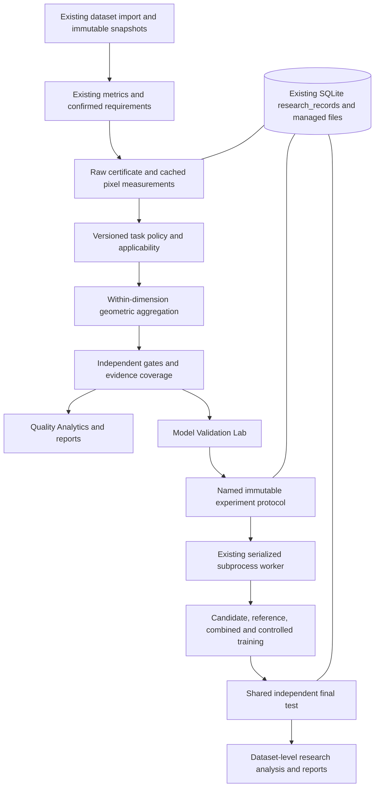

# Adaptive readiness and Model Validation Lab

This extension preserves the existing ingestion, metric registry, requirement-based certificates, persistent workbench and YOLO worker. It adds a multi-dimensional evidence profile and a dedicated experimental workflow. No API key is required for assessment, training, evaluation or reporting.

## Architecture and changed files



New modules:

- `metrics/quality_profiles.py`: validated policies and deterministic content hashes.
- `metrics/quality_aggregation.py`: normalization, cached evidence, applicability, geometric scores, coverage and independent gates.
- `metrics/config/adaptive_quality.json`: six dimensions, task/scenario policies and documented component definitions.
- `backend/workbench/quality_api.py`: previews, immutable saved scoring versions, task comparisons and sensitivity.
- `backend/workbench/experiments.py`: protocol validation, multi-seed orchestration, shared validation sources and matched-size manifests.
- `backend/workbench/combined.py`: a complete combined-training assessment from cached source measurements, with immutable virtual image provenance.
- `backend/workbench/lab_api.py`: named protocols, trusted checkpoint import, external benchmarks and checkpoint resume.
- `backend/workbench/reporting.py`: readable PDF and research HTML exports with actual charts/tables.
- `frontend/src/QualityAnalytics.tsx`, `ExperimentBuilder.tsx`, `BenchmarkCharts.tsx`: quality, protocol and actual benchmark interfaces.
- `tests/test_adaptive_quality.py`, `tests/test_validation_lab.py`, `frontend/src/adaptiveQuality.test.tsx`, `frontend/e2e/adaptive-lab.spec.ts`: new regression and scientific-invariant coverage.
- `backend/scripts/smoke_adaptive_lab.py`, `backend/scripts/smoke_resume.py`: actual local CPU experiment and checkpoint verification.

Modified modules:

- `backend/context.py`, `backend/readiness_engine.py`: typed quality settings and reproducible quality evidence alongside the original certificate.
- `main.py`: new routers and explicit dotenv-disable support for isolated verification.
- `backend/workbench/contracts.py`, `worker.py`, `jobs.py`, `detector.py`, `splits.py`: saved scoring version selection, separate validation sources, experiment steps, recovery/cancellation, real curves/confusion/error denominators, resume, and cached perceptual signatures.
- `backend/workbench/analytics.py`: dimension/baseline predictors, dataset grouping, uncertainty, held-out predictions and paired interventions.
- `backend/workbench/api.py`, `backend/reports.py`: export integration and dimension rows.
- `backend/workbench/variations.py`: environmental diversity selection and display-text repair.
- `frontend/src/Workbench.tsx`, `api.ts`, `workbench.css`: independent Lab navigation, existing workflow integration, actual GPU naming, artifact downloads, training/validation losses, responsive charts, styling and text encoding fixes.
- `requirements/requirements.txt`: ReportLab runtime dependency. PDF inspection additionally used `pypdf` and PyMuPDF in the local verification environment.

Existing tables and files are retained. New `aggregation`, `experiment` and `external_benchmark` records use the existing generic SQLite table. Datasets, models, manifests, curves, logs and raw certificates keep their existing persistence contracts. The old `/api` assessment endpoints and `/?legacy=1` remain available.

## Scoring methodology

The main output is six independent dimensions:

1. Annotation quality: syntax, label availability and independently reviewed/trusted label evidence.
2. Diversity and required coverage: observed scene/weather categories relative to explicitly confirmed target categories.
3. Signal and image quality: measured clarity-criterion compliance, explicit object pixel-size criteria, finite signals and recorded temporal ordering where applicable.
4. Distribution and sample adequacy: uniform-class entropy only when uniformity is explicitly requested, and confirmed minimum sample requirements.
5. Task and operational suitability: confirmed class and operating-condition requirements.
6. Data integrity and reliability: readability/completeness, uniqueness, split evidence, sensor-field completeness and timestamp parseability where applicable.

Raw diagnostics with no defensible monotonic quality direction, such as altitude distributions or scene-embedding dispersion, remain inspectable without being forced into a percentage. `/quality/registry` documents these assignments alongside the complete existing raw registry. Syntax validity is not bounding-box accuracy; brightness is not proof of nighttime coverage; sensor metadata is not calibration validation.

### Normalization

- Good fractions: `100 * fraction`.
- Defect fractions: `100 * (1 - fraction)`, validated strictly in `[0,1]`.
- Zero-defect count requirements: 100 for an observed zero count, 0 for an observed positive count. This is explicit criterion compliance, not a continuous estimate of defect severity.
- Required categories: fraction of explicitly requested categories with observed records.
- Confirmed requirements: fraction with conclusive passing findings; any unknown finding leaves the component unknown.
- Class balance: `100 * H(p) / log(K)`, only with an explicitly confirmed uniform target and at least two declared classes. Missing required classes are included in K.
- Image clarity: fraction of readable images meeting the recorded threshold. The inherited threshold of 100 for thumbnail Laplacian variance is illustrative and uncalibrated. It is not a learned visibility model.
- Object visibility: annotation-derived minimum pixel side, scored only against an explicit `goal.uav_parameters.minimum_object_side_pixels` criterion. This does not establish semantic detectability.
- Timestamps/sensors: actual valid-record or present-cell fractions with recorded denominators; adjacent temporal order excludes missing timestamp pairs.

NaN, infinity, booleans used as numbers, negative weights, invalid fractions and unknown configuration IDs fail clearly. No raw units are combined directly.

### Weights and provenance

The exact default dimension ratios, before task/modality exclusions and normalization, are:

| Task | Annotation | Diversity | Signal | Statistical | Task suitability | Integrity |
|---|---:|---:|---:|---:|---:|---:|
| Object detection | 5 | 3 | 2 | 2 | 4 | 4 |
| Classification | 4 | 2 | 2 | 4 | 3 | 3 |
| Regression | 3 | 2 | 3 | 3 | 3 | 4 |
| Anomaly detection | 1 | 3 | 4 | 3 | 3 | 5 |
| Telemetry | 1 | 3 | 4 | 3 | 4 | 5 |
| Tracking | 5 | 3 | 2 | 2 | 4 | 5 |

These are configurable engineering starting policies motivated by task dependencies. They have not been empirically calibrated or independently expert validated. Their ratios express chosen priorities, not measured effect sizes. Detection gives annotation validity and availability twice the default within-dimension component weight. Classification emphasizes label availability. Telemetry/anomaly policies emphasize finite signals. Exact definitions and explanations are included with every result.

The default scenario makes no adjustment. Explicitly selecting `airport_drone_detection` applies the documented 1.5 priority multipliers to annotation/task dimensions and annotation validity. `nighttime_detection` applies 1.5 to signal/task dimensions. These opt-in policies are sensitivity hypotheses, not evidence that a 1.5 multiplier improves predictions. Unsupported task/scenario combinations are rejected. Free text and qualitative preferences do not silently create numerical multipliers.

For each applicable component:

`effective_weight = base_weight * scenario_multiplier * confirmed_priority_multiplier`

Weights normalize to 1 inside each dimension, retaining the weight assigned to unknown evidence. Dimension importance separately normalizes to 1 across applicable dimensions. Zero importance can exclude score influence; it cannot disable critical requirements. Manual overrides require confirmation and can be saved as a new immutable aggregation record.

Each record stores original context, full frozen policy, effective weights, explanations, normalization/aggregation versions, profile SHA256 and calculation SHA256. Raw evidence remains separate. Replay uses the frozen configuration with the corresponding aggregation implementation; historical results themselves remain immutable. Change version identifiers when changing released scoring semantics.

### Geometric aggregation and incomplete evidence

For eligible component scores `s_i` and normalized within-dimension weights `w_i`:

`dimension_score = 100 * exp(sum(w_i * log(s_i / 100)))`

A genuine positive-weight zero produces an exact zero, without replacing it by epsilon. The primary dimension score is withheld unless its weighted evidence coverage is 1. Unknown measurements are not converted to zero or silently dropped to inflate the observed mean.

The geometric mean alone does not prevent every masking case. A fully measured dimension remains a warning if any contributing metric falls below the configurable warning criterion, even when the geometric mean exceeds it. Independent critical gates and visible dimensions provide additional protection. The default warning criterion of 70 is an uncalibrated review policy, not a scientific readiness boundary.

Measurement states include `measured`, `not_applicable`, `not_assessed`, `insufficient_evidence` and `failed`. Dimension status and overall adaptive status are separate from these measurement states. The original requirement-based `overall_status` is preserved and explicitly labeled as requirements in the UI and PDF; `quality_profile.readiness_status` is the adaptive evidence decision.

Critical gates independently cover unreadable required images, unusable required labels, invalid annotation syntax, exact/group split contamination, incompatible task modality, and confirmed hard requirements (including schema, required operating conditions or user-specified thresholds). Perceptual similarity candidates are warnings requiring review. Unknown hard evidence prevents a confident adaptive decision. A technical failure blocks readiness even if other dimensions are perfect or its weight is zero. Statistical weakness is reported as a warning rather than automatically called technical invalidity.

### Recalculation and sensitivity

Scenario/weight changes reuse frozen measurements. Changing tasks reuses only task-independent measurements and marks context-dependent labels and findings as requiring new evidence. **Review context for this task** opens the context editor; confirm and run the existing assessment pipeline to collect the new task-dependent measurements from the persisted dataset snapshot. Pixel histograms reuse actual ingestion measurements; no histogram is made from an aggregate score.

Sensitivity exports show importance ranking changes and hypothetical metric deterioration. Simulated values are explicitly labeled mathematical sensitivity, are never persisted as measurements, and never enter training evidence or research correlations.

## Model Validation Lab

Independent primary navigation contains six sections:

- Lab Overview.
- Experiment Builder.
- Training Monitor.
- Model Benchmarking.
- Quality-Performance Analysis.
- Experiment Reports.

Existing Training, Experiments, Comparison, Analytics and Reports screens remain as compatible shortcuts to the same underlying services.

The builder supports candidate/reference/combined/controlled modes, dataset versions and matching training-only readiness, saved scoring versions, a hypothesis, seeds, architecture, initialization, training budget, optional shared validation data, independent final test data, mappings and size strategy. Create a protocol, inspect it, then start it. Training and test steps run in the existing isolated worker and persist their child-job/model/evaluation IDs. Final testing starts after all training completes. Failed or incomplete experiments retain partial evidence without invented outcomes.

Natural-size protocols report their actual counts. Matched-size protocols deterministically select whole recording groups to the smaller training count and reassess those exact subsets before training. They fail explicitly when exact group-preserving matching is impossible. Combined mode intentionally changes sample count and requires a separate natural-size protocol.

Combined runs receive a new readiness report for the actual union of both training manifests. Cached pixel/annotation measurements are reused, class mappings are applied, and virtual image references retain access to the original verified bytes. Validation/test records are excluded from this assessment. Source audits are not silently treated as an audit of the combined population; optional visual-model evidence and full cross-source perceptual-pair counts remain unknown unless separately measured. The model links to this combined report rather than inheriting the candidate-only score.

A selected shared validation source replaces native validation partitions for checkpoint selection. Its classes must map completely, and exact/perceptual/group checks prevent overlap with training or final test data. When selecting a split on that source, only its validation partition is used. Without a split, all its images are validation data. Original independent test data never guides checkpoint selection.

GPU selection uses actual PyTorch CUDA availability; defaults remain YOLO11n, batch 4 and 512-pixel inputs. Jobs expose actual epoch/loss/validation/GPU-memory observations, logs, errors, cancellation, checkpoints and artifacts. GPU memory figures are worker allocations at completed epochs, not invented utilization percentages. Out-of-memory errors recommend smaller batches/images. Resume restores a supported local epoch checkpoint and its optimizer state; at least one completed epoch is required. Cancelling a child step cancels the owning experiment because they share one isolated process.

Actual evaluations retain mAP50, mAP50:95, operating precision/recall/F1, per-class AP and error counts, confidence-sweep PR curves, spatial confusion counts, latency scope, device/environment and identical final-test manifests. False positives per image and missed-object fraction have explicit denominators. There is no claimed true-negative-based detection FPR. Same-image overlays require matching test manifests and evaluation settings.

The final-test identity includes canonical ground-truth boxes, class mapping/schema and image checksums. Identical image bytes with changed labels cannot masquerade as the same test. Historical evaluations without this protocol hash remain preserved and receive a comparability warning. The local adapter evaluates retained parsed objects as ordinary normalized YOLO boxes; it does not claim official COCO crowd-ignore benchmark semantics.

Published benchmarks require source URL, citation, dataset and protocol metadata. They remain a separate unverified category, excluded from controlled rankings/correlations. Imported local checkpoints require explicit trust and compatible architecture/classes/development provenance; unverified imported training histories are shown descriptively and excluded from predictive validity analyses.

## Research analysis

Raw metrics, complete dimension scores, equal-weight/arithmetic alternatives and dataset size are available as predictors. Seed repetitions first aggregate within a source/configuration group. Exact shared image content and declared comparable recording groups prevent sources being counted as independent. Group identifiers need a common namespace across datasets. Artificial variants remain paired interventions and do not inflate independent-dataset sample sizes.

Pearson and Spearman associations require at least three varying independent comparable sources. Pearson Fisher-z intervals require at least four; Spearman independent-dataset bootstrap intervals require at least six (1,000 deterministic resamples, seed 42). Seed-level confidence intervals describe training-seed variation only. Small samples remain explicitly exploratory, and multiple comparisons are not presented as confirmed significance.

At six or more independent comparable datasets, univariate predictors use leave-one-dataset-out OLS with training-fold centering/scaling, compared with a training-fold mean predictor. Scoring weights are not fitted or validated on the same held-out dataset. Predictors without sufficient variation/evidence are omitted. Predictions are exploratory and are not readiness decisions.

Paired variants require matching seeds, training protocol and final-test settings. Records report actual training sizes and whether they match. Dimension deltas are withheld when scoring policies differ. Generalization gaps require matching validation/test AP settings. No correlation or one-source intervention establishes universal validity.

## APIs

Interactive typed API documentation remains at `http://127.0.0.1:8000/docs`.

| Endpoint | Purpose |
|---|---|
| `GET /api/v1/quality/registry` | All original raw definitions, dimensions and scoring assignments |
| `GET /api/v1/quality/profiles` | Versioned policy, thresholds and provenance |
| `POST /api/v1/quality/aggregate` | Effective weights, evidence-aware recalculation, optional saved version |
| `GET /api/v1/quality/history` | Immutable scoring versions, optionally filtered by readiness ID |
| `GET /api/v1/quality/{readiness_id}/dimensions` | Saved dimension profile and contributions |
| `POST /api/v1/quality/compare` | Same-evidence task/scenario comparison |
| `POST /api/v1/quality/sensitivity` | Weight rankings and explicitly hypothetical deterioration |
| `GET/POST /api/v1/experiments` | Named protocol registry and validation |
| `GET /api/v1/experiments/{id}` | Protocol, state and child evidence |
| `POST /api/v1/experiments/{id}/start` | Start reviewed protocol once |
| `POST /api/v1/jobs/{id}/resume` | Resume supported interrupted training checkpoints |
| `POST /api/v1/models/import` | Trusted local compatible checkpoint import |
| `GET/POST /api/v1/benchmarks/external` | Separate published benchmark records |
| Existing `/training`, `/evaluations`, `/jobs`, `/models`, `/comparisons`, `/research` | Reused and extended rather than duplicated |
| `GET /api/v1/reports/{id}?format=json|csv|html|pdf` | Dataset and named experiment reports |
| `GET /api/v1/backend/research/export?format=json|csv|html|pdf` | Consolidated research evidence |

`TrainRequest` additionally supports `aggregation_id`, separate validation dataset/split/mapping and acknowledgement of missing comparable validation groups. JSON retains full evidence; CSV includes raw metrics and explicit dimension rows; PDF/HTML include actual charts and readable tables. Long structured evidence is explicitly abbreviated in PDFs with full values available in JSON. Incomplete reports say incomplete. Reports for a selected experiment scope their model analysis to that experiment.

## Exact Windows PowerShell startup

From the configured environment, build and start:

```powershell
Set-Location C:\DataReadiness
.\.venv\Scripts\python.exe -m pip install -r requirements/requirements-training.txt
Push-Location frontend
npm.cmd ci
npm.cmd run build
Pop-Location
.\.venv\Scripts\python.exe -m uvicorn main:app --host 127.0.0.1 --port 8000
```

Open **http://127.0.0.1:8000**. No second server is needed. For development, use a second terminal with `Set-Location C:\DataReadiness\frontend` and `npm.cmd run dev`; Vite proxies the backend at port 8000.

To run fully local without loading `.env` or enabling a remote context provider:

```powershell
Set-Location C:\DataReadiness
$env:PYTHON_DOTENV_DISABLED = '1'
$env:CONTEXT_PROVIDER = 'deterministic'
.\.venv\Scripts\python.exe -m uvicorn main:app --host 127.0.0.1 --port 8000
```

This disables application dotenv loading; it is not an operating-system secret-access boundary. Do not put credentials into frontend settings, reports or task descriptions. Verification did not open `.env`.

## First real validation experiment

1. In **Datasets**, import/register candidate, reference and independent final-test datasets with compatible detection classes. Use actual source-video/session/flight groups with comparable names where available. Dataset versions are shown by checksum.
2. In **Model Validation Lab > Training Monitor**, select the candidate as the working dataset and create a grouped split. Existing complete train/val/test assignments are preserved. Repeat for the reference dataset.
3. In **Dataset Evaluation**, select the candidate and its training assessment scope. Describe the intended detection scenario, interpret locally, review structured context and requirements, resolve questions and confirm. Supply genuine metadata/audit evidence for dimensions you want assessed. Add numerical requirements from your actual application, not from arbitrary desired scores.
4. Run assessment, inspect raw metrics, missing evidence, dimension weights and critical gates. Repeat on the reference training split. If needed, confirm priority overrides and **Save aggregation version**; the builder can select that frozen version.
5. In **Lab > Experiment Builder**, select those exact candidate/reference versions, splits and matching detection readiness records. Enter a name and a hypothesis before seeing final-test outcomes. Choose candidate/reference modes and seeds such as 42, 43 and 44.
6. Choose natural or matched training sizes. Select the same YOLO architecture/initialization and common budget. For pretrained initialization, select your trusted local compatible `.pt` file; downloads are not automatic. Start conservatively with batch 4/image 512 or smaller. Select CPU if the runtime has no CUDA.
7. For identical checkpoint-selection data, select an optional **Shared validation dataset** and its validation partition. Otherwise each source retains its own native validation partition; this difference remains in provenance. Choose independent final-test data and complete class mappings if names differ. Test data must not be used for tuning.
8. **Create and review protocol**, inspect the frozen configuration/counts, then **Start reviewed experiment**. Monitor actual steps in Training Monitor. Cancel/resume only supported epoch checkpoints when needed.
9. Open **Model Benchmarking**, choose the completed evaluation IDs, audit comparison conditions, inspect per-class results, PR curves, confusion counts and matched-image predictions. Natural-size differences remain visible as confounding factors.
10. Open **Quality-Performance Analysis**, choose a measured dimension/raw predictor and performance outcome. Repeated seeds are not additional independent datasets. More independent sources are needed for correlations and held-out predictive analyses.
11. Export the named experiment's JSON/CSV/HTML/PDF from the builder or use consolidated exports in **Experiment Reports**. Dataset reports are separately available from Dataset Evaluation.

For a perturbation study, choose the original candidate/split in Quality-Performance Analysis, create a documented blur/resolution/imbalance/omission/box/environment/sample-count variation, then split and reassess its training subset. Select it as a controlled candidate in a new protocol with the same initialization, budget, seed, validation and unchanged final test. Original data and held-out bytes are retained. Related variants remain paired observations.

## Verification and limitations

See [verification record](adaptive-platform-verification.md) for executed commands and results, and [initial implementation audit](adaptive-platform-checklist.md) for baseline/gaps.

- Functional validation used explicitly synthetic images and real local CPU compute. It is not a scientific demonstration that readiness predicts UAV accuracy or generalization. No user dataset or API key was used.
- CUDA/GPU execution and trusted pretrained/imported checkpoints need local compatible resources; those paths are supported but GPU/pretrained accuracy was not established by this verification.
- Label syntax does not establish semantic correctness or exhaustive visible-object labels. No model, metadata authenticity or sensor calibration accuracy is invented to fill a dimension.
- Combined assessments cover the complete training union using cached evidence. Combined runs share their source datasets and remain excluded from independent-dataset predictive correlations. Optional learned visual evidence and full cross-source perceptual pair counts are explicitly unassessed in that cached union.
- Matched-size grouping can be impossible for particular recording-group sizes; the system rejects that protocol rather than silently breaking groups or duplicating images.
- Training remains detection-specific YOLO11n/YOLO11s. Classification, telemetry and anomaly contexts have readiness policies, not new non-detection training adapters.
- Statistical interpretation still needs enough genuine independent datasets, representative untouched tests and a prospectively chosen protocol. Weights, thresholds and proxy utility remain research hypotheses.

Implementation references: [Ultralytics callbacks](https://docs.ultralytics.com/usage/callbacks/), [metric outputs](https://docs.ultralytics.com/reference/utils/metrics/), and [training/checkpoint resume](https://docs.ultralytics.com/modes/train/).
