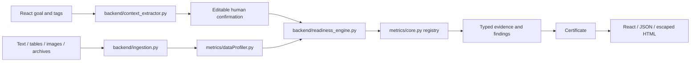

# Architecture and API

The initial repository contained six Python files, no dependencies, UI, ingestion or tests. `Goal` retained its existing fields and became a validated Pydantic model. `Dataprofiler`, `FeaturAnalyzer`, `LabelAnalyzer`, `ISOIECchecker` retain their original public names; correctly spelled aliases are available for the profiler and feature analyzer.



`main.py` owns the streaming HTTP boundary, session records, bounded background executor, job cancellation, cleanup, and static frontend hosting. `backend/large_ingestion.py` stages uploads, batches CSV/Parquet and creates disk-backed DuckDB tables; `metrics/disk_metrics.py` implements exact whole-dataset checks. `backend/image_ingestion.py` streams staged YOLO/VisDrone ZIP members, decodes one image at a time and parses native annotation semantics. Engine/metrics/ingestion do not import FastAPI. `backend/reports.py` renders evidence without an LLM. `backend/context.py` holds all typed contracts.

`backend/record_formats.py` supplies bounded text/JSON/XML/spreadsheet/Arrow records to the same disk-backed table pipeline. `backend/dataset_archives.py` discovers archive candidates, exposes ambiguous choices and streams selected members without executing repository code. Pending choices retain owned staged files and are resolved through `/api/datasets/{id}/select`; cleanup owns their lifetime just like disk tables. `backend/universal_images.py` adapts ImageFolder, COCO, VOC, YAML/.names YOLO and unlabelled collections while preserving source label semantics. See [format details](formats.md).

## API

Interactive typed schemas and responses are at `/docs` and `/openapi.json`.

| Method and path | Input / result |
|---|---|
| POST `/api/context/interpret` | JSON `{text, tags: {category: [tag]}}` → interpretation ID and validated context |
| POST `/api/datasets/upload` | Multipart `file`, optional `metadata` JSON string → dataset ID, modality, SHA256, profile |
| GET `/api/datasets/{id}/profile` | Current profile |
| DELETE `/api/datasets/{id}` | Remove session upload and owned database; 409 while a queued/running job uses it |
| POST `/api/assessments` | JSON `{dataset_id, context, interpretation_id?, reference_dataset_id?}` → 202 job status |
| GET `/api/assessments/{id}` | Job status, stages, safe error |
| GET `/api/assessments/{id}/progress` | Same real progress record |
| POST `/api/assessments/{id}/cancel` | Request cooperative cancellation |
| GET `/api/assessments/{id}/certificate` | Structured certificate; 409 while incomplete |
| GET `/api/assessments/{id}/export?format=json` | Download JSON (`format=html` for escaped readable report) |
| GET `/api/health` | Basic health/version |
| GET `/api/config` | Configured upload and image byte limits |

404 means missing/expired ID; 422 means invalid context/file/metadata; 429 means session/queue capacity. Internal stack traces stay in server logs. No API key is returned. Uploads can be retried; assessment retries create a new job with an unchanged copied context.

## File handling and operations

Defaults: tabular and image uploads up to 2 GiB; total ZIP uncompressed 4 GiB; 50,000 ZIP entries; 20 MiB/member; 200:1 compression ratio; 20 megapixels/image; one million parsed target objects. The former 500,000-row cap routes to disk processing rather than rejecting large tables. Streaming request middleware counts bytes, including chunked bodies, with 128 KiB of multipart overhead. Non-upload request bodies are capped at 1 MiB. Neither middleware nor the upload handler accumulates a complete large file in RAM. The multipart framework spools large files to disk. Image archives are passed to ZipFile by path; no whole-archive `read_bytes()` occurs.

Files above 16 MiB (or Parquet files with large declared decoded sizes / row counts) use the disk backend. CSV is strictly decoded with a whole-file incremental UTF-8 validation pass or an explicit/BOM encoding. Structural validation uses bounded physical lines and 8 MiB decoded records; batches target 8 MiB or 10,000 records. Parquet iterates row batches. Arrow batches enter an owned DuckDB table using internally generated column identifiers, preserving original names in the schema. Global type inference and numeric aggregates inspect the full table. Dataset values are never interpolated into SQL. External SQL access is disabled after configuring the owned spill directory.

DuckDB has a configurable 256 MB working-memory setting, two threads, and a local spill directory. This is not a strict process-memory guarantee; wide Arrow/Parquet rows and library buffers can consume additional memory. See the [DuckDB tuning guidance](https://duckdb.org/reading/2.0/guides/performance/how_to_tune_workloads.html) for backend memory/spill limitations. The user must have sufficient disk space for multipart staging, the database and temporary queries.

ZIP raw member paths, encrypted files, duplicate member names, symlinks and decompression bombs remain rejected. Members are never extracted or executed. Upload handles/readers are closed on success and failure, including Windows Parquet cleanup. Session capacity remains ten datasets and two running assessment threads, with at most four active/queued assessments. Owned databases are deleted on explicit delete, lazy expiry and graceful shutdown; active jobs prevent deletion. Abrupt process termination may leave orphaned temporary directories; after stopping all backend instances these can be removed from `.runtime/datasets`.

Configuration is read from `.env`/environment. Example non-secret metadata:

```json
{
  "source": "synthetic demonstration",
  "csv_encoding": "windows-1252",
  "dataset_version": "v1",
  "collection_date": "2026-01-01",
  "as_of": "2026-02-01",
  "units": {"altitude_meters": "m"},
  "sensor_types": {"gps": ["latitude", "longitude"], "imu": ["ax", "ay", "az"]},
  "independent_annotation_column": "annotator2",
  "trusted_reference_labels": true,
  "preprocessing_fit_scope": "train",
  "model_input_columns": ["altitude_meters"]
}
```

Presence checks validate availability, not authenticity. Trusted references must actually be defensible human-audited or authoritative values. A self-declared flag cannot prove their reliability.

`csv_encoding` is optional and applies only to CSV decoding. By default the loader checks Unicode byte-order marks, then strict UTF-8, then a recorded Windows-1252 fallback. A declared encoding must decode successfully; it is never silently overridden. The profile's `parsing` section records the encoding, source of that choice, delimiter and fallback warnings. This supports older spreadsheet exports with smart quotes while retaining binary-control and structural validation.

## Adding a metric

1. Add a function to `metrics/core.py` decorated with `@metric(id, dimension, method, modalities=..., ...)`. Declare units, contextual and evidence requirements, applicability, output type and decision relevance.
2. Return `result(...)` with observed values, sample size, reasons and references. Raise `MissingEvidence` when evidence is unavailable. Never encode unknown as 0 or 1.
3. Add a diagnostic ID to `DIAGNOSTICS`, or select it through an explicit `Requirement`. Registration alone does not make a metric a hard gate.
4. Add tests, including unavailable evidence and unsupported modality cases; document formula/limits. Engine handles calculation exceptions as errors.

## Adding a modality

Add a bounded loader producing `Dataset`, attach record references/evidence, and declare supported modalities on relevant metrics. Add file-security tests and a full workflow test. Extend explicit modality requirements and UI file acceptance. Do not reuse tabular/image formulas without checking their scientific meaning.

## Repeatability

The certificate records dataset SHA256, metadata, confirmed context, engine/configuration, selected metric definitions, reference SHA256, Python/dependency versions and a deterministic fingerprint. Metrics do not depend on random seeds or wall-clock dates. Timeliness requires an explicit fixed `as_of` date. Job IDs/progress are transport metadata, not statistical evidence. Deterministic certificate equality is tested. Exact environment reproduction also requires the dependency files and platform.
